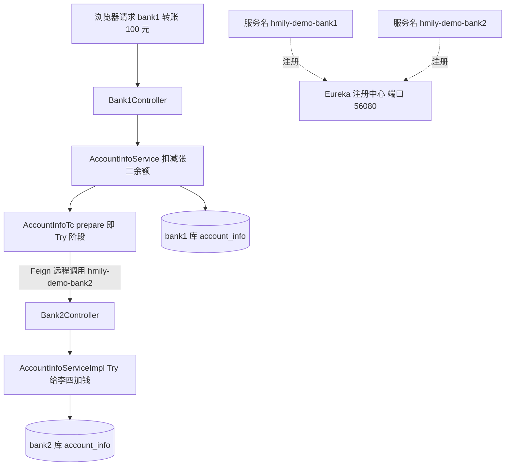
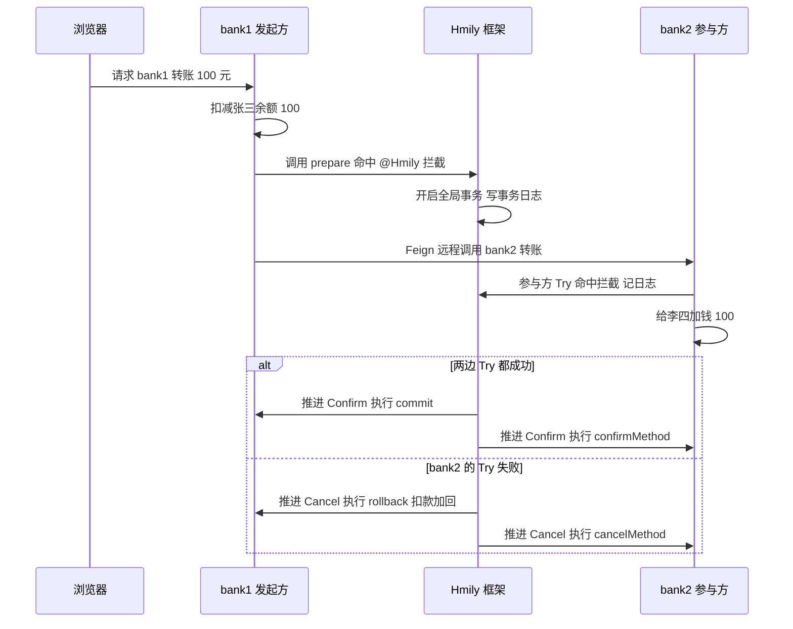

# Hmily 实现转账：环境搭建、bank1 发起方与 bank2 参与方一次搭完

> 🔒 安全提示：文中示例的口令/密钥均为课程教学环境演示口径，生产环境的安全要求见《安全与合规须知》。

Hmily 框架的定位与能力已经认识过，`@Hmily` 注解怎么注册三个阶段也交代了形态。接下来用它跑一个真正能落地的入门案例，业务还是最经典的转账：张三给李四转 100 元，两人账户开在不同银行。这个案例的价值不在转账本身，转账代码只有几行，真正的看点是框架怎么把两个独立微服务上的本地事务串成一个整体：谁是发起方、谁是参与方、注解加在哪、日志写在哪、异常后怎么回滚，一条链路全部走通。后续注册功能解决分布式事务问题，用的正是同一套打法。

## 先给结论

- 案例做了刻意简化：张三在 bank1、李四在 bank2，两个独立微服务各自操作各自的数据库，bank1 通过 Feign 远程调用 bank2。检查余额、冻结解冻这些环节全部省去，A 侧只做扣钱，B 侧只做加钱，重点是研究框架怎么用。
- 环境分三块：bank1 与 bank2 两个数据库，初始数据张三 10000 元、李四 0 元；一个父工程带三个模块，bank1、bank2 加一个 Eureka 注册中心；Hmily 事务日志表由框架运行时自动创建，不用手工建。
- 框架配置的核心是 `org.dromara.hmily` 配置块与 `HmilyTransactionBootstrap` 引导对象，`started: true` 标记发起方、`false` 标记参与方，这个值两边不能配错。
- 业务代码的写法是在 Try 方法上标注 `@Hmily(confirmMethod = "xxx", cancelMethod = "yyy")`，三个方法名完全自定义，但参数列表必须一致；发起方的 Feign 代理方法上也要加 `@Hmily`，把远程调用纳入事务管理。
- 启动类要额外扫描 `org.dromara.hmily` 包，框架内部组件要交给 Spring 容器管理，漏扫了拦截器不生效。

## 业务说明：一个刻意简化的转账

业务场景先交代清楚。张三在 bank1 银行开的户，李四在 bank2 银行开的户，案例里 bank1 与 bank2 就是两个相互独立的微服务，各自操作各自的数据库。张三要给李四转账，分布式事务问题是显然存在的：两个库、一次跨网络调用，任何一步失败都可能一边扣了钱、另一边没到账。目标也是标准的 TCC 目标：交易过程中的每个操作，要么都成功，要么都失败。

与完整版 TCC 转账案例相比，这里做了简化。完整版里 A 账户的 Try 要检查可用余额、冻结金额、扣减可用余额，Confirm 解冻，Cancel 解冻加回；B 账户还要检查账户状态。入门案例把这些环节全部省掉，A 这边只剩扣钱，B 这边只剩加钱。简化的理由很直接：这一课的主角是 Hmily 框架怎么接入、怎么配置、注解怎么写，不是业务怎么设计，冻结解冻那套完整的预留逻辑在注册链路落地时再看它怎么体现。



这张图在讲案例的静态结构：一条请求从 bank1 的控制器进入，先扣张三的钱，再由 TCC 预处理方法发起对 bank2 的远程调用给李四加钱。图的下半部分是两个服务与各自数据库的绑定关系，注册中心负责让 Feign 按服务名找到对方。两个服务之间唯一的远程调用就是这条转账链路，Hmily 的事务管理就压在这条链路上。

## 环境搭建第一块：数据库与初始数据

两个银行两个库，各自的库、表、初始数据都要提前备好。建库建表脚本如下（按本课画面线整理）：

```sql
-- 张三的库 bank1
CREATE DATABASE `bank1` CHARACTER SET utf8 COLLATE utf8_general_ci;
USE bank1;
DROP TABLE IF EXISTS `account_info`;
CREATE TABLE `account_info` (
  `id` bigint(20) NOT NULL AUTO_INCREMENT,
  `account_name` varchar(100) CHARACTER SET utf8 COLLATE utf8_bin NULL DEFAULT NULL COMMENT '户主姓名',
  `account_no` varchar(100) CHARACTER SET utf8 COLLATE utf8_bin NULL DEFAULT NULL COMMENT '银行卡号',
  `account_password` varchar(100) CHARACTER SET utf8 COLLATE utf8_bin NULL DEFAULT NULL COMMENT '账户密码',
  `account_balance` double NULL DEFAULT NULL COMMENT '账户余额',
  PRIMARY KEY (`id`) USING BTREE
) ENGINE = InnoDB CHARACTER SET = utf8 COLLATE = utf8_bin ROW_FORMAT = Dynamic;
INSERT INTO `account_info` VALUES ('1', '张三', '1', NULL, '10000');

-- 李四的库 bank2 建表语句与 bank1 完全相同
INSERT INTO `account_info` VALUES ('2', '李四', '2', NULL, '0');
```

初始状态一目了然：张三是万元户，余额 10000，编号 1；李四余额 0，编号 2。两个库各存一张 `account_info` 表，银行独立，数据也独立，正是分布式事务要面对的格局。

**Hmily 的日志表不用动手建。** 框架简介课说过它需要日志存储，本案例选择数据库方式。如果就此以为要提前建一张日志表，那不必：框架运行时会自动在所连接的库里创建存储日志的表，bank1 与 bank2 各自的库里都会多出这么一张。只建自己的业务库业务表，日志的事框架自己办，这一点在功能测试时要专门进去观察它的内容与清理时机。

## 环境搭建第二块：Maven 工程与依赖

麻雀虽小五脏俱全，工程按规范姿势搭。父工程 `tcc-hmily-demo` 负责依赖管理，下面挂三个模块：`hmily-demo-bank1` 操作张三的余额，`hmily-demo-bank2` 操作李四的余额，`hmily-demo-discover-server` 是 Eureka 实现的注册中心。虽然只是一个小小的转账功能，注册中心照样要起，因为 bank1 要通过 Feign 按服务名远程调用 bank2，服务发现离不开它。

父工程里值得留意的依赖如下（转账案例工程未在课程仓库归档，清单按画面线与本课年代主流坐标整理，版本统一由父工程管理，包名一律按 `com.study.finance` 系改写）：

```xml
<!-- Web 与微服务基础 -->
<dependency>
    <groupId>org.springframework.boot</groupId>
    <artifactId>spring-boot-starter-web</artifactId>
</dependency>
<dependency>
    <groupId>org.springframework.cloud</groupId>
    <artifactId>spring-cloud-starter-netflix-eureka-client</artifactId>
</dependency>
<dependency>
    <groupId>org.springframework.cloud</groupId>
    <artifactId>spring-cloud-starter-openfeign</artifactId>
</dependency>
<!-- 数据库操作 转账本质是两条 update -->
<dependency>
    <groupId>mysql</groupId>
    <artifactId>mysql-connector-java</artifactId>
</dependency>
<dependency>
    <groupId>org.mybatis.spring.boot</groupId>
    <artifactId>mybatis-spring-boot-starter</artifactId>
</dependency>
<!-- Hmily 分布式事务框架 -->
<dependency>
    <groupId>org.dromara</groupId>
    <artifactId>hmily-spring-boot-starter</artifactId>
    <version>2.0.4-RELEASE</version>
</dependency>
```

转账业务的本质是数据库增删改查里的「改」，一边减钱一边加钱，所以 MySQL 驱动、MyBatis、连接池一个不少，外加 ribbon、commons-lang 这类基础依赖。真正的重头是 `hmily-spring-boot-starter`，整个案例的分布式事务管理全靠它，它与注册链路实战里用的 `hmily-springcloud` 是同一框架面向不同接入方式的两个 starter。

## bank1：事务发起方的配置

bank1 是张三所在的银行，转账由它发起，所以在 TCC 的角色表里它是全局事务发起方；bank2 是李四所在的银行，被动接单，属于参与方。这个身份不是框架猜出来的，要靠配置白纸黑字交代。

`application.yml` 里与 Hmily 相关的部分如下：

```yaml
eureka:
  client:
    serviceUrl:
      defaultZone: http://localhost:56080/eureka/
    registry-fetch-interval-seconds: 5      # 获取服务列表的间隔
spring:
  application:
    name: hmily-demo-bank1
  datasource:
    url: jdbc:mysql://localhost:3306/bank1?useUnicode=true&characterEncoding=utf8
    username: root
    password: 123456
    type: com.alibaba.druid.pool.DruidDataSource
    driver-class-name: com.mysql.cj.jdbc.Driver

org:
  dromara:
    hmily:
      serializer: kryo          # 序列化工具
      retryMax: 30              # 最大重试次数
      repositorySupport: db     # 持久化方式 日志存数据库
      started: true             # 事务发起方
      hmilyDbConfig:            # Hmily 日志库的连接信息
        driverClassName: com.mysql.cj.jdbc.Driver
        url: jdbc:mysql://localhost:3306/bank1?useUnicode=true&characterEncoding=utf8
        username: root
        password: 123456

ribbon:
  ConnectTimeout: 600           # 远程调用连接超时
  ReadTimeout: 600              # 远程调用读取超时
```

配置项逐个过。`serializer` 指定 kryo 作为序列化工具，Hmily 底层工作要靠它做序列化反序列化，kryo 的性能比 Java 原生序列化乃至市面上不少同类产品都高。`retryMax` 设 30，是 Confirm 与 Cancel 失败后的最大重试次数，具体数值没有硬性规定，结合应用场景来定，不能无限制地让人一直重试。`repositorySupport: db` 指日志持久化到数据库，框架支持文件、redis、mongodb 等多种方式，这里选 MySQL。`started: true` 声明 bank1 是事务发起方，转账由张三这边发起，李四那边是参与方，这个值框架不会自己判断，配反了整个推进就乱了。`hmilyDbConfig` 是框架连接数据库的独立配置，它要往库里写日志，驱动、地址、账号、密码一样不能少。ribbon 的两个超时是给远程调用兜底的，bank1 是调用方所以由它配。

配置文件里这些值，最终要喂给一个对象。bank1 里有个配置类专门干这件事：

```java
@Configuration
@EnableAspectJAutoProxy(proxyTargetClass = true)
public class DatabaseConfiguration {

    @Autowired
    private Environment env;

    @Bean
    public HmilyTransactionBootstrap hmilyTransactionBootstrap(HmilyInitService hmilyInitService) {
        HmilyTransactionBootstrap bootstrap = new HmilyTransactionBootstrap(hmilyInitService);
        bootstrap.setSerializer(env.getProperty("org.dromara.hmily.serializer"));
        bootstrap.setRetryMax(Integer.parseInt(env.getProperty("org.dromara.hmily.retryMax")));
        bootstrap.setRepositorySupport(env.getProperty("org.dromara.hmily.repositorySupport"));
        HmilyDbConfig hmilyDbConfig = new HmilyDbConfig();
        hmilyDbConfig.setDriverClassName(env.getProperty("org.dromara.hmily.hmilyDbConfig.driverClassName"));
        hmilyDbConfig.setUrl(env.getProperty("org.dromara.hmily.hmilyDbConfig.url"));
        hmilyDbConfig.setUsername(env.getProperty("org.dromara.hmily.hmilyDbConfig.username"));
        hmilyDbConfig.setPassword(env.getProperty("org.dromara.hmily.hmilyDbConfig.password"));
        bootstrap.setHmilyDbConfig(hmilyDbConfig);
        return bootstrap;
    }
}
```

这个配置类产出的 `HmilyTransactionBootstrap` 是 Hmily 事务的引导对象，对框架来说至关重要。它创建时需要知道序列化工具、重试次数、持久化方式、日志库连接这一整套信息，配置类用 `Environment` 把 `application.yml` 里那些键值一个个读出来塞进去，最后作为 Bean 交给容器。类上的 `@EnableAspectJAutoProxy(proxyTargetClass = true)` 也不是装饰：Hmily 内部用 AOP 做方法拦截，这个开关指定基于类的代理，也就是学动态代理时提过的两种实现里基于类的那一种（CGLIB），框架的拦截全靠代理撑着。

## bank1：扣钱与 TCC 三方法的写法

业务入口很短，控制器收到转账请求后调业务层：

```java
@RestController
public class Bank1Controller {

    @Autowired
    private AccountInfoService accountInfoService;

    @RequestMapping("/bank1/transfer")
    public String transfer(@RequestParam("amount") Double amount) {
        this.accountInfoService.updateAccountBalance("1", amount);
        return "bank1向bank2转账：" + amount;
    }
}
```

账户编号写死为 `1`，模拟案例里永远转的是张三的钱，请求参数 `amount` 就是转账金额，测试时传个数字即可。业务实现里张三开始扣钱，金额乘以负一，传负数给数据层即为扣减：

```java
@Service
public class AccountInfoServiceImpl implements AccountInfoService {

    @Autowired
    private AccountInfoDao accountInfoDao;

    @Autowired
    private AccountInfoTc accountInfoTc;

    @Override
    public Boolean updateAccountBalance(String accountNo, Double amount) {
        System.out.println("******* Bank1 Service begin ...");
        // 金额乘以 -1 即为扣减 张三余额减少
        accountInfoDao.updateAccountBalance(accountNo, amount * -1);
        // Try 阶段的预处理单独抽到 TCC 专用 Service 由它发起远程调用
        accountInfoTc.prepare(accountNo, amount);
        return true;
    }
}
```

跟 TCC 相关的三个方法没有直接塞在这个业务方法里，而是单独抽到了一个 TCC 专用 Service，类名里带着 Tc，Try 的预处理 `prepare` 就放在里面：

```java
@Service
public class AccountInfoTcImpl implements AccountInfoTc {

    @Autowired
    private AccountInfoDao accountInfoDao;

    @Autowired
    private Bank2Client bank2Client;

    // Try 阶段 主要动作是发起对 bank2 的远程调用
    @Hmily(confirmMethod = "commit", cancelMethod = "rollback")
    @Override
    public void prepare(String accountNo, double amount) {
        System.out.println("******* Bank1 Service prepare ...");
        if (!bank2Client.transfer(amount)) {
            throw new RuntimeException("bank2 exception");
        }
    }

    // Confirm 阶段 本例没有冻结预留 确认时无事可做
    public void commit(String accountNo, double amount) {
        System.out.println("******* Bank1 Service commit ...");
    }

    // Cancel 阶段 把 Try 扣掉的余额加回去
    public void rollback(String accountNo, double amount) {
        accountInfoDao.updateAccountBalance(accountNo, amount);
        System.out.println("******* Bank1 Service rollback ...");
    }
}
```

`prepare` 上那行 `@Hmily(confirmMethod = "commit", cancelMethod = "rollback")` 就是全部魔法所在。方法名与内部逻辑完全自定义，框架不关心 Try 里写的是什么业务，它只要求把三块代码注册进来：注解所在的方法是 Try，`confirmMethod` 指向 Confirm，`cancelMethod` 指向 Cancel。运行时框架推进两边先执行 Try；Try 里出现异常就往 Cancel 走，框架怎么知道该走哪个方法，靠的就是注解里配的方法名；Try 没问题就往 Confirm 走。假如这个方法叫 `abc`，注解里就得写 `confirmMethod = "abc"`，一一对应，写错名字框架就找不到人。本例的 Confirm 只打印一句话，因为简化版没有冻结预留，确认时确实无事可做；Cancel 干实事，把 Try 扣掉的余额加回去。

还有一处跟以前不一样的地方要圈出来：发起方调用 bank2 走的是 Feign 代理，这个代理方法上也要加 `@Hmily`。以前写 Feign 调用从不需要注解，现在这条远程调用是整个事务里的一个操作，必须交给 Hmily 控制才被纳入事务管理：

```java
@FeignClient(value = "hmily-demo-bank2")
public interface Bank2Client {

    @RequestMapping("/bank2/transfer")
    @Hmily
    Boolean transfer(@RequestParam("amount") Double amount);
}
```

`@FeignClient` 的服务名交给注册中心解析，请求路径与 bank2 控制器的映射一致，金额作为参数传过去。漏了这个注解，远程调用就游离在事务之外，参与方干了活发起方也不知道。

## bank2：事务参与方的写法

bank2 的配置与代码跟 bank1 高度相似，看过 bank1 再看这边几乎是平移，差异就两处。配置上，`started` 要配成 `false`，李四这边是事务参与方，收钱的一方，这个值非常关键，两边一定要配对；数据源与日志库连接的库名换成 bank2；端口是 56082，与 bank1 的 56081 区分开，发请求测试时别打错门牌。其余配置项，序列化工具、重试次数、持久化方式，含义与取值完全一致。

业务上 bank2 简单得多。张三那边要发起远程调用，李四这边坐等收钱就行，三个方法的分配如下：

```java
@Service
public class AccountInfoServiceImpl implements AccountInfoService {

    @Autowired
    private AccountInfoDao accountInfoDao;

    // Try 阶段 给李四加钱 出异常则由框架推进 Cancel
    @Hmily(confirmMethod = "confirmMethod", cancelMethod = "cancelMethod")
    public Boolean updateAccountBalance(String accountNo, Double amount) {
        System.out.println("******** Bank2 Service begin ...");
        try {
            accountInfoDao.updateAccountBalance(accountNo, amount);
        } catch (Exception e) {
            throw new RuntimeException(e.getMessage());
        }
        return true;
    }

    // Confirm 阶段 钱已收到 无事可做
    public Boolean confirmMethod(String accountNo, Double amount) {
        System.out.println("******** Bank2 Service commit ...");
        return true;
    }

    // Cancel 阶段 把刚加的钱乘以 -1 再减回去
    public Boolean cancelMethod(String accountNo, Double amount) {
        accountInfoDao.updateAccountBalance(accountNo, amount * -1);
        System.out.println("******** Bank2 Service rollback ...");
        return true;
    }
}
```

Try 就是那个加钱的 `updateAccountBalance`，注解一挂，它就从普通业务方法变成了 TCC 的 Try，内部一条 update 让李四余额增加。Confirm 只打印一句话，收钱方钱到账即任务完成。Cancel 要干实事：转账出问题时，刚加的钱要减回去，金额乘以负一传给数据层，加多少就减多少，等价于回滚。

三个方法有两处硬约束。**返回值保持一致。** 本例三个方法都返回 `Boolean`，不是要求必须这个类型，而是要求三兄弟口径统一。**参数列表一模一样。** 两个参数，顺序、类型完全相同，框架在 Confirm 与 Cancel 阶段要按 Try 的参数反射调用这两个方法，参数对不上，推进就断了。

控制器没有特殊之处，映射路径与 Feign 代理对得上，接收金额参数后调用业务层，账户编号同样写死为 `2`，永远操作李四。数据层就一条 update 余额的 SQL，实体类就是表字段的映射，不再展开。

## 启动类：把框架的包也扫进来

两个服务的启动类与往常写法基本一致，多出一个关键配置：

```java
@SpringBootApplication(exclude = MongoAutoConfiguration.class)
@EnableDiscoveryClient
@EnableFeignClients(basePackages = {"com.study.finance.hmily.demo.bank1", "org.dromara.hmily"})
@ComponentScan({"com.study.finance.hmily.demo.bank1", "org.dromara.hmily"})
public class Bank1HmilyServer {

    public static void main(String[] args) {
        SpringApplication.run(Bank1HmilyServer.class, args);
    }
}
```

`@ComponentScan` 的扫描路径里除了自己的业务包，多了一个 `org.dromara.hmily`：框架内部有大量类和对象需要交给 Spring 容器管理，这个包是 Hmily 框架 API 所在的包，必须一并扫描，漏掉它拦截、协调统统不生效。bank1 是发起方，`@EnableFeignClients` 指定扫业务包与框架包；bank2 的启动类同理，只扫自己的业务包与框架包，它不发起远程调用，Feign 开关可以省去。`exclude = MongoAutoConfiguration` 是随依赖带进来的自动配置，工程不用 MongoDB，排除掉免得启动时找 mongo 连接报错。

## 运行时框架怎么把两边串起来

环境、配置、代码齐了，把一次转账在框架眼里的完整推进画出来：



这张图在讲一次转账的两阶段推进：请求先进 bank1 完成扣款，`prepare` 方法被 `@Hmily` 拦截后全局事务开启并落日志；Feign 调到 bank2，参与方的 Try 同样被拦截记录，然后执行加钱。之后的走向由结果决定，Try 全过则双方 Confirm，任一失败则发起方 Cancel 把扣掉的钱加回，参与方走自己的 Cancel。整个过程中框架盯着日志推进阶段，这正是简介课说的「框架自身充当事务管理器」的运行时表现，两边的代码只负责把自己那一小块业务写对，串场的事全归框架。

## 常见误区

- **`started` 配反了方向。** 错例：bank1 配 `false`、bank2 配 `true`，程序照样能启动。正解：`started: true` 是发起方，转账由 bank1 发起，它必须配 `true`，参与方配 `false`。配反了框架不知道该推进谁，两阶段直接乱套。
- **启动类漏扫 `org.dromara.hmily` 包。** 错例：只扫业务包，`@Hmily` 注解加了却毫无反应，Try 被当成普通方法执行。正解：框架组件要交给 Spring 管理，`@ComponentScan` 与 `@EnableFeignClients` 的 basePackages 都要把框架包带上。
- **Confirm 与 Cancel 的方法名或参数对不上。** 错例：注解写 `confirmMethod = "commit"`，实际方法叫 `confirm`；或者三个方法参数类型、顺序不一致。正解：方法名完全自定义但必须与注解一致，参数列表三个方法必须一模一样，框架靠反射按名调用。
- **Feign 代理方法上漏加 `@Hmily`。** 错例：只在发起方业务方法上加注解，远程调用游离在事务之外。正解：远程调用是整个事务的一个操作，代理方法上也要标注，框架才能把参与方纳入同一笔全局事务。

## 面试可能被问到的问题

1. 面试官追问：「这个转账案例里 Hmily 的配置最关键的是哪几项？」
   答：`started` 标记谁是全局事务发起方，框架不会自己判断，bank1 配 `true`、bank2 配 `false`；`repositorySupport: db` 指定事务日志持久化到数据库；`hmilyDbConfig` 提供框架连接日志库的独立数据源；`retryMax` 控制第二阶段失败后的重试上限，案例配 30；`serializer` 选 kryo 兼顾性能。
2. 面试官追问：「`@Hmily` 注解怎么把三个阶段注册进框架？」
   答：注解标在 Try 方法上，`confirmMethod` 与 `cancelMethod` 属性写配套方法的名称。方法名完全自定义，但三个方法的参数列表必须一致，框架在 Try 成功后按名推进 Confirm，Try 失败按名推进 Cancel，三块代码的业务内容由开发者自行决定。
3. 面试官追问：「为什么发起方的 Feign 代理方法上也要加 `@Hmily`？」
   答：远程调用是全局事务中的一个操作，参与方 bank2 的加钱动作要靠这条调用触发。代理方法标注后，框架才能在调用发生时把参与方纳入事务、记录分支事务日志，并在失败时推进参与方的 Cancel；漏标则参与方游离在事务管理之外，出了不一致问题框架无从知晓。
4. 面试官追问：「`HmilyTransactionBootstrap` 这个引导对象是干什么的？」
   答：它是 Hmily 事务的引导类实例，框架启动的核心对象，需要序列化工具、最大重试次数、持久化方式与事务日志库连接等一整套参数。工程里用一个配置类从 `application.yml` 读取 `org.dromara.hmily` 前缀的配置注入进去，同时类上开启基于类的 AOP 代理，配合框架的方法拦截。
5. 面试官追问：「入门案例的 Try 为什么没有冻结金额？与完整 TCC 案例差别在哪？」
   答：入门案例刻意简化，把检查余额、冻结、解冻全部去掉，A 侧只扣钱、B 侧只加钱，目的是聚焦框架的接入方式。完整案例里冻结是防止并发消耗预留资源的手段，生产化改造时应把扣减纳入 Try 并做好预留，注册链路实战时按完整套路实现。
6. 面试官追问：「Confirm 或 Cancel 执行失败了怎么办？」
   答：配置 `retryMax` 交给框架重试，案例设 30 次，框架内部还有事务恢复调度周期性处理未完成事务；重试必须配合幂等设计，同一操作执行多次结果一致，否则重复解冻或重复加钱会制造新的不一致，重试耗尽后转人工处理。

## 配套资料

- 讲义：`materials/docs/10/万信金融-第2章-讲义-开户v1.0.md`，「注册功能中的分布式事务」节：注册链路选型 Hmily 的出处，转账案例与注册链路共用同一套接入方式。
- 讲义：`materials/docs/10/day16-项目总结&就业指导v1.0.md`，「3.4.2 什么是 TCC（补偿事务）」小节：三操作两阶段与出错兜底方式的定义，本案例三方法分配的模型依据。
- 代码：`materials/code/10/wanxinp2p/`，P2P 工程归档（目录保留原始命名，路径列到该层级）。
- 说明：转账入门案例工程未在仓库归档，建库脚本、`application.yml`、配置类与三个 Service 的代码示例为按本课画面线整理补全，依赖坐标按 Maven Central 的 `org.dromara:hmily-spring-boot-starter:2.0.4-RELEASE` 校正，包名一律 `com.study.finance` 系，MySQL 账号口径 root/123456。
