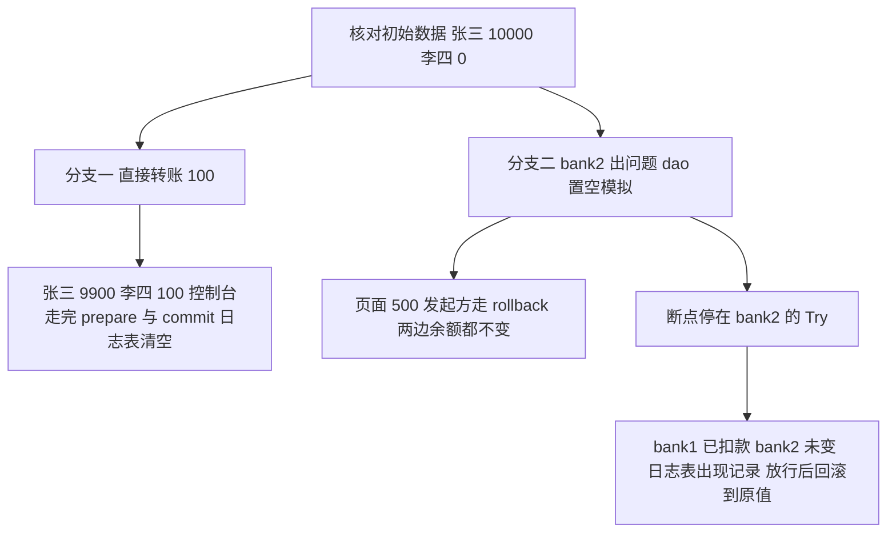

# Hmily 转账功能测试：成功与失败两条分支都走一遍

代码与配置就位之后，剩下的问题是：框架真的把分布式事务管住了吗？验证方式就是把转账功能完整测试一遍，而且要测两种效果：一种是 bank1 与 bank2 全部执行成功；另一种是让 bank2 出问题，重点观察张三这边的事务会不会回滚。两条分支走完，事务日志表里记录的出现与消失也就看明白了，框架「靠日志协调」的说法有了现场证据。

## 先给结论

- 启动顺序：先 Eureka 注册中心（端口 56080），再 bank1（56081）与 bank2（56082）；工程用了 Hmily，启动时控制台会打出框架标志，并出现事务自恢复调度的日志。
- 成功分支：请求 `bank1/transfer?amount=100` 后，张三 10000 变 9900，李四 0 变 100；控制台依次出现 prepare 与 commit，两个日志表在事务操作完成后被清空。
- 失败分支：把 bank2 业务层的 dao 置为 null 制造异常（测试专用写法），再次转账返回 500，发起方控制台出现 rollback；两边余额纹丝不动。
- 断点能看清中间态：bank2 停在断点时，bank1 已扣款、bank2 未变化，发起方日志表里已有业务类与三方法的记录；放行后 bank1 回滚恢复原值。
- Confirm 与 Cancel 出错靠重试兜底，框架自带事务恢复调度周期性处理未完成事务，重试必须配合幂等。

## 测试前的准备

启动顺序有讲究：bank1 要通过 Feign 调 bank2，服务发现依赖注册中心，所以 Eureka 先起。bank1 起来时留意控制台，启动过程会打印 Hmily 自己的标志；还能看到一条 `HmilyTransactionRecoveryScheduled` 的日志，提示 `self recovery execute delayTime:60`，意思是框架的事务自恢复调度每 60 秒执行一轮，这个线程在第二阶段出错的兜底里还要再见面。两个服务端口分别是 56081 与 56082，启动日志一闪而过，要认一下各自的门牌。

服务起来后先做两件核对。一是数据初始状态：用数据库客户端连上 MySQL，bank1 里张三余额 10000，bank2 里李四余额 0，两张 `account_info` 表都过一眼，保证测试从干净的起点出发。二是注册情况：浏览器打开注册中心 `http://localhost:56080`，服务列表里两个微服务都在，Feign 按服务名找得到人，链路才是通的。

## 分支一：两边都成功

请求从发起方进。bank1 是全局事务发起方，转账请求打到它的控制器，路径与参数对照配置文件写：

```bash
# 向发起方 bank1 发转账请求 金额 100
curl "http://localhost:56081/bank1/transfer?amount=100"
# 响应：bank1向bank2转账：100.0
```

页面返回字符串，转账请求已被受理。接着看两边控制台的输出：bank1 打出 `Bank1 Service prepare ...`，这就是 Try 在执行；紧跟着 `Bank1 Service commit ...`，说明框架把事务推进到了 Confirm；bank2 那边打出 `Bank2 Service commit ...`，同样走到 Confirm。全程没有出现 rollback 字样，成功分支成立。

数据库是最终裁判。bank1 里张三的余额从 10000 变成 9900，扣了 100；bank2 里李四的余额从 0 变成 100，收了 100。一边减一边加，数字对得上，钱没有平白多出也没有凭空消失。

两个存日志的表此时再看，都是空的：框架只要操作完，日志表的数据会被清掉，这是它内部的清理机制。日志在事务运行期间记账，事务圆满收场后记录清空，不留尾巴。



这张图把两条测试分支与各自的判定标准摆在一起：分支一看余额一增一减与日志表清空，分支二看 500 响应、rollback 输出与余额不动。图里第三条路径是分支二的加强版，用断点把中间过程放大给人看，稍后展开。

## 分支二：让 bank2 失败，看回滚有没有发生

本机把两个微服务、两个数据库都装在一台电脑上，没法真模拟断网、宕机这类场景，故障就用代码制造。bank2 业务层的 Try 依赖的是注入进来的 dao 对象，把它故意置空，下一行一调就是空指针异常，等于 bank2 在处理时出了问题：

```java
// 测试使用 实际开发绝不能这么写 模拟 bank2 执行时出问题
@Autowired
private AccountInfoDao accountInfoDao;

@Hmily(confirmMethod = "confirmMethod", cancelMethod = "cancelMethod")
public Boolean updateAccountBalance(String accountNo, Double amount) {
    accountInfoDao = null;                      // 故意制造空指针
    try {
        accountInfoDao.updateAccountBalance(accountNo, amount);
    } catch (Exception e) {
        throw new RuntimeException(e.getMessage());
    }
    return true;
}
```

改动后 bank2 重启。此时表里的状态是：李四已有 100，张三 9900。再发一次同样的转账请求，页面返回 500，报错本身是意料之中的事，关键在后头。

bank1 的控制台先打出 `Bank1 Service prepare ...`，Try 已经执行、扣款已经发生；接着远程调用 bank2 收到 500 错误；再往下出现最关键的一行 `Bank1 Service rollback ...`，Cancel 被框架推起来了，回滚发生了。bank2 控制台的空指针堆栈不用细看，那是故意制造的。

两边表核对：张三刷新一遍还是 9900，没有再扣，说明刚才扣掉的 100 已经被 Cancel 加了回去；李四还是 100，没有多收。发起方失败回滚，参与方没有产生任何变化，两边数据始终对得上，分布式事务要的结果拿到了。

## 用断点放大中间过程

上一条分支看的是结果，断点能看过程。制造异常的代码保留，在空指针那一行之前打一个断点，再发一次转账请求。请求会一直转圈，bank2 停在了断点上，bank1 在远程调用的另一头等着，谁也走不动。

此刻冻结的正是事务的中间态。看表：bank1 里张三已经少了 100，Try 的扣款是实打实执行过的；bank2 里李四纹丝没动，异常还没抛出来。再看 Hmily 的日志表：发起方一侧已经能看到记录，里面存着业务处理 Service 的类名、注册的三个方法以及时间等信息，注解注册的三块代码全在记录里；bank2 这边因为还没执行成功，对应的记录看不到。

放行让断点继续，异常抛出，框架推进 Cancel，张三的余额回到 9900。中间扣了、最后加回，整个过程日志表一直在记账，这正是框架协调与恢复的依据，也是框架简介课里「日志对 Hmily 至关重要」的现场版本。

## 从两条分支反推框架的兜底

两条分支合起来看，框架的工作方式就完整了：Try 阶段两边各自执行并写日志，全过推 Confirm，任一失败推 Cancel。Confirm 与 Cancel 自己出错时，`retryMax` 配置的 30 次重试接手，启动日志里那个每 60 秒一轮的自恢复调度也会周期性翻查未完成事务、重试推进；重试彻底失败的部分留给人工处理。本案例的三方法只是简单打印与一条 update，没有做幂等保护，生产环境里重试必须配合幂等实现，否则兜底动作本身会制造新的不一致。

## 常见误区

- **看到 500 就以为框架失灵。** 错例：失败分支里页面报 500，断定 Hmily 没起作用。正解：500 只是参与方异常在网络层的表象，紧接着发起方控制台打出 rollback、余额恢复原值，才是框架收场的证据。
- **只核对余额不看日志表。** 错例：测试完只刷新两张账户表就下结论。正解：日志表是事务状态的直接证据，中间态有哪些记录、完成后何时清空，都靠它观察，排查问题时它是第一现场。
- **把测试专用的破坏性代码当成正式写法。** 错例：以为置空依赖对象是模拟故障的标准手段。正解：那是为本机复现异常用的狠招，仅测试时用，实际故障要用真实环境问题（宕机、断网、超时）去复现。
- **以为失败分支里 bank2 也要执行回滚。** 错例：两边都等着看 bank2 的 rollback 输出。正解：bank2 的 Try 没有执行成功，没有产生需要撤销的变更；它的 Cancel 只在自身已加钱之后的事务失败路径里才有实事可做。

## 面试可能被问到的问题

1. 面试官追问：「转账测试里，bank2 失败后为什么发起方 bank1 的数据还能保持不变？」
   答：bank1 的 Try 已经扣款，bank2 的 Try 抛异常后框架推进 bank1 的 Cancel，rollback 方法把扣掉的金额加回余额，账户恢复原值。Try 与 Cancel 是配对设计的逆操作；参与方没有产生变更，无需处理。
2. 面试官追问：「测试中事务日志表的作用是什么？为什么成功之后表是空的？」
   答：日志表记录事务的开启、参与的业务类与注册的三个方法、时间等信息，是框架协调推进与故障恢复的依据。框架在事务操作完成后会清理日志数据，所以成功分支结束后两张日志表都是空的，观察清理时机也是核对事务闭环的手段。
3. 面试官追问：「启动日志里的 self recovery 是什么？」
   答：那是 Hmily 的事务自恢复调度线程，日志提示每 60 秒执行一轮。它周期性检查未完成的事务，对卡在中间状态的记录按规则重试推进 Confirm 或 Cancel，是第二阶段出错时的自动兜底机制之一。
4. 面试官追问：「重试兜底要注意什么？」
   答：重试的前提是幂等，同一操作执行多少次业务结果都一致。解冻、加钱这类动作被重复执行会造成新的不一致，所以 Confirm 与 Cancel 的实现要能防重；重试次数由 `retryMax` 控制，耗尽后转人工处理。
5. 面试官追问：「如何在不改造业务代码的情况下复现分布式事务失败？」
   答：优先制造真实故障：停掉参与方服务、断开网络、让参与方的数据库不可用，或让它的接口返回异常。测试里把依赖对象置空只是演示手段；真实场景中参与方宕机导致发起方远程调用失败，效果与本案例的失败分支相同。

## 配套资料

- 讲义：`materials/docs/10/万信金融-第2章-讲义-开户v1.0.md`，「注册功能中的分布式事务」节：测试所验证的 Hmily 选型背景，注册链路沿用同一框架。
- 讲义：`materials/docs/10/day16-项目总结&就业指导v1.0.md`，「3.4.2 什么是 TCC（补偿事务）」小节：Try 失败走 Cancel、Confirm 与 Cancel 出错引入重试或人工处理的兜底规则。
- 代码：`materials/code/10/wanxinp2p/`，P2P 工程归档（目录保留原始命名，路径列到该层级）。
- 说明：转账入门案例未在仓库归档，测试请求、失败模拟代码为按本课画面线整理的示例；端口、数据与日志表口径与本专题转账各篇一致。
