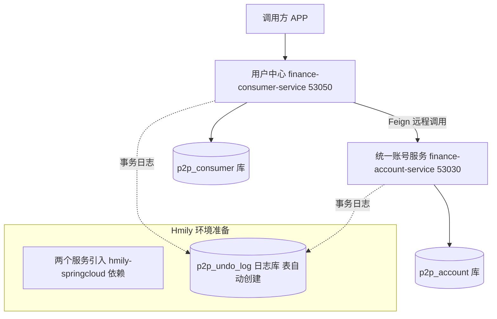

# 把 Hmily 接进注册链路：日志库与两个服务的依赖准备

分布式事务这一块的知识到这里已经铺完：概述里弄清了问题从哪来，CAP 与 BASE 两套理论给了判断依据，TCC 给出了解决方案，Hmily 框架把它变成能写的代码，转账入门案例把整套接入方式跑通了一遍。现在回到当初提出问题的现场：注册功能。前端发起注册请求，用户中心先保存用户信息，再远程调用统一账号服务保存账号数据，两个微服务两个库，一方失败就会出现有用户没账号的不一致。这个问题此前复现过，现在正式用 Hmily 解决它。本课先做接入前的环境准备，两件事：一个专门存事务日志的数据库，两个服务的依赖引入。

## 先给结论

- 注册链路与转账案例同构：用户中心（模块 `finance-consumer-service`，端口 53050，库 `p2p_consumer`）对应 bank1，是事务发起方；统一账号服务（模块 `finance-account-service`，端口 53030，库 `p2p_account`）对应 bank2，是参与方。
- 数据库准备：单独创建一个空库 `p2p_undo_log` 专门存放 Hmily 事务日志，日志表由框架自动创建；与转账案例不同，那里没有单独建库，日志表直接落在 bank1、bank2 业务库里。
- 依赖准备：父工程已统一管理 `org.dromara:hmily-springcloud:2.0.4-RELEASE`，用户中心与统一账号服务两个模块都要引入。
- 引入时带 exclusions 排除框架自带的 spring-boot-starter、spring-boot-starter-test、logback、slf4j 等依赖，避免与工程已有组件冲突。
- 粘依赖前先逐项检查工程已有的依赖，kryo 序列化、spring-retry 等已经在列，别重复添加。

## 业务回顾：注册链路就是 bank1 与 bank2 的翻版

注册功能的调用链画过不止一次：调用方 APP 请求用户中心，用户中心保存用户业务信息，随后远程调用统一账号服务保存对应的账号信息，完成后一路返回。整条链路涉及两个微服务、两个数据库，与转账案例一一对应：用户中心先做本地操作再发起远程调用，是发起方；统一账号服务被动接收调用，是参与方。当初复现问题时就是故意让统一账号服务出错，用户库里有数据、账号库里没有，本地事务对这种跨服务场景无能为力，现在给这条链路配上 Hmily。



这张图把注册链路与 Hmily 环境叠在一张图上：业务流向是用户中心到统一账号服务的一次远程调用，两个服务各自连着业务库；虚线部分是框架的影子，两个服务都会往 `p2p_undo_log` 日志库写事务日志，框架靠它协调两边。图下半块的两个格子就是本课要搭好的两样东西。

## 准备一：给事务日志单独一个库

**转账案例的做法拿来对比。** 入门案例里没有为日志单独建库，Hmily 的日志表直接自动建在了 bank1 与 bank2 各自的业务库里，能用，但日志与业务数据混在一起。项目里为了管理方便，决定单独造一个库，专门存放 Hmily 的日志：

```sql
CREATE DATABASE `p2p_undo_log` CHARACTER SET utf8 COLLATE utf8_general_ci;
```

库是空的就行，里面的日志表不用建。将来配置里让 Hmily 连接这个库，框架自动把日志表建到这里。不单独建库行不行？行，不建的话日志表最终会落到业务库里，与转账案例的效果一样。单独建库的好处是日志与业务隔离，观察与清理都方便，这是课程选择的做法，执行一句建库语句即可。

**后续配置里的落点。** 环境搭好后，两个服务 `application.yml` 里的 `hmilyDbConfig` 连接信息就指向这个库；序列化工具、重试次数、发起方标志这些配置项与转账案例同名同义，接下来两课分别在用户中心与统一账号服务里逐项落地。

## 准备二：两个服务引入 Hmily 依赖

版本不用操心，工程父 POM 的依赖管理里早已备好 `org.dromara:hmily-springcloud:2.0.4-RELEASE`，子模块引依赖时能直接对上。要动手的是往统一账号服务与用户中心两个模块的 `pom.xml` 里粘依赖，而且要带着排除清单一起粘：

```xml
<dependency>
    <groupId>org.dromara</groupId>
    <artifactId>hmily-springcloud</artifactId>
    <version>2.0.4-RELEASE</version>
    <exclusions>
        <exclusion>
            <groupId>org.springframework.boot</groupId>
            <artifactId>spring-boot-starter</artifactId>
        </exclusion>
        <exclusion>
            <groupId>org.springframework.boot</groupId>
            <artifactId>spring-boot-starter-test</artifactId>
        </exclusion>
        <exclusion>
            <groupId>ch.qos.logback</groupId>
            <artifactId>logback-core</artifactId>
        </exclusion>
        <exclusion>
            <groupId>ch.qos.logback</groupId>
            <artifactId>logback-classic</artifactId>
        </exclusion>
        <exclusion>
            <groupId>org.slf4j</groupId>
            <artifactId>slf4j-api</artifactId>
        </exclusion>
    </exclusions>
</dependency>
```

**为什么要一长串排除。** Hmily 自身携带着 spring-boot-starter、spring-boot-starter-test、logback、slf4j 这些依赖，而项目里的微服务早已引入了自己的 Spring Boot 与日志组件，版本由工程统一管理。不排除的话，两套版本同库共存，轻则日志实现错乱，重则启动报各种类冲突。排除的意义是让框架只用它需要的 API，其余一律沿用工程自己的版本。

**先检查再粘贴。** 两个微服务的 `pom.xml` 不是白纸，里面已有不少依赖。粘之前自上而下过一遍：kryo 序列化相关的依赖工程里已经有了，spring-retry 也已经在列，粘进来的清单里碰到重复项就删掉，别倒重了。这类机械活费的不是智力是细心，每做一次都要逐项核对，粘完再整体检查一遍两个文件的依赖列表。

**两边都要引。** 注册链路的两端都要被 Hmily 接管：用户中心是发起方，统一账号服务是参与方，框架要在两个进程里各自拦截方法、各自记日志，缺了任何一边，事务链路就断在那一头，协调与恢复都无从谈起。

## 常见误区

- **以为要单独部署一个事务协调服务。** 错例：寻思着给 Hmily 配套再起一个协调微服务负责推进事务。正解：框架内嵌充当事务管理器，协调监控靠框架自身加日志库，不需要独立协调服务。
- **手工去找日志表的建表脚本。** 错例：担心 `p2p_undo_log` 是空库，提前手工执行建表 DDL。正解：空库正是预期状态，表由框架在运行时自动创建，手工建反而可能与框架预期的结构对不上。
- **引依赖不带 exclusions。** 错例：把三行依赖原样粘进两个 `pom.xml` 就完事。正解：框架自带的 Spring Boot、logback、slf4j 依赖会与工程已有版本冲突，按清单排除，让工程自己的组件生效。
- **只给用户中心引依赖。** 错例：认为只有事务发起方需要框架，参与方服务什么都不用加。正解：发起方与参与方都要被框架拦截与记日志，两个服务的 `pom.xml` 都要有这份依赖。

## 面试可能被问到的问题

1. 面试官追问：「注册功能的分布式事务为什么选 Hmily 这套 TCC 方案？」
   答：用户与账号信息不一致会导致严重问题，业务对一致性要求严格，且注册本身执行时间短。TCC 的软状态时间很短、一致性较强，适合这类短时限严一致业务；Hmily 是落地的 TCC 框架，与工程的 Spring Cloud 体系适配。
2. 面试官追问：「注册链路里谁是事务发起方、谁是参与方？怎么让框架知道？」
   答：用户中心先本地保存用户再远程调用统一账号服务，是发起方，配置 `started: true`；统一账号服务是参与方，配 `false`。框架不自判角色，靠这个标志决定先推进谁执行 Try。
3. 面试官追问：「为什么单独建 `p2p_undo_log` 库？不建行不行？」
   答：这是给 Hmily 事务日志准备的家，日志是框架协调、监控、恢复的依据。不建也可以，日志表会自动落到各业务库里，与转账入门案例一致；单独建库的好处是日志与业务数据隔离，便于观察和清理。
4. 面试官追问：「引入 `hmily-springcloud` 为什么要排除那么多依赖？」
   答：框架自带 spring-boot-starter、spring-boot-starter-test、logback、slf4j 等依赖，而工程微服务已有统一管理的同类组件。不排除会出现版本共存冲突，典型表现是日志实现错乱与启动报错；排除后框架只借 API，组件版本由工程说了算。
5. 面试官追问：「转账入门案例与注册功能的接入步骤有什么异同？」
   答：相同的是套路：引依赖、备日志库、标 `started`、写 `@Hmily` 三方法、扫描框架包。不同的是注册链路是真实业务，两个服务已有自己的数据库与依赖清单，引依赖要先查重、要带排除清单，日志库单独规划为 `p2p_undo_log`，业务方法里还要落实完整的预留与回滚逻辑。

## 配套资料

- 讲义：`materials/docs/10/万信金融-第2章-讲义-开户v1.0.md`，「注册功能中的分布式事务」节：一次注册请求由用户中心服务与统一账号服务协调完成、使用 Hmily 解决的原始说明。
- 讲义：`materials/docs/10/day16-项目总结&就业指导v1.0.md`，「3.4.2 什么是 TCC（补偿事务）」小节：注册业务对一致性要求严格且执行时间短、因此选用 TCC 方案的决策依据。
- 代码：`materials/code/10/wanxinp2p/wanxinp2p/pom.xml`，父工程依赖管理真实存在 `org.dromara:hmily-springcloud:2.0.4-RELEASE` 与 `kryo` 序列化依赖（目录保留原始命名）。
- 代码：`materials/code/10/wanxinp2p/wanxinp2p/wanxinp2p-consumer-service/pom.xml`，用户中心模块真实存在 `spring-retry`、`guava`、`gson` 等依赖，查重环节对照的原始清单（目录保留原始命名）。
- 说明：`p2p_undo_log` 建库语句与依赖排除清单出自课程视频画面线（PPT）；`hmilyDbConfig` 指向日志库的 `application.yml` 写法为按本课转账案例口径补全，完整配置与 `@Hmily` 注解在后续实现篇章落地。
