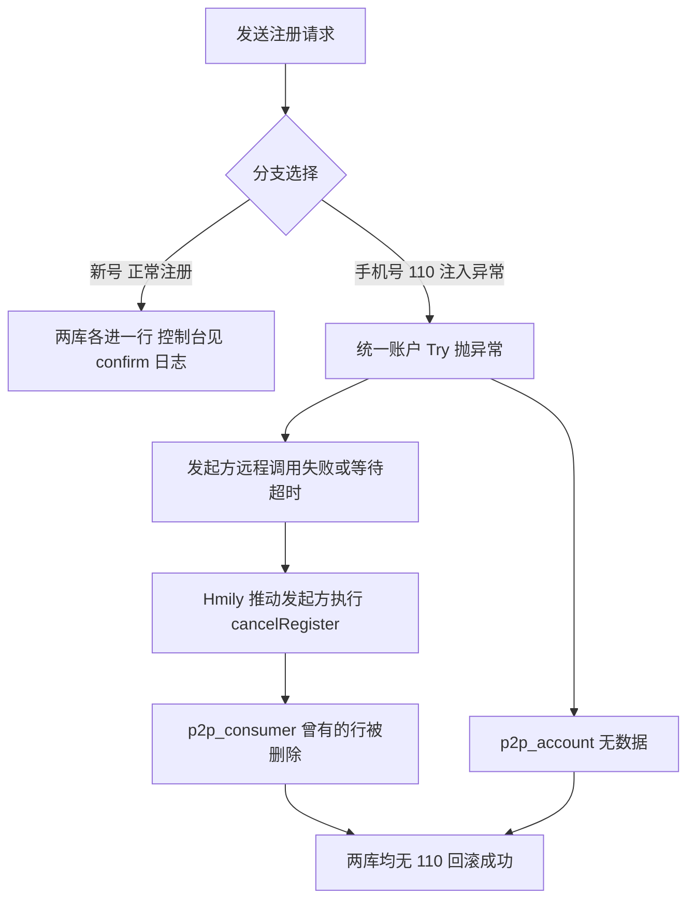

# Hmily 注册功能测试：一次启动踩坑，两条分支验到底

发起方与参与方的改造代码都齐了，验收开始。这次测试要证明的不再是「注册功能能用」，注册功能早测过了，要证明的是加了 Hmily 之后两件事：正常注册不受影响，失败时真的能整体回滚。测试过程中还先摔了一跤：服务起都起不来，一个 `NumberFormatException` 把配置链上的疏漏暴露出来，这个坑的价值不比两条测试分支小。

## 先给结论

- 测试范围两条分支：双服务都成功，两库各进一行；统一账户服务失败，用户中心回滚，两库都没有数据。
- 启动先踩坑：`hmilyTransactionBootstrap` bean 创建失败报 NumberFormatException，根因是 `application.yml` 的 `apollo.bootstrap.namespaces` 清单没有把 `micro_service.spring-cloud-hmily` 加进去，配置在 Apollo 上有、微服务端没加载，等于白配，两个服务都要补。
- 成功分支的判据在库里：`p2p_consumer` 与 `p2p_account` 各一行，控制台出现 confirm 日志。
- 失败分支靠故意注入：统一账户侧对手机号 `110` 抛 RuntimeException，仅测试用；请求后两库都查不到 110，回滚成功。
- 断点观察中间态：发起方 Try 已落库、参与方异常未抛，`p2p_undo_log` 库里 Hmily 自建两张事务日志表；放行后异常与调用超时共同促成双方回滚。

## 服务清单与启动踩坑

老规矩先清点服务。Apollo 一直开着不用动；注册中心重启一次保证干净；网关这次不启动，过网关的链路此前已经测过，本次验证的是事务本身，只起用户中心 consumer-service 与统一账户服务 account-service 就够。用户中心用调试模式启动，一会儿要加断点观察中间过程。

结果第一个起的服务就报了错：

```text
Error creating bean with name 'hmilyTransactionBootstrap' ... NumberFormatException: null
```

顺着栈找，`HmilyConfig` 配置类里 `Integer.parseInt(env.getProperty("org.dromara.hmily.retryMax"))` 拿到的是 null，数字转换当场炸掉。配置读不到，说明 Apollo 客户端没把那组键加载进来。回头检查 Apollo 控制台，公共名称空间里的配置项都在，应用也关联了，问题出在哪？缺的细节在 `application.yml`：新建的名称空间是从未出现过的，客户端要加载哪些名称空间由 `namespaces` 清单说了算，清单里没写的，Apollo 上配得再全也到不了微服务手里：

```yaml
# consumer-service 的 application.yml 节选 清单以工程实际为准 补的是 hmily 一项
app:
  id: consumer-service
apollo:
  bootstrap:
    enabled: true
    namespaces: application,micro_service.spring-boot-druid,micro_service.spring-cloud-hmily
```

逗号后面补上 `micro_service.spring-cloud-hmily`。统一账户服务同样要补，它的 `application.yml` 也是同一个疏漏。两边各改各的，重启，这次控制台打出 Hmily 的启动标志日志，配置链通了，服务正常起来。

这个坑的通用教训值得记牢：配置中心的配置生效是三级联动的，Apollo 上有、应用关联了、客户端加载清单里有，缺一级都拿不到。前两级在 Apollo 控制台操作，最后一级在工程的本地文件里，最容易漏的恰恰是最后一级。

## 成功分支：两库各进一行

测试请求与注册功能的功能测试完全一致，还是直发用户中心的注册接口，手机号换一个两边库都不存在的新号：

```bash
POST http://localhost:53050/consumer/consumers
Content-Type: application/json

{"mobile": "13xxxxxxxxx"}
```

响应 `code` 为 0，注册成功。控制台虽然安静，confirm 的日志已经打出来了，说明 Confirm 阶段被框架正常推进。按惯例回库核对：

```sql
-- 用户中心侧 应出现新行
SELECT ID, USERNAME, MOBILE FROM p2p_consumer.consumer
WHERE MOBILE = '13xxxxxxxxx';

-- 统一账户侧 应出现对应行
SELECT ID, USERNAME, MOBILE FROM p2p_account.account
WHERE MOBILE = '13xxxxxxxxx';
```

两边各一行，字段对得上，加上 Hmily 之后正常注册没有任何退化。事务日志库也值得看一眼，`p2p_undo_log` 库里框架自己建的两张表（全局事务一张、分支事务一张，表名以 hmily_transaction 为前缀）已经有记录，每一次全局事务都会在日志里留下轨迹。

## 失败分支：注入异常看回滚

重点来了。希望的场景是统一账户服务这边出问题，看用户中心能不能跟着回滚。调用链上账号保存发生在统一账户的 `register` 方法里，往里面注入一个失败：

```java
@Override
@Hmily(confirmMethod = "confirmRegister", cancelMethod = "cancelRegister")
public AccountDTO register(AccountRegisterDTO accountRegisterDTO) {
    // 测试专用 故意制造失败 实际项目不会这么写 测完恢复
    if ("110".equals(accountRegisterDTO.getMobile())) {
        throw new RuntimeException("我是故意的");
    }
    // 以下为原有 Try 逻辑
    Account account = new Account();
    account.setUsername(accountRegisterDTO.getUsername());
    account.setMobile(accountRegisterDTO.getMobile());
    account.setPassword(PasswordUtil.generate(accountRegisterDTO.getPassword()));
    account.setDomain("c");
    save(account);
    return convertAccountEntityToDTO(account);
}
```

注入的写法挑了最简单粗暴的一种：手机号等于 110 就抛运行时异常。110 不是合法手机号，不会有真实请求撞进来，条件安全且触发方式明确，Postman 里把手机号改成 10 或 110 都行，只要对得上判断值。改的是统一账户服务，只重启它，用户中心不动。

发送注册请求，`{"mobile": "110"}`，返回注册失败。回两张表核对：

```sql
-- 失败分支 两边都不应再有 110
SELECT COUNT(*) FROM p2p_consumer.consumer WHERE MOBILE = '110';
SELECT COUNT(*) FROM p2p_account.account  WHERE MOBILE = '110';
```

两个计数都是 0。发起方那边曾经保存进去的用户记录被 Cancel 删掉了，参与方这边异常没过保存点本就没写进去，两库干干净净，回滚验证通过。整个判定过程如下：



## 断点观察：中间态与事务日志

数字结论有了，中间过程再看一眼更踏实。在统一账户侧抛异常的那一行打断点，调试模式重启，再发一次 110 的请求。断点停住时查库，现象正好把 TCC 的状态机展示出来：

- `p2p_consumer` 里 110 已经进来了。发起方的 Try 先执行，用户数据早已落库，此刻它正卡在等待远程调用返回。
- `p2p_account` 里没有 110。异常还没抛到，保存语句尚未执行。
- `p2p_undo_log` 库里两张日志表有记录，全局事务与分支事务的状态都写在里面。

放行让异常抛出。参与方 Try 失败，无法继续；与此同时发起方那边的远程调用等不到响应，连接与读超时配置（ribbon 读超时 20 秒，工程归档里有真实配置）让它在停顿期间就判定失败，Try 抛出异常同样成立。无论失败由异常还是超时触发，对 Hmily 来说结论一致：发起方 Try 失败，推动它执行 `cancelRegister`，那行 110 被删除。再查两库，双双清空，控制台一边是参与方的异常堆栈，一边是发起方的回滚动作，最终数据一致。

断点这步的价值在于看清顺序：发起方先落库、参与方后失败，中间态是「一库有一库无」，如果没有 Hmily，这个中间态就是终态，也就是当初用停服务实验暴露出的脏数据现场。现在它只是个转瞬即逝的过程态，回滚机制把它收掉了。到此 Hmily 解决注册功能事务问题的全部代码与验证完成，删掉注入代码，注册链路可以放心往前走了。

## 常见误区

- **配置在 Apollo 配了就以为微服务能拿到。** 错例：控制台里键值齐全、应用也关联了，启动仍报 NumberFormatException。正解：客户端加载清单 `apollo.bootstrap.namespaces` 里必须包含该名称空间，三级联动缺一不可。
- **只改一个服务的清单。** 错例：用户中心补了 namespaces 清单，统一账户没补，一个起来了另一个照旧起不来，来回排查浪费时间。正解：两个服务各自都要补各自的清单，逐个验证启动日志。
- **拿真实手机号做故障注入。** 错例：用库里已存在的号码做注入条件，正常数据被误伤。正解：选 110 这类不可能出现的值做触发条件，注入代码标明测试专用，测完恢复。
- **看到 code 为 0 就宣布 Hmily 接入成功。** 错例：只测成功分支就收工。正解：接入事务框架的价值在失败分支，成功分支只证明没退化，失败分支的两库核对才证明回滚生效。

## 面试可能被问到的问题

1. 面试官追问：「接入分布式事务框架后的测试，和普通功能测试有什么不同？」
   答：普通功能测试以正常路径为主，事务框架的测试必须覆盖失败分支：人为让参与方失败，验证发起方回滚、两库数据一致。判据也从接口响应扩展到数据库终态，响应成功不代表数据正确，回滚后两库都要查。
2. 面试官追问：「启动报 NumberFormatException 指向配置类，排查思路是什么？」
   答：先看栈里是哪个键转换失败，确定配置项没读到；再去 Apollo 确认配置存在且应用已关联；最后查微服务本地 `application.yml` 的 `apollo.bootstrap.namespaces` 清单是否包含该名称空间。本例的根因在第三级，客户端加载清单漏项。
3. 面试官追问：「断点停在参与方抛异常处时，为什么发起方的数据已经在库里？」
   答：TCC 的 Try 是先后执行的：发起方先完成本地 Try 并落库，再发起远程调用，参与方才走到自己的 Try。断点停住时全局事务处于中间态，一库有一库无；回滚的意义就是把这个中间态收掉，让终态回到两边都没有。
4. 面试官追问：「参与方一直不放行，发起方为什么最后也回滚了？」
   答：远程调用有超时配置，ribbon 的连接与读超时到期后，发起方的 Try 以异常收场。Hmily 捕获 Try 失败，从事务日志定位全局事务并推进 Cancel。异常、超时对框架是等价的失败信号，回滚路径一致。
5. 面试官追问：「事务日志表在这次测试里起了什么作用？」
   答：全局事务与分支事务的创建、每一步的成败都记在 `p2p_undo_log` 库的日志表里，框架据此知道哪些分支 Try 成功过、该推 Confirm 还是 Cancel，失败后还能依据日志重试。日志库选 db 持久化，进程崩溃后恢复事务也靠它。

## 配套资料

- 代码：`materials/code/10/wanxinp2p/`，P2P 工程归档（目录保留原始命名，路径列到该层级），`wanxinp2p-consumer-service` 的 `application.properties` 含 ribbon 连接与读超时的真实配置（连接 3000 毫秒、读 20000 毫秒），正文超时触发回滚的依据。
- 代码：`materials/code/10/资料/公共类/Account.java`、`AccountRegisterDTO.java`，注入异常所在方法操作的实体与入参定义。
- 讲义：`materials/docs/10/万信金融-第2章-讲义-开户v1.0.md`，「注册功能中的分布式事务」节及功能测试安排的背景。
- 说明：测试请求、注入代码与核对 SQL 按视频画面线整理，仓库无测试脚本归档；`application.yml` 名称空间清单为节选示例，以工程实际为准；测试手机号以 `13xxxxxxxxx` 占位，110 为注入专用值。
