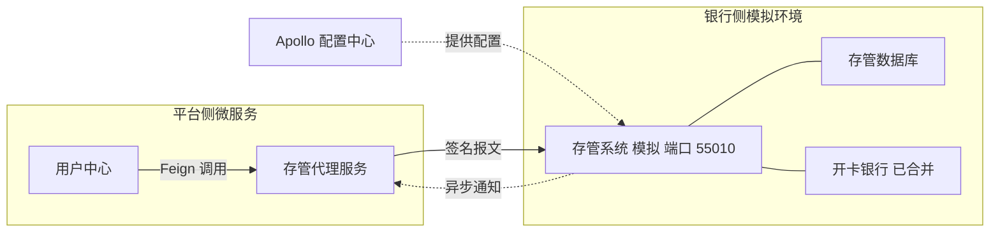
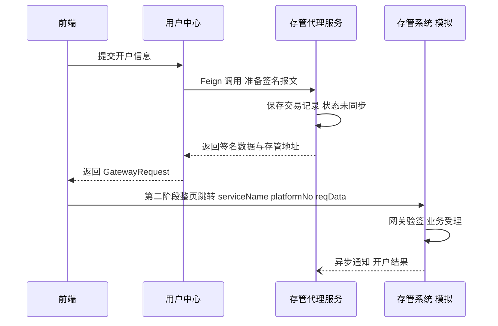

# 部署银行存管系统（模拟）：开户动工之前，先把对接对象跑起来

> 🔒 安全提示：文中示例的口令/密钥均为课程教学环境演示口径，生产环境的安全要求见《安全与合规须知》。

开户的需求分析已经把流程掰到了 1.1 到 1.7 每一步，但整条链路里最关键的一方还不存在：银行存管系统。它不属于平台，不需要开发，可开户第二阶段要把用户整页跳转到它那里，第三阶段的结果通知也从它那里发回来。对接对象连环境都没有，后面的代码写了也没地方验证，所以动工前先把它在本地部署起来，再把它的接口文档过一遍。

## 先给结论

- 存管系统（模拟）是课程直接提供的银行侧系统，平台侧只做部署与对接，不做任何开发，改动也不允许落在它的代码里。
- 部署三步走：初始化数据库、导入工程并接上 Apollo 配置、设置启动参数启动，最后用自带的测试类验证功能真的可用。
- 它的配置在第一章就已经生成到 Apollo，部署时只需指定应用名与端口 55010，不需要重新建配置。
- 对接依据是接口说明文档：所有业务请求经网关接口进入，统一携带 `serviceName`、`platformNo`、`reqData` 三个参数，结果经异步通知回传。

## 对接对象是谁：银行侧的模拟存管端

平台采用银行存管模式，资金统一放在银行，平台只做撮合。开户这件事在银行侧要开立个人存管账户，承担这件事的系统就是存管系统，部署在银行环境，由银行开发维护。课程为了让开发能落地，提供了一个功能等价的模拟存管端工程，与开卡银行的银行卡核验能力合并在一起，工程名按本课口径记作 `depository-server`（资料归档保留原始命名，见文末配套资料）。

它是「别人家的系统」，这决定了两件事。第一，它的代码不需要读懂，更不允许修改，拿来运行就行；第二，它的内部实现平台侧看不到，能依赖的只有两份文档：部署指南和接口说明。这个处境在企业开发里非常常见，调用第三方系统时对方给文档不给源码，会查文档比会写代码更重要。

本地环境部署完成后的组件关系如下：



关键在存管系统这一个节点：平台侧一切与银行的往来都被压缩到「存管代理服务发签名报文、存管系统回异步通知」这一条通道上，存管系统背后挂着独立的数据库与开卡银行，对平台来说就是一个黑盒服务。

## 第一步：初始化数据库

存管系统自己也要管理一堆数据，银行卡、银行卡明细、银行用户都在它的库里。资料里提供了一键初始化脚本 `depository-init.sql`，把脚本拖进数据库客户端直接执行，建库建表一次完成，无报错即成功。生成的库按本课口径记作 `depository_bank`，里面的表节选出来长这样：

```sql
-- 银行卡明细表 记录余额变动 节选自初始化脚本
CREATE TABLE bank_card_detail (
  ID BIGINT(20) NOT NULL AUTO_INCREMENT COMMENT '主键',
  BANK_CARD_ID BIGINT(20) DEFAULT NULL COMMENT '银行卡ID',
  CHANGE_TYPE TINYINT(4) DEFAULT NULL COMMENT '变动类型',
  MONEY DECIMAL(19,2) DEFAULT NULL COMMENT '变动金额',
  BALANCE DECIMAL(19,2) DEFAULT NULL COMMENT '当前余额',
  CREATE_DATE DATETIME DEFAULT NULL COMMENT '创建时间',
  PRIMARY KEY (ID)
) ENGINE=InnoDB DEFAULT CHARSET=utf8 COMMENT='银行卡明细表';

-- 用户表 存银行侧的用户要素
CREATE TABLE bank_user (
  ID BIGINT(20) NOT NULL AUTO_INCREMENT COMMENT '主键',
  FILLNAME VARCHAR(50) NOT NULL COMMENT '真实姓名',
  MOBILE VARCHAR(11) NOT NULL COMMENT '手机号',
  PASSWORD VARCHAR(32) NOT NULL COMMENT '密码',
  USER_TYPE TINYINT(4) NOT NULL COMMENT '用户类型',
  CREATE_DATE DATETIME DEFAULT NULL COMMENT '创建时间',
  PRIMARY KEY (ID)
) ENGINE=InnoDB DEFAULT CHARSET=utf8 COMMENT='用户表';
```

这些表是银行视角的数据模型：银行卡明细表记余额变动，用户表存真实姓名、手机号这类实名要素，后续还有银行卡、平台交易流水等一批表。平台侧的库与它完全独立，两边通过接口报文交换数据，绝不跨库互查。

## 第二步：导入工程、接上 Apollo、启动验证

工程用 IDEA 直接 Open 打开，第一次打开保持联网，Maven 会按 `pom.xml` 拉取依赖，等依赖加载完确认没有红线，环境问题在这一步解决掉。代码本身不用看，它的角色是「跑起来给人调用的现成系统」。

启动参数是这一步的关键。存管系统的配置同样托管在 Apollo 上，而这套配置在第一章搭环境时就已经生成好了，应用下的命名空间里公钥、私钥、数据库连接一应俱全，部署时只需要告诉它「去 Apollo 拿配置、占用哪个端口」：

```bash
# 启动参数 三个 JVM 系统属性缺一不可
-Denv=dev -Dapollo.cluster=DEFAULT -Dserver.port=55010
```

`-Denv=dev` 指定 Apollo 环境，`-Dapollo.cluster=DEFAULT` 指定集群，`-Dserver.port=55010` 指定服务端口。启动日志里能看到连接 Apollo 同步配置、初始化 Spring 环境、加载 MyBatis-Plus 的过程，端口 55010 起来且无报错就算启动成功。

但启动成功只说明进程活着，不代表里面的功能没问题。课程在测试包里提供了一个 `BankCardServiceTest`，用它做冒烟验证：

```java
/** 银行卡服务测试类 节选 包名按 com.study.finance 系改写 */
@RunWith(SpringJUnit4ClassRunner.class)
@SpringBootTest(classes = DepositoryServer.class)
public class BankCardServiceTest {

    @Autowired
    private BankCardService bankCardService;

    @Test
    public void createBankCard() {
        // 循环 100 次 生成随机用户与银行卡 走真实业务层落库
        for (int i = 0; i < 100; i++) {
            BankCardRequest bankCardRequest = new BankCardRequest();
            bankCardRequest.setFullName(ChineseNameGenerator.getInstance().generate());
            bankCardRequest.setMobile(ChineseMobileNumberGenerator.getInstance().generate());
            bankCardRequest.setCardNumber(BankCardNumberGenerator.getInstance().generate());
            bankCardRequest.setBalance(new BigDecimal(100000));
            bankCardRequest.setPassword("888888");
            bankCardService.createBankCard(bankCardRequest);
        }
    }
}
```

测试内部会重新拉一遍 Apollo 配置，所以比普通单测慢；跑的时候控制台会打印 MyBatis-Plus 生成的 `INSERT` 语句，业务层方法里先查卡号是否存在、不存在才保存，一次落 `bank_user` 与 `bank_card` 两张表。跑完后去数据库里数一眼：两张表各多出 100 条随机数据，写链路、读链路、库表结构就全部验证通过了。

## 第三步：把接口说明当成对接合同读一遍

部署完成后，真正指导平台侧写代码的是接口说明文档。它先约定了统一的报文入口：所有业务请求经网关接口进入，平台以浏览器整页跳转的方式把参数带到存管系统，网关侧对报文做格式校验、非空校验与验签后再分发。请求参数只有三个：

| 参数名称 | 必填 | 说明 |
|---|---|---|
| `serviceName` | Y | 请求的存管接口名，标识本次是哪类业务 |
| `platformNo` | Y | 平台编号，平台与存管系统签约时分配 |
| `reqData` | Y | 业务数据报文，JSON 格式 |

开户对应的是「个人绑卡开户」接口，`reqData` 里要求携带 `userNo`（平台用户编号）、`requestNo`（请求流水号）、真实姓名、证件号、银行卡号、银行预留手机号、回调地址等字段，处理结果通过异步通知回传，通知报文里带 `userNo` 与交易状态。平台侧要准备什么数据，以这份文档为准：银行要什么，平台就准备什么，有的由前端直接传，有的在用户中心生成。

这张图在讲一次开户请求从准备到通知的完整对接动线：



关键路径是最后一条虚线：同步返回给前端的只是「可以去银行页面了」，平台侧状态真正翻成同步，靠的是异步通知到达之后的那次落库，这也是部署存管系统时必须把它的库和接口一起吃透的原因。

在企业里对接任何第三方系统都是同样的节奏：先让它的环境在你手里跑起来，再拿接口文档逐字段核对，最后才轮到写代码。

## 常见误区

- **把「进程起来了」当成部署完成。** 错例：服务无报错监听 55010 就开始写对接代码。正解：跑一遍自带的测试类，确认写库链路真实可用，控制台 SQL 与表里数据两头都对上，才算验证通过。
- **重新在 Apollo 上为存管系统建一套配置。** 错例：找不到配置就从零新建命名空间。正解：第一章环境搭建时配置已经生成，部署时按应用名关联已有命名空间，重点核对数据库连接、密钥与访问路径这几项。
- **粘贴密钥配置时把换行也带进去。** 错例：从文档复制公钥私钥到 Apollo，值中间夹了换行导致验签必失败。正解：密钥值必须是一整行，粘贴后逐项检查再发布。
- **只看存管系统代码不看接口文档。** 错例：对着模拟工程的实现反推报文格式。正解：接口说明文档才是对接契约，参数名、必填项、异步通知格式都按文档来，模拟工程只是文档的参考实现。

## 面试可能被问到的问题

1. 面试官追问：「对接一个没有源码的第三方系统，你的工作步骤是什么？」
   答：先按对方部署指南把它的环境搭起来并能启动；再用它自带的验证手段确认功能可用；然后通读接口文档，整理出请求参数、返回值、异步通知格式与错误码；最后在自己侧按文档写对接代码，用文档逐字段核对。全程不假设对方实现细节，一切以文档为契约。
2. 面试官追问：「为什么网关接口只设计 `serviceName`、`platformNo`、`reqData` 三个参数？」
   答：这是典型的网关收敛设计。前两个参数完成身份识别与业务路由，`reqData` 用 JSON 装载全部业务数据并整体签名。接口数量再多，报文骨架不变，网关层校验和验签逻辑只需实现一次，新增业务只是新增一个 `serviceName` 与对应的 `reqData` 结构。
3. 面试官追问：「存管系统为什么单独配一个数据库，而不是和平台共用？」
   答：它模拟的是银行侧系统，与平台是两个信任域，数据必须物理隔离，平台侧库被攻破也不该影响银行侧账务。两边只通过签名报文与异步通知交换数据，这也倒逼平台侧把跨系统交互收敛到存管代理服务一个点上。
4. 面试官追问：「部署完成后为什么还要跑测试类造 100 条数据？」
   答：启动成功只能证明 Spring 环境和端口正常，不能证明业务链路正常。测试类走的是真实的业务层与数据访问层，验证了 Apollo 配置读取、数据库连接、事务与 SQL 生成的整条链路，还顺手留下了可供后续联调使用的测试数据，一次投入三份收益。
5. 面试官追问：「异步通知的参数为什么在部署阶段就要看？」
   答：因为平台侧接收通知的代码，包括交易记录状态流转与报文字段映射，都依赖通知报文的准确格式。部署阶段通读文档，能提前发现字段缺失、类型不一致这类对接问题，避免第三阶段联调时才暴露。

## 配套资料

- 讲义：`materials/docs/10/万信金融-第2章-讲义-开户v1.0.md`，3.2 部署银行存管系统：初始化数据库、导入工程、设置启动参数三步的出处；3.3.1 需求分析中查阅「个人绑卡开户」接口说明的提示。
- 代码：`materials/code/10/wanxinp2p/`，P2P 平台侧工程归档（目录保留原始命名，路径只列到该层级，模拟存管端工程未在该目录归档，随课程资料单独提供）。
- 说明：`depository-server`、`depository_bank`、`depository-init.sql` 为按本课口径使用的中性名称，资料内原始命名以归档目录为准；银行存管系统部署指南与接口说明随课程资料提供，未在 `materials/docs/10/` 单独归档；数据库连接为本机 MySQL，账号 root，密码 123456。
