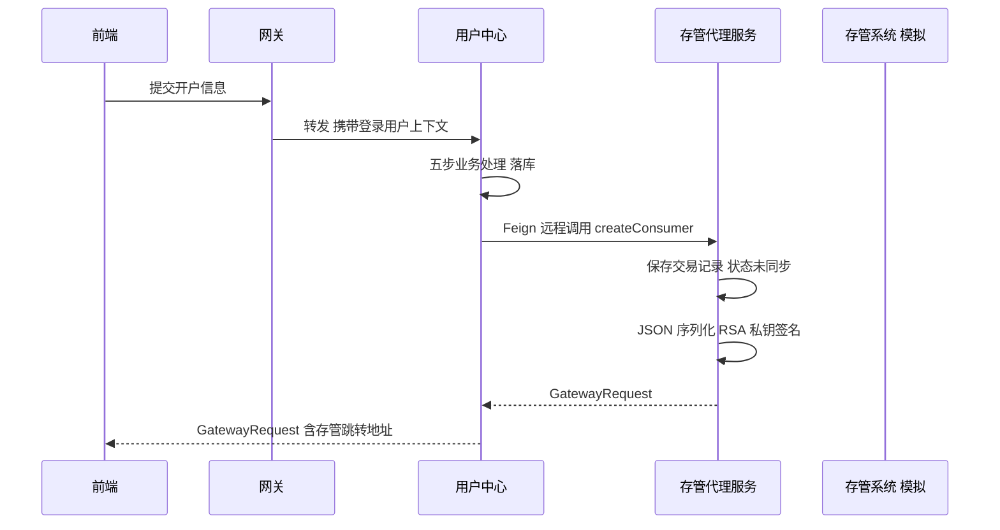
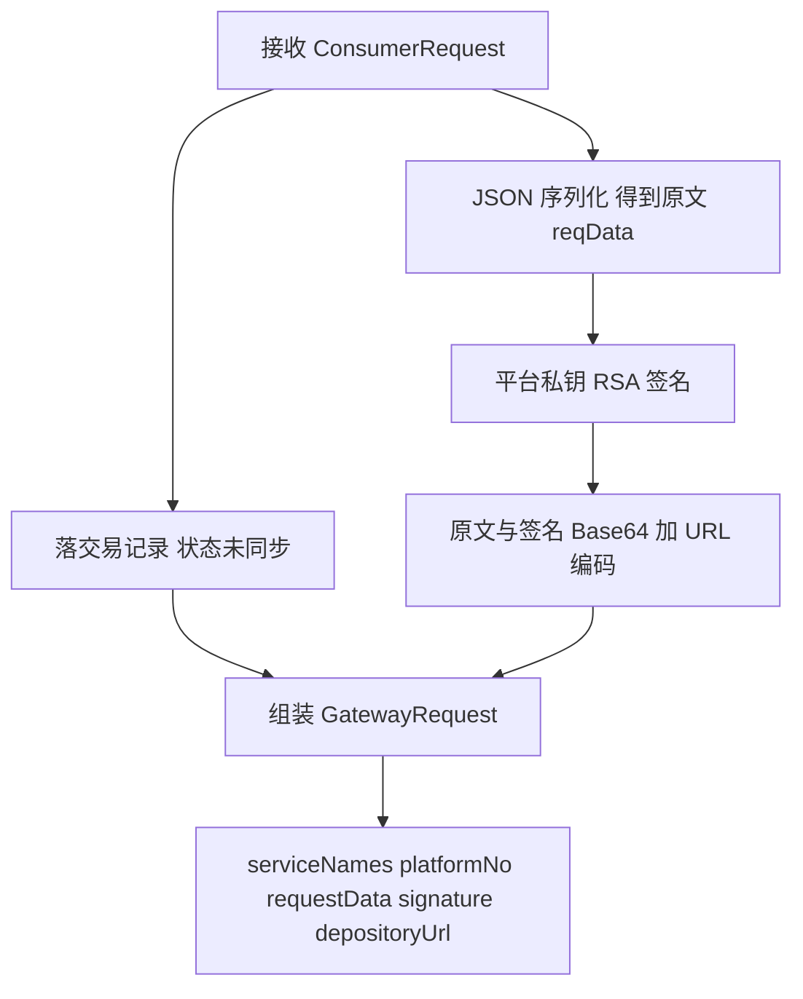

# 开户第一阶段：生成开户数据，从接口定义到签名报文的完整落地

存管系统（模拟）在本地跑起来了，接口文档也过了一遍，回到平台侧动工。开户整个业务被拆成三个阶段，第一阶段「生成开户数据」全部发生在平台侧，却横跨两个微服务：用户中心负责准备数据、更新用户、落银行卡，存管代理服务负责建交易记录、对数据做 RSA 签名，最后把一份可以直接跳转银行的签名报文交回前端。这一篇把两个服务从接口定义到功能实现的完整过程一次讲透。

## 先给结论

- 第一阶段的产物是一个 `GatewayRequest`：签名后的业务报文、平台编号、存管接口名、存管系统地址四样东西，前端拿到它才能走第二阶段的整页跳转。
- 接口定义分两处：用户中心 `ConsumerAPI` 新增 `createConsumer`，存管代理 `DepositoryAgentApi` 新增同名方法，入参与返回值完全一致，因为用户中心是原样转发。
- 用户中心业务层按五步走：判断已开户、判断银行卡已绑定、更新用户信息、保存银行卡、远程调用存管代理，方法整体加 `@Transactional` 保证本地一致。
- 存管代理业务层只做两件事：把开户存成一条「未同步」状态的交易记录；把业务数据序列化成 JSON 后用平台私钥签名，连同存管地址封装返回。
- 私钥等敏感配置全部放在 Apollo，代码里通过配置对象按 key 读取，密钥值不进代码库。

## 第一阶段的全景：一条链路两个服务

第一阶段对应时序图的 1.1 到 1.7，化整为零之后可以这样概括：前端带着身份证号、银行卡号这些开户要素请求用户中心，用户中心查状态、补编号、落库，再把数据转发给存管代理；存管代理把这次开户登记成一条交易记录并签名，签名报文原路返回，经用户中心交给前端，第二阶段再由前端整页跳转银行。这张图在讲整条链路的调用顺序与数据封装：



关键路径在两个业务层之间那次 Feign 调用：用户中心攒好的 `ConsumerRequest` 是唯一的数据载体，存管代理加工完返回的 `GatewayRequest` 是唯一的产物，两边接口签名因此长得一模一样。

## 接口定义：两处契约，一对镜像

接口统一放在 API 工程。用户中心一侧，在 `ConsumerAPI` 里新增方法；存管代理一侧，从资料导入 `finance-depository-agent-service` 工程，在 API 工程新建 `depository` 包，放 `DepositoryAgentApi`。两边方法签名完全一致：

```java
/** 平台侧第一阶段接口定义 包名按 com.study.finance 系改写 */
public interface ConsumerAPI {

    /** 生成开户请求数据 用户中心入口 */
    @ApiOperation("生成开户请求数据")
    @ApiImplicitParam(name = "consumerRequest", value = "开户信息", required = true,
            dataType = "ConsumerRequest", paramType = "body")
    @PostMapping("/my/consumers")
    RestResponse<GatewayRequest> createConsumer(ConsumerRequest consumerRequest);
}

public interface DepositoryAgentApi {

    /** 开通存管账户 存管代理入口 参数与返回值和用户中心一致 */
    RestResponse<GatewayRequest> createConsumer(ConsumerRequest consumerRequest);
}
```

入参和返回值各是一个模型类，课程资料直接提供，按声明所在的包对号入座即可。这两个类值得逐字段看一遍，它们决定了整条链路的数据形状：

```java
/** 前端提交的开户信息 节选关键字段 */
@ApiModel(value = "ConsumerRequest", description = "平台端用户开户信息")
public class ConsumerRequest {
    @ApiModelProperty("id")
    private Long id;
    @ApiModelProperty("用户名")
    private String username;
    @ApiModelProperty("真实姓名")
    private String fullname;
    @ApiModelProperty("身份证号")
    private String idnumber;
    @ApiModelProperty("银行编码")
    private String bankCode;
    @ApiModelProperty("银行卡号")
    private String cardnumber;
    @ApiModelProperty("手机号")
    private String mobile;
    @ApiModelProperty("角色")
    private String role;
    @ApiModelProperty("请求流水号")
    private String requestNo;
    @ApiModelProperty("用户编号")
    private String userNo;
    @ApiModelProperty("页面回调 URL")
    private String callbackUrl;
}

/** 与存管系统对接的签名请求数据 第二阶段跳转银行的全部依据 */
@ApiModel(value = "GatewayRequest", description = "与银行存管系统对接使用的签名请求数据")
public class GatewayRequest {
    @ApiModelProperty("请求的存管接口名")
    private String serviceName;
    @ApiModelProperty("平台编号 平台与存管系统签约时获取")
    private String platformNo;
    @ApiModelProperty("业务数据报文 json 格式")
    private String requestData;
    @ApiModelProperty("对 requestData 参数的签名")
    private String signature;
    @ApiModelProperty("银行存管系统地址")
    private String depositoryUrl;
}
```

`ConsumerRequest` 里前端能传的只有真实姓名、身份证号、银行卡号、手机号这类要素，`id`、`requestNo`、`userNo` 由平台侧生成。`userNo` 特别说明一下：用户表本来有自增主键，`userNo` 是另造的对外编号，专门用于与存管系统交互，避免把内部主键暴露给银行侧。接口定义完，两个 Controller 各补一个空实现，编译先过，再进功能实现。

工程环境按老套路收尾，但配置项值得逐个点名。存管代理工程导入后，在 Apollo 的 `application` 命名空间新增这几项：平台私钥与公钥（`platform.privateKey`、`platform.publicKey`，签名用，公钥同时交换给存管侧备验）、平台编号（`platform.code`，签约时存管方分配）、存管系统地址（`depository.url`，指向本机 55010 的模拟存管端）。粘贴密钥时必须保证值是一整行，从文档复制带出的换行会让密钥非法，这个坑在部署存管系统时已经强调过。其余命名空间按以往经验过一遍：数据库连接池指向存管代理自己的库，MyBatis-Plus 的实体扫描包路径对准存管代理工程里的 `entity` 包，改完逐项发布。启动参数 `-Denv=dev -Dapollo.cluster=DEFAULT -Dserver.port=53070`，注册中心起来后单独起存管代理，端口 53070 无报错，环境就算就位。

## 用户中心侧准备：银行卡的查询能力

开户要用到银行卡的查与存，先把这层能力补齐。数据访问层沿用 MyBatis-Plus 的惯例，接口继承 `BaseMapper`，配一个空映射文件就拿到全部基础能力：

```java
/** 用户绑定银行卡 Mapper 包名按 com.study.finance 系改写 */
public interface BankCardMapper extends BaseMapper<BankCard> {
}
```

```xml
<?xml version="1.0" encoding="UTF-8"?>
<!DOCTYPE mapper PUBLIC "-//mybatis.org//DTD Mapper 3.0//EN"
    "http://mybatis.org/dtd/mybatis-3-mapper.dtd">
<mapper namespace="com.study.finance.consumer.mapper.BankCardMapper">
</mapper>
```

业务层接口继承 `IService<BankCard>`，业务实现继承 MP 的 `ServiceImpl`，再补两个开户要用的查询：按用户编号查卡、按卡号查卡。查询结果统一转成 DTO 返回，转换方法放在实现类私有方法里：

```java
/** 银行卡业务实现 节选 两个查询与实体转换 */
@Service
public class BankCardServiceImpl extends ServiceImpl<BankCardMapper, BankCard>
        implements BankCardService {

    @Override
    public BankCardDTO getByConsumerId(Long consumerId) {
        BankCard bankCard = getOne(new QueryWrapper<BankCard>().lambda()
                .eq(BankCard::getConsumerId, consumerId));
        return convertBankCardEntityToDTO(bankCard);
    }

    @Override
    public BankCardDTO getByCardNumber(String cardNumber) {
        BankCard bankCard = getOne(new QueryWrapper<BankCard>().lambda()
                .eq(BankCard::getCardNumber, cardNumber));
        return convertBankCardEntityToDTO(bankCard);
    }

    /** entity 转 dto 空对象直接返回空 */
    private BankCardDTO convertBankCardEntityToDTO(BankCard entity) {
        if (entity == null) {
            return null;
        }
        BankCardDTO dto = new BankCardDTO();
        BeanUtils.copyProperties(entity, dto);
        return dto;
    }
}
```

`getByConsumerId` 服务于「用户以前绑过卡吗」的场景，`getByCardNumber` 服务于「这张卡被别人用过吗」的场景，两个查询马上都会出现在开户主流程里。条件构造器用 lambda 写法，字段引用直接挂在实体上，字段名写错编译期就报错。

## 用户中心业务层：五步生成开户数据

主业务落在既有的 `ConsumerServiceImpl` 里，新增 `createConsumer` 实现，方法加 `@Transactional`，因为里面连着好几个本地库操作。这段代码看着长，拆开就是五步，一步一步填：

```java
/** 用户中心 生成开户数据 五步主干 包名按 com.study.finance 系改写 */
@Override
@Transactional
public RestResponse<GatewayRequest> createConsumer(ConsumerRequest consumerRequest) {
    // 1.判断当前用户是否已经开户
    ConsumerDTO consumerDTO = getByMobile(consumerRequest.getMobile());
    if (consumerDTO.getIsBindCard() == 1) {
        throw new BusinessException(ConsumerErrorCode.E_140105);
    }
    // 2.判断提交过来的银行卡是否已被绑定
    BankCardDTO bankCardDTO = bankCardService.getByCardNumber(consumerRequest.getCardnumber());
    if (bankCardDTO != null && bankCardDTO.getStatus() == StatusCode.STATUS_IN.getCode()) {
        throw new BusinessException(ConsumerErrorCode.E_140151);
    }
    // 3.更新用户的信息 产生请求流水号与用户编号
    consumerRequest.setId(consumerDTO.getId());
    consumerRequest.setUserNo(CodeNoUtil.getNo(CodePrefixCode.CODE_CONSUMER_PREFIX));
    consumerRequest.setRequestNo(CodeNoUtil.getNo(CodePrefixCode.CODE_REQUEST_PREFIX));
    UpdateWrapper<Consumer> updateWrapper = new UpdateWrapper<>();
    updateWrapper.lambda().eq(Consumer::getMobile, consumerDTO.getMobile());
    updateWrapper.lambda().set(Consumer::getUserNo, consumerRequest.getUserNo());
    updateWrapper.lambda().set(Consumer::getRequestNo, consumerRequest.getRequestNo());
    updateWrapper.lambda().set(Consumer::getFullname, consumerRequest.getFullname());
    updateWrapper.lambda().set(Consumer::getIdNumber, consumerRequest.getIdnumber());
    updateWrapper.lambda().set(Consumer::getAuthList, "ALL");
    this.update(updateWrapper);
    // 4.保存银行卡信息
    BankCard bankCard = new BankCard();
    bankCard.setConsumerId(consumerDTO.getId());
    bankCard.setBankCode(consumerRequest.getBankCode());
    bankCard.setCardNumber(consumerRequest.getCardnumber());
    bankCard.setMobile(consumerRequest.getMobile());
    bankCard.setStatus(StatusCode.STATUS_OUT.getCode());
    BankCardDTO existBankCard = bankCardService.getByConsumerId(bankCard.getConsumerId());
    if (existBankCard != null) {
        // 该用户曾有中断残留的绑卡记录 补上主键让框架走更新
        bankCard.setId(existBankCard.getId());
    }
    bankCardService.saveOrUpdate(bankCard);
    // 5.远程调用存管代理服务
    return depositoryAgentApiAgent.createConsumer(consumerRequest);
}
```

**第一步防重复开户。** 注册只登记了手机号，开户要素是后补的，判断依据是用户表的 `isBindCard` 标记：绑过卡即视为已开户，值为 1 直接抛「用户已开户」的业务异常。查询用手机号定位用户，手机号注册时全局唯一。

**第二步防银行卡复用。** 一张卡在平台只能属于一个人，查银行卡表：查到记录、且状态是已同步（枚举 `STATUS_IN`，表示该卡已被使用），就抛「银行卡已被绑定」。两张表两次查询，对应前面刚补的两个方法。

**第三步补齐用户要素并发放编号。** 请求流水号 `requestNo` 与用户编号 `userNo` 前端都不传，由编号工具按「用户」「请求」两个前缀规则生成，流水号贯穿三个阶段，是存管侧对账与状态回传的凭据。`UpdateWrapper` 以手机号为条件，把真实姓名、身份证号、两个编号以及存管授权字段一次性补进用户表。注册时只有手机号的用户，这一步之后才长成一个完整的开户候选人。

**第四步保存银行卡，藏着一个小设计。** 用户可能走到一半放弃开户，卡信息却已落库；过几天再来开户，不能无脑插入。按用户编号查一次旧卡，查到就把旧记录主键塞回新对象，`saveOrUpdate` 发现主键存在就走 `update`，查不到才走 `insert`，幂等交给框架判断。新卡状态置为「未同步」（枚举 `STATUS_OUT`），与交易记录的状态线呼应，开户全部完成后再翻成已同步。

**第五步原样外发。** 前端传的、平台生成的，此刻都在 `ConsumerRequest` 里，直接交给 Feign 代理 `DepositoryAgentApiAgent`，代理按服务名 `finance-depository-agent-service` 发起调用，把返回的 `GatewayRequest` 透传出去。

Controller 只做一件业务以外的事：给请求补上当前登录用户。开户必然发生在登录之后，用户名与手机号不该由前端重复提交，而是从认证上下文取。这里有一条贯穿全项目的原则：谁能确定的数据就由谁提供，前端不传身份字段，服务端从令牌取，篡改请求体的攻击面就小了一圈：


```java
/** 用户中心开户入口 包名按 com.study.finance 系改写 */
@Override
@ApiOperation("生成开户请求数据")
@PostMapping("/my/consumers")
public RestResponse<GatewayRequest> createConsumer(ConsumerRequest consumerRequest) {
    // 登录态经网关解析后把用户对象放进请求属性 从上下文取出当前用户
    LoginUser user = SecurityUtil.getUser();
    consumerRequest.setMobile(user.getMobile());
    return consumerService.createConsumer(consumerRequest);
}
```

`SecurityUtil` 从 `RequestContextHolder` 拿到当前请求，读取网关解析令牌后放进请求属性的 `jsonToken`，强转成 `LoginUser` 返回。登录方案换了几轮，从传统 session 到 OAuth2 令牌，业务代码取当前用户的方式却收敛在了一个工具类里，这正是当初封装它的意义。

## 存管代理业务层：记录交易，然后签名

存管代理收到请求后做两件事，先登记后签名。数据访问层照旧是 MP 三件套：`DepositoryRecordMapper` 继承 `BaseMapper<DepositoryRecord>`，配空映射文件。业务实现里把保存逻辑抽成私有方法：

```java
/** 存管代理 保存交易记录与签名返回 包名按 com.study.finance 系改写 */
@Service
public class DepositoryRecordServiceImpl
        extends ServiceImpl<DepositoryRecordMapper, DepositoryRecord>
        implements DepositoryRecordService {

    @Autowired
    private ConfigService configService;

    @Override
    public GatewayRequest createConsumer(ConsumerRequest consumerRequest) {
        // 1.保存交易记录 状态未同步
        saveDepositoryRecord(consumerRequest);
        // 2.签名数据并返回
        String reqData = JSON.toJSONString(consumerRequest);
        String sign = RSAUtil.sign(reqData, configService.getPlatformPrivateKey(), "utf-8");
        GatewayRequest gatewayRequest = new GatewayRequest();
        gatewayRequest.setServiceName("PERSONAL_REGISTER");
        gatewayRequest.setPlatformNo(configService.getPlatformCode());
        gatewayRequest.setRequestData(EncryptUtil.encodeURL(EncryptUtil.encodeUTF8StringBase64(reqData)));
        gatewayRequest.setSignature(EncryptUtil.encodeURL(EncryptUtil.encodeUTF8StringBase64(sign)));
        gatewayRequest.setDepositoryUrl(configService.getDepositoryUrl() + "/gateway");
        return gatewayRequest;
    }

    /** 开户也是交易 销户充值提现同表复用 */
    private void saveDepositoryRecord(ConsumerRequest consumerRequest) {
        DepositoryRecord depositoryRecord = new DepositoryRecord();
        depositoryRecord.setRequestNo(consumerRequest.getRequestNo());
        depositoryRecord.setRequestType(
                DepositoryRequestTypeCode.CONSUMER_CREATE.getCode());
        depositoryRecord.setObjectType("Consumer");
        depositoryRecord.setObjectId(consumerRequest.getId());
        depositoryRecord.setCreateDate(LocalDateTime.now());
        depositoryRecord.setRequestStatus(StatusCode.STATUS_OUT.getCode());
        save(depositoryRecord);
    }
}
```

登记的字段各有含义：`requestNo` 关联用户中心那次请求；`requestType` 取自请求类型枚举的「开户」项，枚举里还躺着充值、提现、投标、放款，一张交易记录表装下所有与存管交互的业务；`objectType` 与 `objectId` 记录这次操作的业务实体是哪个用户的哪条数据；`requestStatus` 初始就是「未同步」，银行异步通知到达后由第三阶段翻成同步，通知里若带确认时间与返回报文，再补进 `confirmDate` 与 `responseData`。

签名环节层层加工，每一步都别省。业务对象先用 fastjson 的 `JSON.toJSONString` 转成 JSON 串，这是待签名的原文；再用 `RSAUtil.sign` 以平台私钥做 SHA1WithRSA 签名，签名值经过 Base64 编码；原文与签名还要再过一次 URL 编码，因为第二阶段这两个值要作为 HTTP 参数跟着浏览器跳转走，不编码会被特殊字符截断。`serviceName` 是与存管系统约定的接口名，这里是个人开户；`platformNo` 是签约时分配的平台编号，银行靠它识别请求来自哪家合作平台。这张图在讲存管代理内部的加工顺序：



两条支路在组装处汇合，缺了记录，状态无从流转；缺了签名，银行网关直接拒收。

私钥从哪来？Apollo。密钥、平台编号、存管地址都在配置中心，工程里用一个配置服务类封装读取：

```java
/** 从 Apollo 读取对接配置 节选 包名按 com.study.finance 系改写 */
@EnableApolloConfig("application")
@Service
public class ConfigService {

    private final Config config = ConfigService.getAppConfig();

    /** 平台编号 签约时分配 */
    public String getPlatformCode() {
        return config.getProperty("platform.code", null);
    }

    /** 平台私钥 用于签名 */
    public String getPlatformPrivateKey() {
        return config.getProperty("platform.privateKey", null);
    }

    /** 模拟存管端地址 */
    public String getDepositoryUrl() {
        return config.getProperty("depository.url", null);
    }
}
```

Apollo 的配置对象按 key 取 value，一个方法对应一个配置项，业务层注入这个类就能拿到 `platform.privateKey`、`depository.url` 这些值。密钥类的值在本课资料里以 `example-*` 形态占位，真实项目里对应的是与存管方交换过的正式密钥，只存配置中心，绝不进代码库。

签名与验签是对称的，看一眼银行侧怎么接就明白平台侧为什么这么发。存管系统（模拟）在网关入口挂了拦截器：一个从请求里取 `serviceName`、`platformNo`、`signature` 做格式与非空校验并验签，另一个对 `reqData` 做 Base64 解码还原原文，再用平台公钥核对签名，通过才放行到业务控制器。平台侧用私钥签名、存管侧用配对公钥验签，防的是传输途中被篡改与来历不明的请求。工具类 `RSAUtil` 的核心就是 JDK 的 `Signature`：

```java
/** RSA 签名与验签 节选自课程工具类 包名按 com.study.finance 系改写 密钥以占位符示意 */
public class RSAUtil {

    public static final String SIGN_ALGORITHMS = "SHA1WithRSA";

    /** RSA 签名 content 待签名数据 privateKey 私钥 input_charset 编码 */
    public static String sign(String content, String privateKey, String input_charset) {
        try {
            PKCS8EncodedKeySpec priPKCS8 =
                    new PKCS8EncodedKeySpec(decoder.decode(privateKey));
            KeyFactory keyf = KeyFactory.getInstance("RSA");
            PrivateKey priKey = keyf.generatePrivate(priPKCS8);
            Signature signature = Signature.getInstance(SIGN_ALGORITHMS);
            signature.initSign(priKey);
            signature.update(content.getBytes(input_charset));
            return encoder.encodeToString(signature.sign());
        } catch (Exception e) {
            e.printStackTrace();
        }
        return null;
    }

    /** RSA 验签 content 原文 sign 签名值 public_key 公钥 */
    public static boolean verify(String content, String sign,
                                 String public_key, String input_charset) {
        try {
            KeyFactory keyFactory = KeyFactory.getInstance("RSA");
            byte[] encodedKey = decoder.decode(public_key);
            PublicKey pubKey =
                    keyFactory.generatePublic(new X509EncodedKeySpec(encodedKey));
            Signature signature = Signature.getInstance(SIGN_ALGORITHMS);
            signature.initVerify(pubKey);
            signature.update(content.getBytes(input_charset));
            return signature.verify(decoder.decode(sign));
        } catch (Exception e) {
            e.printStackTrace();
        }
        return false;
    }

    /** 平台与存管侧各持一对密钥 公钥交换给对方 值以占位符示意 */
    public static final String platform_publicKey = "example-platform-public-key";
    public static final String depository_publicKey = "example-depository-public-key";
}
```

签名用 `SHA1WithRSA` 算法对报文摘要做私钥加密，验签方用公钥还原比对，原文一个字节变了签名就对不上。密钥对里平台私钥只在自己手里，存管公钥、平台公钥互相交换，谁签的、有没有被改，验一次就知道。

## 收尾：Controller 与整条链路的串讲

路径约定也值得记一笔：用户中心对前端暴露的接口走 `/my/consumers`，`/my` 前缀表示需要登录态的用户侧接口；存管代理对内暴露的接口走 `/l/consumers`，`/l` 前缀表示内部链路接口；Feign 代理声明时带上服务名与完整路径 `/depository-agent/l/consumers`，与存管代理 Controller 的映射一一对齐，少一段都路由不到。两个服务间的接口签名刻意保持镜像，用户中心不用加工、原样转发，出错面最小。

存管代理的 Controller 同样薄：注入 `DepositoryRecordService`，调 `createConsumer`，用 `RestResponse.success(...)` 包住 `GatewayRequest` 返回。到这里两个服务的代码全部就位，把链路串一遍：前端请求 `/my/consumers`，经网关 53010 到用户中心 53050，Controller 从认证上下文补手机号，业务层五步走完，本地两处落库；Feign 把 `ConsumerRequest` 原样送到存管代理 53070，代理先落一条未同步的交易记录，再把 JSON 原文签名、编码，连同接口名、平台编号、存管地址装进 `GatewayRequest` 返回；用户中心透传，前端拿到报文，第一阶段的使命完成。第二阶段前端带着它整页跳转 `depositoryUrl`，开户的舞台才移到银行侧。

事务的边界也要交代清楚。`@Transactional` 罩住的是用户中心那四步本地操作，用户表与银行卡表同生共死，任何一步抛异常整体回滚；第五步的远程调用如果失败，异常同样向上传播，本地回滚，平台侧不留半成品。跨过服务边界之后的成败，由存管代理那条「未同步」的交易记录兜着：记录建成了而用户没走完第二阶段，状态就停在未同步，它是唯一知道「这次开户走到哪了」的凭据，后续阶段的所有动作都以它为锚点。

## 常见误区

- **把开户当成一张表的事。** 错例：只在用户表补几个字段就完事。正解：用户表补要素、银行卡表落记录、存管代理侧交易记录表建未同步流水，三处落库各有职责，交易记录还是第三阶段状态回传的唯一凭据。
- **编号让前端生成或用数据库主键顶替。** 错例：把自增 `id` 直接当 `userNo` 发给存管系统。正解：`requestNo` 与 `userNo` 按前缀规则由编号工具生成，前者对齐三个阶段，后者隔离内部主键，防止内部标识外泄。
- **签名后忘了编码，或编码顺序颠倒。** 错例：把 JSON 原文直接当 `requestData` 放进跳转参数。正解：先序列化原文、再签名、再 Base64 与 URL 编码，两层处理缺一不可，跳转参数里出现 `+`、`=` 之类字符被截断就是这一步漏了。
- **银行卡信息无脑插入。** 错例：用户中断后重新开户，卡表出现同人多条记录。正解：按用户编号查旧记录，存在则回填主键交给 `saveOrUpdate` 走更新，保证一人一卡一条有效记录。

## 面试可能被问到的问题

1. 面试官追问：「第一阶段为什么要拆成用户中心和存管代理两个服务，用户中心直接签名不行吗？」
   答：签名只是表象，职责才是关键。凡与银行交互的报文格式、密钥管理、交易记录、异步通知接收都收敛在存管代理，用户中心只面向通用接口。银行侧规则一变，改一个服务；没有代理，每个业务服务都要复制一遍银行对接逻辑。
2. 面试官追问：「`requestNo` 和 `userNo` 各自的作用是什么，为什么不用主键？」
   答：`requestNo` 是请求流水号，一次开户一条，贯穿交易记录、跳转报文与异步通知，是对账与状态回传的凭据；`userNo` 是平台侧为每个用户生成的对外编号，专用于与存管系统交互。两者都不用数据库自增主键，避免把内部主键暴露给外部系统，也避免业务含义与存储实现绑死。
3. 面试官追问：「`saveOrUpdate` 判断插还是更新的依据是什么，有什么前提？」
   答：MyBatis-Plus 按对象主键是否为空判断，主键为空走 `insert`，有值先按主键查再决定更新。前提是更新场景要把旧记录主键回填进新对象，否则永远走插入。适合这种「中断重试可能留残留」的场景，把幂等判断交给框架。
4. 面试官追问：「RSA 签名防的是什么？原文和签名为什么要 Base64 加 URL 编码？」
   答：签名防篡改与防伪造，存管侧用平台公钥验签，原文变一个字节验签就失败。Base64 把二进制签名转成可传输字符串，URL 编码保证它作为 HTTP 参数不被特殊字符破坏，两层编码针对的问题不同。
5. 面试官追问：「私钥为什么放 Apollo 而不是写在常量类里？」
   答：密钥属于敏感配置，进代码库就等于随仓库扩散，轮换时要改代码重新发布。放配置中心可以按环境隔离、按权限管控、改完发布即生效，代码里只保留读取逻辑，配置类再把按 key 读取封装成语义化方法，业务代码完全不接触字面值。
6. 面试官追问：「交易记录的未同步状态在整个流程里起什么作用？」
   答：它是平台侧对「银行侧还没确认」这一事实状态的如实表达。第一阶段结束银行还没受理完，记录只能是未同步；第三阶段异步通知到达才翻成同步。有了这个中间状态，通知丢失时能一眼定位差异，也为后续补偿查询提供了依据。

## 配套资料

- 讲义：`materials/docs/10/万信金融-第2章-讲义-开户v1.0.md`，3.3.2 接口定义：`ConsumerAPI` 与 `DepositoryAgentApi` 的 `createConsumer`、`GatewayRequest` 模型；3.3.3.1 用户中心生成开户数据：`BankCardMapper`、`BankCardService` 与五步业务实现；3.3.3.2 存管代理生成开户数据：`DepositoryRecordMapper`、`DepositoryRecordService` 与 Apollo 密钥配置。
- 代码：`materials/code/10/wanxinp2p/`，P2P 工程归档（目录保留原始命名，路径只列到该层级），其中 `wanxinp2p-common` 的 `RSAUtil`、`EncryptUtil` 为正文签名与编码工具的真实出处，`wanxinp2p-consumer-service` 可对照用户中心工程结构，存管代理工程随课程资料单独提供。
- 说明：包名与工程名按 `com.study.finance` 系改写，Apollo 配置键 `platform.code`、`platform.privateKey`、`depository.url` 为本课口径的中性写法；`ConsumerRequest`、`GatewayRequest`、`DepositoryRecord` 等模型字段以课程资料与接口说明为准；密钥值一律以 `example-*` 占位。
