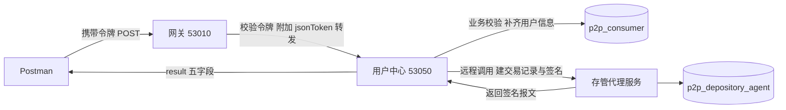
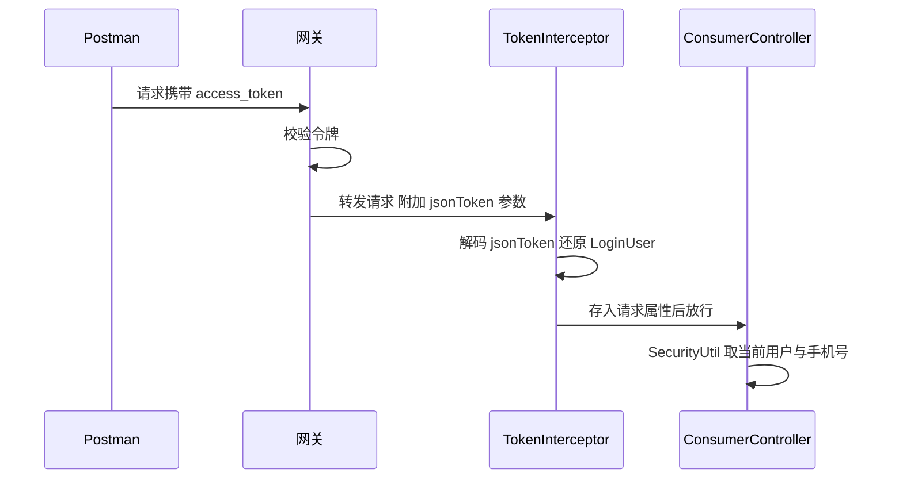

# 开户第一阶段功能测试：两处报错的现场修复、签名报文的验收与历史欠账的归还

生成开户数据的代码全部写完，最容易犯的错觉是「点一下发送就算测过了」。这条接口挂在网关后面，要求携带登录令牌才能访问，测试得把整套微服务都拉起来，按真实调用路径从 Postman 一路打进去。更隐蔽的是，第一阶段代码里有一行 `SecurityUtil.getUser().getMobile()`，它依赖认证拦截那几课埋好的数据传递链路，那部分代码从落地那天起就没被任何业务真正消费过，一直没测。这次开户测试正好把这条欠账一并验收：请求走到 Controller、手机号取到值，就等于这条链路首次跑通。

## 先给结论

- 测试必须过网关：请求发往网关端口并携带登录令牌，网关校验通过才放行转发，缺令牌连用户中心的门都摸不到。
- 两处报错两处修复：`@RequestBody` 注解缺失导致 JSON 报文体没有绑定进参数对象，表现为卡号为空；绑定判断把「与」写成「或」，银行卡不存在时空对象调用方法直接空指针。
- 成功的判据是一份签名报文：`serviceName`、`platformNo`、`reqData`、`signature`、`url` 五个字段齐全，第一阶段才算通过，`url` 留给第二阶段整页跳转。
- 数据核对看两张表：用户中心库的用户信息被补齐，存管代理库的交易记录以「未同步」状态落库。
- 历史欠账顺带还清：网关写入 `jsonToken`、拦截器还原 `LoginUser`、Controller 取手机号，整条数据链路借本次测试完成首次实弹验证。

## 测试前的启动清单与请求形状

**先把船队凑齐，再谈请求。** 这次测试比注册功能的任何一次都重。登录与认证拦截此前已经实现，它们真的会在本次链路里生效：令牌校验发生在网关，校验用的用户信息来自 UAA 与统一账户服务，开户数据最终落在用户中心与存管代理服务。配置中心 Apollo、注册中心、网关、UAA、统一账户服务、用户中心、存管代理服务，一个都不能少，全部起来之后才轮到 Postman 出场。多模块多服务的分布式系统里，测试环境本身就是第一道工程题，服务清单对着时序图数，谁参与这条链路谁就得上场，少起一个，报错都不会指向「服务没启动」，而是指向某个莫名其妙的连接拒绝。

**请求按代码的映射拼出来。** 打开用户中心的 `ConsumerController`，结合时序图找到入口方法，路由映射是 `/my/consumers`，请求方式是 POST，所以 Postman 里地址直接写网关的，端口 53010，路径按网关路由规则补全到用户中心这段映射，将来由网关转发到用户中心。查询参数里加一个 `access_token`，值来自登录接口返回的访问令牌。请求体按 `ConsumerRequest` 的字段挑必要的填：真实姓名、身份证号、银行编码、银行卡号、手机号，以 JSON 格式传输。手机号不能随手编，要从统一账户库里挑一个真实存在的用户，后续认证与业务校验都按它来；身份证号、银行卡号这类要素在第二阶段要接受存管系统核验，本阶段先按占位数据填，报文能不能正确流转才是本课的主角。Controller 入口的形状如下：

```java
@ApiOperation("生成开户请求数据")
@ApiImplicitParam(name = "consumerRequest", value = "开户信息", required = true, dataType = "ConsumerRequest")
@PostMapping("/my/consumers")
public RestResponse<GatewayRequest> createConsumer(@RequestBody ConsumerRequest consumerRequest) {
    // 手机号不信任请求体 以当前登录用户为准 防止冒名开户
    consumerRequest.setMobile(SecurityUtil.getUser().getMobile());
    return consumerService.createConsumer(consumerRequest);
}
```

**手机号为什么取自令牌而不取自请求体。** 前端传来的东西一律不能全信，开户这种资金相关的业务尤其如此。登录用户的手机号在令牌里，Controller 直接从当前登录用户对象上取，请求体里的手机号在开户这件事上没有发言权。这一行代码同时是后面历史欠账的主角，它能不能取到值，取决于整条数据传递链路是否健康。

**登录这一步不能省。** 令牌从哪来？先调登录接口拿访问令牌，把它完整粘贴到 `access_token` 参数里再发开户请求。粘贴时多一个字符少一个字符都会校验失败，这是分布式联调里最常见的低级坑，细心比技巧管用。工具层面用 Postman 而不是前端页面，是刻意的分工：接口层的问题在这一课暴露干净，前后端集成测试留给第二阶段连同跳转一起做，两层各管各的，出了问题不会互相搅局。

## 两处报错的现场与修复

**第一处，卡号为空。** 点击发送，响应回来一个封装的「未知错误」。这类错误提示是系统自定义的，去用户中心的错误码定义里对照，指向的校验是卡号为空。参数明明传了，银行卡号六个 8 端端正正躺在请求体里，怎么会空？顺着代码走：手机号取到了，说明令牌链路没问题；往下走查询银行卡是否绑定时，卡号参数变成了 null。回头看 Controller 方法签名才发现，`@RequestBody` 注解忘了加。没有这个注解，Spring MVC 不会把 JSON 报文体反序列化成 `ConsumerRequest` 对象，请求体里的所有字段都进不来，对象里只有 Controller 手动 set 过的手机号有值。补上注解，重启用户中心服务，再测。

```java
// 缺失 @RequestBody 时方法收不到请求体 反序列化不会发生
public RestResponse<GatewayRequest> createConsumer(ConsumerRequest consumerRequest) {
    // consumerRequest 里只有 Controller 手动 set 的手机号有值 其余字段全空
}
```

**第二处，空指针。** 注解补完再发，卡号六个 8 这回正确进了对象，新的报错接踵而至：空指针。定位到判断银行卡是否已绑定的代码段，查询语句正常拼出并执行，卡号是随手编的，库里当然查不到，查询返回 null，紧接着空对象上调方法，当场翻车。这一段业务校验在业务层里排第一的是「该用户是否已开户」，用手机号查用户，查到即抛已开户错误，挡住重复开户；排第二的才是这张卡是否已被绑定。翻车只是表象，深挖下去还有一个语义错误，原条件把「或」当成了「与」用：

```java
// 修正前 或写法的两个坑 卡不存在时短路失效触发空指针 语义也不成立
if (bankCardDTO != null || bankCardDTO.getStatus() == StatusCode.STATUS_IN.getCode()) {
    throw new BusinessException(ConsumerErrorCode.E_140151);
}

// 修正后 已绑定要求两个条件同时成立
BankCardDTO bankCardDTO = bankCardService.getByCardNumber(consumerRequest.getCardNumber());
if (bankCardDTO != null && bankCardDTO.getStatus() == StatusCode.STATUS_IN.getCode()) {
    throw new BusinessException(ConsumerErrorCode.E_140151);
}
```

**已绑定的语义是两条同时满足。** 银行卡在平台侧存在，只能说明有用户发起过开户并留下了记录；用户完全可能只走了第一阶段就反悔退出，此时卡的信息在表里躺着，状态却还是未同步，银行那边根本没有保存和绑定它。只有「卡存在」且「状态已同步」两个条件同时成立，才能判定这张卡真的被占用了。或写法一来堵死了这类用户的重试之路，二来在卡不存在时让短路机制失效，空对象调用方法直接把线程打崩。改成与写法，两个问题一起消失。改代码必须重启服务才生效，这是 Java 进程的规矩，热部署救不了所有场景，老老实实重启再测，第三次发送，`code 0` 加「成功」的响应回来了。

一段代码连爆两处错误，恰恰说明功能测试不能只测成功路径：参数绑定、判空、条件语义，任何一处疏漏都要靠真实请求逼出来。修的过程也给出一个可复用的定位思路，先确认参数是否按预期进入对象，再看业务校验的条件与数据是否匹配，最后才怀疑框架层。另外短路求值值得单独记一笔：或表达式的右边只在左边为假时才求值，把可能为空的对象访问放在或右边，等于给空指针留了后门；与表达式在左边为假时直接短路，把存在性判断放在前面，对象访问就永远安全。

## 成功报文的形状与两阶段数据核对

**先看报文。** 成功响应的 `result` 里有五个字段，与第一阶段的设计逐一对上：`serviceName` 是请求的存管接口名，个人开户对应 `PERSONAL_REGISTER`；`platformNo` 是平台与存管系统签约时获取的平台编号；`reqData` 是业务数据报文，经过 Base64 编码后呈现为一长串字符；`signature` 是对报文的签名，同样做了编码；`url` 是存管系统开户接口的完整地址，第二阶段前端就往这个地址整页跳转。报文示例（数值均为占位）：

```json
{
  "code": 0,
  "msg": "成功",
  "result": {
    "serviceName": "PERSONAL_REGISTER",
    "platformNo": "example-platform-0001",
    "reqData": "ZUpQQ090eFh3YmN3RT09",
    "signature": "c2lnbmF0dXJlLXNhbXBsZQ==",
    "url": "http://depository.example.com/gateway"
  }
}
```

**报文里的编码不是装饰。** `reqData` 与 `signature` 都经过 Base64 编码，原因是这段数据接下来要走整页跳转，以 URL 参数的形式出现在浏览器地址栏里，原始 JSON 里的花括号、引号、加号这类字符放进 URL 会被转义得面目全非，Base64 把任意字节流转成安全字符集，落地后再解码还原。签名则出自存管代理服务的统一加签：平台编号与密钥参与运算，银行侧验签通过才受理请求，这是与银行对接的信任前提。两个编码动作都发生在存管代理内部，用户中心拿到的已经是成品。

**再查库。** 报文是接口层的证据，数据层还有两处落点要核对。用户中心库 `p2p_consumer` 的 `consumer` 表，该用户此前的真实姓名、银行卡等字段是空的，这次被补齐，用户编号 `user_no` 也一并写入；存管代理库 `p2p_depository_agent` 的 `depository_record` 表新增一条交易记录，`request_no` 是本次开户的请求流水号，`object_id` 外键关联用户的 id，`request_status` 为 0，表示未同步。两条 SQL 就能把证据摆上桌面：

```sql
-- 用户中心侧 用户信息应被补齐
SELECT ID, USERNAME, MOBILE, USER_NO
FROM p2p_consumer.consumer
WHERE MOBILE = '13800000001';

-- 存管代理侧 应有一条未同步的交易记录
SELECT REQUEST_NO, OBJECT_TYPE, OBJECT_ID, REQUEST_STATUS
FROM p2p_depository_agent.depository_record
ORDER BY CREATE_DATE DESC
LIMIT 1;
```

整条测试路径走下来长这样：



关键路径落在用户中心到存管代理这一跳：签名与交易记录都产生在那里，报文五字段是从它的返回值里组装出来的，任何字段缺失都可以回到这段远程调用上查。核对到这里，第一阶段与第二阶段的数据其实已经串起来了：`request_no` 是贯穿三阶段的主线，第一阶段的签名报文、第二阶段的跳转请求、第三阶段的状态更新，全部以它为凭据关联；此刻它带着「未同步」的状态躺在表里，正是在等第二阶段银行侧处理完成后，由异步通知把它翻成「已同步」。中间状态不是缺陷，而是三阶段协作的记账依据。

## 一并归还的历史欠账：微服务怎么拿到当前用户

**欠的究竟是什么。** 认证拦截功能实现时留了一个尾巴：网关解析令牌之后，把明文用户信息转 JSON、Base64 编码，以 `jsonToken` 为键塞进转发请求的查询参数；微服务侧用 Spring MVC 拦截器接住，解码还原成 `LoginUser` 对象放进请求属性。这套代码写完时还没有下游业务消费它，测试一直空着。开户 Controller 里 `SecurityUtil.getUser().getMobile()` 正是它的第一笔真实消费，本次开户测试等于把整条链路实弹验收了一遍。



**两端代码对着看。** 网关侧过滤器在转发请求时把编码后的用户信息塞进查询参数（该过滤器未随资料包归档，代码按本课写法整理）：

```java
// 网关过滤器节选 把明文用户信息编码后写进转发请求
RequestContext ctx = RequestContext.getCurrentContext();
Map<String, List<String>> queryParams = ctx.getRequestQueryParams();
if (queryParams == null) {
    queryParams = new HashMap<>();
}
List<String> values = new ArrayList<>();
values.add(EncryptUtil.encodeUTF8StringBase64(jsonToken));
queryParams.put("jsonToken", values);
ctx.setRequestQueryParams(queryParams);
```

微服务侧拦截器取出并还原，随后放行：

```java
// TokenInterceptor 的 preHandle 节选 键名与网关侧严格一致
String jsonToken = request.getParameter("jsonToken");
if (StringUtils.isNotBlank(jsonToken)) {
    LoginUser loginUser = JSON.parseObject(
            EncryptUtil.decodeUTF8StringBase64(jsonToken), LoginUser.class);
    request.setAttribute("jsonToken", loginUser);
}
return true;
```

键名 `jsonToken` 是跨端契约，网关写入与微服务读取必须用同一个名字，各自发挥就断链。拦截器先于 Controller 执行，Controller 里才能直接从请求属性拿到现成的用户对象。Base64 编解码用的正是公共工具类 `EncryptUtil`，编码解码互为逆操作。这套设计的价值在于取数动作的收拢：一个微服务里三四层 Controller 都可能要当前用户，取参、解码、转对象若各自实现就是成倍重复，拦截器把它们收在一处，业务代码面对的永远是整理好的对象。至此，令牌从登录接口出发，途经网关校验、过滤器递送、拦截器还原，最终落到开户业务的字段上，每个环节都实测过一遍，欠账还清。

## 常见误区

- **把令牌塞进请求体而不是查询参数。** 错例：登录拿到令牌后填进 JSON body，网关校验依旧失败。正解：令牌以 `access_token` 查询参数随 URL 传递，网关按参数取值校验，位置错了网关取不到值。
- **看到 HTTP 200 就当测试通过。** 错例：响应状态永远是 200，业务成败藏在包装对象里。正解：以 `RestResponse` 的 `code` 与 `msg` 为准，业务报错去对应服务的错误码定义里对照具体含义。
- **判断绑定时只看记录是否存在。** 错例：只要表里有这张卡就拒绝开户，把中途放弃用户的重试误杀成重复绑定。正解：存在且状态已同步才算已绑定，两个条件用「与」连接，缺一不可。
- **报错只盯报错那一行。** 错例：空指针出现就对着抛出点改判空，不改语义。正解：先想清楚业务判断本该表达什么，再决定条件结构，让代码语义与业务事实对齐，判空只是附带的安全垫。

## 面试可能被问到的问题

1. 面试官追问：「开户第一阶段为什么要启动这么多服务，能不能绕过网关直连用户中心测？」
   答：不能绕。开户接口是受保护资源，令牌校验收口在网关，绕过网关的请求既没有统一鉴权，也拿不到网关附加的用户信息，Controller 里取不到手机号，业务校验直接失败。测试要按真实调用路径打，跳过的环节迟早变成线上事故。
2. 面试官追问：「Controller 方法漏了 @RequestBody 会有什么现象？」
   答：Spring MVC 不会把请求体的 JSON 反序列化成参数对象，方法拿到的是字段全空的对象，表现为业务层报参数为空。这类问题错在框架层、报在业务层，定位时先确认参数有没有绑定进来，再谈业务逻辑。
3. 面试官追问：「判断银行卡是否已绑定，为什么要求存在与已同步两个条件？」
   答：存在只说明有用户发起过开户并留下记录，用户可能中途放弃，银行侧并未真正绑定；已同步状态才代表银行侧保存完成。只按存在判断会误杀重试，两个条件同时满足才符合业务事实。
4. 面试官追问：「jsonToken 从网关到 Controller 经历了哪些环节，键名起什么作用？」
   答：网关校验令牌后把用户信息转 JSON 并 Base64 编码，以 jsonToken 为键写进转发请求的查询参数；微服务的拦截器取参、解码、反序列化成 LoginUser 存进请求属性再放行；Controller 用工具类从属性取对象。键名是两端共享的契约，写入与读取必须同名。
5. 面试官追问：「第一阶段测试通过的完整判据是什么？」
   答：三层证据。响应层，code 0 且 result 齐含 serviceName、platformNo、reqData、signature、url 五字段；数据层，用户中心补齐用户信息、存管代理落一条未同步交易记录；链路层，url 指向存管系统开户接口，能支撑第二阶段整页跳转。三层齐了才算通过。

## 配套资料

- 讲义：`materials/docs/10/万信金融-第2章-讲义-开户v1.0.md`，3.3 第一阶段生成开户数据的接口定义与功能实现，含 Controller 与业务层校验代码；3.4 第二阶段请求开户，对应签名报文里 `url` 的去向。
- 代码：`materials/code/10/wanxinp2p/`，P2P 工程归档（目录保留原始命名，路径列到该层级），`wanxinp2p-consumer-service` 的用户服务骨架可对照开户入口的位置，`wanxinp2p-common` 的 `EncryptUtil` 是 Base64 编解码的真实实现，`wanxinp2p-gateway-server` 的网关配置可参考。
- 说明：网关写入 `jsonToken` 的过滤器与微服务 `TokenInterceptor` 未在资料包归档，正文代码按本课写法整理；报文示例中的编号与地址均为占位，测试数据请选库中真实存在的 C 端用户，身份证号与银行卡号等要素以数据库与接口文档为准。
