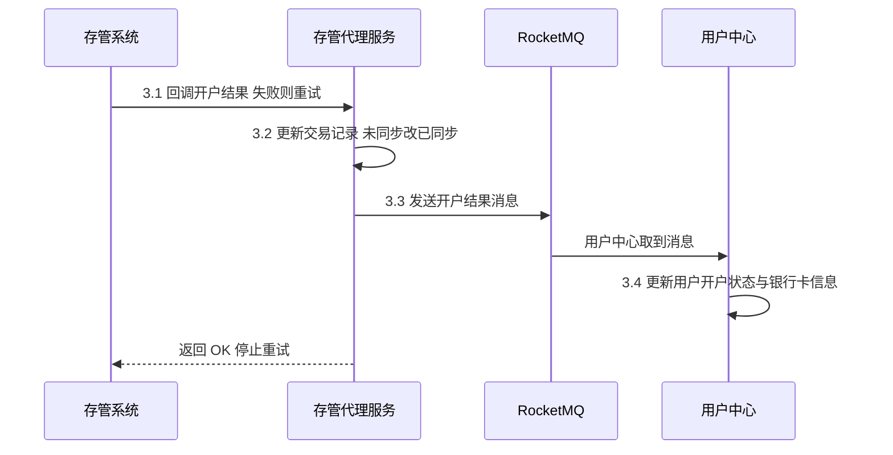

# 开户第三阶段问题分析：成功页之后，异步通知为什么非有不可

前两个阶段全线跑通，用户点「开通存管」，跳银行、确认、提交，最后落到平台的开户成功页，页面上明晃晃写着「完成」。看起来业务已经收官，第三阶段好像没有存在的必要。把这个疑问掰开，恰好能暴露跨机构交互最容易忽视的一层问题：用户看到的结果与平台知道的结果是两回事，两者之间隔着一条不受平台控制的处理链。这一课先不动代码，把问题拆透，下一课的环境与实现才有落点。

## 先给结论

- 银行存管系统与平台是业务上关联、运维上毫不相干的两个系统，银行的处理时长、忙闲波动、响应时的网络状况，平台一概干预不了。
- 两个典型隐患：银行忙时处理排队，用户要干等很久才能见到结果页；银行处理完立即重定向，用户侧网络却中断了，成功页打不开，恢复后也无从得知结果。
- 解法分两层：银行侧按「最大努力通知」的思路回调存管代理并按策略重试，另提供开户结果查询接口兜底；平台侧收到通知后更新交易记录状态，再把结果传给用户中心。
- 存管代理与用户中心之间的传递走 RocketMQ：用户中心是被动方，不知道通知何时会到，消息中间件正好匹配这种「有人发、有人收」的异步关系。
- 第三阶段的动作线是 3.1 回调、3.2 更新交易记录为已同步、3.3 消息通知、3.4 更新用户信息，四步全部由通知驱动。

## 成功页背后的两个隐患

**大背景先立住。** 银行存管系统部署在银行环境，平台对它没有任何管控能力，两边只是业务上产生了联系。银行处理开户要多久、此刻忙不忙、响应重定向时用户网络好不好，这些变量平台既测不到也控不住。第二阶段的演示一切顺利，是因为演示恰好发生在所有变量都友好的时刻，生产环境不会永远这么友好。

**隐患一，银行忙，处理排队。** 平台把请求递过去，银行此刻高负载，要十分钟后才轮到处理这笔开户。用户停在银行确认页之后干什么？同步等待意味着用户盯着页面转圈十分钟，这样的体验在任何产品里都通不过。平台对此毫无办法，因为处理进度完全由银行掌握，轮询银行接口又要把等待成本转嫁给前端，两头都不成立。

**隐患二，响应时网络中断。** 银行处理得飞快，立即响应并重定向到平台成功页，偏偏这时用户网络断了，成功页打不开。过了一会儿网络恢复，可重定向是一次性的动作，恢复后的浏览器回不到那个页面，用户手里只剩一个悬而未决的问题：刚才那笔开户到底成了没有。银行明明处理成功了，用户却拿不到结果，信息在最后一公里断掉。

两个隐患指向同一个事实：开户结果的送达不能依赖用户那条「浏览器在前端等着收响应」的通路，必须有另一条与用户无关的通路把结果告诉平台。

## 解决方案：最大努力通知加查询兜底

**银行侧的职责是尽力送达。** 银行处理完开户，除了给浏览器重定向成功页，还会回调存管代理服务的 Controller，把开户处理结果告知平台。这个回调不指望一次成功：如果回调时代理服务恰好在发版或宕机，通知就失败了，银行不会就此放弃，而是隔一段时间重试，没收到确认就再重试，直到平台正常响应（比如返回一个表示已收到的字符串）或者重试次数达到上限才停止。这正对应分布式事务方案里的「最大努力通知」：发起方尽最大努力把结果递出去，接受方只要活着就一定能收到。

```java
/** 存管代理侧接收回调的接口形状 下一课按此落地 包名按 com.study.finance 系改写 */
@Api(value = "银行存管系统通知服务", tags = "depository-agent")
@RestController
public class DepositoryNotifyController {

    @ApiOperation("接受银行存管系统开户回调结果")
    @RequestMapping(value = "/gateway", method = RequestMethod.GET,
            params = "serviceName=PERSONAL_REGISTER")
    public String receiveDepositoryCreateConsumerResult(
            @RequestParam("serviceName") String serviceName,
            @RequestParam("platformNo") String platformNo,
            @RequestParam("signature") String signature,
            @RequestParam("reqData") String reqData) {
        // 1.更新数据 交易记录状态处理
        // 2.发送消息给用户中心
        // 3.给银行存管系统返回结果
        return "OK";
    }
}
```

接口形状里有三个细节值得提前记住：请求方式是 GET，回调以查询参数传值；`serviceName` 用映射参数限定为 `PERSONAL_REGISTER`，这个 Controller 只服务个人开户这一种通知；返回值是字符串 `OK`，银行看到它就停止重试。银行侧重试与查询的代码属于存管系统成品，平台不用写，但机制必须心里有数。

**查询接口是通知的备胎。** 就算重试撑到上限平台仍然失联，银行还提供一个开户结果查询接口，代理服务恢复后可以拿请求流水号主动查询，把状态补齐。通知与查询互补，两种通路都建立在请求流水号可以唯一定位一笔交易之上，这也是第一阶段建交易记录时坚持生成请求流水号的原因。

**平台侧的职责是被通知驱动。** 通知到达存管代理之后，平台内部还有一条接力链，对应时序图的 3.1 到 3.4：



3.2 是平台侧对事实的记账：交易记录的 `request_status` 从 0 翻成 1，银行处理成功的证据落库；3.4 是用户中心对用户数据的收尾，开户状态与银行卡信息一并更新。承载记账的字段在第一阶段建记录时就已就位：

```java
/** 交易记录关键字段的取值语义 按本课口径整理 */
public class DepositoryRecord {
    private String requestNo;          // 请求流水号 三阶段全程的主线凭据
    private Integer requestStatus;     // 0 未同步 1 已同步 2 处理失败
    private LocalDateTime confirmDate; // 存管侧确认时间 通知到达后回填
}
```

四步的触发源只有通知，没有通知就不动，这正是异步设计「事件驱动」的性格。

## 平台内部的通知为什么要走 RocketMQ

**用户中心是被动方。** 存管代理什么时候会收到银行的通知，取决于银行处理完的时刻与重试节奏，用户中心对此完全无法预知。让用户中心轮询存管代理问「结果到了吗」，问的频率高了浪费资源，低了延迟大，还把两个服务用同步调用拴在一起。被动方接收主动方推送的场景，消息中间件是最贴合的载体：存管代理收到银行通知后往 RocketMQ 发一条消息，用户中心订阅这个主题，消息一到就取走、就更新，双方不互相等待。

用 MQ 还有两个顺带的收益。其一，削峰解耦：银行重试期间如果通知扎堆到达，消息先在队列里排队，用户中心按自己的消费节奏处理，瞬时压力被摊平；其二，天然的重试语义：用户中心消费失败可以返回「稍后重试」，消息会再送，与银行侧的最大努力通知在风格上保持一致。下一课起按「环境到实现」的顺序动工：先搭 RocketMQ 环境与两侧配置，再依次实现存管代理的回调接收、状态更新与消息发送，最后实现用户中心的消息消费与数据更新，把 3.1 到 3.4 逐条落成代码。

## 常见误区

- **把成功页当成开户闭环。** 错例：重定向成功页一出就宣布完成，交易记录状态没人管。正解：成功页只是银行侧处理完毕的用户信号，平台侧状态更新由异步通知驱动，通知到达、状态翻成同步才算闭环。
- **以为回调失败结果就丢了。** 错例：回调时代理服务宕机，便认定开户结果永远到不了平台。正解：银行按策略持续重试直到收到确认或达上限，另附查询接口兜底，结果送达有多重保障，平台要做的是保证回调接口可靠在线。
- **把平台内部通知做成同步调用。** 错例：存管代理收到通知后同步 HTTP 调用户中心，用户中心挂了通知链就断。正解：用户中心是被动方，经消息中间件接收通知，消费失败还能靠消息重试自愈，同步调用把弹性也调没了。
- **忽视 serviceName 这类分流参数。** 错例：回调接口不做接口名限定，把开户、销户、充值的结果都往一个方法里塞。正解：用 `serviceName` 参数映射限定处理范围，每类通知有明确的处理入口，将来扩展业务时按名分流。

## 面试可能被问到的问题

1. 面试官追问：「开户业务里分布式事务的哪个方案落在第三阶段？」
   答：最大努力通知。银行处理完开户后回调存管代理通知结果，通知失败按策略重试，收到平台确认或达到重试上限为止，另提供查询接口兜底。它适合跨机构场景：发起方是银行，接受方是平台，双方都要求最终能拿到结果而不要求强一致。
2. 面试官追问：「为什么用户在银行页等待不如异步通知合理？」
   答：银行处理时长不可控，高峰期排队可能以分钟计，同步等待把银行的处理能力直接转嫁成用户的前端等待；异步通知让用户体验与银行处理解耦，用户先被重定向到结果页或提示页，平台侧等通知到达再更新状态，两边节奏互不拖累。
3. 面试官追问：「存管代理与用户中心之间为什么不用 Feign 同步调用？」
   答：用户中心不知道代理何时收到通知，同步调用要么轮询要么挂起等待，都引入不必要的耦合与资源占用；MQ 场景下代理只管发，用户中心只管收，消费失败还能靠消息重试恢复，双方按自己的节奏工作，故障也被隔离在队列两侧。
4. 面试官追问：「重试一直失败、查询也没做，最终会怎样？」
   答：交易记录停留在未同步状态，用户在平台侧视为未开户，资金层面没有风险；银行侧账户已开立但平台不认。工程上把通知重试与主动查询组合使用，代理恢复后按请求流水号查询补齐状态，最终一致是这类方案的设计目标。
5. 面试官追问：「交易记录的中间状态有什么价值？」
   答：未同步状态如实表达「平台已发起、银行未确认」的事实，是排查跨系统问题的抓手。三阶段流程里，请求流水号加状态字段构成了对账依据，任何一笔开户处在什么阶段、等待谁的动作，都能从这条记录上读出来。

## 配套资料

- 讲义：`materials/docs/10/万信金融-第2章-讲义-开户v1.0.md`，3.5.1 问题分析（银行忙不能很快响应、响应时网络出现问题两个场景），3.5.2 解决方案（回调加重试策略、开户结果查询接口、存管代理与用户中心之间采用 RocketMQ 通知）。
- 代码：`materials/code/10/wanxinp2p/`，P2P 工程归档（目录保留原始命名，路径列到该层级），存管代理服务与用户中心服务的工程位置可对照，第三阶段将落地的 `DepositoryNotifyController` 接口形状出自该讲义 3.5.3.2 节。
- 说明：银行存管系统侧的重试策略与查询接口随存管系统成品提供，未在 `materials/docs/10/` 单独归档，正文按机制描述；回调接口的完整签名与参数定义以讲义 3.5.3.2 与接口说明为准。
