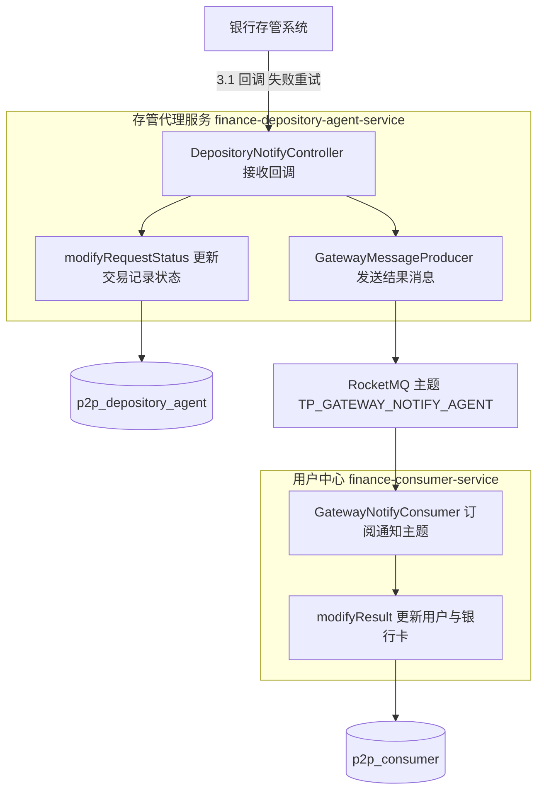

# 开户第三阶段完整实现：搭起 RocketMQ，把银行通知一路落进用户中心

问题拆解完毕，答案已经画在时序图的 3.1 到 3.4 上：银行回调存管代理，代理把交易记录翻成已同步，再把结果经 RocketMQ 递给用户中心，用户中心更新用户与银行卡数据。这一课把整条链路从环境到代码全部落地，涉及两个服务、一个中间件、三个配置面，信息量大，主线却只有一条：存管代理接住通知，用户中心消费通知，数据跟着消息走。

## 先给结论

- 环境三件事：装好 RocketMQ 并配 JAVA_HOME 与 ROCKETMQ_HOME，启动 NameServer 与 Broker，跑起 60000 端口的图形控制台；autoCreateTopicEnable 参数为测试期免建主题提供便利。
- 配置唯一新增点：Apollo 上给用户中心加消费者组 `rocketmq.consumer.group = CID_P2P_GATEWAY_NOTIFY`，name-server 地址与生产者组沿用已有配置，两侧 application.yml 必须引入 `micro_service.spring-rocketmq` 名称空间。
- 存管代理侧三步：`DepositoryNotifyController` 接回调并返回 OK；`modifyRequestStatus` 按流水号把交易记录状态更新为已同步；`GatewayMessageProducer` 把结果发往主题 `TP_GATEWAY_NOTIFY_AGENT`、标签 `PERSONAL_REGISTER`。
- 用户中心侧三步：`modifyResult` 按 `respCode` 判定成败并更新用户与银行卡两张表；`GatewayNotifyConsumer` 手动构建 `DefaultMQPushConsumer` 订阅通知主题；监听器按标签分流，失败返回 `RECONSUME_LATER` 交给消息重试。
- 联调两个易漏点：银行存管系统里两处发送通知的代码此前为演示第二阶段被注释，测试前要恢复；构造方法里要用配置值时 `@Value` 必须挪到构造参数上。

## 全景与任务拆解

动手前把地图铺开。第三阶段的代码全部集中在平台侧两个服务里，银行侧的重试与查询属于存管系统成品：



图上两行任务清单也就是编码顺序：先让 RocketMQ 活起来，再做存管代理的三步，最后做用户中心的三步，联调收尾。消息体 `DepositoryConsumerResponse` 定义在 api 工程的 model 包里，两侧共用同一份类，字段沿用存管侧返回结构：返回码 `respCode`、描述 `respMsg`、交易状态 `status`、请求流水号 `requestNo`，开户结果再补银行代码 `bankCode` 与银行名称 `bankName`。字段清单看着平平无奇，实际是两侧协作的全部接口：流水号换用户、交易状态记账、返回码判成败、银行信息补卡表，每一个字段在下游都有一个明确的消费者，消息体的设计以「下游要用什么」为准，而不是「上游有什么」。

## 搭建 RocketMQ 环境

**先把中间件跑起来。** RocketMQ 的安装与配置此前讲过，环境变量要配 `JAVA_HOME` 与 `ROCKETMQ_HOME` 两个，漏配任何一个启动脚本都会直接报错。安装目录的 bin 下执行三条命令：第一条起 NameServer，它是路由注册与查询的中枢，所有角色都从它拿地址；第二条起 Broker 并指定 NameServer 地址与端口 9876，`autoCreateTopicEnable=true` 让主题自动创建，测试期免去手动建主题的环节；第三条用资料包提供的控制台 jar 起一个图形界面，方便观察集群、主题、消费者与消息的运行状况。三条命令放进一个批处理文件，双击一次全部拉起：

```bash
# 在 RocketMQ 安装目录的 bin 下执行 先配好 JAVA_HOME 与 ROCKETMQ_HOME
start mqnamesrv.cmd
start mqbroker.cmd -n 127.0.0.1:9876 autoCreateTopicEnable=true
# 图形化控制台 jar 随课程资料提供 独立端口 60000
java -jar rocketmq-console-ng-1.0.1.jar --server.port=60000 --rocketmq.config.namesrvAddr=127.0.0.1:9876
```

**依赖与配置两头检查。** 接入 RocketMQ 的只有两个服务：发送方存管代理，接收方用户中心。先查 pom：用户中心的 `rocketmq-spring-boot-starter` 已经在，存管代理没有，补上同款依赖：

```xml
<!-- 存管代理服务补加 用户中心已有同款 -->
<dependency>
    <groupId>org.apache.rocketmq</groupId>
    <artifactId>rocketmq-spring-boot-starter</artifactId>
</dependency>
```

再查 Apollo。用户中心的应用级配置里，NameServer 地址（本机 9876）与生产者组此前已配好，不用动；按讲义口径，唯一的新增项是消费者组名，提交后记得发布：

```properties
# Apollo 用户中心 consumer-service 应用级新增
rocketmq.consumer.group = CID_P2P_GATEWAY_NOTIFY
# 无需改动的既有配置 以 Apollo 实际为准
rocketmq.name-server = 127.0.0.1:9876
```

存管代理侧检查它有没有关联 MQ 的公共名称空间，没有就添加，应用内两个既有配置同样不需要改。配置层还剩最后一处容易栽跟头：工程本地 `application.yml` 的 `apollo.bootstrap.namespaces` 清单里必须引入 `micro_service.spring-rocketmq`，漏引的话 Apollo 上的 MQ 配置根本加载不进来，启动时表现为读不到 name-server。资料归档里用户中心的配置文件可以对照（目录保留原始命名）：

```yaml
# 用户中心 application.yml 节选 名称空间清单以工程实际为准
apollo:
  bootstrap:
    namespaces: application,micro_service.spring-boot-druid,micro_service.spring-boot-http,
      micro_service.mybatis-plus,micro_service.spring-rocketmq
```

配置全部就位，把用户中心与存管代理两个服务重启，观察启动日志没有报错，MQ 环境宣告搭建完成。

## 存管代理侧：接住回调的三步

**第一步，把回调的门面立起来。** 在存管代理服务单独新建 `DepositoryNotifyController`，它只为一件事服务：接收银行存管系统的开户结果回调。方法返回值必须有，银行靠这个返回值判断是否停止重试；参数有四个，回调以 GET 请求把结果装在查询参数里传过来：

```java
@Api(value = "银行存管系统通知服务", tags = "depository-agent")
@RestController
public class DepositoryNotifyController {

    @ApiOperation("接受银行存管系统开户回调结果")
    @ApiImplicitParams({
        @ApiImplicitParam(name = "serviceName", value = "请求的存管接口名",
                required = true, dataType = "String", paramType = "query"),
        @ApiImplicitParam(name = "platformNo", value = "平台编号，平台与存管系统签约时获取",
                required = true, dataType = "String", paramType = "query"),
        @ApiImplicitParam(name = "signature", value = "对reqData参数的签名",
                required = true, dataType = "String", paramType = "query"),
        @ApiImplicitParam(name = "reqData", value = "业务数据报文，json格式",
                required = true, dataType = "String", paramType = "query")
    })
    @RequestMapping(value = "/gateway", method = RequestMethod.GET,
            params = "serviceName=PERSONAL_REGISTER")
    public String receiveDepositoryCreateConsumerResult(
            @RequestParam("serviceName") String serviceName,
            @RequestParam("platformNo") String platformNo,
            @RequestParam("signature") String signature,
            @RequestParam("reqData") String reqData) {
        // 1.更新数据
        // 2.发送消息给用户中心
        // 3.给银行存管系统返回结果
        return "OK";
    }
}
```

`params = "serviceName=PERSONAL_REGISTER"` 是请求映射的细粒度限定：只有带上这个参数值的 GET 请求才会映射到这个方法，个人开户的通知有了专属入口，将来销户、充值各类通知可以按同样的套路各自开门。

**第二步，按流水号更新交易记录状态。** 更新动作放业务层，`DepositoryRecordService` 新增 `modifyRequestStatus`。两个参数一个返回值：流水号定位行，状态承载新值，Boolean 告诉调用方更新成败。交易记录的 `request_status` 有三个取值，0 未同步、1 已同步、2 处理失败，银行处理成功回传 1，失败回传 2，状态值直接透传即可。Mybatis-Plus 的 update 要带条件就要装一个 Wrapper，这里用 `Wrappers` 工具类的 `lambdaUpdate` 写法：

```java
/**
 * 根据请求流水号更新请求状态
 * @param requestNo     请求流水号
 * @param requestStatus 状态 1 已同步 2 处理失败
 * @return 更新是否成功
 */
Boolean modifyRequestStatus(String requestNo, Integer requestStatus);
```

```java
@Override
public Boolean modifyRequestStatus(String requestNo, Integer requestStatus) {
    return update(Wrappers.<DepositoryRecord>lambdaUpdate()
            .eq(DepositoryRecord::getRequestNo, requestNo)
            .set(DepositoryRecord::getRequestStatus, requestStatus)
            .set(DepositoryRecord::getConfirmDate, LocalDateTime.now()));
}
```

`Wrappers.lambdaUpdate()` 直接返回 `LambdaUpdateWrapper`，等价于先 new 一个 Wrapper 再链式设置，但省掉了对象创建的样板行，`eq` 挂条件、`set` 挂新值，与条件构造器的常规用法完全同构，只是不必每次重复书写实体类泛型的 new。顺带把确认时间一并更新，这笔交易何时被银行确认，落库时留下记录。

**第三步，把结果发出去。** 新建 message 包与生产者类，注入 Spring Boot 封装好的 `RocketMQTemplate`，一个方法完成发送：

```java
/** 存管代理服务异步通知消息生产者 */
@Component
public class GatewayMessageProducer {

    @Resource
    private RocketMQTemplate rocketMQTemplate;

    /** 个人开户结果通知 目的地写法为 topic:tag */
    public void personalRegister(DepositoryConsumerResponse response) {
        rocketMQTemplate.convertAndSend("TP_GATEWAY_NOTIFY_AGENT:PERSONAL_REGISTER", response);
    }
}
```

`convertAndSend` 的第一个参数是目的地，冒号前是主题、冒号后是标签，标签是对主题的细分，一条主题上将来会跑开户、销户、充值多种消息，靠标签分类。目的地字符串与消费端严格对应，改一边就断链。消息体就是银行回调带来的那个响应对象，字段里流水号、交易状态、银行信息一应俱全，用户中心要用什么就带什么。

**把三步串成方法体。** 回调参数里的 `reqData` 是 Base64 编码过的 JSON 报文，先解码再反序列化，两步用公共工具类与 JSON 库完成，随后按部就班调用前两步的实现：

```java
public String receiveDepositoryCreateConsumerResult(
        @RequestParam("serviceName") String serviceName,
        @RequestParam("platformNo") String platformNo,
        @RequestParam("signature") String signature,
        @RequestParam("reqData") String reqData) {
    // 1.更新数据 解码报文并反序列化 按流水号更新交易记录状态
    DepositoryConsumerResponse response = JSON.parseObject(
            EncryptUtil.decodeUTF8StringBase64(reqData), DepositoryConsumerResponse.class);
    depositoryRecordService.modifyRequestStatus(response.getRequestNo(), response.getStatus());
    // 2.发送消息给用户中心
    gatewayMessageProducer.personalRegister(response);
    // 3.给银行存管系统返回结果
    return "OK";
}
```

存管代理侧到此收官：收到通知、记账、传话、回执，四个动作一个不多一个不少。

## 用户中心侧：消费通知的三步

**业务层先准备好账本更新。** 用户中心收到消息后要更新两处数据，动作封装在 `ConsumerService` 新增的 `modifyResult` 里。成败判定看返回码：存管侧约定返回码 `00000` 表示处理成功，映射成平台侧「已开户」的状态值，其余映射成失败；消息体里没有用户 id，只有请求流水号，先用流水号把用户查出来换出 id，再分别更新用户表与银行卡表：

```java
@Override
@Transactional
public Boolean modifyResult(DepositoryConsumerResponse response) {
    // 1.获取状态 返回码 00000 表示存管侧处理成功
    int status = DepositoryReturnCode.RETURN_CODE_00000.getCode()
            .equals(response.getRespCode())
            ? StatusCode.STATUS_IN.getCode() : StatusCode.STATUS_FAIL.getCode();
    // 2.更新开户结果 消息体没有用户 id 先按流水号换出用户
    Consumer consumer = getByRequestNo(response.getRequestNo());
    update(Wrappers.<Consumer>lambdaUpdate()
            .eq(Consumer::getId, consumer.getId())
            .set(Consumer::getIsBindCard, status)
            .set(Consumer::getStatus, status));
    // 3.更新银行卡信息
    return bankCardService.update(Wrappers.<BankCard>lambdaUpdate()
            .eq(BankCard::getConsumerId, consumer.getId())
            .set(BankCard::getStatus, status)
            .set(BankCard::getBankCode, response.getBankCode())
            .set(BankCard::getBankName, response.getBankName()));
}

private Consumer getByRequestNo(String requestNo) {
    return getOne(Wrappers.<Consumer>lambdaQuery().eq(Consumer::getRequestNo, requestNo));
}
```

方法上加 `@Transactional` 是必须的：用户表与银行卡表两处更新必须同生共死，卡信息更新失败时用户状态不能先翻过去。是否绑定卡这个字段是开户与否的业务判据，此处一旦置为已开户，用户的资金业务通道就打开了。

**消费端手动构建消费者。** 用户中心在 message 包新建 `GatewayNotifyConsumer`。与发送方的模板对象不同，接收方这一课直接用 RocketMQ 的原生客户端构建：构造方法里 new 出 `DefaultMQPushConsumer`，把 Apollo 上的消费者组、NameServer 地址依次设进去，消费位置选 `CONSUME_FROM_LAST_OFFSET` 表示只消费本次启动之后的新消息，订阅主题 `TP_GATEWAY_NOTIFY_AGENT`、标签用星号通配：

```java
@Component
public class GatewayNotifyConsumer {

    @Value("${rocketmq.consumer.group}")
    private String consumerGroup;
    @Value("${rocketmq.name-server}")
    private String nameServer;
    @Autowired
    private ConsumerService consumerService;

    public GatewayNotifyConsumer() throws MQClientException {
        DefaultMQPushConsumer consumer = new DefaultMQPushConsumer(consumerGroup);
        consumer.setNamesrvAddr(nameServer);
        // 从最后一条开始消费 只关心本次启动之后的通知
        consumer.setConsumeFromWhere(ConsumeFromWhere.CONSUME_FROM_LAST_OFFSET);
        // 订阅通知主题 tag 通配全部接收 在监听器里按标签分流
        consumer.subscribe("TP_GATEWAY_NOTIFY_AGENT", "*");
        // 注册并发消费监听器
        consumer.registerMessageListener(new MessageListenerConcurrently() {
            @Override
            public ConsumeConcurrentlyStatus consumeMessage(
                    List<MessageExt> msgs, ConsumeConcurrentlyContext context) {
                try {
                    MessageExt message = msgs.get(0);
                    String topic = message.getTopic();
                    String tag = message.getTags();
                    String body = new String(message.getBody(), StandardCharsets.UTF_8);
                    // 按标签分流 开户走开户的更新 销户充值提现将来在此扩展
                    if (tag.equals("PERSONAL_REGISTER")) {
                        DepositoryConsumerResponse response =
                                JSON.parseObject(body, DepositoryConsumerResponse.class);
                        consumerService.modifyResult(response);
                    }
                } catch (Exception e) {
                    // 处理失败 稍后重试 消息会重新投递
                    return ConsumeConcurrentlyStatus.RECONSUME_LATER;
                }
                return ConsumeConcurrentlyStatus.CONSUME_SUCCESS;
            }
        });
        consumer.start();
    }
}
```

**标签通配与分流是一对搭档。** 订阅时写星号，意味着这个消费者把该主题下所有标签的消息都接住，接住之后再在监听器里按标签分流：开户的标签走开户的状态更新，将来销户、充值、提现的通知到达时，在判断分支里续写各自的业务即可，消费端类不用推倒重来。标签值两端共用同一个常量最稳妥，手写字符串容易写错且编译器帮不上忙。

**返回值是消费端的事务语言。** 监听器返回 `CONSUME_SUCCESS` 表示这批消息处理完成，RocketMQ 从此不再投递；返回 `RECONSUME_LATER` 表示本次没处理成，消息会按重试策略稍后再送，最多若干次后进入死信主题留人处理。整个方法体套 try-catch，任何一步解析失败、更新失败都以重试收场，业务落库成功才给成功回执，消息可靠性语义就压在这两个返回值上。Push 消费的字面意思是「推过来」，实际机制仍是客户端长轮询拉取后回调监听器，框架把取消息的活包圆了，业务只需要关心「拿到消息做什么、成功失败怎么答」，这正是 Push 模式对业务层最友好的地方。

**构造方法里取配置值的坑。** 上面代码里 `@Value` 标在字段上，但构造方法执行时字段注入还没有发生，`consumerGroup` 与 `nameServer` 都是 null，new 出来的消费者组名就成了空串。讲义给的改法是把 `@Value` 挪到构造方法参数上，让 Spring 在调用构造方法时就把值传进来：

```java
// 修正后的构造方法 配置值经构造参数注入
public GatewayNotifyConsumer(
        @Value("${rocketmq.consumer.group}") String consumerGroup,
        @Value("${rocketmq.name-server}") String nameServer) throws MQClientException {
    DefaultMQPushConsumer consumer = new DefaultMQPushConsumer(consumerGroup);
    consumer.setNamesrvAddr(nameServer);
    // 其余设置同前
}
```

字段上的两个 `@Value` 声明随之删除，避免两处赋值互相干扰。这是构造器注入与字段注入时序差异的典型案例：字段注入发生在对象构造完成之后。

## 联调测试与数据核对

**恢复银行侧的通知出口。** 测试前有一件容易忘的事：为了让第二阶段能演示出成功页，银行存管系统的 `UserServiceImpl` 里两处处理完业务后发送通知的代码被注释掉了，现在要把它们恢复，否则银行永远不回调，平台侧的状态永远不翻。

**启动清单拉满。** RocketMQ 与控制台、Apollo、银行存管系统、平台全部微服务、前端工程，依次启动。为了免受历史数据干扰，讲义附带了测试用户脚本，往用户中心库与统一账户库各插几个新用户，密码即手机号（账号数据已做占位处理）：

```sql
-- 讲义提供的测试用户脚本 账号已做占位 密码即手机号
USE p2p_consumer;
INSERT INTO consumer (ID, USERNAME, MOBILE, IS_BIND_CARD) VALUES
(1001, '13800000001', '13800000001', 0),
(1002, '13800000002', '13800000002', 0);

USE p2p_account;
INSERT INTO account (ID, USERNAME, MOBILE, PASSWORD, DOMAIN) VALUES
(2001, '13800000001', '13800000001', 'example-pwd-hash-0001', 'c'),
(2002, '13800000002', '13800000002', 'example-pwd-hash-0002', 'c');
```

**全链路实测一遍。** 前端登录新用户，点「开通存管」，挑银行侧库里成套的要素走完第二阶段，提交确认。这一刻起链路进入第三阶段：银行处理完回调存管代理，代理更新交易记录并发消息，用户中心收到消息更新两张表。核对清单四条，每条对应一处落库：

| 核对点 | 位置 | 通过判据 |
|---|---|---|
| 交易记录状态 | `p2p_depository_agent.depository_record` | `request_status` 由 0 翻成 1，`confirm_date` 更新 |
| 用户开户状态 | `p2p_consumer.consumer` | `is_bind_card` 与 `status` 更新为已开户 |
| 银行卡信息 | `p2p_consumer` 的银行卡表 | `status` 更新，`bank_code` 与 `bank_name` 补齐 |
| 消息轨迹 | RocketMQ 控制台 | 主题下能看到消息与消费组轨迹 |

四条全中，第三阶段宣告闭环：用户看到成功页的同时，平台侧的状态、用户的开户标志、银行卡的归属信息全部就位，三阶段的账本在两侧完全对齐。

## 常见误区

- **字段 `@Value` 配构造方法直接用。** 错例：字段上标 `@Value`，构造方法里立刻拿它 new 消费者，组名是 null，启动报订阅组无效。正解：把 `@Value` 挪到构造方法参数上做构造器注入，构造执行时值已经到位。
- **把目的地当两个参数传。** 错例：发送时写 `convertAndSend(topic, tag, body)` 一类想当然的重载，消息发到不存在的目的地。正解：目的地字符串按 `topic:tag` 写在一个参数里，两端共用同一常量，杜绝拼写漂移。
- **忘记恢复银行侧被注释的通知代码。** 错例：联调时状态永远不翻，排查平台侧半天，问题在存管系统里。正解：测试前核对银行侧通知出口已恢复，第二阶段演示用的注释只是临时手段。
- **消费成功也返回重试。** 错例：监听器一律返回 `RECONSUME_LATER` 图省事，消息被反复重投甚至进死信。正解：成功返回 `CONSUME_SUCCESS`，仅异常路径返回 `RECONSUME_LATER`，把重试语义留给真正失败的场景。
- **漏掉 Base64 解码直接解析报文。** 错例：拿到 `reqData` 就 `JSON.parseObject`，编码串解析必然失败。正解：先 `decodeUTF8StringBase64` 还原 JSON，再反序列化，编码解码要成对出现。

## 面试可能被问到的问题

1. 面试官追问：「为什么手动 new DefaultMQPushConsumer 而不用 starter 的注解监听？」
   答：starter 提供 `@RocketMQMessageListener` 注解式消费，足够常规场景；手动构建的优势是对消费者组、消费位置、订阅表达式等参数有完全控制权，教学与排查时每一项设置都显式可见。两种方式最终都落到同一个原生客户端上，理解了手动构建，注解背后的行为就全部透明。
2. 面试官追问：「CONSUME_FROM_LAST_OFFSET 意味着什么，有什么风险？」
   答：消费者按队列尾部开始消费，服务停机期间产生的消息不会被补收。适合本场景的是「通知只对最新状态有意义」，错过历史通知可以靠查询接口兜底；若业务要求不丢消息，应选 CONSUME_FROM_LAST_OFFSET 之外的策略并配合持久化位点管理。
3. 面试官追问：「RECONSUME_LATER 的重试机制是怎么运转的？」
   答：返回该状态的消息进入重试队列，按延迟级别逐次重投，重试次数递增、间隔拉长，超过上限后进入死信主题等待人工处理。消费端把它当作业务失败的标准应答，配合幂等设计可以做到失败必达且不重复生效。
4. 面试官追问：「回调接口为什么用 GET 并用参数限定映射？」
   答：GET 与查询参数是银行侧回调的既定协议，`params = "serviceName=PERSONAL_REGISTER"` 让一个 Controller 精确服务一类通知，映射层就完成了分流。将来销户、充值的通知各自有接口名，同样的模式再加一个方法即可，互不干扰。
5. 面试官追问：「modifyResult 里为什么先按流水号查用户再更新？」
   答：消息体由存管侧报文结构决定，携带的是请求流水号而不是用户 id；流水号在第一阶段开户请求时已经写入用户表，用它反查是唯一可靠的关联路径。查询与两处更新包在同一个本地事务里，保证用户状态与银行卡状态同生共死。
6. 面试官追问：「这条链路的消息会重复消费吗，怎么兜底？」
   答：会。银行重试回调、消息重投、消费端重启都可能造成重复。兜底靠状态的幂等性：更新动作以流水号为条件设置固定目标值，重复执行结果不变；业务上还可以先查交易记录状态再决定是否更新，把幂等做成显式判断。

## 配套资料

- 讲义：`materials/docs/10/万信金融-第2章-讲义-开户v1.0.md`，3.5.3 功能实现：3.5.3.1 RocketMQ 环境搭建（启动命令、pom 依赖、Apollo 配置、名称空间检查），3.5.3.2 存管代理服务（`DepositoryNotifyController`、`modifyRequestStatus`、消息生产者），3.5.3.3 用户中心服务（`modifyResult`、`GatewayNotifyConsumer`）；3.5.4 功能测试（银行侧注释恢复、启动清单、测试用户 SQL、构造方法注入改法）。
- 代码：`materials/code/10/rocketmq-all-4.5.0-bin-release/`，RocketMQ 4.5.0 发行包（bin 目录即启动脚本所在）；`materials/code/10/rocketmq-console/`，监控控制台源码工程；`materials/code/10/wanxinp2p_apollo/`，Apollo 接入版工程归档（目录保留原始命名），其用户中心 `application.yml` 含 `micro_service.spring-rocketmq` 名称空间的真实清单；`materials/code/10/wanxinp2p/`，P2P 工程归档（目录保留原始命名，路径列到该层级）。
- 说明：消息体 `DepositoryConsumerResponse` 与返回码、状态枚举按讲义口径整理，包名按 `com.study.finance` 系改写；测试用户 SQL 中的手机号与密码散列均为占位，实际以讲义附带脚本为准；RocketMQ 控制台 jar 随课程资料提供，未单独归档于 `materials/docs/10/`。
