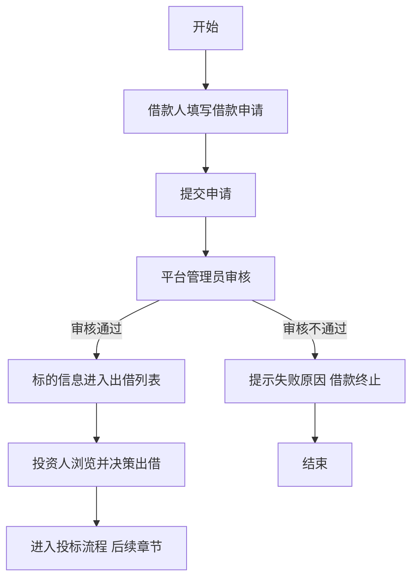
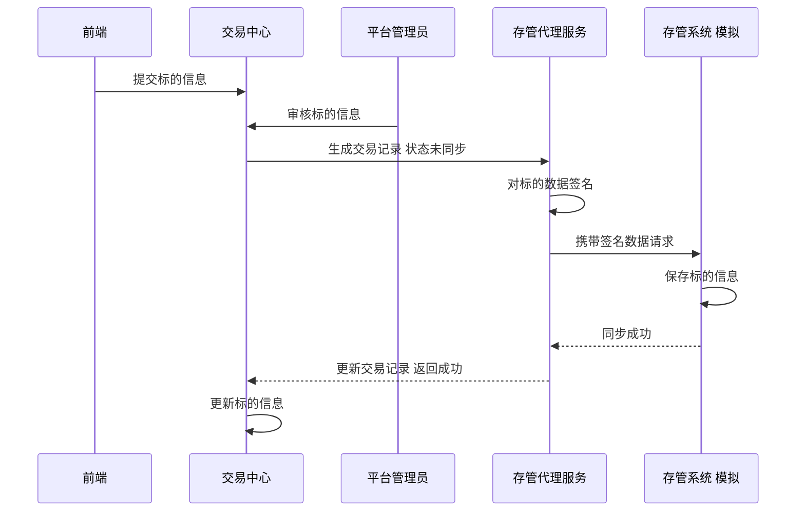

# 发标需求分析：P2P 交易的第一步，借款人申请借款怎么拆

开户业务全部收官，第二章落幕，第三章进入整个项目真正的主战场：交易。P2P 平台的本质是一人借钱、一人投钱，交易的第一步不是投钱，而是有人先把借钱这件事发出来，这就是发标。动工前照例把需求掰清楚：什么是标的、谁发起申请、申请之后经历什么、背后牵动哪些服务。

## 先给结论

- 标的（简称标）是借款人在平台发起的借款项目，发标就是借款人在平台申请借款，发起方永远是借款人，投资人的对应动作叫投标。
- 一个标的最少包含六项要素：描述、借款用途、借款总额、还款方式、借款利率、借款期限。
- 业务主线三段：借款人填申请并提交，平台管理员审核，审核通过后标的信息进入前端出借列表供投资人挑选。
- 系统交互与开户第一阶段同构：交易中心请求存管代理生成交易记录（未同步）并签名，存管代理携带签名数据请求存管系统，同步成功后逐级回传更新。
- 新登场的微服务是交易中心，存管代理与存管系统（模拟）复用开户沉淀下来的那套。

## 标的与发标：先统一语言

P2P 行业把平台里的一个投资项目称为标的，简称标。对投资人来说，所谓投资项目，本质是某个具体的人要借钱：有人要借七万，有人要借三万，每个借款申请就是一个可供出借的项目，页面上四条借款信息就是四个标。一个标的通常至少带着六项信息：描述、借款用途、借款总额、还款方式、借款利率、借款期限。借款用途回答「为什么借」，如日常消费、购物、生意周转；利率与期限直接决定投资人的收益与资金占用，是列表里最抢眼的两个数字。

发标与投标是一对动作，分属两端：借款人发起借款叫发标，投资人把钱出借给某个标叫投标。第三章先做借款人这一侧，投资与出借流程在后面的章节展开。借款人侧的入口是一个借款申请页：选择借款金额（如三万）、选择期限（十二、二十四、三十六个月）、填写借款用途、勾选协议后点击申请，这一下动作就是发标，申请一旦受理，一个标的就诞生了。

## 业务主线：申请、审核、上架

发标不是填完表单就完事，平台在中间横着一道审核。没有这道关，任何人想借多少就发多少，风险无人把守。这条主线走下来是这样的：



关键分叉在管理员审核这一步：不过审则借款终止并给出原因，过审则标的信息立刻出现在前端出借列表（如新标专区），投资人按自己的判断决定要不要出借。审核在行业里有个专业名词叫风控：未满十八周岁不放款，高龄申请人要警惕，身份证等资料要核验，必要时延伸到社保、公积金等个人信息的核查。风控是平台管理端的一项功能，与借款人侧、投资人侧并列，都是后续要开发的范围。

## 系统视角：一条与开户同构的链路

需求层面的交互流程有八步，逐条过：借款人在前端填写借款信息；前端请求交易中心保存标的信息；管理员审核标的信息；交易中心请求存管代理服务生成交易记录（未同步），并对标的数据进行签名；存管代理服务携带标的签名数据请求银行存管系统；存管系统保存标的信息，返回同步成功给存管代理；存管代理更新交易记录，返回同步成功给交易中心；交易中心确认同步成功，更新标的信息。这张图在讲这八步落在哪些服务上：



关键路径与开户第一阶段如出一辙：交易记录先落「未同步」，数据经签名后才出平台，存管侧确认成功再逐级回传。区别只在业务实体与两端角色，开户的入口是用户中心，发标的入口换成了交易中心，这是第三章新增的一个微服务，工程按本课口径记作 `finance-transaction-service`；存管代理服务与存管系统（模拟）原样复用，签名规则、报文规范、交易记录表一概沿用开户时打下的地基。这也解释了为什么开户业务要先把存管对接打磨好：同一套通道，换一种业务数据就能跑。

接口先行，交易中心在 API 工程新建 `transaction` 包，定义发标入口：

```java
/** 交易中心服务 API 按讲义接口定义口径整理 包名按 com.study.finance 系改写 */
public interface TransactionApi {

    /** 借款人发标 */
    @ApiOperation("借款人发标")
    @ApiImplicitParam(name = "project", value = "标的信息", required = true,
            dataType = "Project", paramType = "body")
    @PostMapping("/my/projects")
    RestResponse<ProjectDTO> createProject(ProjectDTO projectDTO);
}
```

与开户的 `createConsumer` 对照着看：入参从开户要素换成标的要素（`ProjectDTO`），路径从 `/my/consumers` 换成 `/my/projects`，返回值依旧是 `RestResponse` 包住的 DTO。配套的 `TransactionController`、`ProjectMapper`、`ProjectService` 等一串骨架也已在讲义的接口定义里点名，具体实现留到下一课展开。管理员审核功能的接口与页面则在管理端一侧，属于平台管理功能的范围。

## 常见误区

- **把发标当成投资人的动作。** 错例：以为出借人在列表里「发起」了标的。正解：标的是借款人发起的借款项目，发标发生在借款人申请借款时，投资人在列表里做的是投标决策。
- **以为申请提交即借款成功。** 错例：借款人点完申请就认为钱到手了。正解：提交后等待审核，过审才上架出借列表，还要等投资人出借、满标放款，借款资金到位是后面多个环节之后的事。
- **把审核当成可有可无的展示环节。** 错例：实现时跳过审核直接让标的上架。正解：审核即风控，年龄、资料、信用信息的核验都发生在这一步，是平台合规与风险控制的核心闸门。
- **以为发标只涉及平台自己的库。** 错例：交易中心落一张标的表就算完成。正解：标的信息要经存管代理签名后同步到存管系统，交易记录同步状态贯穿全程，与银行侧数据一致才算闭环。

## 面试可能被问到的问题

1. 面试官追问：「什么是标的？发标和投标分别是谁的动作？」
   答：标的是借款人在平台发起的借款项目，至少含描述、借款用途、借款总额、还款方式、借款利率、借款期限六要素。发标是借款人侧的动作，即申请借款；投标是投资人侧的动作，即对一个已上架的标出借资金。
2. 面试官追问：「发标为什么必须经过平台审核？」
   答：审核就是风控。平台要拦住未成年、资料造假、信用不良的申请人，核验身份证件乃至社保公积金信息，控制资产端质量。放任自由发标，坏账风险直接转嫁给投资人，平台也触碰合规红线。
3. 面试官追问：「发标的系统链路与开户第一阶段有哪些同构点？」
   答：都是平台侧业务服务发起，先在存管代理落一条未同步的交易记录，再对业务数据 JSON 序列化并 RSA 签名，报文发往存管系统，存管确认后逐级回传更新状态。差别仅在业务实体与入口服务，通道、签名、交易记录表全部复用。
4. 面试官追问：「交易中心为什么要请求存管代理同步标的信息，平台自己存不行吗？」
   答：银行存管模式下资金与交易要素要在银行侧留底，标的是放款与回款计算的业务依据，只在平台侧存，账实无法对齐。经代理同步能统一签名与报文规则，交易记录的未同步状态还天然承担了「对账凭据」的角色。
5. 面试官追问：「管理员审核通过这个状态，前端是怎么感知到的？」
   答：审核动作在管理端落库，标的状态随之变更；借款人前端看到的是审核结果提示，投资人前端在出借列表按状态过滤查询。本质是同一份标的数据在不同端按状态与角色裁剪视图，不需要额外推送。

## 配套资料

- 讲义：`materials/docs/10/万信金融-第3章-讲义-发标v1.0.md`，1.1 什么是发标：标的定义与六要素；1.2 业务流程：申请、审核、上架主线；3.1 需求分析：八步系统交互流程；3.2.1 定义接口：`TransactionApi` 与 `createProject` 的出处。
- 代码：`materials/code/10/wanxinp2p/`，P2P 工程归档（目录保留原始命名，路径只列到该层级），可对照 API 工程结构与包组织方式，交易中心工程随课程资料单独提供。
- 说明：`TransactionApi` 代码块按讲义接口定义口径整理，包名与工程名按 `com.study.finance` 系改写；`ProjectDTO` 字段以下一课实现与接口说明为准。
