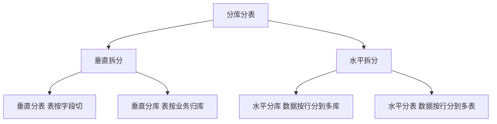
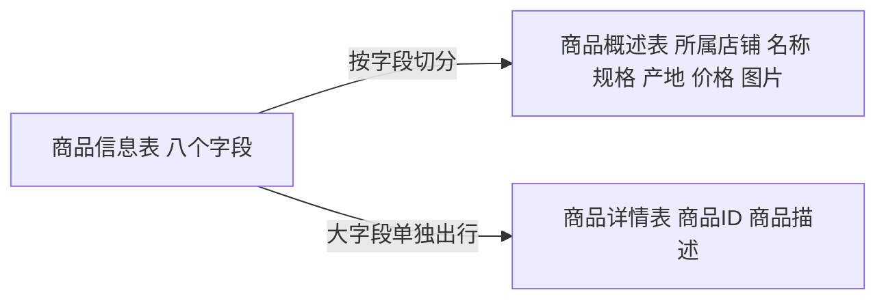
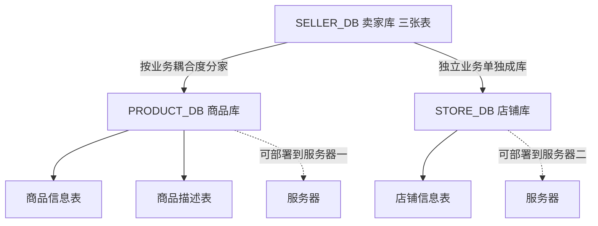

# 垂直分表与垂直分库：按字段切表，按业务分库

分库分表的决策已经立下，但「拆」这个字不能任性执行。同样一块大蛋糕，有人竖着切有人横着切，切法决定了后面所有的收益与代价。拆分有垂直与水平两大方向，各细分两支，一共四种方式，本课把垂直这一支讲透：先按字段把宽表切开，再按业务把表分进不同的库，顺带看清垂直拆分的天花板在哪里。

## 先给结论

- 分库分表在生产中细分为四种：垂直分表、垂直分库、水平分库、水平分表；垂直拆分动的是维度，水平拆分动的是行数。
- 垂直分表是把一个表的字段分散到多个表中，每个表只存储其中一部分字段；表的行数不变，但每张表的体积一定减小。
- 收益来自三处：减少 IO 争抢、降低锁表几率、让高频字段的高效操作不被大字段与冷字段拖累。
- 拆分可循三条经验原则：不常用的字段单独放一张表；`text`、`blob` 等大字段拆出到附表；经常组合查询的列放在同一张表。
- 垂直分库是把表按业务耦合度分类、分布到不同数据库，每个库可以放在不同服务器上，核心理念是专库专用，收益是业务解耦清晰、分级管理、多机分摊压力。
- 垂直拆分的边界：行数没有减少，单表数据量过大的根本问题仍在，这个洞要靠水平拆分来补。

## 拆分路线图：两种方式四种细分

切法要讲究策略。分库分表包括分库和分表两个部分，生产中通常组合成四种方式：垂直分表、垂直分库、水平分库、水平分表。垂直与水平的差别可以用一句话锚定：垂直拆的是「维度」，表按字段切开、库按业务分类，每一片都不重样；水平拆的是「行」，同一张表的数据按规则分成多份，每一份结构完全一样。这张图把四种方式的家谱画清楚：



先从垂直分表开始，它离表结构最近，也最容易上手。场景回到大家最熟悉的电商平台：浏览商品、下单购买，围绕商品与店铺设计数据库。

## 垂直分表：一张宽表怎么被字段压垮

拆分前，商品的所有信息集中在一张商品信息表里：主键、所属店铺、商品名称、规格、产地、商品价格、商品图片，以及商品描述。注意商品描述这个字段，它是 `LONGTEXT` 类型，体积巨大。逛电商时都能感受到：列表页看到的只是商品名称、价格、图片这些基本信息，真对某个商品感兴趣，才会点进详情页往下滑，那里面的图文数据非常多。一张表把高频的基本信息和低频的超大描述捆在一起，每一行的体积都被描述字段撑大，哪怕只查名称和价格，存储引擎也要把带着大字段的行读出来，单次 IO 的负担凭空翻了几十倍。

假设这张表的数据量涨到了一亿行，必须拆。垂直分表的拆法是针对字段下手：把商品描述单独摘出来，连同一个商品 ID 外键，放进一张商品详情表；前六个字段原封不动留在商品概述表。这张图在讲这次「变身」：



定义随之落地：垂直分表是将一个表按照字段分成多表，每个表存储其中一部分字段。至于拆成几张，没有定数，两张、三张、四张都可以，全看具体业务需求，本例是最常见的两分法。这里有一个必须掰清的点：**垂直分表拆的是字段，不是行。** 拆之前有人会想当然：一亿行拆成两张表，每张五千万，十张表每张一千万。全错。行数一行没少，原来一亿行的数据，概述表还是一亿行，详情表也是一亿行，变的是每张表的体积。用数据说话，拆分前后的表结构长这样：

```sql
-- 拆分前 一张表扛所有字段 示例按画面线字段整理
CREATE TABLE product_info (
  id          BIGINT PRIMARY KEY COMMENT '主键',
  store_id    BIGINT COMMENT '所属店铺',
  name        VARCHAR(100) COMMENT '商品名称',
  spec        VARCHAR(50) COMMENT '规格',
  origin      VARCHAR(50) COMMENT '产地',
  price       DECIMAL(10,2) COMMENT '商品价格',
  image       VARCHAR(255) COMMENT '商品图片',
  description LONGTEXT COMMENT '商品描述 体积巨大'
) ENGINE = InnoDB DEFAULT CHARSET = utf8;
```

```sql
-- 拆分后 高频的基本信息留在概述表 低频的大字段住进详情表
CREATE TABLE product_summary (
  id       BIGINT PRIMARY KEY COMMENT '主键',
  store_id BIGINT COMMENT '所属店铺',
  name     VARCHAR(100) COMMENT '商品名称',
  spec     VARCHAR(50) COMMENT '规格',
  origin   VARCHAR(50) COMMENT '产地',
  price    DECIMAL(10,2) COMMENT '商品价格',
  image    VARCHAR(255) COMMENT '商品图片'
) ENGINE = InnoDB DEFAULT CHARSET = utf8;

CREATE TABLE product_detail (
  id          BIGINT PRIMARY KEY COMMENT '主键',
  product_id  BIGINT COMMENT '商品ID',
  description LONGTEXT COMMENT '商品描述'
) ENGINE = InnoDB DEFAULT CHARSET = utf8;
```

查询侧也随之分流，列表与详情各走各的通道：

```sql
-- 商品列表页 只碰概述表 高频路径轻装上阵
SELECT id, name, price, image
FROM product_summary
WHERE store_id = ?
LIMIT 0, 20;

-- 真正进入详情页时才取描述 冷路径单独执行
SELECT description
FROM product_detail
WHERE product_id = ?;
```

## 拆完得到什么

收益有三笔，第一笔是 IO 争抢的减少。拆分之前，不管查概述还是查详情，操作的都是同一张表，读写互相排队；拆分之后，查概述走概述表，查详情走详情表，两路人马互不影响。第二笔是锁表几率的降低，操作对象分开了，锁的冲突面自然缩小。第三笔最关键：充分发挥高频数据的操作效率。商品基本信息的访问频次远高于商品详情，把高频的小字段聚在一处，它们的增删改查不再被 `LONGTEXT` 拖累，热门数据的操作效率就是垂直切分性能提升的主要来源，磁盘争用也随之减少。

## 行数不变，体积变小：一笔要算清的账

行数与体积的关系值得单独算一遍，这是垂直分表最容易被误解的地方。假设拆分前商品信息表的整体物理体积是 10G，按字段切分之后，商品描述这个 `LONGTEXT` 占了大头，被单独搬进详情表；概述表只留下六个短字段，体积大概剩 4G，详情表约 6G。总量没有凭空消失，但每一张表都瘦了，扫描、缓存、排序触碰的数据页随之变少。

对一行数据来说道理相同：拆分前这一行带着七个字段的所有数据，拆分后概述表的这一行只存六个短字段，详情表只存描述。行还是那一行，行数没有变化，但每张表的行都轻了。理解了这一点，就能回答那个经典追问：垂直分表之后每张表里有多少行？答案是一行都没少，减掉的是宽度，不是高度。这也是它与水平拆分的本质分野，水平拆分减的才是行数。

## 三条拆分原则：字段往哪张表搬

知道了垂直分表是什么，接着要回答按什么策略拆。把某个业务实体的各个数据项按访问特性分拣，一般遵循三条原则。

**第一，把不常用的字段单独放在一张表。** 不常用指增删改查的频次低。拿商品表对照：规格、产地这类字段几乎不变，是典型的冷字段；而价格、图片经常变动，半年前卖三千的手机如今标价两千。冷热分开，热字段的频繁写操作就不会与冷字段挤在同一张表里互相干扰。

**第二，把 `text`、`blob` 等大字段拆分出来放在附表。** 商品描述就是标准样本，体积大、访问频次低，留在主表里只会让每次行读取都付出高昂的 IO 代价，单独安置才能两清。

**第三，把经常组合查询的列放在一张表。** 电商场景里查手机经常按名称、价格一起过滤，这几个高频组合的列就放在同一张表，让最常见的查询一次命中，不必跨表取数。

三条原则合起来，就是把「访问特性相似的字段圈在一起」：冷热分离、大小分离、按查询模式聚类。落到本课的例子上，商品描述同时踩中了第二条与第一条，所以它必须独立成表。

## 光分表还不够：库的总量原封不动

垂直分表做完，性能提升了一截，但马上会撞到新墙。所有拆出来的表，不管怎么分，仍然全部待在同一个数据库里。数据库的总体积没有任何变化，磁盘空间眼看见底；更要命的是，这些表还挤在同一台服务器上，竞争的是同一个物理机的 CPU、内存、网络 IO、磁盘。库内垂直分表只解决了单表数据量过大的问题，没有把表分布到不同机器的库上，对减轻数据库整体压力的作用有限。想再上一层楼，得让表分家，这就是垂直分库。

## 垂直分库：按业务的耦合度分家

看例子。当前有一个卖家库 `SELLER_DB`，里面装着三张表：店铺信息、商品信息、商品描述，其中后两张正是刚才垂直分表拆出来的。现在对整个数据库动刀：把商品信息与商品描述挪进新的商品库 `PRODUCT_DB`，把店铺信息单独放进店铺库 `STORE_DB`，两个库可以部署到不同的服务器上。为什么这么分？依据是业务的耦合度：商品信息与商品描述围绕同一份商品数据，业务上高度耦合，理应同居一库；店铺信息是相对独立的业务，单独成库。这张图在讲三张表如何分进两个库：



定义由此成形：垂直分库是指按照业务将表进行分类，分布到不同的数据库上，每个库可以放在不同的服务器上，核心理念是专库专用。表还是那三张，数据一行没动，换的只是归属与部署位置。

分库带来的提升分三层。业务层面，表按业务耦合度归类后，业务层面的耦合被解开，每个库的职责一目了然，业务更加清晰，管理起来也更方便。运维层面，能对不同业务的数据进行分级管理、维护、监控、扩展，商品库火了单独给商品库扩容，互不牵连。性能层面，高并发场景下，垂直分库在一定程度上能提升 IO 与数据库连接数，降低单机硬件资源的瓶颈；条件允许时把不同的库部署到不同服务器，访问压力由多台机器共同分摊，效果更佳。

分家也有要付的账。最直观的是查询方式的变化：分家之前，商品列表想连着店铺信息一起查，一句多表关联查询就能出结果；分家之后，商品信息在商品库，店铺信息在店铺库，数据库层面的关联查询失效，只能拆成多次查询、在应用层把结果拼装起来。所以分库的粒度要拿捏好，强关联、高频联查的表尽量留在同一个库里，这正是刚才把商品信息与商品描述放进同一个商品库的原因之一；拆完之后，也要尽量从业务角度减少跨库联查的诉求，否则省下的性能又会在拼装的路上赔回去。

## 垂直拆分的边界：行数这道坎还在

把垂直分表与垂直分库放在一起收个口，两者动刀的位置与解决的问题一览：

```text
          垂直分表                    垂直分库
拆分对象  表内的字段                  库内的表
拆分依据  访问频次 字段体积 组合查询    业务耦合度
行数变化  不变                        不变
体积变化  单表体积减小                单库体积减小
部署变化  仍在同一个库一台机器        库可分布到不同服务器
主要收益  IO争抢与锁表减少 热数据提效  业务解耦 分级管理 多机分摊
遗留问题  单表行数仍在增长            单表行数仍在增长
```

垂直分表是把表里的字段拆出来放到不同的表里，动的是列；垂直分库是把不同的表拆出来放到不同的数据库里，动的是表的归属。两者合力，业务边界清晰了，宽表瘦身了，多机分摊也实现了，但有一件事它们谁都解决不了：表里的行数还在原样增长。商品表哪怕拆成再多的库、再多的表，每个逻辑表的行数照样能涨到千万上亿，单表数据量过大的问题依然悬在头顶。垂直拆分到顶了，再往上就要换一种刀法，沿着行去切，那是水平分库与水平分表的战场。

## 常见误区

- **把垂直分表当成按行拆分。** 错例：一亿行的表垂直拆成两张五千万行的表。正解：垂直分表按字段切，行数一行不减，减的是每张表的体积；按行拆是水平分表的事。
- **以为拆完表库的负担就变小了。** 错例：库内垂直分表后认为性能问题解决，不再关注服务器资源。正解：所有表仍竞争同一物理机的 CPU、内存、网络 IO、磁盘，库的总体积不变，还要靠垂直分库把表分到不同的库乃至服务器上。
- **把高频小字段挪进附表。** 错例：把价格、名称这类每次列表页都要用的列拆出去，结果每次查询都要跨表关联。正解：热字段留在主表，拆走的是低频、大体积、不常组合查询的字段；拆分后尽量从业务角度避免联查，否则性能得不偿失。
- **垂直分库后继续跨库写关联查询。** 错例：商品库与店铺库分家后，业务代码仍按原来的多表 `JOIN` 一把梭。正解：分库后跨库关联查询失效，需按业务拆成多次查询在应用层拼装，或把强关联的表留在同一个库里。

## 面试可能被问到的问题

1. 面试官追问：「垂直分表和水平分表的区别是什么？」
   答：垂直分表按字段拆，把一个表的字段分散到多个表中，每个表存储一部分字段，行数不变、体积变小；水平分表按行拆，在同一个数据库内把同一个表的数据按规则拆到多个表中，每个表结构相同、各持一部分行。前者解决宽表问题，后者解决单表数据量过大的问题。
2. 面试官追问：「垂直分表为什么能提升性能？」
   答：一是减少 IO 争抢并降低锁表几率，查基本信息与查详情互不影响；二是充分发挥高频数据的操作效率，商品描述这类大字段、低频字段拆出后，热门字段的操作不再被 `LONGTEXT` 的 IO 代价拖累；三是磁盘争用减少，存储也更节省。
3. 面试官追问：「垂直拆分时字段怎么归表，有哪些原则？」
   答：三条经验原则：不常用的字段单独放一张表；`text`、`blob` 等大字段拆出到附表；经常组合查询的列放在同一张表。本质是把访问特性相似的字段圈在一起，冷热分离、大小分离、按查询模式聚类。
4. 面试官追问：「垂直分库的依据和核心理念是什么，带来哪些提升？」
   答：依据是业务耦合度，把耦合高的表放同一个库，相对独立的业务单独成库，核心理念是专库专用。提升包括：解决业务层面的耦合、业务清晰；能对不同业务的数据分级管理、维护、监控、扩展；高并发下一定程度上提升 IO 与数据库连接数、降低单机硬件瓶颈，库分散到不同服务器后多机分摊压力。
5. 面试官追问：「垂直拆分解决不了什么问题？」
   答：行数问题。垂直分表不减行数，垂直分库不减行数，单表数据量仍会增长到千万上亿。垂直拆分只能让单表的列变窄、让业务归位，一旦数据行数继续膨胀并逼近单表阈值，就要引入水平分库分表，按行把数据切小。

## 配套资料

- 讲义：`materials/docs/10/Sharding-jdbc专题-v1.0.md`，1.2.1 垂直分表：商品案例、定义、提升与三条拆分原则；1.2.2 垂直分库：`SELLER_DB` 拆分案例、专库专用与三层提升；1.2.5 小结。
- 代码：`materials/code/10/基础代码/基础代码/dbsharding/`，分库分表演示工程归档（目录保留原始命名，路径只列到该层级），其中商品演示工程的商品基本信息表与商品描述表即垂直分表落地后的两表结构。
- 说明：建表与查询 SQL 为按画面线字段与讲义查询口径整理的示例，非课程工程源码；拆分原则与收益表述以讲义原文口径为准。
