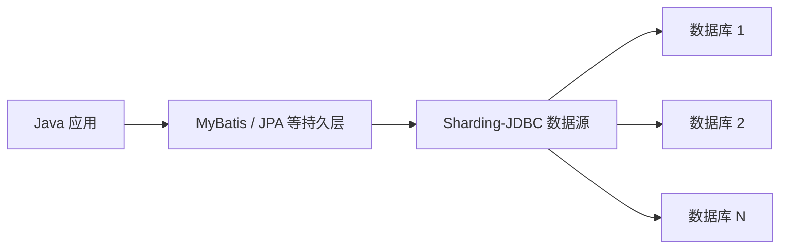
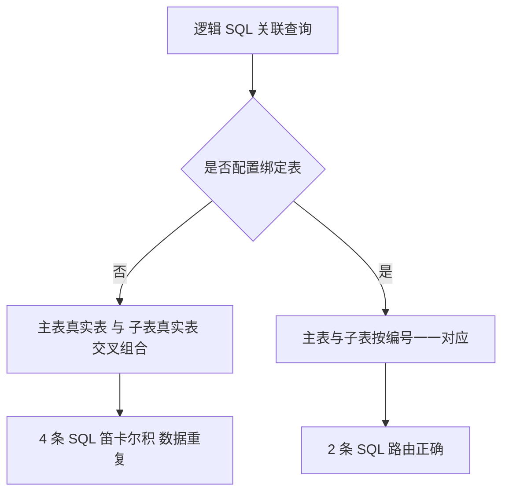
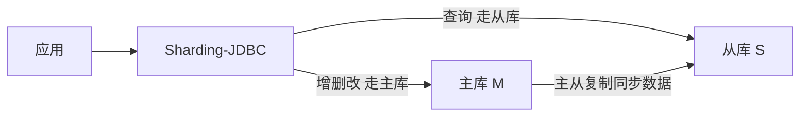

# Sharding-JDBC 概览：把分库分表的复杂度收进一个 JDBC 增强层

数据量涨到单库单表扛不住，拆分是必然动作。但拆库拆表本身不是难点，难点在拆完之后：原来一条 SQL 就能完成的跨表关联、分页排序、主键自增，现在跨了多个节点，每一件都要自己想办法。手工处理这些问题费时费力，市面上的数据层中间件把这个复杂度封装了起来，Sharding-JDBC 是其中使用流行度较高的一款。后面的入门案例、水平拆分、垂直拆分与读写分离实践，全部构建在这套框架之上，先把它的定位与核心概念打牢。

## 先给结论

- Sharding-JDBC 是一款开源的分布式数据库中间件，定位为轻量级 Java 框架，以增强版 JDBC 驱动的形态工作在应用进程内，以 jar 包引入，无需额外部署。
- 从 3.0 版本起它并入 Sharding-Sphere 生态，进入 Apache 孵化器，4.0 之后即为 Apache 版本；生态内还有 Sharding-Proxy、Sharding-Sidecar 两款产品，三者相互独立，可按需单独选用。
- 两大核心功能：数据分片（即分库分表）与读写分离，既负责把数据拆出去，也负责把拆完之后带来的跨库关联、分页归并等问题处理掉。
- 完全兼容 JDBC 规范、主流 ORM 框架、连接池与数据库，应用层代码照旧写，复杂度全部收敛到配置里。
- 分片体系有六个高频名词：逻辑表、真实表、数据节点、分片键、分片策略、绑定表，加上主键生成策略，后续所有配置都围绕它们展开。

## 它是什么，又站在哪一层

用一句话概括：Sharding-JDBC 是增强版的 JDBC。最早学数据库操作时接触的 JDBC 驱动，主要面向单库单表；把驱动换成 Sharding-JDBC 之后，应用仍然以为自己在操作一个数据库，实际背后是多个库多张表，数据落到哪个节点、结果怎么合并，全部由框架在 JDBC 层完成。它专门用于分库分表以及解决分库分表带来的问题，同时兼容 JDBC 规范。

版本脉络值得记一笔。Sharding-JDBC 由电商平台当当网研发，从 3.0 开始被包含进 Sharding-Sphere，随后项目进入 Apache 孵化器，4.0 之后的版本即 Apache 版本。Sharding-Sphere 是一个生态圈，由三款相互独立的产品组成：

- `Sharding-JDBC`：Java 同构场景下的客户端分片方案，本课学习对象。
- `Sharding-Proxy`：独立部署的数据库代理，面向异构语言场景。
- `Sharding-Sidecar`：面向云原生的规划中产品。

三款产品都提供标准化的数据分片、分布式事务与数据库治理能力，但彼此独立，只关注 Sharding-JDBC 并不妨碍理解另外两个。这张图展示它在整体结构中所处的位置：



关键路径在中间一层：Sharding-JDBC 顶替了原来普通数据源的位置，应用与持久层框架感知不到下面的真实库数量和数据分布。引入方式就是加一个 Maven 依赖，下面是课程 `dbsharding` 父工程里锁定的真实版本：

```xml
<dependency>
    <groupId>org.apache.shardingsphere</groupId>
    <artifactId>sharding-jdbc-spring-boot-starter</artifactId>
    <version>4.0.0-RC1</version>
</dependency>
```

兼容性是这个框架的强项，也是它流行的原因之一。对 ORM 框架，JPA、Hibernate、MyBatis 以及 Spring 的 JDBC Template 全部支持；对连接池，Druid、C3P0、DBCP、BoneCP、HikariCP 都在支持列表里；对数据库，MySQL、Oracle、SQLServer、PostgreSQL 均可接入。万信金融项目的持久层用的是 MyBatis、连接池用的是 Druid，两者都在支持之列，直接引入即可，不会因为换了它导致别的组件不可用。

性能层面官方给过两组数据：与原生 JDBC 相比，相同并发下的性能损耗不超过 7%；启用分库分表之后，吞吐量相对不分表的原生 JDBC 有接近 2 倍的提升。损耗主要来自 SQL 解析与结果归并，收益来自数据分散后的并行执行，账算下来是划算的。

## 核心功能一：数据分片的六个名词

数据分片是 Sharding-JDBC 的核心功能，指按照某个维度，将存放在单一数据库、单一表中的数据分散存储到多个数据库或多张表中，以达到提升性能瓶颈与可用性的效果。这件事与之前讨论的分库分表是同一件事，框架只是把它命名为「数据分片」。具体到怎么拆，业界沉淀出垂直分表、垂直分库、水平分库、水平分表四种方式：垂直方向按业务和字段切，解决业务耦合与冷热字段争抢；水平方向按数据行切，解决单库单表数据量过大的问题。一个系统的常规演进路径是设计阶段先做垂直拆分，数据量与访问压力持续增长后再上水平拆分。围绕这套拆分动作，框架定义了一组名词，后面的配置全靠这些名词支撑，逐个过一遍。

**逻辑表与真实表。** 水平拆分的数据库（表）中，相同逻辑和数据结构的表的总称叫逻辑表。例如订单数据根据主键尾数拆分为 10 张表，从 `t_order_0` 到 `t_order_9`，它们的逻辑表名就是 `t_order`；而物理真实存在的、带编号后缀的 `t_order_0` 到 `t_order_9` 叫真实表。开发人员面向逻辑表写 SQL，真实表只存在于数据库里。

**数据节点。** 数据分片的最小单元，由数据源名称和数据表名组成。`m1.product_info_1` 读作 m1 数据源里的 product_info_1 表，这就是一个数据节点；入门案例里一个逻辑表通常对应四到六个这样的节点。

**分片键。** 用于分片的数据库字段，是把数据水平拆分的关键字段。按订单主键取模拆分，主键就是分片键；按店铺 ID 拆库，店铺 ID 就是分片键。SQL 中如果不携带分片键，框架只能全路由到所有节点，性能较差，因此分片键的选择要提前设计。除单字段外，Sharding-JDBC 也支持多字段组合分片。

**分片策略与分片算法。** 真正可用于分片操作的是分片键加分片算法，二者合起来叫分片策略。内置的策略包括标准策略（对应 `=`、`IN`、`BETWEEN AND`）、复合策略（多分片键）、行表达式策略（Groovy 表达式，如 `t_user_$->{u_id % 8}`）、Hint 策略与不分片策略，日常最常用的是行表达式策略。

**主键生成策略。** 分库分表之后，各分片的数据库各自维护的自增主键无法保证全局唯一，必须改用分布式全局主键。Sharding-JDBC 内置了 SNOWFLAKE（雪花算法），在客户端生成全局不重复、趋势递增的 ID，递增性对索引性能友好。

**绑定表。** 指分片规则一致的主表和子表。商品信息表与商品描述表都按商品 ID 分片，则此两张表互为绑定表关系。绑定表之间的多表关联查询不会出现笛卡尔积，关联查询效率大大提高。这条最容易被忽视，用一个 SQL 看后果，示例表名按入门案例的 `product_info`、`product_descript` 整理：

```sql
-- 逻辑 SQL：两张表均按商品 id 分片
select p1.*, p2.description
from product_info p1
inner join product_descript p2 on p1.id = p2.product_info_id;
```

不配置绑定表关系时，主表两张真实表与子表两张真实表会交叉组合，最终执行 4 条真实 SQL，呈现笛卡尔积；配置绑定表之后，只按「1 对 1、2 对 2」的对应关系执行 2 条：

```sql
-- 未配置绑定表：4 条（笛卡尔积）
select ... from product_info_1 p1 inner join product_descript_1 p2 on p1.id = p2.product_info_id;
select ... from product_info_1 p1 inner join product_descript_2 p2 on p1.id = p2.product_info_id;
select ... from product_info_2 p1 inner join product_descript_1 p2 on p1.id = p2.product_info_id;
select ... from product_info_2 p1 inner join product_descript_2 p2 on p1.id = p2.product_info_id;
-- 配置绑定表后：2 条
select ... from product_info_1 p1 inner join product_descript_1 p2 on p1.id = p2.product_info_id;
select ... from product_info_2 p1 inner join product_descript_2 p2 on p1.id = p2.product_info_id;
```



配置绑定表只需一行配置项，效果却是查询数量减半且结果正确。另外绑定表之间的分片键要完全相同，分片键名字都不一致的话，对应关系无从谈起。

与绑定表并列的还有一类广播表（也叫公共表）。实际应用里，参数表、数据字典表这类数据量不大、变动少、又被高频关联查询依赖的表，适合在每个数据库都保存一份，框架会把所有针对它们的更新操作同时发送到所有分库执行，保证各库数据一致。这类表和海量数据表做关联查询时，由于每个分片本地都有完整数据，关联可以就近完成，避免了跨库拉取。入门案例的库表设计里用不到广播表，但做系统字典、地区编码这类功能时要记得它。

## 核心功能二：读写分离

分库分表解决的是数据量与存储压力，还有一个问题它无能为力：同一个库、同一张表同时承担读与写时，写操作会拖累读操作。数据库的写操作指增删改，相对耗时，写一万条数据到 Oracle 可能要三分钟；读操作指查询，相对较快，读一万条数据可能只要五秒。在高并发场景下，写操作会严重拖累读操作，这是单纯分库分表无法解决的。

读写分离的思路是把这两种操作分开：将数据库拆分为主库和从库，主库只负责处理增删改操作，从库只负责处理查询操作。它能有效避免由数据更新导致的行锁争抢，使整个系统的查询性能得到极大改善。资源充足时还可以升级拓扑：一主多从让查询压力分散到多个从库，多主多从在提升性能与吞吐量的同时提高可用性，任何一个主库宕机，其余主库还能承接写入。拓扑选型要结合业务并发量决定，不是配置越多越好。



主库到从库的箭头是读写分离唯一的额外代价：两个库之间的数据要同步，不同步的话，刚插入主库的数据在从库上查不到。这个同步依赖 MySQL 自身的主从复制能力，需要单独搭建主从架构并配置复制链路，框架不代劳。读写分离的完整搭建过程在入门案例里逐步展开。

Sharding-JDBC 对读写分离的支持方式是「透明」：它解析 SQL 语义，判断语句是写操作就走主库、是读操作就走从库，应用不需要为两个库分别维护连接。即便做了读写分离，编程体验也和操作一个数据库一样，路由这件事对使用者不可见。

再补一句优化选型的顺序观念。系统设计阶段就应该根据业务耦合的松紧确定垂直拆分方案；当数据量与访问压力不算特别大时，缓存、读写分离、索引优化是性价比更高的手段，应优先考虑；只有数据量极大且持续增长、上面几招都不够用时，才动用水平分库分表。读写分离处于这条优化链的中段：成本比分库分表低，收益立竿见影，也因此成为大多数系统走向分片前的标准动作。

## 它在工程里的位置

放在微服务体系里看，Sharding-JDBC 工作在服务的数据访问层：应用代码调用持久层框架，持久层框架面向 Sharding-JDBC 提供的数据源，数据源再对接真实的主从与分片数据库。课程为这一章准备了 `dbsharding` 总体父工程，用它统一管理依赖版本，入门案例工程 `sharding-jdbc-demo` 挂在其下。父工程的关键版本锁定如下（真实代码，包名按 `com.study.finance` 系改写）：

```xml
<dependencyManagement>
    <dependencies>
        <dependency>
            <groupId>mysql</groupId>
            <artifactId>mysql-connector-java</artifactId>
            <version>5.1.47</version>
        </dependency>
        <dependency>
            <groupId>org.mybatis.spring.boot</groupId>
            <artifactId>mybatis-spring-boot-starter</artifactId>
            <version>2.0.0</version>
        </dependency>
        <dependency>
            <groupId>com.alibaba</groupId>
            <artifactId>druid-spring-boot-starter</artifactId>
            <version>1.1.16</version>
        </dependency>
        <dependency>
            <groupId>org.apache.shardingsphere</groupId>
            <artifactId>sharding-jdbc-spring-boot-starter</artifactId>
            <version>4.0.0-RC1</version>
        </dependency>
    </dependencies>
</dependencyManagement>
```

更直观的是启动类：除了常规的 Spring Boot 装配，它没有为分片写一行代码。使用 Sharding-JDBC 前需要人工对数据库进行分库分表，在应用程序中加入它的 jar 包，之后应用程序通过它操作分库分表后的数据库，就像使用 JDBC 驱动一样，无需指定具体要操作哪个库哪张表：

```java
package com.study.finance.dbsharding.simple;

import org.springframework.boot.SpringApplication;
import org.springframework.boot.autoconfigure.SpringBootApplication;

@SpringBootApplication
public class ShardingJdbcSimpleBootstrap {

    public static void main(String[] args) {
        SpringApplication.run(ShardingJdbcSimpleBootstrap.class, args);
    }
}
```

真正的功夫全部在配置层：数据源怎么定义、主从关系怎么对应、每张表按什么键拆到哪，这些配置项构成了使用 Sharding-JDBC 的主要工作量，也是入门案例的主角。

## 常见误区

- **把它当成需要单独部署的中间件服务。** 错例：以为要先在服务器上装一个 Sharding 进程再连它。正解：Sharding-JDBC 以 jar 包形式内嵌在应用里，客户端直连数据库，无需额外部署与依赖；独立进程形态是生态里的 Sharding-Proxy。
- **以为主从数据同步也归它负责。** 错例：配好主从规则就认为两边数据自动一致了。正解：同步靠 MySQL 自身的主从复制，要在数据库层搭建复制链路；框架只负责把写路由到主库、读路由到从库。
- **以为不配置绑定表只影响性能不影响正确性。** 错例：关联查询结果里出现重复数据才发现问题。正解：不配置绑定表会产生笛卡尔积路由，SQL 数量为主表真实表数乘以子表真实表数，既慢又可能出错，绑定表的分片键还必须一致。
- **以为垂直拆分就能解决单表数据量过大的问题。** 错例：按业务拆完库就认为高枕无忧。正解：垂直分库解决业务耦合与单机资源瓶颈，垂直分表解决冷热字段 IO 争抢，单表行数持续增长仍要靠水平拆分来分摊。

## 面试可能被问到的问题

1. 面试官追问：「Sharding-JDBC 的定位是什么？和 Sharding-Proxy 有什么区别？」
   答：Sharding-JDBC 定位为轻量级 Java 框架，是 JDBC 层的增强，以 jar 包内嵌在应用中、客户端直连数据库，性能损耗小、部署零成本。Sharding-Proxy 是独立部署的数据库代理，实现了 MySQL 协议，适合异构语言或不方便改代码的场景。两者同属 Sharding-Sphere 生态，功能语义一致，接入方式不同。
2. 面试官追问：「数据分片涉及哪些核心概念？」
   答：逻辑表与真实表、数据节点、分片键、分片算法与分片策略、绑定表、广播表，以及主键生成策略。逻辑表是面向开发的表名，真实表是物理表，数据节点由数据源名加表名组成，分片策略等于分片键加分片算法，绑定表是分片规则一致的主子表。
3. 面试官追问：「什么是绑定表？不配置会怎样？」
   答：分片规则一致的主表与子表互为绑定表。不配置时，关联查询会按笛卡尔积路由，SQL 条数为主表真实表数乘以子表真实表数，带来大量无效查询与数据重复；配置后只按编号一一对应执行，效率大幅提高。前提是两张表的分片键完全相同。
4. 面试官追问：「读写分离解决什么问题？又带来什么新问题？」
   答：高并发下写操作耗时长，会拖累同为单库承载的读操作，读写分离把增删改放到主库、查询放到从库，避免更新引发的行锁争抢。新问题是主从间的数据同步与主从延迟，同步依赖 MySQL 主从复制，需要在数据库层单独搭建；框架负责按 SQL 语义自动路由，应用无感。
5. 面试官追问：「分库分表之后主键自增为什么失效了？怎么解决？」
   答：每个分片库各自维护自增计数，生成的 ID 局部唯一但全局重复，如两个库都会产出 ID 为 1 的行。解决思路是用分布式全局主键，Sharding-JDBC 内置 SNOWFLAKE 雪花算法，在客户端生成全局唯一且趋势递增的 ID，递增特性对 B+ 树索引友好。
6. 面试官追问：「它的兼容性如何？会不会用了它导致现有组件失效？」
   答：它完全兼容 JDBC 规范，适配 JPA、Hibernate、MyBatis 等主流 ORM，支持 Druid、C3P0、DBCP、BoneCP、HikariCP 等连接池，支持 MySQL、Oracle、SQLServer、PostgreSQL 等数据库。接入只替换数据源，上层组件不受影响。

## 配套资料

- 讲义：`materials/docs/10/Sharding-jdbc专题-v1.0.md`，1.4 节 Sharding-JDBC 介绍（定位、版本演进、生态三产品、兼容性与性能对比）；2.2.1 数据分片（六个名词与绑定表示例）；2.2.2 读写分离（定义、优势与主从架构）；3.x 执行原理（SQL 解析、路由、改写、执行、归并）。
- 代码：`materials/code/10/基础代码/基础代码/dbsharding/`，分库分表示例工程的父工程骨架（目录保留课程原始命名，路径只列到该层级），其中父 `pom.xml` 锁定了本课使用的 Sharding-JDBC 4.0.0-RC1 与 MyBatis、Druid、MySQL 驱动版本，启动类 `ShardingJdbcSimpleBootstrap` 即文中代码出处。
- 说明：绑定表 SQL 示例的表名按入门案例的 `product_info`、`product_descript` 整理，与讲义中中文表名示例一一对应；工程内原始机构包名已按 `com.study.finance` 系改写，课程中未提供完整分片实现的源码包，后续配置与 DAO 代码以讲义与画面线为准。
