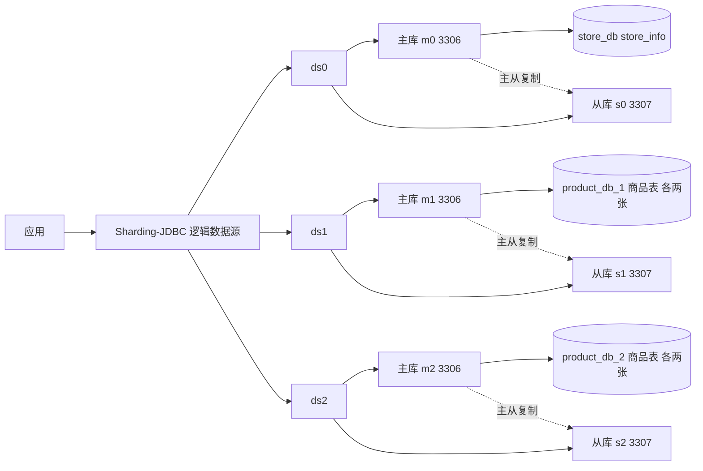
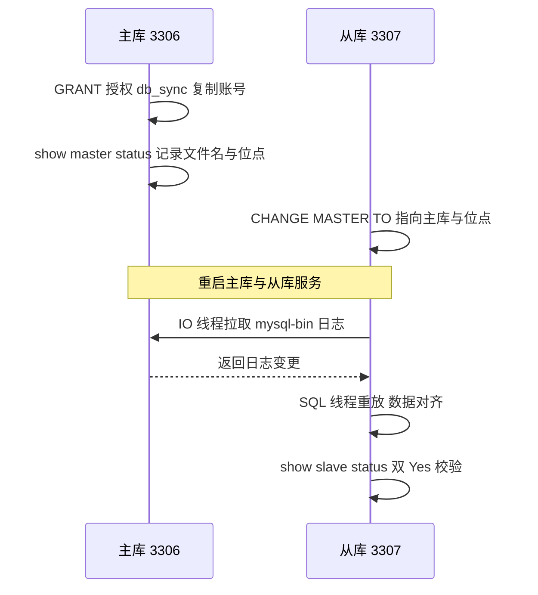
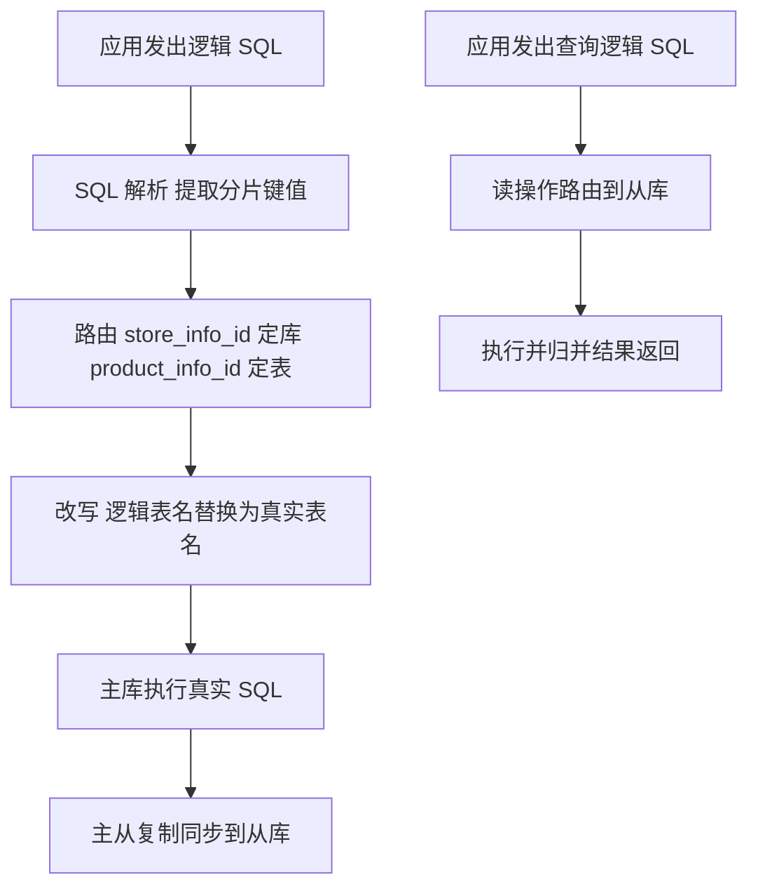

# Sharding-JDBC 入门案例：从库表设计、主从环境到分片增删改查的完整落地

> 🔒 安全提示：文中示例的口令/密钥均为课程教学环境演示口径，生产环境的安全要求见《安全与合规须知》。

概念听完了总得见真章。这个入门案例模拟电商平台的一个极小切片：商品先添加、再展示，列表项里同时带出商品基本信息、商品描述和所属店铺三块数据。案例虽小，链路却一点不含糊：它把 Sharding-JDBC 的两大核心功能，数据分片与读写分离，放在同一套环境里跑通。为了呈现读写分离，还要在单机上先搭出一套 MySQL 主从复制环境。项目背景也不抽象：万信金融的交易中心数据库后续正是按这套思路做分库分表与读写分离的，案例里的每一步都能平移过去。

## 先给结论

- 库表设计走「先垂直后水平」的完整路径：商品与店铺垂直分库，商品信息与商品描述垂直分表，再水平分出 product_db_1、product_db_2 两个商品库，库内商品表各拆两张，最终 3 个库、9 张真实表。
- 分库用店铺 ID 做分片键，分表用商品 ID 做分片键，策略都是对 2 取模再加 1；两张商品表的 ID 由 SNOWFLAKE 雪花算法生成，保证全局唯一且趋势递增。
- 读写分离靠单机搭建的 MySQL 主从复制：主库 3306 授权并记录位点，从库 3307 指向主库，`Slave_IO_Running` 与 `Slave_SQL_Running` 双 Yes 才算链路打通。
- 应用侧全部工作在配置层：6 个真实数据源组成 3 对主从逻辑数据源，一个默认分库策略加三张表的分表策略加一条绑定表配置，就把分片与读写分离全部声明完毕。
- 持久层代码与传统 MyBatis 写法完全一致，SQL 里写逻辑表名，主键列不赋值由雪花算法生成，路由、改写、归并对代码透明。

## 需求与数据库设计

需求只有两件事：往平台添加商品，然后查询商品列表，列表的每一项除了商品名称、规格、产地、价格、图片这些基本信息，还要拼出商品描述与所属店铺名称。数据是三块：商品信息、商品描述、店铺信息。

按「数据库设计要在需求分析阶段就定下来」的原则，拆分动作分四步演进。第一步垂直分库：店铺与商品业务边界清晰，把店铺库 `store_db` 从商品数据里拆出来，专库专用。第二步垂直分表：商品描述字段长、访问频次低，商品基本信息访问频次高，把描述单独拆成一张表，避免冷热字段 IO 争抢。第三步水平分库：商品数据量持续增长，单机商品库扛不住，按规则把商品数据拆到 `product_db_1` 与 `product_db_2` 两个库。第四步水平分表：每个商品库里商品信息与商品描述各再拆两张真实表，`product_info_1`、`product_info_2`、`product_descript_1`、`product_descript_2`。

这张图是设计定稿后的全貌，主从各一套、逻辑数据源与真实库的对应关系一并标出：



分片策略是设计的灵魂，规则只有两条。分库看店铺 ID：插入一行数据，先看它的所属店铺 `store_info_id` 是奇数还是偶数，奇偶决定这行数据进 `product_db_1` 还是 `product_db_2`。分表看商品 ID：数据进了商品库之后，再看商品 ID `product_info_id` 的奇偶，决定落到编号 1 还是编号 2 的真实表。商品信息与商品描述共用同一套分片规则，构成绑定表，关联查询时一一对应。每张商品表的主键都由雪花算法生成，不管落到哪个库哪张表，ID 全局不重复，而且趋势递增，对索引友好。

把两条规则串起来走一遍：插入一条所属店铺 ID 为 6、商品 ID 为雪花值的商品记录，店铺 ID 为偶数，先路由到 `product_db_2`；商品 ID 奇偶再决定落在 `product_info_2` 还是 `product_info_1`。同样的判断在查询时反向生效，框架拿到分片键值就能算出去哪个节点找数据。这套设计在后面所有配置项里反复出现，务必吃透。

## 搭建主从数据库环境

读写分离至少要一主一从，还要主从之间能同步数据。演示在一台电脑上完成：把本机原有的 MySQL 5.7.25 安装目录整体复制一份，改名 `mysql-5.7.25-s1` 作为从库使用，主库沿用原来的 3306 实例，从库之后配成 3307。注意复制只是造出了从库的「身体」，主从属性靠配置文件才能立起来。

配置文件 `my.ini` 不一定在安装目录下，Windows 上常常在 ProgramData 的 MySQL 目录里，两边实例的配置文件都要各自找到、各自修改。主库配置开了二进制日志、定了服务 ID，并圈定要同步的业务库、屏蔽系统库：

```ini
[mysqld]
# 开启日志，主从同步靠它
log-bin = mysql-bin
# 设置服务 id，主从不能一样
server-id = 1
# 设置需要同步的数据库
binlog-do-db = store_db
binlog-do-db = product_db_1
binlog-do-db = product_db_2
# 屏蔽系统库同步
binlog-ignore-db = mysql
binlog-ignore-db = information_schema
binlog-ignore-db = performance_schema
```

从库配置多两件大事：端口改成 3307 避免与主库冲突，数据目录指向复制出来的从库目录；同步范围的写法从库粒度到表，`.%` 表示库下所有表：

```ini
[mysqld]
# 从库端口，主库默认 3306
port = 3307
# 数据存放目录，指向复制出的从库目录
datadir = D:\mysql-5.7.25-s1\data
# 开启日志
log-bin = mysql-bin
# 服务 id，与主库区分
server-id = 2
# 需要同步的库与表，.% 表示库下所有表
replicate_wild_do_table = store_db.%
replicate_wild_do_table = product_db_1.%
replicate_wild_do_table = product_db_2.%
# 屏蔽系统库同步
replicate_wild_ignore_table = mysql.%
replicate_wild_ignore_table = information_schema.%
replicate_wild_ignore_table = performance_schema.%
```

复制出来的从库不会自动出现在 Windows 服务列表里，要以管理员身份打开命令行，进到从库的 bin 目录执行安装命令，把从库注册成独立服务（服务名可自取，配置文件路径必须写对）：

```bash
mysqld --install MySQLS1 --defaults-file="D:\mysql-5.7.25-s1\my.ini"
```

三个细节一不留神就翻车。其一，从库 data 目录下自带的 `auto.cnf` 要删掉，里面记录的 server UUID 与主库相同，主从要求唯一，删除后重启会自动生成新的。其二，`--defaults-file` 与等号之间不能有空格。其三，从库账号密码与主库一致（root/123456），因为它就是主库目录的副本，这样两个实例都能正常连接，服务列表里主库从库各占一项，可以分别启停。

## 配置主从数据同步

主从是两个相互独立的数据库实例，从库不能想拿数据就拿，主库要对从库授权，然后从库指明「从哪个文件哪个位点开始追」。整个流程五步，命令都在 MySQL 客户端里执行：

```bash
# 第一步 主库登录后：授权从库专用的复制账号
GRANT REPLICATION SLAVE ON *.* TO 'db_sync'@'%' IDENTIFIED BY 'db_sync';
# 第二步 刷新权限立即生效
FLUSH PRIVILEGES;
# 第三步 查看二进制日志文件名与位点，记下来，每台机器的结果不一样，以自己的输出为准
show master status;
# 第四步 从库登录后（端口 3307）：指向主库，账号密码与文件名、位点均来自前面几步
CHANGE MASTER TO
  master_host = 'localhost',
  master_user = 'db_sync',
  master_password = 'db_sync',
  master_log_file = 'mysql-bin.000001',
  master_log_pos = 592;
# 第五步 重启主从两个服务后，在从库检查链路，两个 Running 都是 Yes 才算成功
show slave status\G
```

MySQL 主从同步的底层靠二进制日志：主库把变更写入 `mysql-bin` 日志，从库的 IO 线程拉取日志、SQL 线程重放，两边数据就对齐了。`show master status` 返回的 File 与 Position 就是「从日志的哪个位置开始追」，`CHANGE MASTER TO` 把这组坐标交给从库。授权命令里的 `REPLICATION SLAVE` 是固定权限名，`'db_sync'@'%'` 表示允许本机使用该账号做复制，账号密码不一致时以自己实际创建的为准。



链路通不通的判据只有一条：`show slave status` 里 `Slave_IO_Running` 与 `Slave_SQL_Running` 同时为 Yes。任何一步执行报错，优先检查位点值、账号密码与 server-id 是否唯一；从库此前若已配置过主库指向，先执行 `stop slave` 与 `reset slave` 再重新开始。

## 初始化库表并验证同步

环境齐了开始造库造表。按设计定稿需要 3 个脚本：`store_db.sql` 建 `store_db` 与 `store_info` 表，`product_db_1.sql`、`product_db_2.sql` 分别建两个商品库及其四张表，建表脚本按画面线与库表设计整理如下（课程资料包中提供完整脚本）：

```sql
CREATE DATABASE `store_db` CHARACTER SET 'utf8' COLLATE 'utf8_general_ci';
USE `store_db`;
DROP TABLE IF EXISTS `store_info`;
CREATE TABLE `store_info` (
  `id` BIGINT NOT NULL COMMENT 'ID',
  `store_name` VARCHAR(100) NOT NULL COMMENT '店铺名称',
  `region_code` VARCHAR(20) NOT NULL COMMENT '区域编码',
  PRIMARY KEY (`id`) USING BTREE
) ENGINE = INNODB CHARACTER SET = utf8 COLLATE = utf8_general_ci ROW_FORMAT = DYNAMIC;
INSERT INTO `store_info` VALUES (1, '南京德才', '110109');
INSERT INTO `store_info` VALUES (2, '南京德才', '110109');
```

关键动作只有一个：三个脚本全部只在主库执行。执行完切到从库刷新，`store_db`、`product_db_1`、`product_db_2` 与里面的表连同测试数据一样不少，这就顺带完成了主从同步的第一次实战检验，脚本没在从库跑过，数据却原样出现了。商品库的表结构与 `store_info` 同风格，`product_info` 含 id、store_info_id（所属店铺）、product_name、spec、region_code、price、image_url 等列，`product_descript` 含 id、product_info_id、store_info_id、description，两张表通过商品 ID 与店铺 ID 共同支撑分片与绑定。

## 工程搭建与基本配置

工程结构沿用分库分表示例工程的组织方式：`dbsharding` 父工程统一管理依赖版本，入门案例工程 `sharding-jdbc-demo` 作为子模块挂在其下。子工程引入的依赖如下（真实工程骨架，包名按 `com.study.finance` 系改写）：

```xml
<parent>
    <artifactId>dbsharding</artifactId>
    <groupId>com.study.finance</groupId>
    <version>1.0-SNAPSHOT</version>
</parent>
<artifactId>sharding-jdbc-demo</artifactId>
<dependencies>
    <dependency>
        <groupId>org.springframework.boot</groupId>
        <artifactId>spring-boot-starter-web</artifactId>
    </dependency>
    <dependency>
        <groupId>org.springframework.boot</groupId>
        <artifactId>spring-boot-starter-actuator</artifactId>
    </dependency>
    <dependency>
        <groupId>org.mybatis.spring.boot</groupId>
        <artifactId>mybatis-spring-boot-starter</artifactId>
    </dependency>
    <dependency>
        <groupId>com.alibaba</groupId>
        <artifactId>druid-spring-boot-starter</artifactId>
    </dependency>
    <dependency>
        <groupId>org.apache.shardingsphere</groupId>
        <artifactId>sharding-jdbc-spring-boot-starter</artifactId>
    </dependency>
</dependencies>
```

配置文件用 properties 格式，分两大块：常规基本配置与 Sharding-JDBC 专属配置。基本配置没有新鲜事，服务端口 56081、应用名与访问路径、UTF-8 编码、Swagger 开关；有两个配置项值得展开：

```properties
server.port=56081
spring.application.name = sharding-jdbc-demo
server.servlet.context-path = /sharding-jdbc-demo
spring.http.encoding.charset = UTF-8
spring.http.encoding.force = true
# 开启 swagger
swagger.enable = true
# 同名 bean 允许覆盖
spring.main.allow-bean-definition-overriding = true
# 将带有下划线的字段映射为驼峰格式的实体类属性
mybatis.configuration.map-underscore-to-camel-case = true
```

`allow-bean-definition-overriding` 是多框架整合的高频坑位：项目引入的框架越来越多，两个框架注册了同一个名字的 bean，Spring 启动即报冲突，打开该配置允许后注册的覆盖先注册的。`map-underscore-to-camel-case` 则把表里的 `image_url` 自动映射为实体类的 `imageUrl`，下划线消失变驼峰，MyBatis 时代的标配。

## 分片规则配置：五块拼齐

Sharding-JDBC 的配置项数量庞大，但结构清晰，拆成五块逐一声明。第一块定义真实数据源，本机主从各 3 个库，共 6 个物理数据源，m 前缀是主库、s 前缀是从库，每个数据源配连接池、驱动、URL、账号密码：

```properties
# 真实数据源定义 m 为主库 s 为从库
spring.shardingsphere.datasource.names = m0,m1,m2,s0,s1,s2
spring.shardingsphere.datasource.m0.type = com.alibaba.druid.pool.DruidDataSource
spring.shardingsphere.datasource.m0.driver-class-name = com.mysql.jdbc.Driver
spring.shardingsphere.datasource.m0.url = jdbc:mysql://localhost:3306/store_db?useUnicode=true
spring.shardingsphere.datasource.m0.username = root
spring.shardingsphere.datasource.m0.password = 123456
spring.shardingsphere.datasource.m1.type = com.alibaba.druid.pool.DruidDataSource
spring.shardingsphere.datasource.m1.url = jdbc:mysql://localhost:3306/product_db_1?useUnicode=true
spring.shardingsphere.datasource.m2.url = jdbc:mysql://localhost:3306/product_db_2?useUnicode=true
# 从库三个数据源 s0/s1/s2 指向 3307 的同名库，其余配置与主库对应项一致
spring.shardingsphere.datasource.s0.url = jdbc:mysql://localhost:3307/store_db?useUnicode=true
spring.shardingsphere.datasource.s1.url = jdbc:mysql://localhost:3307/product_db_1?useUnicode=true
spring.shardingsphere.datasource.s2.url = jdbc:mysql://localhost:3307/product_db_2?useUnicode=true
```

第二块定义主从规则，把 6 个真实数据源两两配对成 3 个逻辑数据源，ds0 对应 store_db 主从、ds1 对应 product_db_1 主从、ds2 对应 product_db_2 主从：

```properties
# 逻辑数据源（主从对应关系）
spring.shardingsphere.sharding.master-slave-rules.ds0.master-data-source-name = m0
spring.shardingsphere.sharding.master-slave-rules.ds0.slave-data-source-names = s0
spring.shardingsphere.sharding.master-slave-rules.ds1.master-data-source-name = m1
spring.shardingsphere.sharding.master-slave-rules.ds1.slave-data-source-names = s1
spring.shardingsphere.sharding.master-slave-rules.ds2.master-data-source-name = m2
spring.shardingsphere.sharding.master-slave-rules.ds2.slave-data-source-names = s2
```

第三块定义分库策略。全局默认策略把分片键定为 `store_info_id`，算法是对 2 取模再加 1，表达式结果只会是 1 或 2，恰好命中 ds1、ds2 两个商品库：

```properties
# 分库策略 以 store_info_id 为分片键 奇偶取模加 1 路由到 ds1 或 ds2
spring.shardingsphere.sharding.default-database-strategy.inline.sharding-column = store_info_id
spring.shardingsphere.sharding.default-database-strategy.inline.algorithm-expression = ds${store_info_id % 2 + 1}
```

加 1 不是画蛇添足：店铺库对应的逻辑数据源叫 ds0，商品数据只能去 ds1、ds2，取模结果 0、1 加 1 后正好变成 1、2。如果直接 `store_info_id % 2`，数据会被路由到不存在的 ds0。这也是逻辑数据源命名要先想好的原因，表达式与命名必须对得上。

第四块定义三张表的分表策略。`store_info` 不做水平分表，数据节点写死在 ds0；两张商品表的数据节点是「两个商品库各两张真实表」共四个节点，按商品 ID 奇偶路由到编号 1 或 2 的真实表，主键生成策略挂 SNOWFLAKE：

```properties
# store_info 不水平分表 固定在 ds0
spring.shardingsphere.sharding.tables.store_info.actual-data-nodes = ds${0}.store_info
spring.shardingsphere.sharding.tables.store_info.table-strategy.inline.sharding-column = id
spring.shardingsphere.sharding.tables.store_info.table-strategy.inline.algorithm-expression = store_info
# product_info 分表 两个商品库各两张真实表 按商品 ID 奇偶路由 主键雪花算法
spring.shardingsphere.sharding.tables.product_info.actual-data-nodes = ds$->{1..2}.product_info_$->{1..2}
spring.shardingsphere.sharding.tables.product_info.table-strategy.inline.sharding-column = product_info_id
spring.shardingsphere.sharding.tables.product_info.table-strategy.inline.algorithm-expression = product_info_$->{product_info_id % 2 + 1}
spring.shardingsphere.sharding.tables.product_info.key-generator.type = SNOWFLAKE
spring.shardingsphere.sharding.tables.product_info.key-generator.column = product_info_id
# product_descript 分表策略与 product_info 完全一致 主键列为 id
spring.shardingsphere.sharding.tables.product_descript.actual-data-nodes = ds$->{1..2}.product_descript_$->{1..2}
spring.shardingsphere.sharding.tables.product_descript.table-strategy.inline.sharding-column = product_info_id
spring.shardingsphere.sharding.tables.product_descript.table-strategy.inline.algorithm-expression = product_descript_$->{product_info_id % 2 + 1}
spring.shardingsphere.sharding.tables.product_descript.key-generator.type = SNOWFLAKE
spring.shardingsphere.sharding.tables.product_descript.key-generator.column = id
```

第五块收尾：声明绑定表并打开 SQL 日志。绑定表配置写逻辑表名，两张表的分片键同为 `product_info_id`；`sql.show` 打开后，框架实际执行的路由与改写结果会打印到控制台，是调试分片规则的第一调试工具：

```properties
# 绑定表 两张表的分片键名字必须一致
spring.shardingsphere.sharding.binding-tables = product_info,product_descript
# 打开 SQL 输出日志
spring.shardingsphere.props.sql.show = true
```

## 持久层实现：逻辑表名与雪花主键

配置声明完，代码侧几乎无事可做。Controller、Service、实体类都是常规三层写法，值得细看的只有持久层的 DAO 接口，它集中了两个决定成败的细节：

```java
package com.study.finance.dbsharding.demo.dao;

import org.apache.ibatis.annotations.*;
import org.springframework.stereotype.Component;
import java.util.List;

@Mapper
@Component
public interface ProductDao {

    /** 新增商品信息 主键 product_info_id 由 SNOWFLAKE 生成 语句不携带主键列 */
    @Insert("insert into product_info(store_info_id, product_name, spec, region_code, price, image_url) " +
            "values(#{storeInfoId}, #{productName}, #{spec}, #{regionCode}, #{price}, #{imageUrl})")
    @Options(useGeneratedKeys = true, keyProperty = "id", keyColumn = "id")
    int insertProductInfo(ProductInfo productInfo);

    /** 新增商品描述 主键 id 由 SNOWFLAKE 生成 */
    @Insert("insert into product_descript(product_info_id, store_info_id, description) " +
            "values(#{productInfoId}, #{storeInfoId}, #{description})")
    @Options(useGeneratedKeys = true, keyProperty = "id", keyColumn = "id")
    int insertProductDescription(ProductDescription productDescription);

    /** 商品列表 商品信息与商品描述绑定表关联查询 */
    @Select("select i.*, d.description from product_info i " +
            "inner join product_descript d on i.id = d.product_info_id")
    List<ProductInfo> selectProductList();
}
```

细节一：SQL 里的表名都是 `product_info`、`product_descript` 这样的逻辑表名，不带 `_1`、`_2` 后缀。数据库里真实存在的只有带后缀的真实表，逻辑表名并不物理存在，但就是要写它，由 Sharding-JDBC 依据分片配置把逻辑名改写成真实表名再执行。写成真实表名反而会让框架找不到对应的逻辑表，路由直接失效。

细节二：插入语句没有给主键赋值，两张表的主键由配置里的 SNOWFLAKE 生成，`@Options(useGeneratedKeys = true, keyProperty = "id", keyColumn = "id")` 一方面告知 MyBatis 主键自动生成不用关心，另一方面把生成的键值回填到实体属性，方法的 int 返回值也能把主键带出来供后续使用。绑定表关联查询 `selectProductList` 也因为配置了绑定关系，只会按编号对应关系执行两条真实 SQL，不会出现笛卡尔积。

## 跑通验证：一条 SQL 的旅程

配置与代码就位后，拿一条插入语句把整条链路走通。Sharding-JDBC 拿到 SQL 后依次做五件事：解析 SQL 提取分片键值；按分库策略算出目标逻辑数据源、按分表策略算出目标真实表；把逻辑表名改写成真实表名；在对应节点执行真实 SQL；把多节点的结果归并返回：



控制台日志是最好的验收现场。开启 `sql.show` 后能看到同一句逻辑 SQL 被改写成了几条真实 SQL、分别路由到哪个数据源：插入落主库，从库稍后出现同样的数据；查询被派给从库执行。增删改查、分库、分表、绑定表、读写分离全部在日志里留下痕迹，案例至此闭环。这套配置思路整体平移到项目里，就是交易中心数据库做分库分表与读写分离的施工图。

## 常见误区

- **从库脚本再执行一遍。** 错例：三个建库脚本在主库跑完后，又在从库连一遍跑同样的脚本。正解：脚本只在主库执行，从库靠主从复制自动获得库表与数据，两边都建不仅多余，还会掩盖同步链路故障。
- **主从配置细节踩坑不断。** 错例：server-id 两边写成一样的、从库 `auto.cnf` 没删、`--defaults-file` 中间加了空格、从库端口忘了改 3307。正解：这四处是单机主从环境的高频翻车点，任何一处出错链路都起不来，搭建时逐项核对。
- **SQL 里写真实表名。** 错例：以为要精确到 `product_info_1` 才能插得进数据。正解：SQL 永远写逻辑表名，真实表名由框架在改写阶段生成，写真实表名等于绕过框架的路由规则。
- **分片键随手选。** 错例：图省事用一个查询中很少出现的字段做分片键，结果绝大多数查询不带分片键，全部走全路由。正解：分片键要选查询高频携带、能均匀打散数据的字段；绑定表的分片键还必须名字一致，否则对应关系无从建立。

## 面试可能被问到的问题

1. 面试官追问：「这个案例的库表是怎么拆的？分片键分别是什么？」
   答：四步拆分：店铺与商品垂直分库，商品信息与描述垂直分表，再水平分出两个商品库，库内商品表各拆两张，共 3 库 9 表。分库以店铺 ID `store_info_id` 为分片键，分表以商品 ID `product_info_id` 为分片键，都是对 2 取模加 1 的奇偶策略，主键由 SNOWFLAKE 生成。
2. 面试官追问：「单机怎么搭 MySQL 主从？判断搭成功的标准是什么？」
   答：复制安装目录造出从库，主库开 log-bin 并指定同步库，从库改端口 3307、指定 data 目录，注册成 Windows 服务；主库 GRANT 授权复制账号并用 show master status 记录文件与位点，从库 CHANGE MASTER TO 指向主库，重启后 show slave status 里 Slave_IO_Running 与 Slave_SQL_Running 双 Yes 即成功。
3. 面试官追问：「为什么分片算法要写成取模加 1，不加行不行？」
   答：不行。逻辑数据源里 ds0 是店铺库，商品数据只允许落 ds1、ds2，取模结果是 0 或 1，加 1 后正好映射为 1 或 2；不加会路由到不存在的 ds0。它体现的是表达式与逻辑数据源命名必须对齐这一约束。
4. 面试官追问：「应用代码里能感知到分片吗？SQL 该怎么写？」
   答：感知不到。SQL 全部写逻辑表名，不带 `_1`、`_2` 后缀，主键不赋值由框架的 SNOWFLAKE 生成，MyBatis 用 useGeneratedKeys 回填主键。路由、改写、执行、归并都发生在数据源内部，Controller、Service 与传统写法无异。
5. 面试官追问：「配置里 6 个数据源和 3 个 master-slave-rules 分别解决什么问题？」
   答：6 个真实数据源对应主从两端共 6 个物理库，是框架的连接目标；3 条主从规则把每对主从聚合成一个逻辑数据源，声明谁主谁从，框架据此把写路由到主库、读路由到从库。分库分表策略再作用在逻辑数据源之上，两层规则叠加完成路由。
6. 面试官追问：「怎么验证读写分离和分片真的生效了？」
   答：打开 props.sql.show 观察 SQL 日志：插入语句应被改写为真实表名并路由到 3306 主库，查询语句应路由到 3307 从库；按不同店铺 ID 插入的数据应分布在不同商品库，商品 ID 奇偶不同的数据落在不同真实表。日志与两侧库里的数据对照，就是最直接的证据。

## 配套资料

- 讲义：`materials/docs/10/Sharding-jdbc专题-v1.0.md`，2.3 入门案例（需求、环境与功能实现脉络）、2.5 其他集成方式、3.x 执行原理（SQL 解析、路由、改写、执行、归并）与第 4 至 7 节的水平分表、水平分库、垂直分库、公共表实操；主从同步命令与 CHANGE MASTER TO 参数按视频画面线整理。
- 代码：`materials/code/10/基础代码/基础代码/dbsharding/`，分库分表示例工程（目录保留课程原始命名，路径只列到该层级），含父 `pom.xml` 依赖版本锁定与启动类 `ShardingJdbcSimpleBootstrap`，案例工程 `sharding-jdbc-demo` 的完整 DAO 与配置随课程资料提供。
- 说明：建库建表脚本与安装服务命令按画面线与库表设计整理，列名与位点值以实际环境输出为准；工程内原始机构包名已按 `com.study.finance` 系改写，MySQL 密码统一按 root/123456 口径书写。
