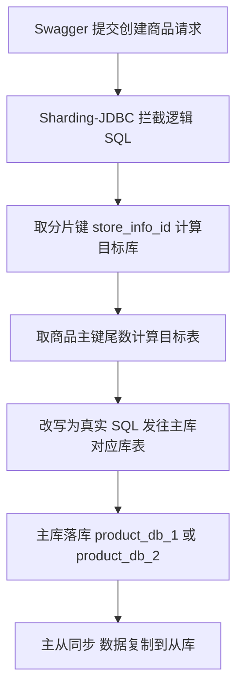

# Sharding-JDBC 入门案例功能测试：用两条数据见证分片路由与读写分离

入门案例的核心代码与配置已经铺完，接下来做它最刺激的部分：功能测试。没有前端页面，一条商品数据插进去，到底落进了哪个库、哪张表？查询走的是主库还是从库？这些在配置里写好的规则，只有在数据库工具和控制台日志里亲眼见过，才算真正建立手感。

## 先给结论

- 测试环境是主从架构：主库负责增删改，从库负责查询，主从之间配置了数据同步；主库与从库各有三个库，服务启动时一共连接六个数据源。
- 测试四件事：创建商品验证分库、验证分表，观察主从数据是否同步，查询商品验证读写分离。
- 入口是 Swagger 文档页，服务端口 56081，访问 `http://localhost:56081/swagger-ui.html`，先测添加再测查询。
- 分库看店铺 ID：`store_info_id % 2 + 1` 决定落 `product_db_1` 还是 `product_db_2`；分表看商品主键：主键尾数奇偶决定落 `product_info_1` 还是 `product_info_2`。
- 写入的证据在数据库工具里比对，读走的证据在控制台日志里：查询语句前缀的数据源名字以 S 开头，即从库。

## 测试前的环境与工具

先回顾数据环境。数据库工具里挂着两个连接：主库连接与从库连接，是典型的一主一从读写分离形态。主库负责数据的增删改，从库专门应付查询，两者之间配好了数据同步。两边各自有三个库：店铺库 `store_db`，商品库 `product_db_1` 与 `product_db_2`。店铺库的 `store_info` 表只有两条初始数据，店铺 ID 为 1 和 2，这一点直接约束了后面测试数据的取值。服务端是一个商品微服务，端口 56081，启动时会一共连上六个数据源。

没有前端页面，测试工具二选一：Postman 或 Swagger。工程里集成了 Swagger，那就用它，顺便复习一下用法：浏览器打开 `http://localhost:56081/swagger-ui.html`，文档页里能看到商品的 Controller，两个方法，一个是查询，一个是添加。测试顺序必须先添加后查询，表里没数据，查询无从验证。

## 添加商品：两条数据分别喂给奇数与偶数

点开添加接口，它是 POST 请求，参数用 `@RequestBody` 接 JSON。Swagger 页面自带了请求示例，把示例值替换成测试值即可，商品名、价格、规格、图片、描述这些字段随便给，只有一个字段不能随便写：`storeInfoId`，它是所属店铺的 ID，对应店铺库 `store_info` 表的数据，初始数据只有 1 和 2，所以这个值要么给 1 要么给 2，给了别的值就偏离了测试前提。请求体长这样：

```json
{
  "productName": "示例手机",
  "spec": "8G+128G",
  "price": 2999.00,
  "imageUrl": "https://example.com/img/phone.png",
  "descript": "示例商品描述",
  "storeInfoId": 2
}
```

点 Execute，返回状态码 200，创建成功。为了让分库分表的效果可观察，再执行一次，这次 `storeInfoId` 换成另一个值，两条数据一个走偶数路径、一个走奇数路径，对比才有意义。

## 验证分库：店铺 ID 决定去哪个库

分库策略看的是 `storeInfoId`，规则是字段值对 2 取模再加 1，余数决定落到 `product_db_1` 还是 `product_db_2`。动手算一下：`storeInfoId` 为 2，2 除以 2 余 0，加 1 得 1，落 `product_db_1`；`storeInfoId` 为 1，1 除以 2 余 1，加 1 得 2，落 `product_db_2`。打开数据库工具核对：`product_db_1` 里有一条商品数据、`product_db_2` 里有一条，各自的新增确实与配置的计算结果一一对应。库的选择由配置里的数据源映射决定，`ds2` 这类数据源名再映射到对应的主库，链条完整对得上。

## 验证分表：主键尾数决定进哪张表

每个商品库里 `product_info` 有两张真实表：`product_info_1` 与 `product_info_2`，一条数据只能进其中一张，判断依据还是分片键的奇偶，这里的分片键换成了商品主键。主键由雪花算法生成，位数很长，只看最后一位：尾数是 8，8 对 2 取模余 0，加 1 得 1，进 `product_info_1`；尾数是 1，余 1 加 1 得 2，进 `product_info_2`。配置里的行表达式用占位符承接计算结果，表名当场算出来。到库里核对，两条数据分别躺在预期的那张表里，商品描述随同主键对齐落进同一下标的描述表，关联查询时两张表的下标天然一致，不会出现笛卡尔积式的组合。

这张图把一次插入的完整路由画出来：



关键路径是 C 与 D 两步计算：库与表各有一套取模表达式，先定库再定表，逻辑 SQL 被改写成带真实库表名的语句才发出去。

## 主从同步与读写分离：一眼看见读写在两台机器上分工

主从同步的验证最简单：增删改归主库管，刚才的插入发生在主库，现在打开从库连接，进对应的库和表看一眼，刚才添加的数据在从库里也都有了，同步链路工作正常。

读写分离要靠一次查询来见证。回到 Swagger 执行查询商品接口，GET 请求不需要参数，直接执行，返回 200，刚才添加的两条商品都被查了出来。问题是怎么证明这次查询走的是从库？答案在控制台日志里。日志会把每一条实际执行的 SQL 连同它落到的数据源名字一起打印，而配置里 M 开头的数据源是主库、S 开头的是从库。翻到查询段落，这次查询打印出来的数据源名字全部以 S 开头，查询确实发生在从库上；对照插入时段的日志，写入语句落在 M 开头的主库上，读写分离的分工一目了然。

```text
Actual SQL: m1 ::: insert into product_info_1 (product_info_id, product_name, spec, price, image_url, store_info_id, id) VALUES (?, ?, ?, ?, ?, ?, ?)
Actual SQL: m1 ::: insert into product_descript_1 (product_info_id, descrip, store_info_id, id) VALUES (?, ?, ?, ?)
Actual SQL: s1 ::: select i.*, d.descrip from product_info_1 i inner join product_descript_1 d on i.product_info_id = d.product_info_id
```

日志节选给出了最硬的证据：插入打在主库 `m1` 并带着真实表名 `product_info_1`，查询打在从库 `s1`，逻辑表在执行前被改写成了具体库表。日志按本课演示整理，字段以实际工程为准。

## 收口：案例测试全部通过，重点回到配置

到这里，入门案例的四个验证项全部过关：分库、分表、主从同步、读写分离，每一条都有数据库工具或控制台日志作证。做两个收尾提醒。其一，使用 Sharding-JDBC 主要就是玩那一堆配置，配置项多但不算复杂，课后要结合分库分表与读写分离两张规则图反复对照。其二，测试时不要只点按钮，要把每条数据的落点跟配置里的分片表达式亲手算一遍，策略、日志、库表三方对上，这套规则才真正长在脑子里。

## 常见误区

- **先查后插。** 错例：一上来执行查询接口，列表为空还以为查询有 bug。正解：表里没有数据，先通过添加接口造数据，再验证查询与读写分离。
- **`storeInfoId` 随手填。** 错例：店铺 ID 填了个不存在的值，路由照样算出落点，与初始数据对不上。正解：店铺库初始数据只有 ID 1 和 2，测试值必须从这两个里选，才能与配置的计算结果严丝合缝。
- **分表只看分库结果。** 错例：确认了数据进了 `product_db_1` 就收工。正解：库里还有 `product_info_1` 与 `product_info_2` 两张真实表，分表由主键尾数决定，要再核对一层。
- **只看接口返回 200 就判定读写分离生效。** 错例：查询返回数据就觉得读写分离没问题。正解：读写分离的证据在控制台日志的数据源前缀，查询语句落在 S 开头的从库数据源上才算验证通过。

## 面试可能被问到的问题

1. 面试官追问：「怎么验证一条数据被路由到了预期的库和表？」
   答：三个证据链：提交前按分片表达式手动算落点，比如分片键取模决定库、主键尾数决定表；数据库工具里打开目标库表核对；控制台日志看改写后的 Actual SQL 带着哪个数据源名与真实表名。三者一致才算验证通过。
2. 面试官追问：「读写分离在日志里怎么看出来？」
   答：配置里主库数据源以 M 开头、从库以 S 开头，Sharding-JDBC 打印的每条 Actual SQL 都带数据源名。写入语句落在 M 开头的源上，查询语句落在 S 开头的源上，就证明增删改走主库、查询走从库。
3. 面试官追问：「为什么分表策略看主键尾数就能对齐两张表？」
   答：主键是分片键，尾数取模加 1 得到表下标，同一主键永远算出同一张表；商品描述表用同一个商品主键做分片，下标与商品表天然一致，互为绑定表，关联查询按同一下标组合，不会产生笛卡尔积。
4. 面试官追问：「主从同步没生效时，测试会看到什么现象？」
   答：主库里有新数据，从库对应的库表里迟迟查不到；查询接口仍会执行成功但可能读不到刚插入的数据，出现写后读不一致。排查方向是主从同步配置与从库状态，业务上还要注意复制存在延迟，刚写完立刻读的场景要评估一致性要求。
5. 面试官追问：「这个入门案例里一次插入会被拆成几条 SQL？」
   答：商品信息与商品描述各一条，逻辑 SQL 被改写为两条真实 SQL，分别插入与主键下标对应的 `product_info_x` 和 `product_descript_x`，都落在分片键算出的同一个库的主库数据源上，日志里能看到两条 Actual SQL。

## 配套资料

- 讲义：`materials/docs/10/Sharding-jdbc专题-v1.0.md`，2.3 编写程序与测试、2.4 流程分析（解析、路由、改写、执行、归并五步）。
- 代码：`materials/code/10/基础代码/基础代码/dbsharding/`，分库分表演示工程归档（目录保留原始命名，路径只列到该层级），其中商品演示工程的实体与表结构（`product_info`、`product_descript`、`store_info`）可对照本课请求体与表名。
- 说明：请求体 JSON、日志节选为按本课演示整理的示例，服务端口与数据源命名以演示口径为准；分库分表与读写分离规则的完整配置，见入门案例搭建与配置部分的讲解。
