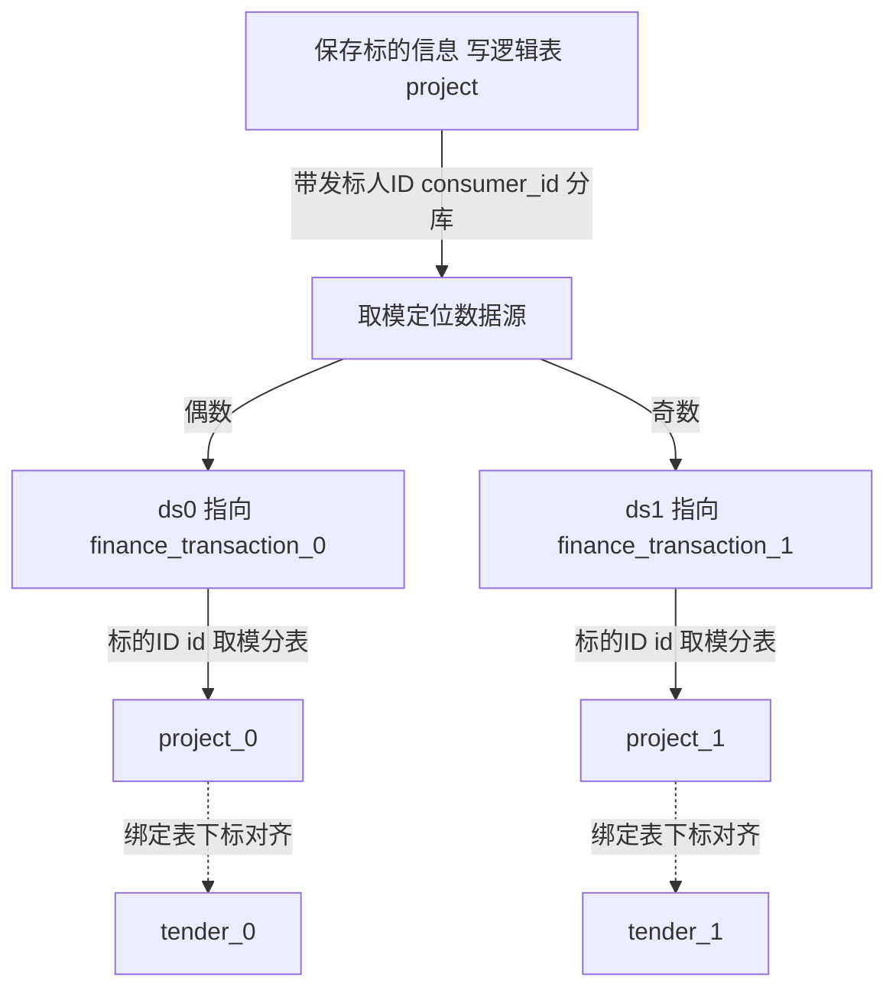

# 交易中心微服务环境搭建：导入工程、接通 Apollo、配好分片

> 🔒 安全提示：文中示例的口令/密钥均为课程教学环境演示口径，生产环境的安全要求见《安全与合规须知》。

分库分表的设计在上一课敲定，两个交易库早在第一章初始化环境时就由脚本建好了。轮到写发标功能时发现，代码还没地方放：交易中心这个微服务此前并不存在。这一课解决的就是「在哪写」的问题：导入交易中心的初始工程，把 Apollo 配置全部接好，分库分表规则翻译成 Sharding-JDBC 能认识的配置，最后把服务拉起来验证。

## 先给结论

- 平台里所有交易相关的功能（发标、投标）都收进一个独立微服务：交易中心 `finance-transaction-service`。工程不用从零写，导入课程提供的初始工程，pom 依赖与基础代码已经备好。
- 配置主体在 Apollo：新建项目 `transaction-service`，关联 HTTP、Eureka、Ribbon、Feign、Mybatis-Plus、RocketMQ 等公共名称空间，其中 Mybatis-Plus 的包扫描路径要改成交易中心自己的包。
- 分库分表规则落在 Apollo 的 `application` 名称空间：两个数据源 `ds0`、`ds1` 分别指向 `finance_transaction_0` 与 `finance_transaction_1`，分库键为发标人 ID，标的信息表按主键 ID 分表、投标信息表按标的 ID 分表，两表互为绑定表。
- 本地 `application.yml` 只写应用身份与名称空间清单；启动参数指定端口 53060，启动顺序保持注册中心在前、交易中心在后，控制台无报错即环境就绪。

## 工程与依赖：初始工程里已经有什么

交易中心按业务语义命名，对应工程 `finance-transaction-service`。课程资料里直接提供了这个初始工程，把它复制到工程目录下，用 IDEA 的 Maven 导入向导挂进现有 P2P 工程即可，导入动作与前面各服务完全一样。导入完成后的第一件事是把 pom 从头到尾过一遍，重点盯与交易场景直接相关的几项：MySQL 驱动、Druid 连接池，以及支撑分库分表的核心依赖：

```xml
<!-- Sharding-JDBC 与 Spring Boot 的集成启动器 -->
<dependency>
    <groupId>org.apache.shardingsphere</groupId>
    <artifactId>sharding-jdbc-spring-boot-starter</artifactId>
</dependency>
```

依赖之外，初始工程里的基础代码也值得整体过一遍，知道每样东西是干什么的，用的时候才找得到。**common 包里是各类常量与公共能力**：交易场景免不了设置各种交易状态，状态码常量已经备好；全局异常处理器与常用工具类沿用以前的套路；与令牌相关的工具类封装着从登录态里取当前用户信息的方法，正是第四章认证拦截时用过的那套。**config 包里是框架配置类**：Mybatis-Plus、Swagger、SpringMVC 的配置都已就位。**entity 包里躺着两张表对应的实体**：标的信息的 `Project` 与投标信息的 `Tender`，发标投标各用各的。**service 包里有基于 Apollo 的 `ConfigService` 取配置的代码**，需要动态配置时走它。启动类与所有微服务一模一样，不再展开。

## Apollo 侧：建项目、关联名称空间

本地配置文件几乎是空白的，真正的配置大头在 Apollo。控制台上新建项目，应用 ID 填 `transaction-service`，必须与本地 `application.yml` 里的 `app.id` 一致，这是客户端取配置的钥匙。项目建好之后照老规矩关联公共名称空间，交易中心用到这些：`application`、HTTP、Eureka、Ribbon、Feign、Mybatis-Plus、RocketMQ。RocketMQ 这一列值得留意，交易中心后续要靠它承接标的信息同步的消息通知，所以名称空间现在就挂上。

关联完成不等于能用，逐个核对修改。按以往每建一个服务的经验，必改的一处是 Mybatis-Plus：名称空间里登记的 Mapper 与实体扫描包路径还指着别的服务，要改成交易中心自己的包，否则后面写好的 Mapper 根本扫不到。Eureka、Ribbon、Feign 这些注册与调用类的配置直接沿用。本地 `application.yml` 则只保留身份信息与名称空间清单：

```yaml
app:
  id: transaction-service
apollo:
  bootstrap:
    enabled: true
    namespaces: application,micro_service.spring-boot-http,micro_service.spring-eureka,micro_service.spring-ribbon,micro_service.mybatis-plus,micro_service.spring-cloud-feign,micro_service.spring-rocketmq

spring:
  application:
    name: transaction-service
  main:
    allow-bean-definition-overriding: true

logging:
  config: classpath:log4j2-dev.xml
```

清单里写哪个名称空间，客户端启动时就拉哪个，本地文件的作用到此为止，剩下的全部交给 Apollo。

## 分片配置：把规则翻译成 Sharding-JDBC 的语言

环境搭建的重头戏在 `application` 名称空间。上一课设计的分库分表规则，现在要写成配置。数据源部分声明两个连接，`ds0` 与 `ds1` 分别指向两个交易库，账号密码按本机实际填写：

```properties
# 示例 按本课分片口径整理 库名按 com.study.finance 系口径改写

# Swagger 开关与未匹配请求抛异常 MVC 调试常用
swagger.enable = true
spring.mvc.throw-exception-if-no-handler-found = true

spring.shardingsphere.datasource.names = ds0,ds1

spring.shardingsphere.datasource.ds0.type = com.alibaba.druid.pool.DruidDataSource
spring.shardingsphere.datasource.ds0.driver-class-name = com.mysql.cj.jdbc.Driver
spring.shardingsphere.datasource.ds0.url = jdbc:mysql://localhost:3306/finance_transaction_0?useUnicode=true
spring.shardingsphere.datasource.ds0.username = root
spring.shardingsphere.datasource.ds0.password = 123456

spring.shardingsphere.datasource.ds1.type = com.alibaba.druid.pool.DruidDataSource
spring.shardingsphere.datasource.ds1.driver-class-name = com.mysql.cj.jdbc.Driver
spring.shardingsphere.datasource.ds1.url = jdbc:mysql://localhost:3306/finance_transaction_1?useUnicode=true
spring.shardingsphere.datasource.ds1.username = root
spring.shardingsphere.datasource.ds1.password = 123456

# 分库策略 统一按发标人ID取模 入库即定库
spring.shardingsphere.sharding.default-database-strategy.inline.sharding-column = CONSUMER_ID
spring.shardingsphere.sharding.default-database-strategy.inline.algorithm-expression = ds$->{CONSUMER_ID % 2}

# 标的信息表 两库各两张 分表键为主键ID 主键交给雪花算法
spring.shardingsphere.sharding.tables.project.actual-data-nodes = ds$->{0..1}.project_$->{0..1}
spring.shardingsphere.sharding.tables.project.table-strategy.inline.sharding-column = id
spring.shardingsphere.sharding.tables.project.table-strategy.inline.algorithm-expression = project_$->{id % 2}
spring.shardingsphere.sharding.tables.project.key-generator.column = id
spring.shardingsphere.sharding.tables.project.key-generator.type = SNOWFLAKE

# 投标信息表 分表键为标的ID 与标的表下标严格对齐
spring.shardingsphere.sharding.tables.tender.actual-data-nodes = ds$->{0..1}.tender_$->{0..1}
spring.shardingsphere.sharding.tables.tender.table-strategy.inline.sharding-column = project_id
spring.shardingsphere.sharding.tables.tender.table-strategy.inline.algorithm-expression = tender_$->{project_id % 2}

# 两张表互为绑定表
spring.shardingsphere.sharding.binding-tables = project,tender
```

逐行对照上一课的设计读：数据源清单声明 `ds0`、`ds1` 两个连接池，类型统一用 Druid，URL 各自指向一个交易库。分库策略这次走的是 `default-database-strategy`，即全局默认策略，任何表只要 SQL 里带着 `CONSUMER_ID` 这个字段，入库路由一律按它对 2 取模，发标人 ID 是奇数进 `ds1`、偶数进 `ds0`。分表策略各表单独声明：标的信息表的数据节点写成两个库各两张真实表，分表键就是它的主键 `id`；投标信息表的分表键是 `project_id`。两个分表键的字段名不能凭感觉写，要打开表结构对照着看，标的信息表里主键就叫 `id`，投标信息表里关联标的的字段叫 `project_id`，写错了分片算法直接失效。主键生成交给雪花算法，两个库各自自增必然撞号的问题就此杜绝。绑定表声明收尾，与标的 ID 相关的关联查询按下标两两配对，不产生笛卡尔积。

这张图在讲一次保存标的信息请求的真实落点：



关键路径一句话：业务代码永远只写逻辑表 `project`，先按发标人 ID 定库，再按标的 ID 定表，投标表靠绑定关系自动对齐，整套路由由 Sharding-JDBC 在 SQL 改写阶段完成。

## 启动验证：从 Apollo 拉配置拉得通才算通

启动参数按老规矩配：`-Denv=dev -Dapollo.cluster=DEFAULT -Dserver.port=53060`。端口 53060 是课程端口约定表里登记给交易中心的，不许自行占用别的号。启动顺序依旧注册中心 53000 在前，交易中心随后。

启动过程盯着控制台看，交易中心会先去 Apollo 加载各个名称空间的配置，配置有问题这里就会吐错误日志；加载完毕、Tomcat 起在 53060、全程无报错，环境就算搭好了。谨慎起见还可以再进一步：仿照统一账户当年的做法，在 controller 包里建一个测试 Controller，写一个返回 hello 的接口，直连 `http://localhost:53060/transaction/hello` 验一下上下文路径与配置加载都正常。这个可选动作做完，发标业务所需的微服务环境就全部就位，下一课开始把发标需求拆成可实现的接口。

## 常见误区

- **数据源账号密码照抄示例。** 错例：配置里原样粘贴示例的连接串，本机 MySQL 的密码不是这个，启动时连接失败。正解：URL、账号、密码按本机环境实际填写，两个数据源逐一核对。
- **名称空间漏关联。** 错例：只关联了 HTTP 和 Eureka，服务启动到 Feign 远程调用或 RocketMQ 配置解析时才报错。正解：交易中心用到 Feign 调用户中心、后续用 RocketMQ 收发消息，名称空间清单一次配齐。
- **分表键字段名凭印象写。** 错例：投标信息表的分表键写成 `id`，与它的主键混淆。正解：分表键写表里真实存在的字段名，投标表按标的 ID 分表，字段名是 `project_id`，配置前打开表结构核对。
- **Mybatis-Plus 扫描路径不改。** 错例：沿用公共名称空间里其他服务的包路径，启动不报错，但接口一调就报 Mapper 不存在。正解：把 Mapper 与实体扫描的包路径改成交易中心自己的包，改完发布配置。

## 面试可能被问到的问题

1. 面试官追问：「你们的分库分表配置为什么放在 Apollo 而不是本地配置文件？」
   答：配置中心集中管理是项目的治理策略，分片规则、数据源这类配置改动频繁且多环境取值不同，放 Apollo 可以改完发布即生效，不用重新打包；本地文件只留应用身份与名称空间清单。代价是配置不发布不生效，操作规程上要习惯「改完必发布」。
2. 面试官追问：「default-database-strategy 和每张表单独配 database-strategy 有什么区别？」
   答：前者是全局默认分库策略，所有表共用，只要 SQL 带分片键就按它路由；后者逐表声明，适合不同表分库键不一致的场景。交易库里标的信息表和投标信息表的分库键都是发标人 ID，用默认策略一份声明全覆盖，配置更短也更不容易漏配。
3. 面试官追问：「绑定表配置漏了会怎样？」
   答：绑定表声明的是分片规则一致的表组合。漏配后关联查询会被 Sharding-JDBC 当成非绑定表处理，按各表的数据节点做笛卡尔积组合路由，查询性能急剧下降；配好之后同一标的的标的信息与投标记录下标对齐，路由两两配对。
4. 面试官追问：「分表键的字段名写错了，服务还能正常启动吗？」
   答：多数情况能启动，因为分片算法只在执行 SQL 时才真正解析。启动不报错不代表配置正确，插入或查询时才抛出找不到分片列之类的异常。所以分片配置上线前要用真实 SQL 做一轮功能验证，不能只看启动日志。
5. 面试官追问：「新微服务启动后第一步做什么验证？」
   答：先看控制台是否完整加载了 Apollo 各名称空间的配置、有没有报错；再看端口是否按约定表起对；然后直连一个测试接口验证上下文路径与配置生效；涉及注册发现的还要去 Eureka 控制台确认实例已注册为 UP。直连通之后再验网关路由，链路才算真正打通。

## 配套资料

- 讲义：`materials/docs/10/万信金融-第3章-讲义-发标v1.0.md`，3.3 开发环境搭建：导入交易中心工程、检查依赖与基础代码、Apollo 建项目并配置分片规则的三步出处。
- 讲义：`materials/docs/10/万信金融-生产环境-部署文档.md`，服务端口表登记交易中心端口 53060（原文 `transaction-service` 一行），端口不许自行占用的依据。
- 讲义：`materials/docs/10/万信金融-第1章-讲义-开发环境搭建v1.0.md`，1.1 数据库环境：两个交易库随初始化脚本建好的说明。
- 代码：`materials/code/10/wanxinp2p/`，P2P 工程归档（目录保留原始命名，路径只列到该层级），可对照已有服务的 pom 组织与包结构；交易中心工程随课程资料单独提供，资料包内无成品源码。
- 说明：`application.yml` 与分片配置示例为按画面线与本课分片口径整理的补全，库名按 `com.study.finance` 系口径改写，密钥、账号密码以本机环境为准。
