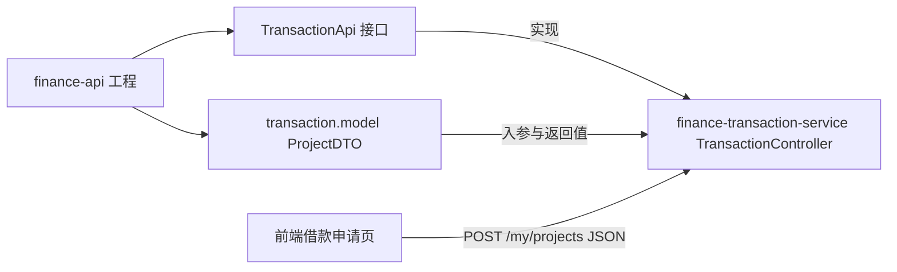

# 交易中心保存标的信息：先定 TransactionApi，再把 ProjectDTO 掂清楚

需求分析把时序图拆成了两段，实现也从最简单的一段下手：1.1 到 1.3 的借款人发标，整段只涉及交易中心一个微服务，功能本质是增删改查里的增。老规矩，写业务之前先把接口定下来，接口定了，参数结构、返回约定、调用方式才算真正落定。

## 先给结论

- 服务接口统一放在 api 工程：新建 `transaction` 包，定义 `TransactionApi`，命名语式与用户中心、存管代理的接口保持一致。
- 接口先只放一个方法：`createProject`，入参 `ProjectDTO`，返回 `RestResponse<ProjectDTO>`，路径 `POST /my/projects`。
- `ProjectDTO` 是标的信息的完整画像，字段几十个起步：身份类（id、标的编码、发标人 id、用户编码）、业务类（名称、描述、类型、期限、利率、还款方式、金额）、状态类（标的状态、创建时间）与交易扩展类（请求流水号、剩余额度、风险等级、出借人数、是否债权转让）。
- id 与编码是两套标识：id 是系统内部主键，编码是对外展示与引用的业务号，都能唯一标识一个标的，但产生方式与使用场合不同。
- Controller 顺手立起来：`TransactionController` 实现 `TransactionApi`，方法先空实现，`@RequestBody` 注解不能忘。

## 接口放在哪：api 工程的 transaction 包

P2P 项目里所有微服务对外暴露的接口都定义在 api 工程，这已经是一条固定纪律。原因不难推：接口一旦要被别的服务通过 Feign 远程调用，或者被前端工程对照生成文档，接口定义就不能锁在某个服务自己的代码里。交易中心是新增的，所以在 api 工程里先建一个 `transaction` 包，包名直接用业务域命名，然后在包里定义 `TransactionApi` 接口。命名方式照旧扫一眼工程里的既有接口：用户中心的接口、存管代理的接口，都是「业务域 + Api」的语式，交易中心照此办理。

```java
/** 交易中心服务 API 按讲义与画面线口径整理 包名按 com.study.finance 系改写 */
package com.study.finance.api.transaction;

/**
 * 交易中心服务API
 */
public interface TransactionApi {

    /**
     * 借款人发标
     * @param projectDTO 标的信息
     * @return 保存后的标的信息
     */
    RestResponse<ProjectDTO> createProject(ProjectDTO projectDTO);
}
```

方法名 `createProject` 里的 project 就是标的的含义：一个投资项目。接口眼下只定义这一个方法，后面实现投标等功能时再往里加，接口跟着业务生长，不提前堆方法。

## 参数与返回值：createProject 的两边

方法的入参是一个 DTO 对象，套路与开户完全一样。前端在借款申请页填写的信息（金额、期限、用途、利率），随请求体发过来，后端把它封装成 `ProjectDTO`。这个类此刻还不存在，课程资料里提供了现成的定义，直接放进 api 工程 `transaction` 包下的 `model` 子包，与用户中心当年放 `ConsumerDTO` 的位置如出一辙。

返回值是 `RestResponse<ProjectDTO>`：Controller 层的返回统一用 `RestResponse` 封装，把状态码、提示信息与业务数据一起交回前端；业务数据选 DTO 而不是实体，是为了不让数据库结构直接泄漏到接口层，前端要什么字段由 DTO 决定。对照开户接口 `createConsumer`，两边的签名几乎是镜像的，路径一个 `/my/consumers` 一个 `/my/projects`，`my` 前缀都表示操作对象是当前登录用户自己的资源。

## ProjectDTO：一张标的到底有多少字段

打开 `ProjectDTO` 把字段过一遍，会发现交易业务的数据密度远超之前的用户信息。身份类字段有标的 id、发标人 id（`consumerId`）、发标人用户编码（`userNo`）、标的编码（`projectNo`）；业务类字段有标的名称、描述、类型、期限、利率（还不止一个）、还款方式、借款金额；状态类有标的状态、创建时间；交易扩展类有请求流水号、剩余额度、风险等级、出借人数、是否债权转让。债权相关的字段本阶段还用不到，先占位。这里最值得掰清楚的是 id 与编码的区别：

| 字段 | 含义 | 产生方式 | 主要用途 |
|---|---|---|---|
| `id` | 标的主键 | 雪花算法生成 | 系统内部关联、分表路由 |
| `projectNo` | 标的编码 | 按业务前缀规则生成 | 对外展示与引用 |
| `consumerId` | 发标人主键 | 用户注册时生成 | 分库路由 |
| `userNo` | 用户编码 | 按业务前缀规则生成 | 对外展示与引用 |

两套标识都能唯一锁定一条记录，但 id 面向系统，编码面向人。这组字段定义整理如下：

```java
/** 标的信息 DTO 按画面线与讲义口径整理 包名按 com.study.finance 系改写 */
public class ProjectDTO {

    /** 标的主键 序列化成字符串避免前端精度丢失 */
    @JsonSerialize(using = ToStringSerializer.class)
    private Long id;

    /** 发标人id */
    private Long consumerId;
    /** 借款人用户编码 */
    private String userNo;
    /** 标的编码 */
    private String projectNo;
    /** 标的名称 */
    private String name;
    /** 标的描述 */
    private String description;
    /** 标的类型 */
    private String type;
    /** 标的期限 借多久 */
    private Integer period;
    /** 借款利率 */
    private BigDecimal rate;
    /** 还款方式 */
    private String repaymentWay;
    /** 借款金额 */
    private BigDecimal amount;
    /** 标的状态 */
    private String projectStatus;
    /** 创建日期 */
    private LocalDate createDate;
    /** 是否是债权转让 */
    private Integer isAssignment;
    /** 请求流水号 */
    private String requestNo;
    /** 剩余额度 */
    private BigDecimal remainingAmount;
    /** 风险等级 */
    private String riskLevel;
    /** 出借人数 */
    private Integer investCount;
}
```

金额与利率用 `BigDecimal` 而不是 `double`，金融场景对精度零容忍；日期用 `LocalDate`；主键上加 `ToStringSerializer`，把长整型序列化成字符串，避免前端 JavaScript 处理大数时精度丢失。这些细节都是交易系统区别于普通增删改查的地方。

## Controller 空实现：骨架先立起来

接口定义完，顺手把实现方的骨架立起来。交易中心的 `controller` 包里还不存在 Controller，新建 `TransactionController` 实现刚定义的 `TransactionApi`，重写 `createProject`，方法体先返回空，实现留给下一课：

```java
/** 交易中心控制器 按画面线口径整理 包名按 com.study.finance 系改写 */
@Api(value = "交易中心服务", tags = "transaction")
@RestController
public class TransactionController implements TransactionApi {

    @Autowired
    private TransactionService transactionService;

    @ApiOperation("借款人发标")
    @ApiImplicitParam(name = "project", value = "标的信息", required = true,
            dataType = "Project", paramType = "body")
    @PostMapping("/my/projects")
    @Override
    public RestResponse<ProjectDTO> createProject(@RequestBody ProjectDTO projectDTO) {
        return null;
    }
}
```

注解逐个过：类上的 `@Api` 与方法上的 `@ApiOperation` 供 Swagger 生成文档；`@ApiImplicitParam` 补充参数说明；`@PostMapping("/my/projects")` 声明请求路径；参数上的 `@RequestBody` 最容易漏，少了它 Spring 会把请求体当成表单参数去解析，JSON 数据根本进不到 DTO 里。业务层的 `TransactionService` 已经在初始工程里备好，此刻只是注入备用。这张图在讲接口三方的关系：



关键点在左上角：接口与 DTO 都住在 api 工程，Controller 只是实现方，前端与将来的 Feign 调用方都能引用同一份定义，契约只有一份。

## 常见误区

- **把接口定义在服务工程里。** 错例：`TransactionApi` 直接写进 `finance-transaction-service`，其他服务要调用时无从引用。正解：对外接口与 DTO 统一放 api 工程的 `transaction` 包，服务工程只做实现，Feign 调用方与前端文档共享同一份契约。
- **id 与编码混用一个字段。** 错例：拿主键 id 直接当标的编码展示给用户，或者把业务编码当主键建关联。正解：id 是系统内部主键由雪花算法生成，编码是对外业务号按前缀规则生成，两套标识各司其职。
- **金额与利率用浮点类型。** 错例：`amount`、`rate` 定义成 `double`，参与运算后出现精度误差。正解：金融字段一律 `BigDecimal`，序列化与展示环节同样保持字符串精度意识。
- **忘写 `@RequestBody`。** 错例：Controller 方法参数裸写 DTO，前端发 JSON 过来后字段全是 null。正解：JSON 请求体必须配 `@RequestBody`，参数才能被反序列化进 `ProjectDTO`。

## 面试可能被问到的问题

1. 面试官追问：「服务接口为什么要单独放一个 api 工程？」
   答：接口是被多个消费方共享的契约。放在独立 api 工程里，服务提供方实现它，Feign 调用方依赖它生成代理，Swagger 按它出文档，契约只有一份，改接口时所有相关方能同步看到，避免了定义散落各处导致的版本不一致。
2. 面试官追问：「DTO 和实体类为什么分开定义？」
   答：实体类映射数据库表结构，DTO 映射接口契约，两者的字段集合与演进节奏不同。分开后可以在 DTO 里裁剪、合并、增加展示字段，而不破坏表映射；数据库结构变化也不会直接穿透到前端，接口层始终可控。
3. 面试官追问：「主键为什么要序列化成字符串返回给前端？」
   答：分布式主键常用雪花算法，取值超出 JavaScript Number 的安全整数范围，前端按数值处理会出现末位精度丢失。返回时用 `ToStringSerializer` 把长整型转成字符串，前端按字符串透传，精度无损。
4. 面试官追问：「金融系统里金额字段用 double 会出什么问题？」
   答：二进制浮点无法精确表示大部分十进制小数，0.1 加 0.2 会得到近似值，金额参与运算后误差累积，对账必然出错。金融场景统一用 `BigDecimal`，并注意用字符串构造、指定舍入模式，才能保证计算精确。
5. 面试官追问：「Controller 空实现这一步有必要吗？」
   答：有必要。接口与实现骨架先立起来，Swagger 文档立刻可见，前后端可以并行开发，联调时按文档对接；实现逐课填充，接口签名稳定不变，避免写到一半才发现参数结构不合理而大改。

## 配套资料

- 讲义：`materials/docs/10/万信金融-第3章-讲义-发标v1.0.md`，3.2.1 定义接口：`TransactionApi` 接口、`TransactionController` 空实现与 `ProjectMapper` 预告的出处。
- 代码：`materials/code/10/wanxinp2p/`，P2P 工程归档（目录保留原始命名，路径只列到该层级），api 工程与 model 包的组织方式可对照；交易中心工程与 `ProjectDTO` 完整源码随课程资料单独提供。
- 说明：`TransactionApi` 与 `TransactionController` 代码块按画面线与讲义口径整理，包名按 `com.study.finance` 系改写；`ProjectDTO` 字段清单按画面线字段与讲解口径整理，个别扩展字段注释为口径还原。

