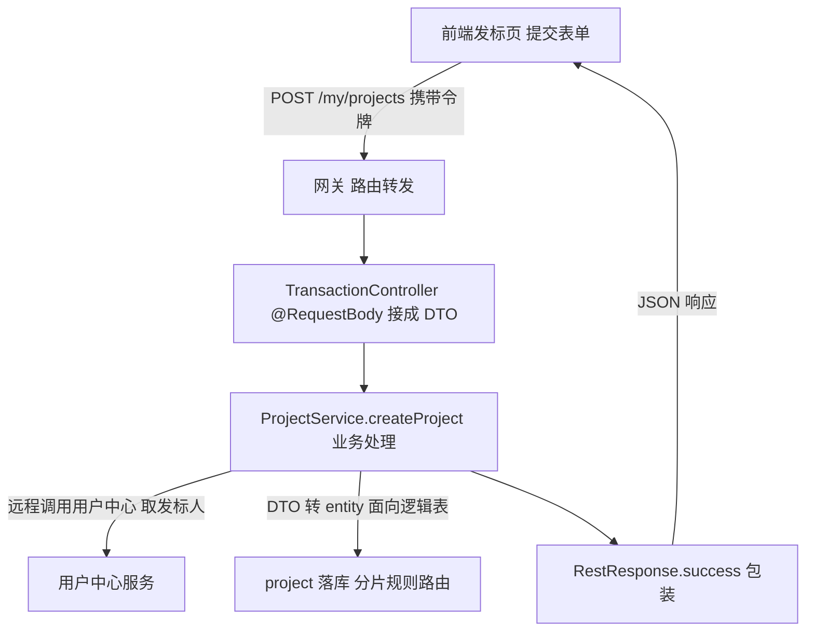

# 交易中心保存标的信息 Controller：薄薄一层，只做接收、调用与包装

业务层的保存标的信息代码已经全部写完，从远程调用用户中心取发标人，到标的编码、状态、利率的一连串赋值，再到面向逻辑表 `project` 的落库，都已在业务层收口。按分层习惯，这一棒最后要交回 Controller。很多初学者在这里反而容易犯嘀咕：业务层已经把活干完了，Controller 还剩什么可写？为什么就三五行？`@RequestBody` 到底什么时候要加？返回值为什么要再套一层 `RestResponse`？这一课把交易中心的 `TransactionController` 补完，顺便把这些问题一次说清。

## 先给结论

- `TransactionController` 实现的是 API 工程里的 `TransactionApi` 接口，类上挂 `@Api` 与 `@RestController`，端点声明为 `POST /my/projects`，与接口定义严格一致。
- Controller 层只做三件事：接收参数、调用业务层、包装返回。发标人补全、编码生成、状态流转全部留在业务层，Controller 不写一行业务。
- 入参是前端提交的标的要素，用 `@RequestBody` 接成 `ProjectDTO`；出参统一用 `RestResponse` 包装，`code` 为 0 表示成功，前端按这个契约解析。
- 面向接口实现的好处直接兑现：Swagger 文档注解在 API 工程里已写好，实现类一落地，文档与契约自动对齐。

## Controller 层的职责边界

分层架构里 Controller 是整个服务的门卫：请求从网关路由进来，第一站就是它。门卫的职责是核对来人、放行、把回执递出去，而不是替里面的人办公。对应到代码，Controller 该有的只有参数接收、一次业务层调用、一次响应包装。业务逻辑一旦爬进 Controller，分层就名存实亡：同一个能力没法被别的入口复用，事务边界也会被打乱，这层代码很快会膨胀到没人敢动。

交易中心这个工程里，保存标的的业务方法 `createProject` 已经在业务层就绪，方法签名收一个 `ProjectDTO`、还一个 `ProjectDTO`。Controller 要做的只是把前端发来的 JSON 接成这个 DTO，递进业务层，再把结果按统一响应格式递回去。

## 端点实现：从空壳到三行

工程骨架生成时，`TransactionController` 里只有一个 `return null` 的空壳。完善后的完整代码如下，包名按 `com.study.finance` 系口径改写：

```java
/** 交易中心控制器 包名按 com.study.finance 系改写 */
@Api(value = "交易中心服务", tags = "transaction")
@RestController
public class TransactionController implements TransactionApi {

    @Autowired
    private ProjectService projectService;

    @Override
    @ApiOperation("借款人发标")
    @ApiImplicitParam(name = "project", value = "标的信息", required = true,
            dataType = "Project", paramType = "body")
    @PostMapping("/my/projects")
    public RestResponse<ProjectDTO> createProject(@RequestBody ProjectDTO projectDTO) {
        ProjectDTO dto = projectService.createProject(projectDTO);
        return RestResponse.success(dto);
    }
}
```

逐个拆开看。类上的 `@Api(value = "交易中心服务", tags = "transaction")` 把控制器归到 Swagger 文档的 transaction 分组；`@RestController` 等价于 `@Controller` 加 `@ResponseBody`，方法返回值直接序列化成 JSON。`@PostMapping("/my/projects")` 是发标端点的访问路径，必须与 API 工程里 `TransactionApi` 定义的路径一字不差，否则接口契约与文档就对不上了。`@RequestBody` 负责把请求体里的 JSON 反序列化成 `ProjectDTO`，标的名称、金额、期限、用途这些前端表单字段全靠它落位。方法体里两行：调用业务层，`RestResponse.success(dto)` 包装返回。

`RestResponse` 是公共工程提供的通用响应包装，真实源码的核心部分如下（节选自工程归档的公共模块）：

```java
/** RestResponse 通用响应包装 节选 包名按 com.study.finance 系改写 */
@JsonInclude(Include.NON_NULL)
@ApiModel(value = "RestResponse<T>", description = "响应通用参数包装")
public class RestResponse<T> {

    @ApiModelProperty("响应错误编码,0为正常")
    private int code;

    @ApiModelProperty("响应错误信息")
    private String msg;

    @ApiModelProperty("响应内容")
    private T result;

    public static <T> RestResponse<T> success(T result) {
        RestResponse<T> response = new RestResponse<T>();
        response.setResult(result);
        return response;
    }
}
```

`success` 静态方法不设 `code`，而 `code` 的默认值本来就是 0，正好落在「0 为正常」的约定上；字段为 `null` 时不序列化，响应体保持干净。全项目的接口都按这个壳子返回，前端只需要写一次统一的响应处理逻辑。保存标的信息这条链路里，它装着的 `result` 就是刚落库的标的 DTO，里面有标的编码、状态、利率等业务层补全后的完整数据，前端拿到后直接进入「等待审核」的展示。

## 一次发标请求的完整路径

这张图在讲一次 `POST /my/projects` 请求从页面到落库再返回的全过程：



关键路径在 Controller 这一站的进出：进来的参数必须是反序列化完成的 `ProjectDTO`，出去的必须是 `RestResponse` 包好的 JSON，中间只隔一次业务层调用。令牌校验、令牌解析这些与登录态相关的动作发生在网关与接收请求的微服务一侧，Controller 本身不感知；落库时写的是逻辑表 `project`，真实落在哪个库哪张表由分片规则按发标人 ID 与标的 ID 计算，Controller 与业务层都不用关心。

## 常见误区

- **忘写 `@RequestBody`。** 错例：方法签名写成 `createProject(ProjectDTO projectDTO)`，Spring 按查询参数绑定，而前端发的是 JSON 请求体，DTO 各字段全部为 `null`。正解：JSON 请求体必须配 `@RequestBody`，让反序列化器接管。
- **把业务搬进 Controller。** 错例：在 Controller 里直接远程调用用户中心、设置标的状态、拼标的编码。正解：这些全部留在业务层，Controller 保持三行；否则同一套保存逻辑无法被其他入口复用。
- **返回裸 DTO。** 错例：方法直接 `return projectService.createProject(projectDTO);`，返回类型声明成 `ProjectDTO`。正解：统一用 `RestResponse` 包装，响应里必须有 `code` 与 `msg`，前端才能做统一的成败分支。
- **路径与接口定义脱节。** 错例：实现类随手写成 `/projects/save`。正解：实现 `TransactionApi` 的方法，路径、入参、出参都以 API 工程的定义为准，文档注解也是契约的一部分。

## 面试可能被问到的问题

1. 面试官追问：「`@RequestBody` 不加会怎样？」
   答：Spring 会退回按查询参数或表单参数绑定，前端发的 JSON 请求体不会被解析，DTO 字段全是默认值，业务拿到的等于一个空对象。所以 JSON 方式的 POST 接口必须加 `@RequestBody`，并且一个方法只能有一个请求体参数。
2. 面试官追问：「Controller 为什么要求写得很薄？」
   答：Controller 的价值是协议适配与参数收发，业务规则集中在业务层才能保证复用与事务边界清晰。业务写进 Controller 后，同一个能力无法被定时任务、消息消费等其他入口复用，测试也要起整个 Web 容器，维护成本急剧上升。
3. 面试官追问：「统一响应包装 `RestResponse` 带来什么好处？」
   答：全服务接口的响应结构一致，`code` 表达成败、`msg` 表达原因、`result` 装数据，前端可以写一次统一的拦截处理；Swagger 文档也能按同一模型生成；异常处理器往里填错误码时同样不用改前端逻辑。
4. 面试官追问：「为什么让 Controller 去实现 API 工程里的接口？」
   答：API 工程的接口承载了方法签名、路径与 Swagger 注解，是服务间调用与文档生成的契约来源。实现该接口能保证服务提供方与契约严格一致，Feign 代理与控制器天然对齐，改签名时编译器直接报错提醒两侧同步。

## 配套资料

- 讲义：`materials/docs/10/万信金融-第3章-讲义-发标v1.0.md`，3.2 交易中心保存标的信息：`TransactionController` 完善 `createProject` 的步骤与注解口径。
- 代码：`materials/code/10/wanxinp2p_apollo/`，公共模块归档（目录保留原始命名，路径只列到该层级），`RestResponse` 的真实源码、`CodeNoUtil` 与 `CodePrefixCode` 编码工具可对照。
- 代码：`materials/code/10/wanxinp2p/`，P2P 工程归档（目录保留原始命名，路径只列到该层级），控制器与 API 工程的组织方式可对照。
- 说明：交易中心工程随课程资料单独提供，未随仓库归档；`TransactionController` 代码按画面线与讲义口径整理，包名按 `com.study.finance` 系改写。
