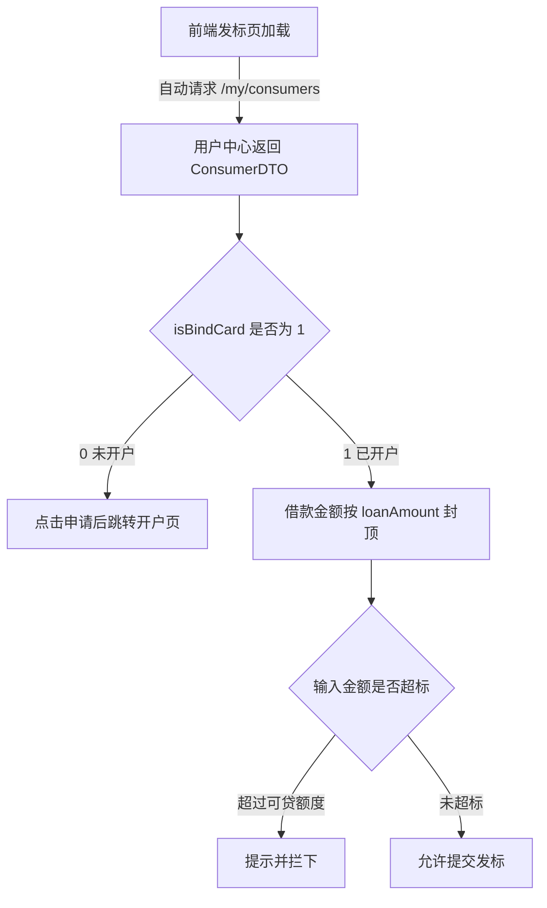
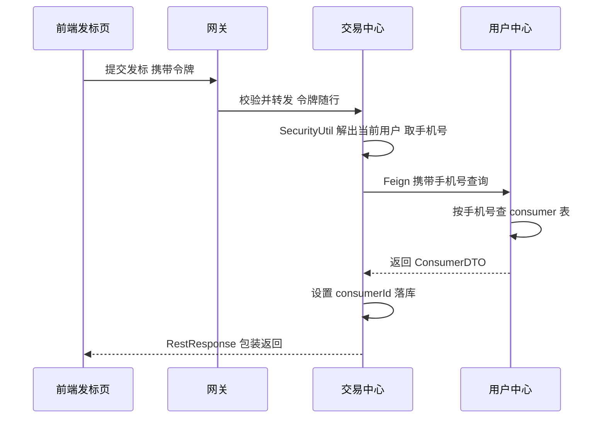

# 发标先决条件与前后端联调：登录了不代表能借，令牌只到收请求的那一站

保存标的信息的代码全部就位，按惯性该测了。这一课没有急着点测试，而是先补了一段与前端配合的业务：发标有两个先决条件，没开户不给发，借款金额超了可贷额度也不给发。补完之后进入前后端集成测试，第一轮顺利验证了先决条件，第二轮却在已开户账号上炸出一个非常经典的问题：业务层远程调用用户中心取当前登录用户，取回来全是空。这个坑把「令牌只存在于浏览器发出的那次请求里」这条规矩砸得很实，值得完整复盘。

## 先给结论

- 登录成功不等于可以发标。两个先决条件：已开户（用户表 `IS_BIND_CARD` 为 1，绑定过银行卡），借款金额不超过本人可贷额度；前端负责拦截与跳转，后端负责把判断依据查出来给前端。
- 后端配合点只有一个接口：用户中心新增面向前端的 `getMyConsumer`，路径 `/my/consumers`，返回的 `ConsumerDTO` 里 `isBindCard` 表示是否开户、`loanAmount` 表示可贷额度，前端发标页会自动调用并自行处理。
- 可贷额度在生产上由平台风控按信用、月收入、工作性质、年龄等综合评估；课程从简，直接在表里手工给值，不能低于 2000。
- 联调前置两件事：Apollo 里给网关补交易中心的路由；启动清单里 Apollo、注册中心、网关、统一账户、用户中心、UAA、交易中心、存管相关服务一个不少。
- 联调暴露的经典问题：业务层用 Feign 调用户中心取当前登录用户，拿到的响应对象全空，空指针恰好断在分片键赋值那一行。根因是令牌只随浏览器请求到达交易中心，Feign 发起的新请求不携带令牌，在用户中心一侧解析令牌必然为空。修复口径是把「解析令牌、取出手机号」上移到交易中心，Feign 接口显式传手机号，用户中心只按手机号查询。

## 登录之后为什么还不能发标

登录开放之后，前端里一大片功能跟着亮了，发标按钮也在其中。但一个刚注册、只走过登录流程的用户，可能还没开户：没有绑定银行卡，没有登记身份证信息。这时让他发标，别人投标了，钱打到哪里？银行卡都没绑，资金没有去处。所以发标的第一道门是开户状态：未开户就跳转到开户界面，先开户再回来发标。

第二道门是金额。发标页的借款金额是个可以自由输入的文本框，但不能想填多少填多少。每个用户都有一个属于自己的可贷额度，逻辑与信用卡额度完全一样：卡是自己的，额度是平台给的，刷卡不能超过额度。额度填 5 万，借款申请输 6 万，直接拦下。这两道判断由前端执行：金额输入框的最大值按可贷额度封顶，开户状态决定点击申请后是走发标流程还是跳开户页。

前端能执行判断的前提，是它拿得到这两个字段。它们都躺在用户中心的 `consumer` 表里：`IS_BIND_CARD` 为 0 表示未开户，1 表示已开户；可贷额度是另一列，目前多数记录还是空的，测试前要手工补上。表里现成的数据有 0 也有 1，正好用来分别验证两种走向。

至于可贷额度本身怎么来的，真实业务里由平台风控评估：信用记录、月收入、工作性质、年龄都在参考范围内，评估通过才给出一个值，并非用户想借多少就批多少。课程还没讲到风控模块，这里做简化处理：直接在表里给测试用户设置值，规则是不能低于 2000，理由很直白，借两三千块找亲戚朋友周转即可，不值得走平台流程。

## 后端配合：一个面向前端的查询接口

后端要做的事就一句话：查当前登录用户的信息，返回给前端。用户中心里其实已经有一个功能相同的方法，上一课业务层保存标的信息时刚用过它，但它服务的是内部调用，路径以内部前缀开头。工程里对路径前缀有约定，内部微服务之间互调的接口走内部前缀，前端调用的接口走面向用户的路径，两套分轨。前端要调这个能力，就得按讲义的口径单独再定义一个方法，功能一样、归属不同：

```java
/** 用户中心 API 新增方法 包名按 com.study.finance 系改写 */
public interface ConsumerApi {

    /** 获取当前登录用户 供前端调用 */
    @ApiOperation("获取当前登录用户")
    @GetMapping("/my/consumers")
    RestResponse<ConsumerDTO> getMyConsumer();
}
```

实现同样不复杂：取当前登录用户，拿到手机号，按手机号查一次库，把查到的 `ConsumerDTO` 包进 `RestResponse` 返回：

```java
/** 用户中心控制器实现 按讲义口径整理 包名按 com.study.finance 系改写 */
@Override
@ApiOperation("获取登录用户信息")
@GetMapping("/my/consumers")
public RestResponse<ConsumerDTO> getMyConsumer() {
    ConsumerDTO consumerDTO = consumerService.getByMobile(SecurityUtil.getUser().getMobile());
    return RestResponse.success(consumerDTO);
}
```

接口就位之后，前端的动作不用后端操心：发标页加载时会自动向这个接口发请求，拿到响应里的 `isBindCard` 与 `loanAmount` 后自行完成封顶与跳转。这张图在讲前端拿到两个字段之后的分流：



关键点在于职责切分：后端只供数据，不替前端做页面判断；前端只做展示层拦截，不负责数据正确性。这也是这一课反复强调的「配合前端写代码」的确切含义。

## 联调第一轮：先决条件逐个验证

集成测试的老规矩，配置先行。前端发标请求要经网关转发到交易中心，Apollo 的网关应用里必须提前补上交易中心的路由，忘了这一步，前端的请求根本到不了交易中心，页面上只有一个含糊的报错。按本课网关的路由口径补一条交易中心的路由即可，与此前给统一账户、用户中心补路由是同一写法：

```properties
# Apollo 网关应用新增 交易中心路由 示例按本课路由口径整理
zuul.routes.transaction-service.path = /transaction/**
zuul.routes.transaction-service.stripPrefix = false
```

启动清单也照旧：Apollo 与注册中心是地基，网关、统一账户、用户中心、UAA 是登录链路，交易中心与存管相关服务是本功能的链路主角，前端工程最后起。网关还有个容易忘的细节：路由配置写进 Apollo 之后，运行中的网关未必即时生效，按此前集成测试的经验，改完配置重启网关，前端请求才稳定到达交易中心。全部就绪后挑账号。第一个账号特意挑 `IS_BIND_CARD` 为 0 的：登录成功，点击「借钱」进入发标页，Network 面板里立刻能看到对 `/my/consumers` 的自动请求，响应里 `isBindCard` 为 0、可贷额度一万。页面上借款金额的最大可选值正是一万，改成两万会被立刻提示并弹回上限，第一个先决条件生效。继续选期限与用途，勾协议，点「立即申请」，页面没有走发标流程，而是直接跳到了开户界面，恰好是此前开发的开户功能，第二个先决条件同样生效。两个判断都是前端执行的，但它拿到的判断依据，全部来自刚补的那个查询接口。

## 一个经典坑：令牌只到收请求的那一站

第二轮换已开户账号，可贷额度三万。登录、进入发标页，页面封顶值变成三万，说明接口工作正常。借一万、十二个月、个人生活消费，点击「立即申请」，请求确实发出去了，目标正是交易中心的 `/my/projects`，但前端收到「未知错误」。控制台里交易中心抛了空指针，位置在业务层 `ProjectServiceImpl` 的第三十三行，恰好是给 `consumerId` 赋值的那一行，而这个字段正是分库分片键的来源。

排错路径一路顺着空值往上游走。断点打在业务层，重放请求后观察：入参 `ProjectDTO` 不为空，为空的是远程调用的返回，`RestResponse` 里的 `ConsumerDTO` 整个是空的。也就是说 Feign 调用本身通了，用户中心返回的结果里没有数据。断点再前移到用户中心的控制器，`SecurityUtil.getUser()` 返回的就是空，手机号为空，按手机号查询自然查不出任何东西。

问题由此浮出水面。`SecurityUtil` 取当前登录用户的原理，是从当前请求的上下文里取出令牌，再解出登录用户，核心写法如下：

```java
/** SecurityUtil 取当前登录用户 节选 按画面线整理 */
public static LoginUser getUser() {
    ServletRequestAttributes attributes =
            (ServletRequestAttributes) RequestContextHolder.getRequestAttributes();
    if (attributes != null) {
        HttpServletRequest request = attributes.getRequest();
        // 从请求头里解出令牌 还原成 LoginUser
        Object jwt = resolveToken(request);
        if (jwt instanceof LoginUser) {
            return (LoginUser) jwt;
        }
    }
    return new LoginUser();
}
```

浏览器发往交易中心的请求带着令牌，网关校验后把请求连同令牌转发给交易中心，所以在交易中心这一侧用 `SecurityUtil` 一定能取到用户。但业务层随后发起的 Feign 调用是一个全新的请求，默认不携带任何令牌，等这个请求到达用户中心，里面已经没有令牌可解，`SecurityUtil` 只能还给一个空对象。同样的代码，在收到浏览器请求的服务里百试百灵，在被远程调用的服务里必然落空，这就是那句话的含义：请求发到了哪里，就只能在那一侧取当前登录用户。

修复思路顺势而出：把「解析令牌、取出手机号」这一步挪到交易中心，手机号作为普通参数传给用户中心。交易中心侧的 Feign 代理接口改成带参版本，用户中心一侧的控制器也按路径参数接收，接口、代理、实现、注解四处配套改动，一处都不能漏：

```java
/** 交易中心侧 Feign 代理 修复后口径 包名按 com.study.finance 系改写 */
@FeignClient(value = "consumer-service")
public interface ConsumerApiAgent {

    /** 按手机号查用户 令牌已在交易中心解开 这里只传手机号 */
    @GetMapping("/consumer/currConsumer/{mobile}")
    RestResponse<ConsumerDTO> getCurConsumer(@PathVariable("mobile") String mobile);
}
```

```java
/** 用户中心控制器 新增路径参数版本 按讲义口径整理 包名按 com.study.finance 系改写 */
@Override
@ApiOperation("获取登录用户信息")
@GetMapping("/currConsumer/{mobile}")
public RestResponse<ConsumerDTO> getCurConsumer(@PathVariable(value = "mobile") String mobile) {
    ConsumerDTO consumerDTO = consumerService.getByMobile(mobile);
    return RestResponse.success(consumerDTO);
}
```

业务层里原来的无参调用改成传入手机号：先在交易中心用 `SecurityUtil.getUser()` 拿到当前登录用户，取其手机号，再带着手机号走 Feign。这张图在讲修复之后的完整链路：



关键分水岭在第三步：令牌的解析发生在收到浏览器请求的交易中心，Feign 链路上跑的只是普通参数手机号，用户中心不再依赖令牌上下文，空指针的土壤被整块挖走。

## 联调第二轮：落库见真章

改动涉及两个服务，重启后用同一个已开户账号重测。登录，进入发标页，封顶三万，借一万、十二个月、个人生活消费，点击「立即申请」，这次没有报错，页面提示资料审核中，Network 面板里发往交易中心的请求返回 200。

验收以数据为准，而且这次查库要先过分库分表这一关：交易库按发标人 ID 奇偶分片，先看该用户的 ID 是奇是偶，再决定去 `finance_transaction_0` 还是 `finance_transaction_1`。本例的记录落在了 `finance_transaction_1` 的 `project_1` 表里，逐列核对：借款人是位女士，标的名称自动拼成了「某某女士第 1 次借款」，称谓来自身份证号判别，次数来自该发标人历史标计数加一；借款金额一万；十二个月折算成天，期限列是 360 天；标的状态是募集中，正是业务层保存时写入的初始状态；年化利率、佣金利率等几个值来自 Apollo 的配置；标的编码带 `PRO_` 前缀，由编码工具生成。业务层塞进去的每一类值都能在表里找到落点，1.1 到 1.3 的保存标的信息功能就此验收通过。

## 常见误区

- **以为登录即可发标。** 错例：注册登录做完就直接开放发标，未开户用户一路把标发出去。正解：发标前先取 `isBindCard` 与 `loanAmount`，未开户跳开户页，金额按额度封顶，前端拦截、后端供数，两侧缺一不可。
- **把内部接口直接给前端用。** 错例：前端直接调内部微服务间互调的接口。正解：路径前缀区分调用方，面向前端的查询单独定义方法，内部接口与前端接口分轨，避免调用方与鉴权方式错配。
- **在被远程调用的服务里解析令牌。** 错例：业务层把「取当前登录用户」写在 Feign 调用的对端，结果永远为空。正解：在收到浏览器请求的那一侧解出登录信息，再把手机号这类标识作为参数下传；或者由 Feign 拦截器把令牌透传到下游，二选一，不能指望令牌自动跨服务。
- **配套改动漏三落四。** 错例：Feign 接口加了参数，控制器忘了 `@PathVariable`，或 API 接口没同步。正解：接口定义、Feign 代理、控制器实现、注解四处一起改，改完重启两侧服务再测。
- **可贷额度随手填。** 错例：留空或填一个低于 2000 的值。正解：额度直接决定前端封顶值，留空则发标页金额无法选择；测试数据按业务底线设置，别低于 2000。

## 面试可能被问到的问题

1. 面试官追问：「先决条件校验放在前端，安全吗？」
   答：演示项目里金额封顶与开户跳转都在前端完成，后端只供数据。生产环境这属于风控入口，必须后端兜底：提交发标时服务端再校验一次开户状态与额度，前端校验只负责体验，防不住绕过页面直接调接口的请求。
2. 面试官追问：「`SecurityUtil.getUser()` 为什么跨服务取不到用户？」
   答：它的实现依赖 `RequestContextHolder` 拿到当前请求，再从请求头解出令牌还原登录用户。令牌只存在于浏览器发出的那次请求里，微服务间 Feign 调用是新的请求，默认不带头，所以对端解析不到。要么在发起方解好再传参，要么用拦截器把令牌透传。
3. 面试官追问：「Feign 调用要传递登录态有哪些方案？」
   答：常见三种。显式传参，把用户标识当普通参数传，简单清晰但要改签名；实现 `RequestInterceptor`，把当前请求头里的令牌复制到 Feign 请求模板，对业务代码零侵入；网关解析后把用户信息放进统一请求头，下游统一读取。本项目采用的是第一种，最直观也最不容易出幺蛾子。
4. 面试官追问：「可贷额度这种数据生产上怎么产生？」
   答：由风控模块按借款人信用记录、月收入、工作性质、年龄等综合评估给出，属于授信决策的产物，且会随还款表现动态调整。课程里简化为直接在表里设值，是为了先打通业务链路，额度模型的实现属于风控专题。
5. 面试官追问：「联调报空指针，你的排查顺序是什么？」
   答：先看异常栈定位到行，判断哪个对象可能为空；再沿数据流向加断点，从入参往上游追，区分「请求没进来」「查了没数据」「上游就没给」三种情况；这次是返回对象整条为空，进一步追到取用户的工具方法，确认是令牌上下文缺失，属于第三种。
6. 面试官追问：「为什么测试要挑两个不同开户状态的账号？」
   答：先决条件有两条分支，未开户要验证跳转开户页，已开户要验证正常发标与金额封顶，两条分支各用一个账号走一遍才叫覆盖。只用一个已开户账号，第一个先决条件等于没测。

## 配套资料

- 讲义：`materials/docs/10/万信金融-第3章-讲义-发标v1.0.md`，3.2.3 发标业务的先决条件：`getMyConsumer` 接口定义、`isBindCard` 与 `loanAmount` 字段说明、可贷额度不低于 2000 的约定。
- 代码：`materials/code/10/wanxinp2p_apollo/`，公共模块归档（目录保留原始命名，路径只列到该层级），`RestResponse`、`SecurityUtil` 所在公共工程的工具类口径可对照。
- 代码：`materials/code/10/wanxinp2p/`，P2P 工程归档（目录保留原始命名，路径只列到该层级），用户中心控制器与 Feign 代理的组织方式可对照。
- 说明：交易中心与用户中心的完整实现随课程资料单独提供，未随仓库归档；文中代码按画面线与讲义口径整理，包名按 `com.study.finance` 系改写；网关路由配置为按本课路由口径补全的示例。
