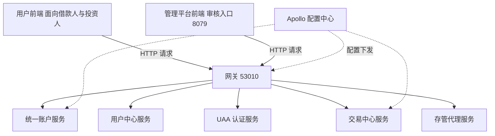

# 部署管理平台前端工程：给审核功能一个独立的运营入口

> 🔒 安全提示：文中示例的口令/密钥均为课程教学环境演示口径，生产环境的安全要求见《安全与合规须知》。

保存标的信息的前后端链路已经全部打通，标的落库后等待审核。审核这个动作由谁来做？P2P 平台有专门的工作人员负责审核标的：评估借款用途是否合法、借款人有没有还款能力，审核通过标的信息才进入出借列表，不通过则借款终止。管理员审标得有一个操作界面：把待审标的分页查出来，逐条看借款人是谁、借多少、期限利率几何，旁边摆着通过与不通过的按钮。这个界面不在借款人用的前端里，而是一个独立的管理平台前端工程，代码现成，本课只做部署。

## 先给结论

- 审核标的属于运营侧功能，业务实现仍放在交易中心工程里，但入口需要一个独立的管理平台前端。
- 管理平台前端基于 vue-element-admin 集成方案，技术栈为 Vue 2.6.10 + element-ui 2.7.0 + axios，代码无需动手改，只要部署起来能登录。
- 部署四步：用 HBuilder X 导入工程；可选安装「内置终端」插件；工程名右键执行 `npm install` 安装依赖（菜单不存在说明依赖已随工程带齐，直接跳过）；右键执行 `npm run dev` 启动。
- 前端占用 8079 端口，登录账号 admin；登录要成功，Apollo 与注册中心、网关、统一账户、用户中心、UAA 等微服务必须先起齐。
- 管理平台前端与用户前端共用同一套服务端，请求同样经网关转发，架构上没有特殊通道。

## 为什么审核要单独一个前端

项目至今只有一个前端工程，服务对象是普通用户：借款人填申请、投资人看出借列表。管理平台前端面向的是另一类人，平台自己的工作人员，他们登录后做的事是审核标的、管理运营数据，与用户端的功能、权限、界面形态完全不同。两类角色塞进同一个前端，权限裁剪会越做越复杂，发版节奏也会互相拖累，拆开是迟早的事，本课顺势把它立起来。

拆开之后整体架构没有变：两个前端，一个服务端。这张图在讲两套前端的请求去向：



关键在于管理平台前端没有任何特殊通道：它的登录走同一套 UAA 认证，业务请求同样过网关按路由转发到各微服务，审核功能的后端实现就落在交易中心工程里。对服务端来说，多了一个前端只是多了一类调用方，架构不变。

## 部署四步：导入、装依赖、启动、登录

工程从资料文件夹里拿来，用 HBuilder X 打开。注意打开的是管理平台前端，别和一直在用的用户前端搞混，两者技术栈与运行方式都不一样：用户前端是 uni-app 工程，直接点运行到浏览器；管理平台前端基于 vue-element-admin，要靠 npm 脚本启动。

第一件可选的事是安装 HBuilder X 的「内置终端」插件，菜单视图里可以呼出，作用是让 `npm` 命令的日志直接打印在编辑器下方的终端面板里；不装也能跑，只是要自己另开一个命令行窗口执行命令。

第二步安装依赖。在工程名上右键，找 `npm install` 菜单：

```bash
# 右键菜单执行 或在终端里手动执行 在线安装前端依赖库 需要联网
npm install
```

执行后下方会滚动安装日志，联网下载依赖库。有的环境打开菜单找不到 `npm install` 这一项，这反而是好消息：说明随工程分发的依赖库已经齐全，这一步直接跳过。

第三步启动。继续在工程名上右键，这次执行 `npm run dev`：

```bash
# 启动开发服务器 首次编译较慢 等待出现端口信息
npm run dev
```

弹出终端选择时，装过内置终端插件就选内置终端。第一次启动最慢，观察控制台直到出现类似下面的提示，算启动成功：

```text
App running at:
- Local:   http://localhost:8079/
- Network: http://192.168.25.128:8079/

Note that the development build is not optimized.
To create a production build, run npm run build.
```

8079 就是管理平台前端的开发服务器端口，正常情况下浏览器会自动打开登录页，地址形如 `localhost:8079/#/login`。开发环境的接口指向由工程内的环境配置文件声明，样式如下（示例为按本课前端写法补全，实际以工程内配置为准）：

```ini
# .env.development 示例为按本课前端写法补全
# 接口基础地址指向本机网关
VUE_APP_BASE_API = 'http://localhost:53010'
```

第四步登录。账号 admin，密码也是 admin。登录能走通的前提是后端起齐：Apollo、注册中心、网关、统一账户、用户中心、UAA，缺一个登录请求都会失败。若密码始终不对，多半是历史数据被人改过，admin/admin 与 123456 两个都试一遍，仍不行就往管理员表里补插一条数据再用。判断部署是否完成的标志很朴素：登录页能正常打开，即工程已就位。

## 常见误区

- **把管理平台前端当用户前端运行。** 错例：打开工程后像 uni-app 那样点「运行到浏览器」。正解：vue-element-admin 工程要用 `npm run dev` 启动，运行方式由技术栈决定，两套前端不要混用操作。
- **找不到 `npm install` 菜单就卡住。** 错例：认定环境坏了，反复重装工具。正解：菜单不存在说明依赖库已随工程带齐，跳过安装直接启动即可。
- **页面没开就下结论部署失败。** 错例：首次启动编译慢，等不及就重开。正解：第一次启动最慢，等控制台出现端口信息为准；启动后个别报错先看是否影响登录，不影响就继续。
- **前端一起来就点登录。** 错例：只启动了前端工程就验证账号。正解：登录走的是 UAA 认证与用户中心查询，Apollo 与相关微服务没起齐必然失败，先起后端再登录。

## 面试可能被问到的问题

1. 面试官追问：「管理端和用户端为什么要拆成两个前端工程？」
   答：两类角色的功能、权限与界面形态完全不同，运营侧要的是列表加审核动作，用户侧要的是申请与出借流程。拆开后权限模型各自独立，发版互不影响，后端仍是同一套微服务，只是多了一类调用方。
2. 面试官追问：「vue-element-admin 是什么，用它省了什么？」
   答：它是一套基于 Vue 与 element-ui 的后台管理集成方案，内置登录、路由权限、布局、请求封装等通用能力。管理平台这类项目直接在它上面做业务页面，省掉从零搭脚手架的成本，本课的工程即基于该方案提供，只需部署。
3. 面试官追问：「前端开发服务器 8079 的请求是怎么到微服务的？」
   答：开发环境下前端的接口基础地址指向网关，业务请求按路径前缀经网关路由转发到对应微服务，与生产形态一致；跨域由网关或代理配置消化，前端不需要关心每个微服务的真实地址。
4. 面试官追问：「`npm install` 与 `npm run dev` 分别做了什么？」
   答：`npm install` 按 `package.json` 与锁文件把依赖下载到 `node_modules`，是运行的前提；`npm run dev` 执行脚本里定义的开发命令，启动带热更新的开发服务器。前者装环境，后者跑应用，首次都要联网。

## 配套资料

- 讲义：`materials/docs/10/万信金融-第3章-讲义-发标v1.0.md`，3.3 部署 P2P 管理平台前端工程：3.3.1 打开前端工程（vue-element-admin 与技术栈清单）、3.3.2 搭建运行环境（内置终端插件、`npm install`、`npm run dev`、8079 端口、admin 账号与启动依赖清单）。
- 代码：`materials/code/10/wanxinp2p_front/`，用户前端 uni-app 工程归档（目录保留原始命名，路径只列到该层级），可对照两套前端的工程技术栈与运行方式差异。
- 说明：管理平台前端工程随课程资料单独提供，未随仓库归档；文中环境配置文件与命令为按本课写法补全的示例，端口与技术栈清单以讲义与画面线为准。
