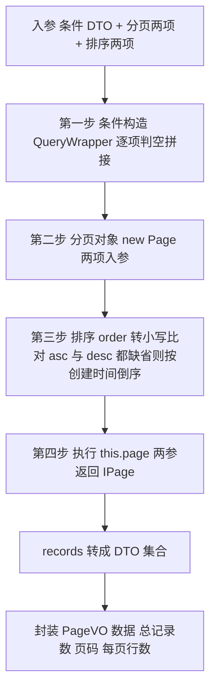

# 查询标的信息：条件、分页、排序，一张列表的全要素查询

管理平台前端已经部署就位，审核标的功能可以动工了。动手的起点却不是审核本身：管理员要审标，页面上得先把标的列表查出来，每个标的后跟着审核按钮，逐条操作。所以审核业务的第一块拼图是一个查询，而且不是随手写个 `select *` 的查询，管理端的列表页要支撑按类型、名称、期限、利率、状态等多条件组合筛选，要分页，还要按指定字段升降序排列。三个视频连着讲完接口定义与功能实现，正好合成一篇。

## 先给结论

- 查询标的信息是增删改查里的查，但做成了全要素版本：条件、分页、排序三件套齐备，只有平台管理员在管理平台看得到，数据访问层沿用保存标的时搭好的 MyBatis-Plus 环境，无需新增。
- 接口：`TransactionApi` 新增 `queryProjects`，入参五个，`ProjectQueryDTO` 装查询条件、`order` 与 `sortBy` 管排序、`pageNo` 与 `pageSize` 管分页，返回 `RestResponse<PageVO<ProjectDTO>>`。
- 参数设计：查询条件字段多、会扩展，走 `@RequestBody` 接 JSON；分页与排序是通用小参数，走 URL 查询参数。
- 实现固定四步：`QueryWrapper` 组条件、`Page` 对象定分页、按 `order` 与 `sortBy` 拼排序（缺省按创建时间倒序）、`this.page(page, wrapper)` 执行后把 `IPage` 里的记录转成 DTO 装进 `PageVO`。
- 字符串条件用 `isNotBlank` 判空，数值区间条件判 `null` 后用 `ge` 与 `le` 拼上下界；排序的 `order` 值统一转小写再比对，两个排序参数必须成对出现才生效。

## 列表查询为什么要做全

管理员打开管理平台，进入标的审核页面，看到的是一张分页表格：标的名称、借款金额、期限、利率、还款方式、状态，每一行末尾是审核按钮。数据量一大，翻页找标的不现实，筛选是刚需：按类型挑出新标、精英标这类营销分类，按借款金额或年化利率划区间找重点标的，按状态只看待审的记录。列表查询做得越顺手，审核效率越高，所以这一课把一个查询该有的能力一次做全，而不是只写个最小可用版本。审核动作本身属于下一课的内容，但它的可用性完全建立在这张列表之上，先把查询立住，审核才有落点。

功能完整意味着参数不会少。条件可能有八九个，还带分页两项、排序两项，怎么组织参数、怎么封装返回，接口定义这一步就要想清楚。

## 定义接口：五个入参与一个分页壳

交易中心的方法照例先在 API 工程的 `transaction` 包里定义。条件对象 `ProjectQueryDTO` 先落进 API 工程的 model 包，字段覆盖了前端会用的全部筛选项：

```java
/** 标的信息查询对象 按讲义口径整理 包名按 com.study.finance 系改写 */
@Data
@ApiModel(value = "ProjectQueryDTO", description = "标的信息查询对象")
public class ProjectQueryDTO {

    @ApiModelProperty("标的的类型")
    private String type;

    @ApiModelProperty("名称")
    private String name;

    @ApiModelProperty("起止标的期限(单位:天)")
    private Integer startPeriod;

    @ApiModelProperty("起止标的期限(单位:天)")
    private Integer endPeriod;

    @ApiModelProperty("起止年化利率(投资人视图)")
    private BigDecimal startAnnualRate;

    @ApiModelProperty("起止年化利率(投资人视图)")
    private BigDecimal endAnnualRate;

    @ApiModelProperty("年化利率(借款人视图)")
    private BigDecimal borrowerAnnualRate;

    @ApiModelProperty("还款方式")
    private String repaymentWay;

    @ApiModelProperty("标的状态")
    private String projectStatus;
}
```

期限与利率都是区间语义，各有一对起止字段；类型、名称、还款方式、状态是等值匹配。字段背后挂着业务语义：标的类型里的新标、精英标是平台做的营销分类，精英标说白了就是把质量较高的标的挂上标签吸引投标；年化利率的区间筛选是投资人视角的产物，挑标的先看利率高低，8 到 10 的区间就是筛出这个收益档的所有标的；期限按月起步，六到十二个月、十二到二十四个月都是常见的筛选档位，落库时折算成天，所以区间字段的单位是天。接口方法把这九个字段打包进 DTO，再加上四个散参：

```java
/** 交易中心 API 新增查询方法 包名按 com.study.finance 系改写 */
public interface TransactionApi {

    /** 借款人发标 */
    @PostMapping("/my/projects")
    RestResponse<ProjectDTO> createProject(ProjectDTO projectDTO);

    /**
     * 检索标的信息 带条件带分页带排序
     */
    @ApiOperation("检索标的信息")
    @ApiImplicitParams({
            @ApiImplicitParam(name = "projectQueryDTO", value = "标的信息查询对象",
                    required = true, dataType = "ProjectQueryDTO", paramType = "body"),
            @ApiImplicitParam(name = "order", value = "顺序", required = false,
                    dataType = "string", paramType = "query"),
            @ApiImplicitParam(name = "pageNo", value = "页码", required = true,
                    dataType = "int", paramType = "query"),
            @ApiImplicitParam(name = "pageSize", value = "每页记录数", required = true,
                    dataType = "int", paramType = "query"),
            @ApiImplicitParam(name = "sortBy", value = "排序字段", required = false,
                    dataType = "string", paramType = "query")
    })
    @PostMapping("/projects")
    RestResponse<PageVO<ProjectDTO>> queryProjects(ProjectQueryDTO projectQueryDTO,
            String order, Integer pageNo, Integer pageSize, String sortBy);
}
```

返回值里的 `PageVO` 是公共工程提供的通用分页壳，四个属性各司其职：`content` 是当前页数据集合，范型决定每行长什么样；`total` 是总记录数，翻页控件靠它算总页数；`pageNo` 与 `pageSize` 是本次查询的页码与每页行数，回显给前端。它的骨架如下：

```java
/** 通用分页对象 节选 包名按 com.study.finance 系改写 */
public class PageVO<T> implements Serializable {

    /** 当前页数据 查出来的每行封装成 T */
    private List<T> content = new ArrayList<>();
    /** 总记录数 */
    private long total;
    /** 第几页 */
    private int pageNo;
    /** 每页多少行 */
    private int pageSize;

    public PageVO(List<T> content, long total, int pageNo, int pageSize) {
        this.content = content;
        this.total = total;
        this.pageNo = pageNo;
        this.pageSize = pageSize;
    }
}
```

集合的范型选 `ProjectDTO` 而不是实体 `Project`，是契约隔离的考虑：接口对外暴露的永远是 DTO，表结构变化被挡在业务层以内，前端与文档看到的字段保持稳定。把这个检索接口与发标接口并排放着看还有个发现：发标走 `/my/projects`，检索走 `/projects`。发标的调用方是借款人前端，检索的调用方是管理平台前端，路径风格随调用方分开，与上一课「内部接口与前端接口分轨」是同一套约定在不同维度的体现。控制器实现还是空壳起步，补上 Swagger 注解与 Spring MVC 注解：

```java
/** 交易中心控制器 检索标的实现 包名按 com.study.finance 系改写 */
@Override
@ApiOperation("检索标的信息")
@ApiImplicitParams({
        @ApiImplicitParam(name = "projectQueryDTO", value = "标的信息查询对象",
                required = true, dataType = "ProjectQueryDTO", paramType = "body"),
        @ApiImplicitParam(name = "pageNo", value = "页码", required = true,
                dataType = "int", paramType = "query"),
        @ApiImplicitParam(name = "pageSize", value = "每页记录数", required = true,
                dataType = "int", paramType = "query")
})
@PostMapping("/projects")
public RestResponse<PageVO<ProjectDTO>> queryProjects(@RequestBody ProjectQueryDTO projectQueryDTO,
        String order, Integer pageNo, Integer pageSize, String sortBy) {
    return null;
}
```

参数走向有个值得咀嚼的设计：条件对象挂在 `@RequestBody` 上，从请求体读 JSON；分页与排序四个参数不加注解，直接从 URL 查询参数绑定。条件字段多、后续还会增减，放请求体里扩展成本最低；页码、行数、排序方向这类短小且几乎所有列表接口都长一样的参数，放 URL 上可读性好，日志里一眼可见。一个接口同时用两种参数来源，是很常见的工程折中。

那堆 `@ApiImplicitParam` 注解看着冗长，价值在于把每个参数的名字、含义、必填与否、来源位置讲给文档听，管理平台前端对着生成的接口文档就能联调，不用追着后端问字段。至于先写空实现再补注解的节奏，是编译器驱动开发的惯用法：接口一定义，实现类立刻报错，让开发环境把方法骨架生成出来，注解与实现再往骨架里填，错漏最少。

## 功能实现：四步走完一条链

业务层接口新增方法 `queryProjectsByQueryDTO`，签名与控制器方法几乎一致，唯一差别是返回值少包一层 `RestResponse`：控制器拿到业务层的 `PageVO` 之后才套上统一响应壳。这个规律值得记下：业务层接口的方法签名照着控制器抄，把 `RestResponse` 这层壳去掉，参数与返回值原样保留，控制器只是在业务层结果的基础上多包一层统一响应。两层各管各的，业务层不管协议，控制器不管规则。

数据访问层在保存标的信息时已经就位，Mapper 与实体都是现成的，这次一个类都不用新增，直接从业务层开工。条件、分页、排序、执行封装四件事堆在一起写很容易乱，固定的做法是拆步骤：先集中把条件构造器填好，再造分页对象，再拼排序，三样齐了才执行查询，查完做结果转换。每一步的产物都明确，写错了也容易定位是哪一步的问题。整条链路的顺序与产出如下图：



第一步组条件。`QueryWrapper` 的范型必须写表实体 `Project`，不是查询 DTO，它拼的是 SQL 条件，自然要对着实体与列的映射来。逐项判空再拼接，动态查询的核心就在这一串 if：

```java
/** 条件构造 节选 按讲义与画面线口径整理 包名按 com.study.finance 系改写 */
// 带条件 泛型是表实体 Project
QueryWrapper<Project> queryWrapper = new QueryWrapper<>();
// 标的类型 字符串条件 非空才拼
if (StringUtils.isNotBlank(projectQueryDTO.getType())) {
    queryWrapper.lambda().eq(Project::getType, projectQueryDTO.getType());
}
// 名称 等值匹配
if (StringUtils.isNotBlank(projectQueryDTO.getName())) {
    queryWrapper.lambda().eq(Project::getName, projectQueryDTO.getName());
}
// 起止年化利率 区间条件 数值判 null 用 ge 与 le 拼上下界
if (null != projectQueryDTO.getStartAnnualRate()) {
    queryWrapper.lambda().ge(Project::getAnnualRate, projectQueryDTO.getStartAnnualRate());
}
if (null != projectQueryDTO.getEndAnnualRate()) {
    queryWrapper.lambda().le(Project::getAnnualRate, projectQueryDTO.getEndAnnualRate());
}
// 起止期限 同为区间
if (null != projectQueryDTO.getStartPeriod()) {
    queryWrapper.lambda().ge(Project::getPeriod, projectQueryDTO.getStartPeriod());
}
if (null != projectQueryDTO.getEndPeriod()) {
    queryWrapper.lambda().le(Project::getPeriod, projectQueryDTO.getEndPeriod());
}
// 标的状态 字符串等值
if (StringUtils.isNotBlank(projectQueryDTO.getProjectStatus())) {
    queryWrapper.lambda().eq(Project::getProjectStatus, projectQueryDTO.getProjectStatus());
}
```

判空方式按字段类型分两派：字符串条件用工具类的 `isNotBlank`，null、空串、纯空白都算没传；数值是包装类型，只跟 `null` 比较，区间上下界各管一头，`ge` 是大于等于，`le` 是小于等于，前端传 8 到 10 的利率区间，落进 SQL 就是两条边界条件。为什么动态条件必须逐项判空？前端有九个筛选项，用户未必都用：可能只按类型查，也可能只框一个利率区间。判空的本质是「传了才拼」，哪个字段有值哪条条件进 SQL，没值的字段完全不出现，这样一份实现就能覆盖所有筛选组合，而不是为每种组合写一条查询。工具类要导 Apache Commons Lang3 的包，别顺手导成 Spring 自带的 `StringUtils`，那个类里没有 `isNotBlank`。

第二步定分页，一行：

```java
// 分页对象 承载页码与每页行数
Page<Project> page = new Page<>(pageNo, pageSize);
```

第三步拼排序。`order` 表达升序还是降序，`sortBy` 表达按哪个字段排，两者是搭档，缺一不可，所以要整体判空、成对生效。前端传来的 `order` 大小写不可控，统一转小写再比对：

```java
// 排序 order 与 sortBy 成对出现 都非空才生效
if (StringUtils.isNotBlank(order) && StringUtils.isNotBlank(sortBy)) {
    // 前端传值大小写不可控 统一转小写再比较
    if (order.toLowerCase().equals("asc")) {
        queryWrapper.orderByAsc(sortBy);
    } else if (order.toLowerCase().equals("desc")) {
        queryWrapper.orderByDesc(sortBy);
    }
} else {
    // 两个值都没传 客户不打算排序 给默认排序 按创建时间倒序 最新发的标排前面
    queryWrapper.lambda().orderByDesc(Project::getCreateDate);
}
```

默认排序不是可有可无的补丁。用户没有表达排序意愿时，数据库返回顺序没有承诺，列表每次刷新都可能变脸；按创建时间倒序是最符合直觉的兜底，最新发的标永远在最前面，管理员打开页面先看到新标的。写排序时还有个小选择：`orderByAsc` 与 `orderByDesc` 收的是字段引用，lambda 指向实体的 getter 即可，不必手写列名字符串，列名写错要到运行时才炸，lambda 写错编译期就过不去。

第四步执行并封装。MyBatis-Plus 在业务基类里封装好了分页查询方法，两个参数，分页对象在前、条件构造器在后，返回类型是 `IPage`。`Page` 是入参也是实现类，`IPage` 是分页结果的接口视角，里面装着当前页记录集合与总记录数，`getRecords` 取集合，`getTotal` 取总数。这里有个隐含前提：分页能力来自此前环境准备时注册的分页拦截器，它是真正把 `limit` 拼进 SQL、把 count 查出来的角色。拦截器没配的话，`Page` 参数不会报错，但 SQL 里不会出现分页语句，每次都把全表查回来，数据量一大就是事故，联调时列表快得反常或慢得离谱都要先想起它：

```java
// 执行查询 条件 分页 排序一次交给 MyBatis-Plus
IPage<Project> iPage = this.page(page, queryWrapper);
// 当前页记录是实体集合 转成 DTO 集合
List<ProjectDTO> projectDTOList = convertProjectEntityListToDTOList(iPage.getRecords());
// 封装 PageVO 总记录数从 IPage 取 页码与行数就是入参
return new PageVO<>(projectDTOList, iPage.getTotal(), pageNo, pageSize);
```

`IPage` 里的记录是 `List<Project>`，要的却是 `List<ProjectDTO>`，集合层面的转换逐条进行，封装一个转换方法循环处理，字段拷贝交给 Spring 的工具类。这个方法与保存标的时的 DTO 转 entity 正好互为逆操作，独立成方法是为了复用：下次再有查询返回实体集合，转换逻辑直接拿来就用：

```java
/** 实体集合转 DTO 集合 按讲义口径整理 */
private List<ProjectDTO> convertProjectEntityListToDTOList(List<Project> projectList) {
    List<ProjectDTO> dtoList = new ArrayList<>();
    if (projectList == null || projectList.isEmpty()) {
        return dtoList;
    }
    projectList.forEach(project -> {
        ProjectDTO projectDTO = new ProjectDTO();
        BeanUtils.copyProperties(project, projectDTO);
        dtoList.add(projectDTO);
    });
    return dtoList;
}
```

至此业务层返回 `PageVO`，控制器的空实现补上一行业务调用加一次 `RestResponse.success` 包装，接口就完整了。管理平台的表格组件拿到 `content` 渲染行数据、拿 `total` 算总页数、拿 `pageNo` 与 `pageSize` 回显当前页，一次接口调用与前端翻页控件完全对齐。复杂查询的代码容易写成一锅粥，拆成条件、分页、排序、执行封装四步逐段落笔，每一步的产物都明确，是最稳妥的写法。

## 顺带一提：分片口径下这条 SQL 怎么跑

标的查询的条件里通常不含发标人 ID，而在本项目的分片口径下，标的信息表按发标人 ID 分库、按标的 ID 分表。没有分片键的查询走广播路由：逻辑表 `project` 上的一条 SQL 会被改写后发往两个交易库的 `project_0` 与 `project_1` 四个真实表，各查各的，结果在内存里归并出统一的分页结果。

归并这一步比看起来讲究。每个分片各自带着 `limit` 返回，跨片的总记录数要靠各分片 count 之和；跨片排序分页更要求每个分片都返回排序后的前若干行，归并器再在内存里做一次统一排序与截取，才能保证页码与顺序在全量数据上正确。MyBatis-Plus 生成的分页语句与 Sharding-JDBC 的归并机制在物理分片之上协同工作，业务代码照旧面向逻辑表，管理端列表的功能体验与单库时无异，代价是物理查询份数随分片数翻倍。管理端场景标的总量可控，这个代价完全可以接受；若是面向投资人的高频出借列表，就该考虑带分片键查询或改走检索方案了。

## 常见误区

- **`QueryWrapper` 范型写成查询 DTO。** 错例：`new QueryWrapper<ProjectQueryDTO>()`，运行时找不到列映射直接报错。正解：范型必须是表实体 `Project`，DTO 只装条件值，从 DTO 里 `get` 出来塞进条件。
- **`StringUtils` 导错包。** 错例：导了 Spring 的 `org.springframework.util.StringUtils`，调 `isNotBlank` 编译不过。正解：Apache Commons Lang3 的 `org.apache.commons.lang3.StringUtils` 才有这个方法。
- **数值区间用字符串工具判空。** 错例：对 `BigDecimal` 调 `isNotBlank`，类型对不上。正解：包装类型只判 `null`，区间用 `ge` 与 `le` 各拼一界。
- **排序参数只判一个。** 错例：只判 `order` 非空就用 `sortBy` 排序，`sortBy` 为空时 SQL 拼出不合法的 `order by`。正解：`order` 与 `sortBy` 成对出现，两者同时非空才拼排序，否则走默认排序。
- **把 `IPage` 直接透给前端。** 错例：控制器返回 `IPage<Project>`，分页实现类直接序列化。正解：转成公共工程定义的 `PageVO<ProjectDTO>`，契约稳定，分页实现想换随时能换。
- **分页拦截器没配还以为分页生效了。** 错例：测试数据只有几行，页大小设成十也看不出异常。正解：核对生成 SQL 里是否带 `limit` 与 count 语句，或造一批超过一页的数据验证翻页，别让小数据量掩盖配置缺失。

## 面试可能被问到的问题

1. 面试官追问：「MyBatis-Plus 条件构造器的 lambda 写法好在哪？」
   答：`Project::getType` 这类方法引用让字段名在编译期被检查，重命名字段时编译器直接报错，避免手写列名字符串的运行时风险；同时 `eq`、`ge`、`le`、`like` 等方法语义清晰，动态条件就是一串判空加拼接，可读性远高于手拼 SQL。
2. 面试官追问：「MyBatis-Plus 的分页是怎么实现的？」
   答：靠分页插件，本质是 MyBatis 拦截器。查询进来先按原 SQL 发一条 count 拿总数，再根据分页参数在 SQL 后拼接 limit 语句，把总记录数与当前页数据回填进 `Page` 对象，调用方拿到的 `IPage` 里 `getTotal` 与 `getRecords` 各就各位。
3. 面试官追问：「为什么查询条件放请求体，分页排序放 URL 参数？」
   答：条件字段多且会持续扩展，JSON 请求体加字段不动方法签名，扩展成本最低；页码、行数、排序方向短小且格式固定，放查询参数便于阅读、日志排查与缓存键构造。一个接口混用两种参数来源是工程上很常见的折中。
4. 面试官追问：「排序字段由前端传入，有什么风险？」
   答：`sortBy` 拼进 `order by` 属于字符串拼接，有 SQL 注入面，也可能传一个不存在的列导致 SQL 报错。稳妥做法是服务端维护可排序字段的白名单，传入的 `sortBy` 必须命中白名单，再映射成真实列名，这一步课程里从简，生产必须补上。
5. 面试官追问：「动态条件查询的判空为什么有两种写法？」
   答：字符串要排除空串与纯空白，用 `isNotBlank`；数值是包装类型，只需判断 `null`，因为传了就一定有值可比。混用会把类型问题暴露在编译期或运行期，按字段类型选判空方式是基本纪律。
6. 面试官追问：「分库分表之后，不带分片键的列表查询代价是什么？」
   答：走广播路由，SQL 被改写后发往所有分片并行查询，再在内存归并排序分页。功能上无损，代价是物理查询份数随分片数增长，跨片归并吃内存。管理端数据量可控可以接受，面向用户的高频查询则尽量带上分片键或改走检索方案。

## 配套资料

- 讲义：`materials/docs/10/万信金融-第3章-讲义-发标v1.0.md`，3.4 查询标的信息：3.4.1 定义接口（`queryProjects`、`ProjectQueryDTO`、`PageVO` 与控制器实现）、3.4.2 功能实现（条件、分页、排序、执行与封装）、3.4.3 前后端集成测试。
- 代码：`materials/code/10/wanxinp2p_apollo/`，公共模块归档（目录保留原始命名，路径只列到该层级），`RestResponse` 等公共类真实源码可对照，`PageVO` 同属公共工程口径。
- 代码：`materials/code/10/wanxinp2p/`，P2P 工程归档（目录保留原始命名，路径只列到该层级），API 工程与业务工程的包组织方式可对照。
- 说明：交易中心工程随课程资料单独提供，未随仓库归档；查询实现代码按画面线与讲义口径整理，包名按 `com.study.finance` 系改写；排序白名单等生产加固为按主流写法补充的建议，非课程内容。
