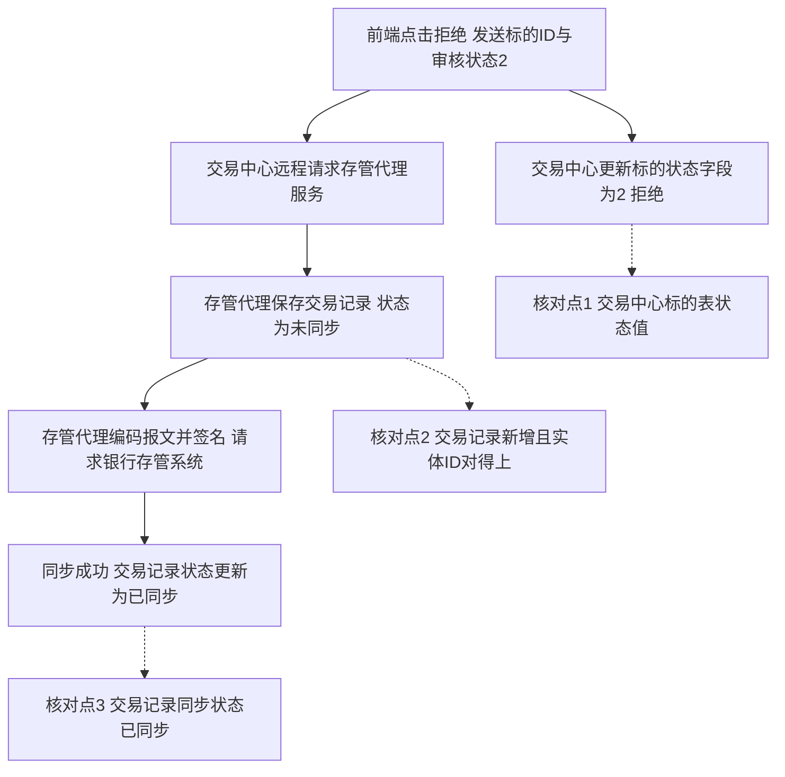

# 审核标的前后端集成测试：两轮联调揪出两个隐蔽缺陷

审核标的功能的接口定义与实现已经全部完成，交易中心与存管代理服务两侧的代码都已就位，接下来进入前后端集成测试。这一步远比「点一下通过按钮」复杂：要启动的服务横跨配置中心、网关、多个业务微服务、管理平台前端与银行存管系统，操作之后还要到两套数据库里逐项核对状态是否按预期变化。实测过程恰好暴露了两个写代码时几乎无法自查的缺陷，一个藏在存管代理的 Base64 编码环节，一个藏在交易中心的更新语句上，前后端集成测试的价值正体现在这里。

## 先给结论

- 启动清单五件套：Apollo 配置中心、后端微服务全套（管理平台要登录，鉴权链路缺一环都会卡在前端）、管理平台前端、银行存管系统；管理平台前端别启动成借款人用户端。
- 前端交互约定：审核弹窗点击通过向交易中心发送标的 ID 加审核状态 1，点击拒绝发送标的 ID 加审核状态 2。
- 测试路径建议先拒绝再通过：拒绝路径先跑通并核对数据，通过路径再验证一轮，每个用例都要落到数据库确认。
- 缺陷一：存管代理把 JSON 报文做 Base64 处理时误用了解码方法，报 `Illegal base64 character '7b'`，换回编码方法即修复。
- 缺陷二：交易中心更新标的状态时只封装了 `lambdaUpdate` 条件没有调用执行方法，控制台连 update 语句都不打印，补上 `update(...)` 调用后状态正常落库。

## 把环境撑起来：一次审核要动用多少服务

测试前的第一件事不是找 bug，而是把清单列全。配置中心 Apollo 已在运行；后端微服务需要全部启动，包括网关、用户中心、统一账户、交易中心与存管代理服务，因为管理平台的操作要登录，令牌校验、远程调用任何一环缺席，测试还没开始就会卡在前端；管理平台前端要确认启动的是管理端工程而不是借款人用户端，两者页面长得很像，启动错了连审核按钮都找不到；银行存管系统也在启动清单里，它对存管代理暴露服务端口，审核链路的同步环节要真正打过去。

服务全部就位后打开管理平台，进入标的信息列表。列表里是此前发标功能留下的数据：一条标的，状态为募集中，年化利率 15%，行末挂着审核按钮。点击审核弹出确认窗，窗口里两个按钮：拒绝与通过。前端点击通过时把标的 ID 与数值 1 发给交易中心，点击拒绝时发送标的 ID 与数值 2；前端还承担了一部分展示判断，收到 1 按审核通过渲染，收到 2 按审核拒绝渲染。这套交互口径决定了后端参数的含义，测试前必须弄清。

## 测试从拒绝开始，第一枪就打出一个异常

有经验的测试路径是先拒绝后通过：把标的一开始拒掉，走完一遍完整链路再放开，两个用例互不干扰。点击拒绝，结果没有辜负「集成测试一定会出问题」的预期，页面直接报错。

排查从控制台入手。交易中心一片安静，错误出在存管代理服务：`java.lang.IllegalArgumentException: Illegal base64 character '7b'`。解决 bug 的基本功是读懂异常信息，这段报错把类名与行号都交代了，顺着堆栈点过去，出错的那行在做 Base64 处理。

这个错误信息本身就带着答案。字符 7b 的十六进制对应 ASCII 表里的 `{`，而 JSON 报文的第一个字符恰好就是 `{`。Base64 解码器遇到它直接拒绝，说明这段 JSON 文本根本不该被解码，它应该被编码。回看审核链路的上下文：存管代理要把标的信息组装成 JSON 报文，做 Base64 编码后作为请求参数发往银行存管系统，配合签名一起完成票据校验。写代码时编码方法顺手写成了同类的解码方法，一字之差，整条链路崩在这里。修复前后对照如下：

```java
// 修复前 误用解码方法 JSON 报文里出现 { 即 0x7b 解码器直接抛异常
String reqData = EncryptUtil.decodeUTF8StringBase64(jsonString);

// 修复后 该做的是编码 JSON 转 Base64 后放进请求参数
String reqData = EncryptUtil.encodeUTF8StringBase64(jsonString);
```

`EncryptUtil` 是公共工程的工具类，`encodeUTF8StringBase64` 与 `decodeUTF8StringBase64` 两个方法基于 JDK 的 `java.util.Base64` 实现，名字里 encode 与 decode 的区分度足够，写错更多是复制粘贴时的手滑。修改涉及存管代理服务的代码，改完必须重启该服务再测。

第二次点击拒绝，控制台安静了，交易中心与存管代理都没有报错，存管代理的控制台里还能看到查询与写入语句依次打出。页面不报错只是第一关，数据到底改对了没有，要去数据库里核对。

## 到数据库里核对：拒绝路径的全部落点

核对的对象就是审核链路时序图里的几个关键步骤，一个一个对。这张图在讲拒绝路径上数据变化的核对点：



三个核对点逐一确认。交易记录表在存管代理服务的数据库 `finance_depository_agent` 里，按时间排序找到刚插入的那条，它的关联业务实体 ID 是 96993；拿这个 ID 到交易中心的标的表里反查，因为标的信息按分片规则落在两个交易库的 `project_0` 与 `project_1` 四张真实表里，按 ID 定位后两边数据严丝合缝，证明交易记录确实保存成功。交易记录的同步状态字段从 0（未同步）更新成了 1（已同步），说明银行存管系统的同步环节走通了。交易中心这边标的状态字段变成 2，对应拒绝语义。数据、状态、时间三方对上，拒绝路径宣告通过。

## 通过路径卡住：一条没有执行的更新

拒绝通过后再测通过路径，现实中这也合理：标的最初被拒，借款人补充材料后管理员复查通过。点击通过，前端没有报错，控制台也没有异常，但刷新交易中心标的表，状态值纹丝不动，还是 2。

没有报错的逻辑错误最难排查，抓手只有一个：看预期的 SQL 有没有真的发生。负责改状态的代码在交易中心，控制台自上而下翻，查询语句一条接一条，update 一条都没有。存管代理那边明明有更新，交易中心这边却静悄悄，问题必然出在交易中心负责更新的这段代码上：

```java
// 修复前 只封装不执行 这行代码编译通过 运行时却什么也不做
Wrappers.<Project>lambdaUpdate()
        .set(Project::getStatus, Integer.parseInt(approveStatus))
        .eq(Project::getId, id);

// 修复后 以封装结果为参数调用 update 才真正落库
this.update(Wrappers.<Project>lambdaUpdate()
        .set(Project::getStatus, Integer.parseInt(approveStatus))
        .eq(Project::getId, id));
```

原因在 MyBatis-Plus 的设计：`Wrappers.lambdaUpdate()` 的职责只是封装条件与待修改字段的值，它是一个描述「要怎么改」的对象，本身不带任何执行语义。没有把封装结果交给 `update` 方法，数据库就不会收到 update 语句，控制台自然一条都不打印。这是个编译器完全查不出来的缺陷，静态看代码语法挑不出毛病，只有集成测试把整条链路跑起来才暴露。修改后重启交易中心，再次点击通过，在浏览器开发者工具里能看到发出的请求，参数是标的 ID 加审核状态 1，随后核对交易中心标的表，状态值从 2 变成了 1。

到这里，发标与审核标的整块功能全部测试通过。回头复盘两个缺陷：一个把编码写成了解码，一个只封装没有执行，共同点是单看代码编译不出问题，只有真实环境里跑一遍才能现形。集成测试不是走过场，它是唯一能把代码、配置、数据库、外部系统串起来验证的手段。

## 常见误区

- **只测通过路径，拒绝路径裸奔。** 错例：审核功能上线前只点过一次通过。正解：通过与拒绝是两条独立的分支，参数、状态落点、异常路径都不同，必须各测一轮。
- **前端不报错就认定功能正常。** 错例：点击通过后页面无异常便直接关闭测试。正解：每个操作都要到数据库核对状态与数据落点，无报错只排除了崩溃，不排除逻辑空转。
- **异常信息不细读就盲目打断点。** 错例：看到 `Illegal base64 character '7b'` 只知道报错了，全链路乱加断点。正解：异常自带类名、行号与原因，先顺着堆栈定位，再结合字符 0x7b 与业务上下文判断。
- **把 `lambdaUpdate` 封装当成已执行的更新。** 错例：写完 `Wrappers.lambdaUpdate().set(...).eq(...)` 就以为状态改了。正解：封装对象必须作为参数传给 `update` 方法才落库，验证手段是核对控制台是否打印出 update 语句。
- **启动错前端工程。** 错例：把借款人用户端当管理平台启动，找了半天审核按钮。正解：核对工程名与访问地址，管理端与用户端是两个独立前端。

## 面试可能被问到的问题

1. 面试官追问：「前后端集成测试前，怎么确定要启动哪些服务？」
   答：沿调用链列清单。管理平台前端要登录，就涉及网关与认证相关服务；审核操作触发交易中心与存管代理的远程调用，两个服务都要起；链路末端还有银行存管系统；配置中心与注册中心是基础设施也要在位。清单列完后逐个确认再开测，能省掉大量假故障排查。
2. 面试官追问：「`Illegal base64 character '7b'` 这种报错怎么定位？」
   答：0x7b 对应字符 `{`，JSON 报文以它开头，说明解码器收到了不该解码的文本，大概率是编码与解码方法用反了。异常堆栈里已经有类名与行号，顺着定位到 Base64 处理那行，结合业务意图（该编码还是该解码）即可修复。
3. 面试官追问：「MyBatis-Plus 的 `lambdaUpdate` 为什么没有执行更新？」
   答：它是条件与字段值的封装器，生成一个描述更新动作的 Wrapper 对象，不带执行语义。必须把这个对象作为参数传给 `update` 方法，由业务基类或 Mapper 去执行 SQL。封装与执行分离，好处是同一份条件可以复用，代价是漏掉执行调用时编译期毫无感知。
4. 面试官追问：「没有报错的功能缺陷怎么排查？」
   答：从预期行为与实际现象的差异入手，再核对中间证据。本例预期是标的状态更新，实际没变，先看控制台有没有生成预期 SQL，没有 update 语句就说明执行环节缺失，再回到代码层找原因。证据链比猜测可靠。
5. 面试官追问：「审核通过和拒绝分别改变哪些数据？」
   答：交易中心按审核结果更新标的状态字段，拒绝落 2、通过落 1；存管代理新增一条交易记录，记录请求流水号、关联实体与同步状态，银行同步成功后状态从未同步更新为已同步并写入确认时间。两边数据靠关联实体 ID 与流水号对齐。

## 配套资料

- 讲义：`materials/docs/10/万信金融-第3章-讲义-发标v1.0.md`，3.5 存管代理服务标的同步（交易中心 `projectsApprovalStatus`、存管代理 `createProject`、`saveDepositoryRecord`、`sendHttpGet` 的实现）与 3.5.2.3 前后端集成测试。
- 代码：`materials/code/10/wanxinp2p_apollo/`，公共模块归档（目录保留原始命名，路径只列到该层级），`EncryptUtil` 的 Base64 编解码方法真实源码可对照。
- 代码：`materials/code/10/wanxinp2p/`，P2P 工程归档（目录保留原始命名，路径只列到该层级），公共工具类与工程组织方式可对照。
- 说明：交易中心与存管代理服务工程随课程资料单独提供，未随仓库归档，更新状态与 Base64 处理代码按讲义与画面线口径整理，包名按 `com.study.finance` 系改写；管理平台前端组件代码未随仓库归档，交互口径按画面线描述。
