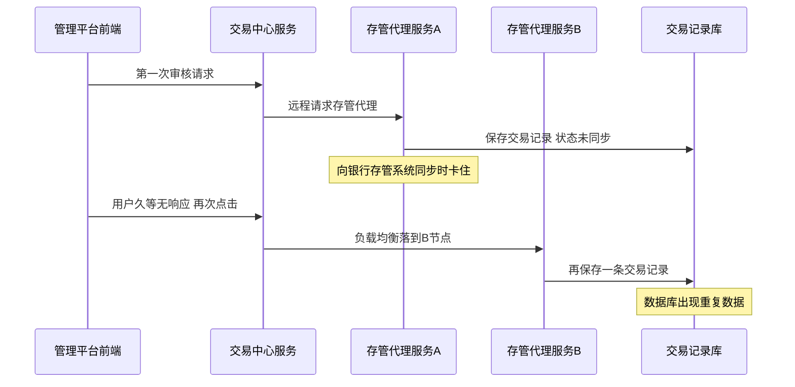

# 分布式幂等性分析：一次审核为什么会写出两条交易记录

审核标的功能前后端集成测试已经通过，功能上挑不出毛病，但这条链路里还埋着一个平时看不见、特定条件下会爆的问题。审核一次标的，前端到交易中心、交易中心到存管代理服务、存管代理服务再到银行存管系统，跨四五个节点，任何一环卡住，用户就会重试；重试的请求一旦落到集群的另一台服务器上，别人已经做过的事就要再做一遍，数据库里凭空多出一条交易记录。金融系统里，重复数据不是小事，这一课把问题的成因一层层拆开。

## 先给结论

- 问题成立的三个前提：一条大请求响应链路里嵌套两次远程请求（交易中心到存管代理服务、存管代理服务到银行存管系统）；整条链路处理耗时较长且银行侧耗时不可控；生产环境微服务以集群形式部署。
- 由此推出的第一类问题：第一次请求卡在中间环节（交易记录已保存、银行同步未完成），用户重试，请求落到集群另一节点，该节点不知情地再保存一条交易记录，数据库出现重复数据。
- 第二类问题：用户在短时间内连续点击，多个请求全部从头执行一遍，白白消耗服务资源。
- 幂等性定义：一个业务操作，不管重复执行多少次，最终产生的效果或返回的结果都和执行一次是一样的。
- 下一课的方案要同时达成两个目标：数据不能重复保存；短时间的重复请求只放行一个，其余直接挡回。

## 问题出在哪：链路长、耗时长、部署还是集群

把审核标的的完整时序摆开，从 2.1 管理员审核通过开始，到 2.14 审核成功结束，中间穿插着标的信息组装、签名、保存交易记录、向银行存管系统同步、同步结果回写等多个环节。这条大链路里嵌套着两个小请求响应过程：2.2 交易中心发起的对存管代理服务的请求，以及 2.5 存管代理服务发起的对银行存管系统的请求。每嵌套一层远程调用，出问题的面就宽一分。

耗时是第二个前提。整条链路处理完毕需要的时间不会短，尤其银行存管系统是银行一方的系统，它那边处理多久、网络状况如何，都不受项目控制，也没法精确评估。假设整条链路五秒左右才能走完，这五秒里用户看到的界面就是干等着。

集群是第三个前提，也是最容易被忽略的一个。生产环境的微服务很可能以集群形式部署，存管代理服务尤其如此：项目里凡是与银行存管系统打交道都要经过它，流量集中，最可能扩容成三五台实例同时运行。交易中心发出的每一次请求，经负载均衡分配，可能落到其中任何一台。三个前提交织在一起，问题就有了发生的土壤。

## 重复数据是怎么产生的

用一次具体的推演把问题演出来。这张时序图在讲第一次请求卡住、第二次请求落到另一台实例的完整过程：



第一次请求经负载均衡落到存管代理服务的 A 服务器，A 按流程执行，先往数据库保存一条交易记录，也就是链路里的 2.4 步。保存刚完成，继续往银行存管系统同步时因为网络或其他原因卡住了，后续步骤走不下去。交易中心收不到响应，前端也就一直转圈。

用户的耐心是有限的。等了一段时间界面毫无反应，很可能再次点击审核按钮。第二次请求到达交易中心，交易中心照常发起远程调用，这一次负载均衡把它分配到存管代理服务的 B 服务器。B 对 A 做过什么一无所知，它只管按自己的流程执行，走到保存交易记录这一步，又往数据库里插了一条。此刻问题已经坐实：数据库里存了两条重复的交易记录。

看一眼存管代理保存交易记录的代码，问题会更直观。改造前的逻辑上来就落库，没有任何防重动作：

```java
/** 交易记录保存 改造前 节选 包名按 com.study.finance 系改写 */
private DepositoryRecord saveDepositoryRecord(String requestNo, String requestType,
        String objectType, Long objectId) {
    DepositoryRecord depositoryRecord = new DepositoryRecord();
    // 设置请求流水号
    depositoryRecord.setRequestNo(requestNo);
    // 设置请求类型
    depositoryRecord.setRequestType(requestType);
    // 设置关联业务实体类型与标识
    depositoryRecord.setObjectType(objectType);
    depositoryRecord.setObjectId(objectId);
    // 设置请求时间与数据同步状态 未同步
    depositoryRecord.setCreateDate(LocalDateTime.now());
    depositoryRecord.setRequestStatus(StatusCode.STATUS_OUT.getCode());
    // 直接保存 无任何防重判断
    save(depositoryRecord);
    return depositoryRecord;
}
```

两次请求各自生成各自的流水号，两条记录的 `requestNo` 不同，数据库的唯一约束拦不住，重复就这样落进了表里。交易记录重复只是第一层破坏：如果 B 节点把后续步骤也走完，银行存管系统会被重复通知一次，标的的状态被重复更新一遍，越往下走，不一致的代价越大。

## 短时间重复点击：资源被白白烧掉

第二类问题不需要网络故障参与。有的用户是急脾气，页面上三五秒之内连点好几次按钮，前端就发过来好几个请求。整条审核链路按前面的假设要走五秒左右，如果五秒之内用户已经点了三次，三个请求会在服务端几乎同时展开，每个都从头到尾走一遍流程，保存、签名、远程调用银行。

合理的预期是：用户多等几秒无可厚非，超过合理时间后的重试属于正常操作，应该处理；但短时间内连点出来的重复请求，服务端必须识别并挡住。请求进来可以，但不能你点一次我从头执行一遍、你再点一次我又从头执行一遍，这么烧资源谁也扛不住。只放其中一个请求往下走，其余的直接返回一个「业务正在处理」就够了。

## 幂等性：把重复请求变成无害请求

这两个问题的共同解法有一个专门的名字，幂等性。它的定义很朴素：一个业务操作，不管重复执行多少次，最终产生的效果或返回的结果，都和只执行一次一样。拿生活场景类比，电梯按钮按多少次，电梯只会来一次；而转账接口如果不做处理，点两次就可能转两笔钱，这就是天然幂等与天然不幂等的区别。HTTP 语义里 GET 是幂等的，POST 默认不是，所以业务层面的 POST 接口要靠自己补上这道防线。

回到审核标的服务，实现幂等性意味着两件事：其一，同一笔业务不管请求重试多少次，交易记录只保存一次，数据库不再出现重复数据；其二，短时间内重复发送的请求，只允许一个拿到执行权继续走流程，其余的请求被识别后直接返回正在处理的提示，不再消耗任何下游资源。幂等一旦实现，重复保存与重复执行这两类问题同时消失，代价只是给每个请求一个可识别的凭证，并让服务端有能力判断「这件事我是不是已经做过了」。凭证怎么设计、判断在哪一步做，就是下一课的内容。

## 常见误区

- **以为前端禁用按钮就解决了重复提交。** 错例：点击后把按钮置灰，认为服务端不用防。正解：前端限制只是体验优化，绕过前端直接刷接口、重放请求都绕不过服务端，防重必须做在服务端。
- **以为只有网络故障才会产生重复请求。** 错例：认为测试环境一切正常就没有幂等问题。正解：用户习惯性连点、网关或客户端超时重试、消息重复投递都会制造重复请求，网络故障只是其中一种触发器。
- **把幂等性和事务混为一谈。** 错例：说「加了分布式事务就不需要幂等了」。正解：事务解决的是一组操作的原子性与一致性，幂等解决的是同一操作重复执行后果一致，两者关注点不同，分布式事务框架本身还常常依赖幂等来处理重试。
- **以为单机运行就不用考虑。** 错例：本地起一个实例测试没发现问题就上线。正解：生产以集群为常态，请求随时可能落到不同节点，单机测试发现不了跨节点的重复，防重方案必须按集群场景设计。

## 面试可能被问到的问题

1. 面试官追问：「什么是幂等性，为什么金融系统必须实现幂等？」
   答：幂等性指一个业务操作无论重复执行多少次，产生的效果或返回的结果都与执行一次相同。金融系统的写操作几乎都涉及资金与账务，一次重复请求可能变成重复扣款、重复记账，后果不可逆，所以转账、放款、审核同步这类接口必须把幂等当成底线能力。
2. 面试官追问：「哪些场景会产生重复请求？」
   答：常见有四类：用户界面上短时间内重复点击；客户端或网关在超时后自动重试；消费消息时因为消息中间件的重复投递再次触发业务；服务内部调用失败后的补偿重试。这些场景叠加集群部署，重复请求几乎必然出现。
3. 面试官追问：「幂等性和分布式事务是什么关系？」
   答：分布式事务保证跨多个服务的操作要么都成功要么都回滚，关注一致性；幂等保证同一操作重复执行的后果不变，关注重复性。事务执行过程中的重试、补偿动作本身就需要幂等保护，两者配合使用，不能互相替代。
4. 面试官追问：「HTTP 方法的天然幂等性是怎么划分的？」
   答：GET、PUT、DELETE 在语义上是幂等的，同一请求重复执行效果不变；POST 天然不幂等，重复提交会产生新资源或新数据。所以业务上的创建、提交类接口都用 POST 承载，需要额外设计防重机制。
5. 面试官追问：「你们项目里审核业务是怎么发现幂等问题的？」
   答：从链路结构分析的。审核要经过交易中心到存管代理、存管代理到银行存管系统两次远程调用，银行侧耗时不可控，存管代理又以集群部署，第一次请求卡住后重试会落到另一台实例再保存一条交易记录。推演出重复数据与重复执行两类问题后，确定了以请求流水号为凭证的防重方案。

## 配套资料

- 讲义：`materials/docs/10/万信金融-第3章-讲义-发标v1.0.md`，3.6 分布式事务幂等性，3.6.1 问题分析（三前提推演与重复数据成因）。
- 代码：`materials/code/10/wanxinp2p_apollo/`，公共模块归档（目录保留原始命名，路径只列到该层级），状态码 `StatusCode` 相关口径可对照。
- 说明：存管代理服务工程随课程资料单独提供，未随仓库归档，交易记录保存代码按讲义口径整理，包名按 `com.study.finance` 系改写。
