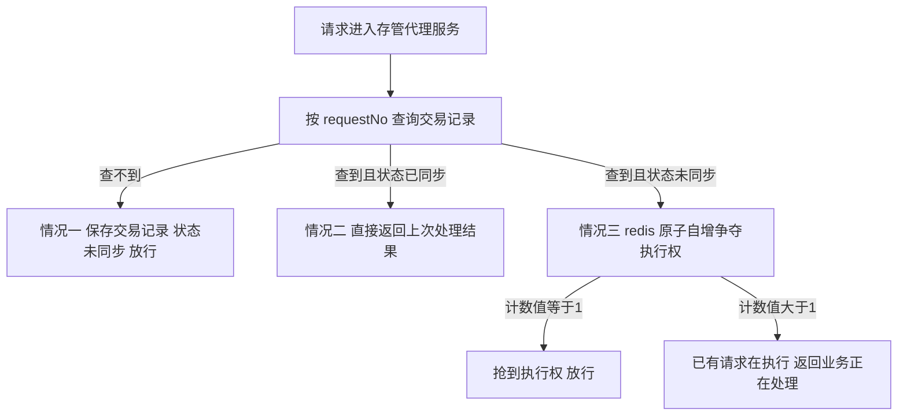

# 幂等性解决思路：按流水号查记录，三种情况分流处理

幂等性问题已经推演清楚：重复请求会造成交易记录重复保存，短时间连点会让同一笔业务被反复执行。动手写代码之前，先把方案想透。审核业务里重复的根源，是服务端对「这个请求是否处理过、处理到哪一步」一无所知。钥匙其实就藏在交易记录本身：每个发标请求都带着一个唯一的请求流水号 `requestNo`，先按它查交易记录，再按查询结果分三种情况处理，重复请求自然现形。

## 先给结论

- 要具体解决两个问题：数据重复保存；短时间内重复点击与重复请求只放行一个。
- 方案骨架：存管代理服务收到请求后不再直接保存，先按 `requestNo` 查交易记录，按「不存在」「存在且已同步」「存在且未同步」三种情况分流。
- 情况一，交易记录不存在：说明之前的请求连保存交易记录这步都没成功，本次请求按第一次处理，保存交易记录，状态初始为未同步。
- 情况二，交易记录存在且状态为已同步：上一次请求已经把核心业务全部执行完，本次什么都不做，直接把上次保存的处理结果返回。
- 情况三，交易记录存在且状态为未同步：恰处并发窗口，利用 Redis 原子自增争夺执行权，计数值大于 1 说明已有请求在执行，直接返回「业务正在处理」。
- 代码落点：在存管代理服务的 `DepositoryRecordServiceImpl` 里单独定义一个幂等处理方法，入参交易记录对象，三种情况在方法内闭环。

## 从直接保存到先查后判

改造前的逻辑是组装好交易记录对象就落库，对历史一无所知。改造后的入口多了一步：先查。查询条件就是请求流水号 `requestNo`，每个发标请求在交易中心侧生成时都全局唯一，它就是这笔业务在系统里的身份证。查出来的结果只有三种，恰好对应一次请求生命周期的三个阶段：刚起步（从未成功过）、已经走完（已同步）、卡在半路（未同步）。这张图在讲三分流的判定路径：



讲义把三分流的原则写得很清楚：交易记录不存在则新增，`requestNo` 是唯一索引，新保存的数据状态为未同步；交易记录存在且状态为未同步时存在并发可能，利用 Redis 原子性自增争夺请求执行权，计数值大于 1 直接返回正在处理；交易记录存在且状态为已同步时，直接返回处理结果。三句话就是整个方案的骨架。

## 情况一：查不到就保存，这是最简单的一条路

按 `requestNo` 查交易记录，结果为空，说明这笔业务从没成功走到过保存这一步，或者压根没有请求处理过它。本次请求就是「第一次」，直接保存交易记录，初始状态为未同步，然后继续往下执行签名与同步。防重的判定基线就是这张交易记录表：查得到就有历史，查不到就从头开始。`requestNo` 的唯一索引在这里还承担兜底职责，万一两个并发请求同时查空、同时保存，数据库的唯一约束会拦下其中一条，方案在最坏情况下也有底线。

## 情况二：已同步就是办完了，直接把结果递回去

查到交易记录，且状态是已同步，意味着前一次请求已经把签名、保存交易记录、向银行存管系统同步、回写状态这一整段核心链路全部走完。核心业务做完了，本次请求再来就没有任何要执行的动作，唯一要做的就是把上次银行存管系统返回的处理结果原样递回去：上次结果在处理完成时已经随交易记录一起持久化，本次取出来直接返回，交易中心拿到结果再回应前端。整个请求在数据库查询这一步就终止，一分下游资源都不消耗。这一条也解释了为什么处理结果必须落库，不落库，重复请求来了就无果可返。

## 情况三：未同步的并发窗口，用 Redis 抢执行权

查到交易记录，但状态还是未同步，这是最微妙的一档。未同步说明前一次请求保存了交易记录之后、银行同步完成之前卡住了，链路正悬在半空；此刻又进来一个请求，如果不拦，它会把同样的流程再走一遍。三个请求可能同时卡在这个窗口，方案要求只能放一个往下走。

拦截手段是 Redis 的原子自增。多个请求对同一个 `requestNo` 做 `increment`，Redis 单线程处理写命令，返回值各不相同：第一个请求拿到 1，后续请求拿到 2、3、4。返回 1 的请求就是执行权的赢家，设置有效期后放行；拿到大于 1 值的请求立刻明白已有同伴在执行，直接返回「业务正在处理」，不再往下走。选 Redis 而不是数据库锁，看中的是两点：自增是原子操作，集群里多个实例同时对同一个 key 自增也不会出现计数错乱；纯内存操作，开销远小于锁表。

有效期是方案里容易被忽略的细节。自增的 key 不能只加不减，前一次请求的执行权释放后，同一个流水号后续合法重试还要能放行，所以给 key 设置一个略大于整条链路估计耗时的有效期，过期自动清零，超时后的重试回到情况一的轨道。有效期的取值按业务耗时估计，本课按整链路约五秒的假设来设。

## 幂等处理方法的长相

思路落成代码，是在存管代理服务的 `DepositoryRecordServiceImpl` 里单独定义一个私有方法，三种情况在方法体内闭环。骨架按讲义口径整理如下：

```java
/**
 * 实现幂等性
 * @param depositoryRecord 交易记录对象
 * @return 需要直接返回给调用方的响应 为 null 表示本次请求可以继续往下执行
 */
private DepositoryResponseDTO<DepositoryBaseResponse> handleIdempotent(
        DepositoryRecord depositoryRecord) {
    // 根据 requestNo 查询交易记录
    String requestNo = depositoryRecord.getRequestNo();
    DepositoryRecordDTO depositoryRecordDTO = getByRequestNo(requestNo);

    // 1. 交易记录不存在 保存交易记录
    // 2. 交易记录存在且状态为未同步 利用 redis 原子自增争夺执行权
    // 3. 交易记录存在且状态为已同步 直接返回处理结果
    return null;
}
```

返回值的设计值得琢磨：方法返回统一响应对象，返回 `null` 表示本次请求可以继续往下执行，返回非空对象表示调用方应立刻把这个响应原样递回去。三种情况的出口各不相同，情况一与情况三里抢到执行权的请求都返回 `null` 放行；情况三里没抢到的抛业务异常短路；情况二返回完整的处理结果。调用方只需区分空与非空，分流逻辑全部封装在方法内部。

方法签名里出现两个响应对象，都是存管代理与调用方之间的既有契约。`DepositoryBaseResponse` 是银行存管系统响应的基础结构，`DepositoryResponseDTO` 在其外再包一层业务数据与签名，外层范型指明业务报文的解析类型：

```java
/** 响应基础结构 字段口径按讲义 包名按 com.study.finance 系改写 */
public class DepositoryBaseResponse implements Serializable {
    /** 返回码 */
    private String respCode;
    /** 描述信息 */
    private String respMsg;
    /** 交易状态 */
    private Integer status;
    /** 请求流水号 */
    private String requestNo;
}

/** 存管响应 DTO 节选 包名按 com.study.finance 系改写 */
@Data
public class DepositoryResponseDTO<T> implements Serializable {
    /** 业务数据报文 JSON 格式 */
    private T respData;
    /** 签名数据 */
    private String signature;
}
```

三个情况里，前两个解决的是上一课推演的第一类问题（数据重复保存），第三个情况三解决的是短时间重复请求的问题。三种情况合在一起，审核业务对「同一笔操作反复到来」就有了完整的应对：没做过的从头做，做完的把结果递回去，做了一半的只放行一个。编码实现按这个骨架展开，是下一课的内容。

## 常见误区

- **判断顺序随意排布。** 错例：先判已同步再判未同步，逻辑虽通但终态判断埋在中间，阅读时主流程不清晰。正解：先判不存在（新请求），再判未同步（并发窗口，抢执行权），最后判已同步（终态直接返回），由动态到终态层层收窄。
- **用先查后设的方式抢执行权。** 错例：先 `get(key)` 判空再 `set(key)`，并发下两个请求都拿到空，双双放行，防重失效。正解：抢占动作必须原子，用 Redis 自增或 `SETNX` 这类单条原子命令，让并发请求的胜负在 Redis 内部一次定出。
- **忘记给自增 key 设置有效期。** 错例：只 `incrBy` 不 `expire`，流水号 key 永久残留。正解：抢到执行权后立刻设置有效期，取值覆盖整条链路估计耗时，过期自动清理，超时后的合法重试才有机会放行。
- **情况二返回一个伪造的成功响应。** 错例：查到已同步就随手返回固定成功码。正解：必须返回上次持久化的真实处理结果，调用方与前端需要与第一次请求完全一致的响应内容。

## 面试可能被问到的问题

1. 面试官追问：「幂等方案为什么是先查数据库再抢 Redis，两步能不能调换？」
   答：查询决定分流方向，只有查到记录且状态为未同步时才存在并发窗口，才需要抢执行权；查空或已同步都不必碰 Redis。调换顺序会让每个请求都先消耗一次 Redis 操作，白白增加开销，而且没有记录可争时抢占毫无意义。
2. 面试官追问：「Redis 原子自增防重的原理是什么？」
   答：多个请求对同一个 key 执行自增，Redis 单线程处理写命令，返回值依次为 1、2、3，拿到 1 的请求即第一个到达者，获得执行权，其余请求凭大于 1 的返回值判断已有同伴在执行。原子性保证计数不会错乱，这是它能充当执行权裁判的根本原因。
3. 面试官追问：「防重的并发兜底为什么还要靠数据库唯一索引？」
   答：查询与抢占之间存在极短时间窗，两个并发请求可能同时查到记录不存在。Redis 抢执行权拦的是已同步前的窗口，而查空保存的窗口靠 `requestNo` 的唯一索引兜底，重复插入会被数据库拒绝。方案分层设计，每一层各守一段窗口。
4. 面试官追问：「自增 key 的有效期怎么定？」
   答：按整条业务链路的估计耗时设定，略留余量。设得太短，正常请求还没执行完 key 就过期，后续重试会绕过防重再走一遍；设得太长，窗口内的合法重试会被误挡。本课按链路约五秒的估计设定，测试时为演示方便可临时调大。
5. 面试官追问：「为什么已同步的判断要放在自增判断之后？」
   答：未同步是活跃状态，正处于并发窗口，越早拦截越能避免重复执行；已同步是终态，记录已定型，晚一点判断不影响正确性。把最需要争分夺秒的分支放前面，也符合按请求生命周期阅读的习惯。

## 配套资料

- 讲义：`materials/docs/10/万信金融-第3章-讲义-发标v1.0.md`，3.6.2 功能实现（三种情况处理原则与 `handleIdempotent` 方法骨架）。
- 代码：`materials/code/10/sailing/`，公共缓存封装归档（目录保留原始命名，路径只列到该层级），`Cache` 接口与 `RedisCache` 实现（含 `incrBy`、`expire`）真实源码可对照。
- 说明：存管代理服务工程随课程资料单独提供，未随仓库归档，幂等方法骨架与响应对象按讲义口径整理，包名按 `com.study.finance` 系改写。
