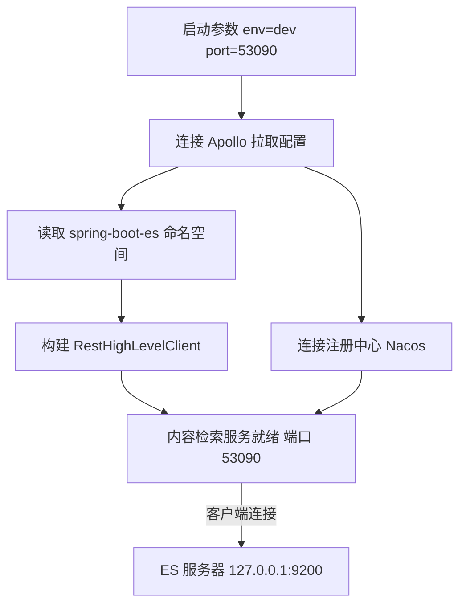

# 标的检索开发环境搭建：导入内容检索微服务并装配 RestHighLevelClient

数据同步链路已经闭环：MySQL 一有变化，Logstash 就把数据搬进 ES 索引库。整张检索蓝图只剩最后一块，前端发检索请求到交易中心，交易中心转发给内容检索服务，内容检索服务查 ES 返回结果。开发这条链路之前，先把内容检索微服务的工程搭起来：导入初始工程、认一遍骨架代码、在 Apollo 上建好配置、装配 ES 客户端，最后启动验证。环境不通，后面写再多检索代码都是空中楼阁。

## 先给结论

- 新导入一个微服务工程，内容检索服务（按本项目口径记作 `finance-content-search-service`），它是项目里此前不存在的新工程，初始代码由资料包提供。
- ES 依赖版本取 7.2.0，客户端 API 分低级别与高级别两种，工程用的是高级别客户端 `RestHighLevelClient`。
- Apollo 上新建 `content-search-service` 项目存配置，并新建 `spring-boot-es` 命名空间，配置两个键：ES 服务器地址 `finance.es.host` 与索引库名 `finance.es.index`。
- 配置类 `ElasticsearchConfig` 读取地址配置，按冒号拆成 IP 与端口，构建出 `RestHighLevelClient` 的 Bean 供全工程注入。
- 启动参数携带 `-Dserver.port=53090`，内容检索服务占用 53090 端口；启动前注册中心与 ES 都要在运行状态，ES 没起会直接连接报错。

## 导入工程与依赖清单

内容检索服务是这一章新登场的服务，项目此前没有这个工程，工程目录拷进项目后按熟悉的方式导入即可。导入后先过一遍骨架：`pom.xml` 里与常规微服务工程相比，重点多了 Elasticsearch 相关依赖：

```xml
<!-- ES 核心与高级别客户端 版本与服务端保持同代 -->
<dependency>
    <groupId>org.elasticsearch</groupId>
    <artifactId>elasticsearch</artifactId>
    <version>7.2.0</version>
</dependency>
<dependency>
    <groupId>org.elasticsearch.client</groupId>
    <artifactId>elasticsearch-rest-high-level-client</artifactId>
    <version>7.2.0</version>
</dependency>
<!-- 配置中心客户端与配置处理辅助 -->
<dependency>
    <groupId>com.ctrip.framework.apollo</groupId>
    <artifactId>apollo-client</artifactId>
</dependency>
<dependency>
    <groupId>org.springframework.boot</groupId>
    <artifactId>spring-boot-configuration-processor</artifactId>
    <optional>true</optional>
</dependency>
```

客户端 API 要分清两个层级。低级别客户端 `RestClient` 只负责 HTTP 传输，请求与响应都要自己拼 JSON；高级别客户端 `RestHighLevelClient` 在低级别之上封装了完整的 API 语义，建索引、查文档、构造查询条件都有现成对象，本工程用的是高级别。`elasticsearch-rest-high-level-client` 是高级别客户端的坐标，服务端 7.2.0，客户端也取 7.2.0，两端同代最稳。

`application.yml` 与其他微服务工程没有差别，核心还是 Apollo 接入与命名空间列表：

```yaml
app:
  id: content-search-service
  apollo:
    bootstrap:
      enabled: true
    namespaces: application,micro_service.spring-boot-http,micro_service.spring-eureka,micro_service.spring-cloud-feign
spring:
  application:
    name: content-search-service
logging:
  config: classpath:log4j2-dev.xml
```

公共包里的代码也过一眼：错误状态码封装、Spring MVC 全局异常捕获类此前项目都用过，直接复用；配置类里除了惯例的 Swagger 配置，真正的新面孔只有一个 Elasticsearch 配置类，下一节展开。

## Apollo 配置：ES 地址与索引库名上配置中心

每次新导入一个工程，都要在 Apollo 上为它新建一个项目来存储相关配置。内容检索服务的公共命名空间（服务基本路径、Swagger 开关等）照其他工程的口径配齐，真正需要关注的是一个新建的命名空间，取名 `spring-boot-es`（`es` 即 Elasticsearch 的缩写），里面只放两个键值对：

| Key | Value | 含义 |
|---|---|---|
| `finance.es.host` | `127.0.0.1:9200` | ES 服务器地址 |
| `finance.es.index` | `finance_project` | 标的信息索引库名 |

两个键都上配置中心，而不是写死在代码里，各有理由。ES 服务器地址搞成配置，是考虑到将来部署形态可能变化：开发连本机单机版，生产可能换成集群地址，服务地址不止一个，配置化之后改 Apollo 即可，代码不动。索引库名上配置是同样的灵活性考虑：当前操作的是 `finance_project` 这一个库，但业务演进后未必一直只用它，把名字挂在配置上，将来操作哪个索引库就从配置里取，换库零改动。

## 配置类：把地址变成一个可注入的客户端

配置类 `ElasticsearchConfig` 干一件事：从配置里读出 ES 地址，构建出 `RestHighLevelClient` 对象交由 Spring 容器管理（包名按 `com.study.finance` 系口径改写）：

```java
package com.study.finance.search.config;

import org.apache.http.HttpHost;
import org.elasticsearch.client.RestClient;
import org.elasticsearch.client.RestHighLevelClient;
import org.springframework.beans.factory.annotation.Value;
import org.springframework.context.annotation.Bean;
import org.springframework.context.annotation.Configuration;

@Configuration
public class ElasticsearchConfig {

    /** ES 服务器地址 形如 127.0.0.1:9200 值来自 Apollo 的 spring-boot-es 命名空间 */
    @Value("${finance.es.host}")
    private String esHost;

    @Bean
    public RestHighLevelClient restHighLevelClient() {
        // 按冒号拆分 取出 IP 与端口
        String ip = esHost.split(":")[0];
        int port = Integer.parseInt(esHost.split(":")[1]);
        HttpHost httpHost = new HttpHost(ip, port);
        return new RestHighLevelClient(RestClient.builder(httpHost));
    }
}
```

`@Value` 注解按键名 `finance.es.host` 取到 `127.0.0.1:9200` 这个字符串。构建客户端需要两个参数：IP 地址与端口号，所以先用冒号把字符串拆开，前半段转 IP，后半段解析成 int 端口，封装成 `HttpHost` 交给 `RestClient.builder`，最终产出高级别客户端对象。整个工程后续所有的 ES 操作，查询、分页、排序，都通过注入这个 `client` 完成，它就是内容检索服务连接 ES 服务器端的唯一通道。

## 模型与接口骨架

工程在 `model` 包里已经放好了实体类。标的信息的索引实体 `ProjectIndexDTO` 对应 ES 里的文档字段，上一课 Logstash 采集进来的字段名在这里一一登场：

```java
/** 标的索引信息 与 ES 文档字段一一对应 按本课写法整理 包名按 com.study.finance 系口径 */
public class ProjectIndexDTO {

    @ApiModelProperty(value = "标的索引信息")
    private Long id;

    @ApiModelProperty(value = "发标人标识")
    private Long consumerId;

    @ApiModelProperty(value = "发标人用户编号")
    private String userNo;

    @ApiModelProperty(value = "标的编码")
    private String projectNo;

    @ApiModelProperty(value = "标的名称")
    private String name;

    // 标的描述、类型、期限、年利率、借款人年利率、佣金年利率、状态、是否转让、创建与修改时间等属性随文档字段补齐
}
```

配套还有一个查询条件对象 `ProjectQueryParamsDTO`，封装前端检索时携带的条件：标的类型、利率范围等，属性按实际检索需求增减。接口层留了骨架：公共 API 工程里定义 `ContentSearchApi` 接口，检索方法带条件、分页、排序三组参数，返回分页包装对象；服务工程里的 `ContentSearchController` 挂好注解等着实现：

```java
/**
 * 内容检索服务 API
 */
public interface ContentSearchApi {

    /**
     * 检索标的 带条件 带分页 带排序
     * @param projectQueryParamsDTO 查询条件封装
     * @param pageNo 页码
     * @param pageSize 每页记录数
     * @param sortBy 排序字段
     * @param order 排序顺序
     * @return 分页的标的信息
     */
    RestResponse<PageVO<ProjectDTO>> queryProjectIndex(ProjectQueryParamsDTO projectQueryParamsDTO,
            Integer pageNo, Integer pageSize, String sortBy, String order);
}
```

方法体的实现是后续几课的内容，本课只要骨架就位、环境能跑通。

## 启动验证

启动链路把新、旧依赖都串了一遍，这张图在讲服务起来前后要满足的依赖关系：



启动参数按工程惯例配置：`-Denv=dev` 指定环境、`-Dapollo.cluster=DEFAULT` 指定 Apollo 集群、`-Dserver.port=53090` 指定端口，内容检索服务的端口号定为 53090。启动前注册中心要先起，服务启动时要连注册中心；ES 也必须已在运行，服务启动过程会建立与 ES 的连接，ES 没启动会在这一步报连接错误，报错信息直接指向 9200 端口不通。控制台依次出现从 Apollo 加载配置、`53090` 端口绑定、注册完成的日志，全程无 `ERROR` 即环境就绪，可以在检索服务里动手实现标的信息的快速检索了。

## 常见误区

- **客户端与服务端版本错代。** 错例：服务端 7.3.1，工程里客户端引 6.x，运行期出现序列化或 API 不兼容问题。正解：`elasticsearch` 与 `elasticsearch-rest-high-level-client` 与服务端保持同代（本课服务端 7.x，客户端 7.2.0），升级服务端时客户端同步评估。
- **把 ES 地址写死在代码里。** 错例：`new HttpHost("127.0.0.1", 9200)` 直接硬编码。正解：地址与索引库名都放 Apollo，`@Value` 注入；换部署环境或换索引库只改配置，代码零改动。
- **ES 没启动就先起检索服务。** 错例：服务启动时连接 ES 失败，误判为工程问题反复重启。正解：启动顺序上注册中心与 ES 先行，看到 9200 端口可访问后再起检索服务，连接类报错先核对 ES 状态。
- **索引实体字段与 ES 文档字段对不上。** 错例：`ProjectIndexDTO` 属性名按 Java 驼峰随手起，与 Logstash 采集进来的小写拼接字段名不一致，查询结果反序列化出空值。正解：索引实体属性与上一课映射里的字段名逐一对照（如 `consumerid`、`projectno`），保证映射一致。

## 面试可能被问到的问题

1. 面试官追问：「`RestHighLevelClient` 与低级别 `RestClient` 的区别是什么？」
   答：低级别客户端只做 HTTP 传输，请求体响应体都要自己拼解析 JSON，灵活性高但样板代码多；高级别客户端在其上封装了完整的 ES API 语义，构建查询、分页、排序都有类型化对象，开发效率与类型安全都更好。本工程选高级别客户端，日常检索开发几乎不再手写 JSON。
2. 面试官追问：「为什么 ES 地址与索引库名要放 Apollo 配置中心？」
   答：两者都是随部署形态变化概率高的外部依赖信息。地址在开发、测试、生产环境各不相同，集群部署时还是多个节点；索引库名可能随业务演进调整。配置中心集中管理后，环境切换与索引迁移只改配置不动代码，配合配置热更新还能做到不重启生效。
3. 面试官追问：「`@Value` 拿到的地址为什么按冒号拆分而不是直接配两个键？」
   答：一个键存 `ip:port` 是把「一个 ES 实例」作为一个配置单元，拆分逻辑集中在配置类一处；将来切集群时只需把值扩展成多地址列表再循环构建 `HttpHost`，配置结构不用推倒重来。两种方式都可行，取舍点在集群扩展时的改动范围。
4. 面试官追问：「内容检索服务启动失败，你会按什么顺序排查？」
   答：先看控制台第一段日志确认 Apollo 配置是否拉取成功，配置拉不下来会阻塞启动；再看注册中心是否在线；然后核对 ES 是否启动、9200 端口是否可达，客户端构建失败多出在这一步；最后核对启动参数里端口 53090 与环境标识是否正确。按依赖链路从外到内排查，比盲目重启有效。
5. 面试官追问：「检索服务的查询条件对象为什么单独设计一个 DTO，直接复用数据库查询的 `ProjectQueryDTO` 不行吗？」
   答：两个数据源的可检索维度不同。MySQL 查询条件对象面向表字段与精确过滤，ES 检索还涉及分词匹配、范围聚合等维度，字段语义与取值形式并不一致。独立 DTO 让检索接口的契约清晰，两侧各自演进互不牵连；返回值复用 `ProjectDTO` 是可行的，因为无论从哪个数据源查出来，标的信息的业务形态是同一个。

## 配套资料

- 讲义：`materials/docs/10/万信金融-第3章-讲义-发标v1.0.md`，4.5 节「搭建开发环境」（导入内容检索微服务工程、Apollo 新建项目与命名空间、启动参数 `-Denv=dev -Dapollo.cluster=DEFAULT -Dserver.port=53090`）。
- 代码：`materials/code/10/wanxinp2p_apollo/`，项目公共模块归档（目录保留原始命名，路径只列到该层级），`RestResponse`、`PageVO`、错误码与全局异常处理等公共类型真实源码可对照。
- 说明：内容检索微服务工程（初始代码）随课程资料单独提供，未随仓库归档；依赖清单、`ElasticsearchConfig`、索引实体与接口骨架按画面线与主流写法整理补全，包名按 `com.study.finance` 系口径改写，配置键名同口径处理。
