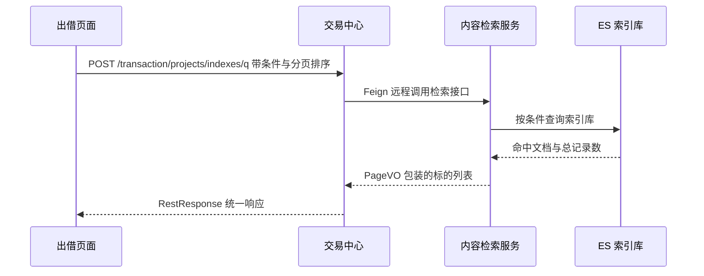

# 标的信息检索（一）：交易中心怎么把检索请求接进来

出借页面上有一个搜索框，用户敲入「借款」两个字，期望把名称或描述里带这个词的标的都翻出来，还要能按期限、利率筛选，按字段排序，支持翻页。这类模糊匹配、多条件组合的查询，继续压在 MySQL 上，数据量一大就是慢查询的重灾区。检索环境已经就绪，标的数据也通过同步管道进了 Elasticsearch 索引库，现在缺的是把请求接到检索链路上的那段代码。链条的起点在交易中心，这一课先把交易中心的接口立起来。

## 先给结论

- 检索链路横跨两个微服务：前端请求交易中心，交易中心通过 Feign 远程调用内容检索服务，真正查 Elasticsearch 的代码在内容检索服务里，交易中心只做参数接收与转发。
- 交易中心侧新增的检索方法与查库的 `queryProjects` 构成重载，条件对象换成检索专用的 `ProjectQueryParamsDTO`，路径定为 `POST /projects/indexes/q`，与查库的列表接口靠路径区分数据源。
- 检索条件对象的字段语义与管理端查询对象不同：`name` 与 `description` 标注分词匹配，期限与利率是区间字段，单位是天。
- 控制器依旧空实现起步，Swagger 注解把参数含义写给前端联调人员，条件走 `@RequestBody` 接 JSON，分页与排序走 URL 查询参数。

## 两个微服务怎么分工

检索这条链路涉及交易中心与内容检索服务两个微服务，请求的完整旅程如下图：



关键路径看两段：交易中心收到请求后不是自己查库，而是发起一次 Feign 远程调用，把条件、分页、排序一股脑转给内容检索服务；内容检索服务查完 Elasticsearch，把结果原路送回，交易中心套上统一响应壳交还前端。交易中心在这条链路里基本没干重活，核心查询逻辑全部落在内容检索服务。

这个分工是刻意的架构选择。检索不是标的这一处业务的需求，项目里多处业务数据都有全文检索的诉求，把检索能力收敛成独立微服务，谁要查就调谁，避免每个业务工程都去维护一套 Elasticsearch 客户端代码。也正因为交易中心这边逻辑轻、与此前写过的查询接口高度相似，接口定义一步到位讲清楚，实现放到下一课过一遍即可。

## 定义交易中心的检索接口

接口照例定义在 API 工程里。检索条件与管理端查库的条件长得像但不相同，所以先落一个检索专用的条件对象 `ProjectQueryParamsDTO`，放进 API 工程 `search` 包的 model 子包：

```java
/** 标的检索参数对象 包名按 com.study.finance 系改写 */
@Data
@ApiModel(value = "ProjectQueryParamsDTO", description = "标的的检索参数")
public class ProjectQueryParamsDTO {

    @ApiModelProperty("标的名称(分词匹配)")
    private String name;

    @ApiModelProperty("标的描述(分词匹配)")
    private String description;

    @ApiModelProperty("起止标的期限(单位:天)")
    private Integer startPeriod;

    @ApiModelProperty("起止标的期限(单位:天)")
    private Integer endPeriod;

    @ApiModelProperty("起止年化利率(投资人视图)")
    private BigDecimal startAnnualRate;

    @ApiModelProperty("起止年化利率(投资人视图)")
    private BigDecimal endAnnualRate;

    @ApiModelProperty("标的状态")
    private String status;
}
```

字段数量比管理端查询对象少，语义却更贴检索场景：`name` 与 `description` 的注释明确写着分词匹配，意味着这两个字段在索引里是按分词器切过词条的，查询走的是倒排索引而不是 `like` 模糊匹配；期限与利率依旧是一对起止字段框区间，落库时把月折算成了天，所以单位是天。

API 接口 `TransactionApi` 新增方法。注意方法名与此前查库的 `queryProjects` 相同，靠参数类型区分，构成重载：

```java
/** 交易中心 API 新增检索方法 与查库方法构成重载 包名按 com.study.finance 系改写 */
public interface TransactionApi {

    /**
     * 从 ES 检索标的信息 条件加分页加排序
     */
    @ApiOperation("从 ES 检索标的信息")
    @ApiImplicitParams({
            @ApiImplicitParam(name = "projectQueryParamsDTO", value = "标的检索条件对象",
                    required = true, dataType = "ProjectQueryParamsDTO", paramType = "body"),
            @ApiImplicitParam(name = "pageNo", value = "页码", required = true,
                    dataType = "int", paramType = "query"),
            @ApiImplicitParam(name = "pageSize", value = "每页记录数", required = true,
                    dataType = "int", paramType = "query"),
            @ApiImplicitParam(name = "sortBy", value = "排序字段", required = false,
                    dataType = "string", paramType = "query"),
            @ApiImplicitParam(name = "order", value = "顺序", required = false,
                    dataType = "string", paramType = "query")
    })
    @PostMapping("/projects/indexes/q")
    RestResponse<PageVO<ProjectDTO>> queryProjects(ProjectQueryParamsDTO projectQueryParamsDTO,
            Integer pageNo, Integer pageSize, String sortBy, String order);
}
```

返回值仍是 `PageVO<ProjectDTO>` 套 `RestResponse`，与查库接口完全一致：分页壳是公共工程的通用结构，前端拿到 `content`、`total`、`pageNo`、`pageSize` 就能渲染表格与翻页控件，不用关心数据来自 MySQL 还是 Elasticsearch。对调用方隐藏数据源，正是这套接口设计的价值所在。

接口定义好之后，控制器顺手补一个空实现，让编译器先把方法骨架生成出来：

```java
/** 交易中心控制器 检索空实现 类上已带 /transaction 前缀 包名按 com.study.finance 系改写 */
@Override
@ApiOperation("从 ES 检索标的信息")
@ApiImplicitParams({
        @ApiImplicitParam(name = "projectQueryParamsDTO", value = "标的检索条件对象",
                required = true, dataType = "ProjectQueryParamsDTO", paramType = "body"),
        @ApiImplicitParam(name = "pageNo", value = "页码", required = true,
                dataType = "int", paramType = "query"),
        @ApiImplicitParam(name = "pageSize", value = "每页记录数", required = true,
                dataType = "int", paramType = "query"),
        @ApiImplicitParam(name = "sortBy", value = "排序字段", required = false,
                dataType = "string", paramType = "query"),
        @ApiImplicitParam(name = "order", value = "顺序", required = false,
                dataType = "string", paramType = "query")
})
@PostMapping("/projects/indexes/q")
public RestResponse<PageVO<ProjectDTO>> queryProjects(@RequestBody ProjectQueryParamsDTO projectQueryParamsDTO,
        Integer pageNo, Integer pageSize, String sortBy, String order) {
    return null;
}
```

路径设计值得停留一下：查库的管理端列表是 `POST /projects`，检索走 `POST /projects/indexes/q`，两者并存于同一个控制器。`indexes/q` 这个尾巴是在暗示数据来源，`q` 是 query 的缩写，整条路径读出来就是「到索引里查」。管理端审核列表查库要的是全字段与精确条件，出借页面检索要的是快与模糊匹配，两条路径各走各的数据源，互不干扰。

参数约定与查库接口如出一辙：条件对象挂 `@RequestBody` 从请求体读 JSON，字段多、还会扩展，放请求体成本最低；`pageNo`、`pageSize`、`sortBy`、`order` 四个散参不加注解，从 URL 查询参数绑定，短小、格式固定，日志里一眼可见。唯一要留心的是 `sortBy` 与 `order` 标成了非必填，检索时用户不表达排序意愿，服务端会采用默认排序策略，这个策略下一课在检索服务里能看到。

## 为什么条件对象要分两套

把 `ProjectQueryDTO` 与 `ProjectQueryParamsDTO` 并排放着看，会发现字段高度重叠却又各有取舍。管理端查询对象里留着标的类型、还款方式这类等值筛选字段，因为管理员按业务分类精确过滤；检索对象里砍掉了这些，留出 `name` 与 `description` 两个分词匹配字段，因为普通投资人搜索时敲的是关键词，不是业务分类码。

分两套对象还有一层工程考虑：两边的查询执行引擎完全不同，MySQL 的条件构造与 Elasticsearch 的查询构造，能接受的字段类型与空值语义不一样。条件对象跟着查询引擎走，各自的扩展互不牵连，这比硬共用一个大而全的 DTO 更干净。代价是字段定义有重复，但检索对象字段少，重复成本可控。

## 常见误区

- **两个条件对象混用。** 错例：检索接口直接复用管理端的 `ProjectQueryDTO`，前端传来的分词匹配字段无处安放。正解：检索走 `ProjectQueryParamsDTO`，字段语义跟着检索场景走，与管理端对象各自独立演进。
- **条件对象忘加 `@RequestBody`。** 错例：`@PostMapping` 方法里 DTO 不加注解，Spring 会按查询参数逐字段绑定，请求体的 JSON 全部落空，条件对象每个属性都是 null。正解：请求体 JSON 必须挂 `@RequestBody`，散参才走查询参数。
- **重载方法签名没变。** 错例：新增检索方法时入参类型仍写 `ProjectQueryDTO`，与查库方法签名完全相同，编译直接报重复方法。正解：重载要求参数列表可区分，换条件对象类型是最自然的区分方式。
- **排序参数写成必填。** 错例：Swagger 注解里 `sortBy`、`order` 标 `required = true`，前端被迫瞎传排序值。正解：标成非必填，文档与行为一致，未传时走服务端默认排序。

## 面试可能被问到的问题

1. 面试官追问：「检索接口为什么要单独分出一个条件对象？」
   答：检索场景与管理端查询的字段语义不同，检索关心分词匹配的关键词字段，管理端关心业务分类的等值筛选字段；两边底层引擎不同，一个走 SQL 条件构造，一个走 Elasticsearch 查询构造。分开定义让各自扩展互不牵连，接口文档也更清晰。
2. 面试官追问：「为什么查库和查 ES 的接口返回值都用 PageVO？」
   答：PageVO 是公共工程的通用分页壳，content、total、pageNo、pageSize 四个属性对前端翻页控件完全够用。返回结构统一，前端不感知数据源变化，后端把查库换成查 ES 时契约不用动。
3. 面试官追问：「交易中心的接口路径 /projects 与 /projects/indexes/q 并存，会不会混乱？」
   答：路径是数据源的自我声明，indexes/q 表明查的是索引库。管理端审核列表与投资人出借检索是两类调用方、两类查询诉求，路径分开后网关转发、日志排查、权限控制都能按路径区分，比共用一条路径再靠参数区分干净得多。
4. 面试官追问：「接口定义为什么要连 Swagger 注解一起写？」
   答：检索接口参数多、来源分两处，光看方法签名很难知道哪个参数在 body、哪个在 query、哪些必填。注解生成的接口文档让前端联调时对着填，减少来回沟通成本，这类注解的价值在多服务协作时尤其明显。

## 配套资料

- 讲义：`materials/docs/10/万信金融-第3章-讲义-发标v1.0.md`，标的快速检索一节：需求分析与交易中心的查询接口定义（`TransactionApi` 重载方法、`ProjectQueryParamsDTO`、控制器注解）。
- 代码：`materials/code/10/wanxinp2p_apollo/`，公共模块归档（目录保留原始命名，路径只列到该层级），`RestResponse` 的真实源码可对照，`PageVO` 同属公共工程口径。
- 代码：`materials/code/10/wanxinp2p/`，P2P 工程归档（目录保留原始命名，路径只列到该层级），API 工程与业务工程的包组织方式可对照。
- 说明：交易中心工程随课程资料单独提供，未随仓库归档；本课代码按画面线与讲义口径整理，包名按 `com.study.finance` 系改写。
