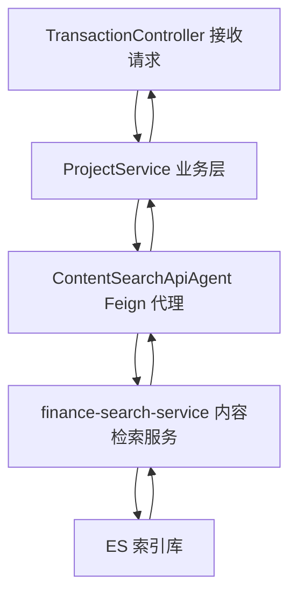

# 标的信息检索（二）：交易中心的一跳 Feign 转发

接口定义好了，交易中心这边要兑现承诺：接住前端的检索请求，转手交给内容检索服务。这一课的实现代码量不大，但它是微服务协作最典型的形态，业务层不碰数据库、不碰索引，只做一次远程调用加一次结果校验，链路上每层的职责边界值得看清。

## 先给结论

- 交易中心这次不涉及数据访问层，直接从业务层开工：业务层注入内容检索服务的 Feign 代理，方法一进来就发起远程调用。
- Feign 代理 `ContentSearchApiAgent` 指向 `finance-search-service`，路径 `/l/projects/indexes/q`，`/l` 打头是内部接口约定，前端请求经网关访问不到这条路径。
- 远程响应先判 `isSuccessful`，不成功抛 `BusinessException`，成功则 `getResult()` 取出 `PageVO` 直接返回，控制器再包一层 `RestResponse.success`。
- Feign 方法参数必须逐个写清 `@RequestBody` 与 `@RequestParam`，漏注解会导致参数在请求里丢失，这是远程调用最隐蔽的坑。

## 交易中心的活儿到底是什么

需求分析图里交易中心的位置很清楚：它上游接前端，下游接内容检索服务。拆开看就三件事，接收并封装前端参数、通过 Feign 发起远程调用、把检索结果包装成统一响应返回。没有任何一处直接与 Elasticsearch 或数据库打交道。

交易中心内部的调用层次如下图：



关键路径是业务层到 Feign 代理这一跳：控制器调业务层，业务层调代理，代理把方法调用翻译成 HTTP 请求打到内容检索服务。层次虽多，每层只干一件事，控制器管协议，业务层管编排，代理管传输。

## 第一步：定义 Feign 代理

远程调用先要有代理。在交易中心的 API 工程里新建 `ContentSearchApiAgent` 接口，方法签名与检索服务的接口严格对应：

```java
/** 内容检索服务 Feign 代理 包名按 com.study.finance 系改写 */
@FeignClient(value = "finance-search-service")
public interface ContentSearchApiAgent {

    /** /l 打头是内部接口约定 前端请求经网关访问不到 */
    @PostMapping(value = "/l/projects/indexes/q")
    RestResponse<PageVO<ProjectDTO>> queryProjectIndex(
            @RequestBody ProjectQueryParamsDTO projectQueryParamsDTO,
            @RequestParam Integer pageNo,
            @RequestParam Integer pageSize,
            @RequestParam(required = false) String sortBy,
            @RequestParam(required = false) String order);
}
```

`@FeignClient` 的 value 填的是内容检索服务在注册中心的服务名，Feign 会从注册中心拉到实例列表，做客户端负载均衡后把请求发过去，调用方完全不用管 IP 与端口。这套写法此前在开户、存管的远程调用里用过多次，唯一的新面孔是路径上的 `/l` 前缀：项目约定 `/l` 打头的路径是微服务之间的内部接口，网关不向前端转发这类路径，前端想直接戳也戳不到，检索能力就这样被保护在服务网格内部。

参数注解这一行不能省。条件对象挂 `@RequestBody`，随请求体传 JSON；四个分页排序参数挂 `@RequestParam`，拼在 URL 上，其中 `sortBy` 与 `order` 标了 `required = false`，允许不传，走检索服务的默认排序。Feign 不会替你猜参数来源，漏了注解，参数直接从请求里消失，对端收到一堆 null，这种问题运行时不报错、结果却不对，排查起来最费时间。

## 第二步：业务层发起调用并校验结果

业务层接口 `ProjectService` 新增重载方法 `queryProjects`，签名照着控制器抄，只去掉 `RestResponse` 这层壳。实现类里先注入代理，再写方法体：

```java
/** 交易中心业务层检索实现 包名按 com.study.finance 系改写 */
@Autowired
private ContentSearchApiAgent contentSearchApiAgent;

@Override
public PageVO<ProjectDTO> queryProjects(ProjectQueryParamsDTO projectQueryParamsDTO,
        Integer pageNo, Integer pageSize, String sortBy, String order) {
    // 一进来就发起远程调用 条件 分页 排序全部透传
    RestResponse<PageVO<ProjectDTO>> esResponse =
            contentSearchApiAgent.queryProjectIndex(projectQueryParamsDTO,
                    pageNo, pageSize, sortBy, order);
    // 远程响应不成功 抛业务异常交全局异常处理器
    if (!esResponse.isSuccessful()) {
        throw new BusinessException(CommonErrorCode.UNKNOWN);
    }
    // 成功则从统一响应里取出分页结果 直接返回
    return esResponse.getResult();
}
```

方法体只有三步：调代理、判成败、取结果。`RestResponse` 是公共工程的统一响应壳，远程调用的返回值被它包着，`isSuccessful` 判断对端处理是否正常，不正常就抛 `BusinessException`，交给全局异常处理器转成规范的错误响应；正常则 `getResult()` 把 `PageVO<ProjectDTO>` 从壳里取出来，作为业务层返回值。控制器那头拿到的已经是干净的分页对象，补上业务调用加一次 `RestResponse.success` 包装就完事：

```java
/** 交易中心控制器 检索实现补全 包名按 com.study.finance 系改写 */
@PostMapping("/projects/indexes/q")
public RestResponse<PageVO<ProjectDTO>> queryProjects(@RequestBody ProjectQueryParamsDTO projectQueryParamsDTO,
        Integer pageNo, Integer pageSize, String sortBy, String order) {
    PageVO<ProjectDTO> projects = projectService.queryProjects(projectQueryParamsDTO,
            pageNo, pageSize, sortBy, order);
    return RestResponse.success(projects);
}
```

成败判断的方向要格外留意：`isSuccessful` 为真才是成功，不成功才抛异常，条件里的取反写反了，失败会被当成功、成功反被抛异常，功能表面上能跑，数据一异常就露馅。这也是为什么校验逻辑要紧跟在调用之后写，不要攒到最后一起补。

## 这一课为什么没有数据访问层

以往交易中心的功能实现总是四层齐动：控制器、业务层、Mapper、数据库。这次 Mapper 一行没写，因为交易中心对这次查询没有任何数据所有权，标的数据在交易库里，检索诉求却是对索引库发起的，索引的同步与查询都归内容检索服务管。交易中心只扮演「编排者」，把调用链串起来。

这种瘦化是服务拆分带来的直接收益：检索能力只在一处维护，交易中心的代码量与依赖面同时缩小。反过来看，这也要求远程调用的容错意识更强，对端服务挂了、超时了，交易中心的这条接口就会失败，所以校验 `isSuccessful` 并抛出明确异常，比吞掉异常返回空数据更能暴露问题。

## 常见误区

- **Feign 方法参数漏注解。** 错例：`@RequestBody` 忘写，条件对象的字段全部为 null，检索永远查不到数据且无报错。正解：逐个参数标明来源，DTO 挂 `@RequestBody`，散参挂 `@RequestParam`，可选参数标 `required = false`。
- **`isSuccessful` 判断方向写反。** 错例：`if (esResponse.isSuccessful())` 里抛异常，成功请求全部报错。正解：不成功才抛，`!esResponse.isSuccessful()` 是唯一正确的方向。
- **在交易中心直接注入 Elasticsearch 客户端。** 错例：嫌远程调用绕，在交易中心引入 `RestHighLevelClient` 查索引。正解：检索能力收敛在内容检索服务，交易中心跨过服务边界直连索引，等于把拆分出来的服务又焊死回去。
- **拿到响应不校验直接 `getResult`。** 错例：对端返回错误码时，`getResult` 返回 null，null 一路透传到前端引发空指针。正解：先判 `isSuccessful`，失败抛业务异常，让全局异常处理器给出规范错误响应。

## 面试可能被问到的问题

1. 面试官追问：「Feign 的工作原理是什么？」
   答：Feign 是声明式 HTTP 客户端，接口方法上的注解被解析成 HTTP 请求模板，调用方法时由动态代理把参数填进模板，再经负载均衡选一个服务实例发出请求，响应反序列化成方法返回值。开发人员只写接口不写传输代码，服务名经注册中心解析成真实地址。
2. 面试官追问：「内部接口为什么用 /l 前缀约定？」
   答：靠网关转发规则做访问控制，/l 打头的路径网关不对外路由，前端请求到不了，这类接口只供微服务之间内部调用。配合注册中心的服务名调用，内部接口既不暴露公网入口，也不需要在每个服务里重复做鉴权。
3. 面试官追问：「远程调用的返回值为什么要包统一响应壳？」
   答：跨服务的响应需要携带状态信息，调用方要能区分业务成功与失败，RestResponse 的 code、msg、result 三段式就是为此设计的。调用方先判 isSuccessful 再取 result，失败时的错误码能一路向上传递，避免静默失败。
4. 面试官追问：「交易中心这个查询为什么不做本地缓存或本地兜底？」
   答：检索结果实时性要求高，标的每分钟都在变化，缓存反而引入一致性问题；兜底查库会让两条查询路径的结果口径不一致，用户看到的数据忽多忽少。更合理的容错方向是对远程调用做超时控制与降级提示，而不是悄悄换成另一份数据。

## 配套资料

- 讲义：`materials/docs/10/万信金融-第3章-讲义-发标v1.0.md`，标的快速检索一节，交易中心的查询功能：定义 Feign 代理、业务层实现方法、完善控制器。
- 代码：`materials/code/10/wanxinp2p_apollo/`，公共模块归档（目录保留原始命名，路径只列到该层级），`RestResponse` 的真实源码可对照，`isSuccessful` 与 `getResult` 的行为以它为准。
- 代码：`materials/code/10/wanxinp2p/`，P2P 工程归档（目录保留原始命名，路径只列到该层级），消费者服务的 Feign 调用写法可对照。
- 说明：交易中心工程随课程资料单独提供，未随仓库归档；本课代码按画面线与讲义口径整理，包名按 `com.study.finance` 系改写，服务名按中性命名统一为 `finance-search-service`。
