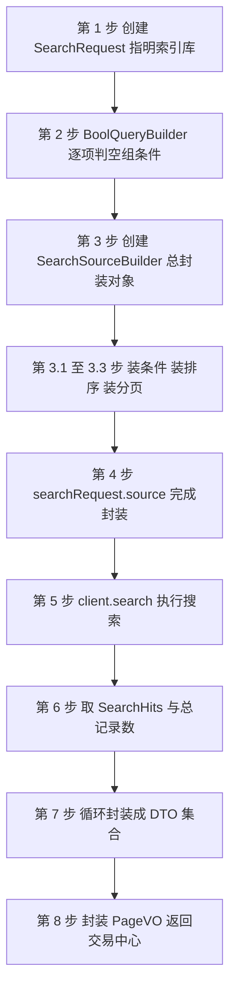

# 标的信息检索（三）：内容检索服务里把 ES 查询一次写全

交易中心的请求已经转发到内容检索服务门口，剩下整条检索链路里最硬的一块：真的从 Elasticsearch 索引库把数据查出来。查询要同时带条件、分页、排序，检索服务又是新建的工程，接口、客户端、查询构造、结果解析都要从零写起。三个视频连着讲完接口定义与功能实现，正好合成一篇。

## 先给结论

- 版本决定技术选型：课程用的 Elasticsearch 是 7.3.1，Spring Data Elasticsearch 的版本节奏跟不上这么新的 ES，所以直接用官方推荐的 RestHighLevelClient 手写查询。
- 业务层只定义一个方法 `queryProjectIndex`，签名与交易中心转发来的参数一一对应，实现拆成八步：建请求、组条件、建总封装、装条件、装排序分页、完成封装、执行搜索、解析封装。
- 条件用 `BoolQueryBuilder` 组装，逐项判空后 `must` 拼接；名称字段用 `termQuery` 词条查询，期限区间用 `rangeQuery` 配 `gte` 与 `lte`。
- 分页的 `from` 是起始偏移量不是页码，必须做 `(pageNo - 1) * pageSize` 的换算，这是 ES 查询与 SQL 分页最容易混淆的一点。
- 结果解析走 `SearchHits` 到 `SearchHit` 再到 `getSourceAsMap` 的路径，Map 里的值全是 Object，逐字段做类型转换才能塞进 DTO。

## 业务接口：一个方法签名定住整条链

检索服务侧不涉及数据库，Controller 与 Service 两层就够了，接口先在业务层立起来。检索工程没有现成的业务接口，新建 `ProjectIndexService`：

```java
/** 标的检索业务层接口 包名按 com.study.finance 系改写 */
public interface ProjectIndexService {

    /**
     * 标的检索 条件加分页加排序
     */
    PageVO<ProjectDTO> queryProjectIndex(ProjectQueryParamsDTO projectQueryParamsDTO,
            Integer pageNo, Integer pageSize, String sortBy, String order);
}
```

签名与交易中心 Feign 代理的方法严格对齐：条件对象同款，分页排序散参顺序一致，返回值同为 `PageVO<ProjectDTO>`。这种对齐不是巧合，Feign 代理的方法就是对这条 HTTP 请求的声明，两边的参数从请求体与查询参数里按名字对号入座，任何一侧改动签名，另一侧必须同步，否则参数悄然丢失。返回值不带 `RestResponse` 壳，控制器统一包装，与交易中心侧的分层规律完全一致。

值得留意的是业务层没有叫 Service 而带上了 Index 后缀。`ProjectIndexService` 这个名字里，Index 三个字就是给查询对象的定位：它操作的是索引库而不是数据库，方法语义从「查标的记录」变成「查标的索引文档」。检索工程后续还会长出别的检索接口，按资源加 Index 的命名方式能把索引类查询与普通业务查询在名字层面区分开，工程一大，命名就是导航。

## 准备工作：客户端与索引名两个注入

实现类动手前先注入两样东西。第一样是 RestHighLevelClient，它在检索环境搭建时已经在配置类里注册成了 Bean；第二样是索引库名称，配置在配置中心内容检索服务的命名空间里，key 为 `finance.es.index`，值是 `finance_project`，用 `@Value` 注进来：

```java
/** 检索实现类的两项准备 包名按 com.study.finance 系改写 */
@Service
public class ProjectIndexServiceImpl implements ProjectIndexService {

    /** 高级别 REST 客户端 配置类中已注册为 Bean */
    @Autowired
    private RestHighLevelClient restHighLevelClient;

    /** 索引库名称 配置中心下发 key 为 finance.es.index */
    @Value("${finance.es.index}")
    private String projectIndex;
}
```

索引名不写死在代码里而走配置中心，是环境解耦的老规矩：开发、测试、生产的索引命名可能不同，改配置不改代码。这两个配置项就放在配置中心为内容检索服务准备的命名空间里，与 ES 连接地址同一组，检索环境搭建阶段已经备好并验证过连通性，实现类里照着 key 取值即可。客户端的注册写法如下，按本课配置整理：

```java
/** RestHighLevelClient 注册示例 按本课配置整理 包名按 com.study.finance 系改写 */
@Configuration
public class ElasticsearchConfig {

    @Value("${finance.es.host}")
    private String esHost;

    @Bean
    public RestHighLevelClient restHighLevelClient() {
        return new RestHighLevelClient(RestClient.builder(HttpHost.create(esHost)));
    }
}
```

`finance.es.host` 的值形如 `127.0.0.1:9200`，9200 是 Elasticsearch 的 HTTP 端口。高级别客户端在低级别 REST 客户端之上封装了请求构造与响应解析，后面的查询全部经由它发出。

为什么不用 Spring Data Elasticsearch？它的 Repository 抽象确实能省掉大量模板代码，但它对 ES 版本有严格的适配矩阵，课程用的 7.3.1 相当新，对应版本的 Spring Data 还没跟上，硬凑版本会踩兼容坑。官方推荐的做法是用自家的高级别客户端，虽然代码长一些，但 API 与 ES 特性同步，不用担心适配滞后。这也是工程选型的普遍规律：框架的便利性与版本跟进能力要一起评估。

## 八步法总览

官方 API 用起来不如 MyBatis-Plus 那样顺滑，一个查询要经手多个对象，直接一气写完容易乱。实现时拆成八步，每步产物明确：



关键路径是两根对象链条：请求链从 `SearchRequest` 到 `SearchSourceBuilder` 再回到 `SearchRequest`，条件、排序、分页全部装进总封装对象后一次性交给请求；结果链从 `SearchResponse` 到 `SearchHits` 再到 `SearchHit` 数组，命中数据逐条转成 DTO。两条链理清了，代码再多也有骨架。

拆步骤的习惯此前查库时也用过：条件、分页、排序、执行封装四步走。这次拆成八步不是流程变繁琐，而是官方 API 的对象层级更深，一步一个对象的产出物，写错了能立刻定位到哪一步。八步里的顺序也有讲究，条件先于总封装，总封装先于完成封装，执行之前所有参数必须就位，颠倒了顺序编译器会直接拦住。

## 第 1 与第 2 步：请求对象与查询条件

第 1 步创建搜索请求对象，构造参数就是要查的索引库名，直接把注入的 `projectIndex` 放进去。第 2 步组条件，ES 里的条件封装对象是 `BoolQueryBuilder`，它不由 new 产生，而是通过 `QueryBuilders.boolQuery()` 这个静态工厂方法获得：

```java
// 1. 创建搜索请求对象 构造参数指明要查的索引库
SearchRequest searchRequest = new SearchRequest(projectIndex);

// 2.1 创建条件封装对象 通过 QueryBuilders 的静态方法获得
BoolQueryBuilder queryBuilder = QueryBuilders.boolQuery();

// 2.2 逐项判空并封装条件
// 标的名称 字符串条件 isNotBlank 判空 词条查询
if (StringUtils.isNotBlank(projectQueryParamsDTO.getName())) {
    queryBuilder.must(QueryBuilders.termQuery("name", projectQueryParamsDTO.getName()));
}

// 期限区间 数值判 null 范围查询 gte 下界 lte 上界
if (projectQueryParamsDTO.getStartPeriod() != null) {
    queryBuilder.must(QueryBuilders.rangeQuery("period")
            .gte(projectQueryParamsDTO.getStartPeriod()));
}
if (projectQueryParamsDTO.getEndPeriod() != null) {
    queryBuilder.must(QueryBuilders.rangeQuery("period")
            .lte(projectQueryParamsDTO.getEndPeriod()));
}
```

判空纪律与写 SQL 时一模一样：字符串条件用 Apache Commons Lang3 的 `isNotBlank`，数值是包装类型只判 `null`，传了才拼，没传的字段不进查询。动态查询的本质在两个引擎里是同一句话，只是拼的对象从 `QueryWrapper` 换成了 `BoolQueryBuilder`。

查询类型的选择是这一步真正的知识点。名称字段在索引建模时用 ik 分词器切过词条，倒排索引里存的是切出来的词，所以这里用 `termQuery` 做词条查询，查询串作为一个词条去倒排表里精确命中，用户敲「借款」就能命中所有名称里含这个词的标的。期限是数值字段，区间语义用 `rangeQuery`，`gte` 是大于等于，`lte` 是小于等于，前端框一个 60 到 360 天的区间，落成两条边界条件。`must` 表示这些条件之间是且的关系，全部满足才算命中。课程演示只拼了这三个条件，其余字段照着同样模式补即可，判空加选择查询类型再加 `must`，一个字段一串。

## 第 3 与第 4 步：总封装对象把条件排序分页装齐

`SearchSourceBuilder` 是整个查询的总封装对象，条件、排序、分页最终都要装进它：

```java
// 3. 创建总封装对象 条件 排序 分页最终都装进它
SearchSourceBuilder searchSourceBuilder = new SearchSourceBuilder();

// 3.1 装条件
searchSourceBuilder.query(queryBuilder);

// 3.2 装排序 order 与 sortBy 成对生效 缺省按创建时间倒序
if (StringUtils.isNotBlank(sortBy) && StringUtils.isNotBlank(order)) {
    if (order.toLowerCase().equals("asc")) {
        searchSourceBuilder.sort(sortBy, SortOrder.ASC);
    } else if (order.toLowerCase().equals("desc")) {
        searchSourceBuilder.sort(sortBy, SortOrder.DESC);
    }
} else {
    searchSourceBuilder.sort("createdate", SortOrder.DESC);
}

// 3.3 装分页 from 是起始偏移量 页码要做换算
searchSourceBuilder.from((pageNo - 1) * pageSize);
searchSourceBuilder.size(pageSize);

// 4. 完成封装 把总封装对象交给请求对象
searchRequest.source(searchSourceBuilder);
```

排序的写法与 `QueryWrapper.orderByAsc` 似曾相识：`sortBy` 指定字段，`SortOrder.ASC` 与 `SortOrder.DESC` 是枚举值表达方向，`order` 统一转小写再比对，两个参数成对非空才生效。都不传时给默认排序，按创建时间 `createdate` 倒序，最新发的标排最前，与查库列表的默认策略保持一致，前端体验不会因为换了数据源而变脸。

分页那两行藏着本课最容易被忽略的换算。前端传来的是页码 `pageNo`，ES 的 `from` 要的是从第几条开始取的偏移量，第 1 页从 0 开始，第 2 页从 `pageSize` 开始，所以偏移量是 `(pageNo - 1) * pageSize`，`size` 才是每页条数。直接把页码塞给 `from`，翻页会从错误的位置开始取数，第一页恰好从 1 开始取还看不出来，越往后错得越离谱。对照 SQL 就清楚了：`limit` 后面那个 offset 与这里的 `from` 是同一个角色，MyBatis-Plus 的分页插件替我们做了页码到偏移的换算，ES 这边没有插件兜底，换算必须自己写。第 4 步一行 `source()` 把总封装对象交给请求对象，请求此刻才知道查哪个库、按什么条件、怎么排、怎么翻页。

## 第 5 步：执行搜索

执行靠注入的客户端，一个 `search` 方法，参数是请求对象与请求选项，后者用默认的 `RequestOptions.DEFAULT`：

```java
// 5. 执行搜索的前置准备 结果容器先备好
List<ProjectDTO> list = new ArrayList<>();
PageVO<ProjectDTO> pageVO = new PageVO<>();
try {
    SearchResponse searchResponse = restHighLevelClient
            .search(searchRequest, RequestOptions.DEFAULT);
} catch (Exception e) {
    e.printStackTrace();
    return null;
}
```

`search` 方法声明了受检异常 IOException，编译器强制 try catch，这一步才是真正向索引库发请求的时刻，返回的 `SearchResponse` 就是响应全量内容。课程里 catch 之后打印堆栈并返回 null，做法从简；生产环境更推荐转成业务异常抛出去，让交易中心与前端拿到明确的失败信号，静默返回 null 会把一次故障伪装成一次「查无结果」，排查时极具迷惑性。第二个参数 `RequestOptions.DEFAULT` 是请求选项的默认实现，监听、告警这类高级特性开启时才需要自定义选项，常规查询用默认值即可。联调时如果想看这条查询最终长什么样，把 `searchSourceBuilder` 用 `toString` 打进日志，得到的就是一段可直接贴进开发工具执行的查询 DSL，验证条件与排序分页是否如预期非常方便。

## 第 6 到第 8 步：取结果、循环封装、组装分页壳

响应不是现成的 DTO 列表，要手动拆开。第 6 步取命中集合与总记录数；第 7 步循环把每个 `SearchHit` 转成 DTO；第 8 步装进 `PageVO` 返回：

```java
// 6. 获取搜索结果 命中集合与总记录数
SearchHits hits = searchResponse.getHits();
long totalHits = hits.getTotalHits().value;
pageVO.setTotal(totalHits);

// 7. 循环封装 每个命中文档转 Map 再逐字段取值转换
for (SearchHit hit : hits.getHits()) {
    ProjectDTO projectDTO = new ProjectDTO();
    Map<String, Object> sourceAsMap = hit.getSourceAsMap();
    Double amount = (Double) sourceAsMap.get("amount");
    String projectStatus = (String) sourceAsMap.get("projectStatus");
    Integer period = Integer.parseInt(sourceAsMap.get("period").toString());
    String name = (String) sourceAsMap.get("name");
    String description = (String) sourceAsMap.get("description");
    projectDTO.setAmount(new BigDecimal(amount));
    projectDTO.setProjectStatus(projectStatus);
    projectDTO.setPeriod(period);
    projectDTO.setName(name);
    projectDTO.setDescription(description);
    list.add(projectDTO);
}

// 8. 封装 PageVO 并返回给交易中心
pageVO.setContent(list);
pageVO.setPageSize(pageSize);
pageVO.setPageNo(pageNo);
return pageVO;
```

解析路径值得记牢：`SearchHits` 类似集合壳，`getTotalHits().value` 取总记录数，7.x 里总命中数是对象，`.value` 才是数值；`hits.getHits()` 返回 `SearchHit` 数组，每个元素对应一条命中文档；`hit.getSourceAsMap()` 把文档源转成 Map，键名与索引文档 `_source` 里的字段一字不差，拿不准就到 head 插件里点开一条文档对照。

Map 里的值全是 Object，类型转换逐字段手工做：字符串字段强转即可；数值字段要留心索引里的实际类型，金额取出来是 Double，包成 BigDecimal；期限在索引里可能落成整型或字符串，先 `toString` 再 `parseInt` 是最稳的通用写法，两种存储形态都兜得住。这与查库路径上实体转 DTO 的批量拷贝形成鲜明对比：MyBatis-Plus 那边有字段映射可以依赖 BeanUtils，ES 这边字段名、类型都靠自己对着索引 mapping 手工对齐，代码长就长在这里。循环结束后 `PageVO` 四件套装齐，结果原路送回交易中心，整条检索链路就此打通。

## 字段口径：解析代码里的键名从哪里来

解析段那些字符串键名不是拍脑袋写的，它们的权威来源是索引的字段建模。索引在检索环境搭建时创建，mapping 里定义了每个字段的名字与类型，同步管道往里写数据时也按这套字段名落盘，所以解析代码里的键名必须与 mapping 一字不差。想确认某个键，两条路都通：打开 head 插件点开一条文档看 `_source` 的实际字段，或者查索引的 mapping 定义。键名对不上时程序不报错，`get` 返回 null，字段悄悄丢失，这是无类型 Map 带来的隐性风险，也是为什么解析代码写完要对着文档源逐键核对一遍。

条件字段与解析字段还必须遵守同一份口径。查询里 `termQuery("name", ...)` 用的键名，与解析时 `sourceAsMap.get("name")` 用的键名是同一个字段的两端，一头改了另一头不改，查询与取数立刻错位。项目里字段多、服务多，靠记忆维持口径迟早出错，稳妥的做法是建一份字段对照表随工程维护，或者在 API 工程里把字段名定义为常量，查询与解析都引用常量，改动点收敛到一处。

条件集合也留了扩展空间。课程演示只拼了名称与期限三个条件，检索对象里还躺着 `description`、起止年化利率、状态几个字段，补法完全同构：描述与名称一样是分词字段，照 `termQuery` 的模板换字段名与判空来源；年化利率是数值区间，照 `rangeQuery` 配 `gte` 与 `lte` 的模板各拼一界；状态是等值语义，`termQuery` 直接过。每补一个字段就是一串判空加查询类型选择加 `must`，模式固定到近乎机械，这也正是为什么条件构造可以放心地按需生长，不会把实现类撑乱。自己动手补几个字段再各自测一遍，比只看示例理解深一层。

## 常见误区

- **把页码直接当 `from`。** 错例：`searchSourceBuilder.from(pageNo)`，第 2 页会跳过第 1 条数据取 2 条。正解：`from` 是起始偏移量，必须做 `(pageNo - 1) * pageSize` 换算，`size` 才是每页条数。
- **给分词字段用错查询类型。** 错例：对名称字段用精确匹配整句查询，查询串与倒排索引里的单个词条对不上，命中率极低。正解：分词字段配 `termQuery` 做词条级匹配，或按需改用 `matchQuery` 让查询串也分词，取决于字段建模方式。
- **总记录数取值方式用错版本 API。** 错例：按 6.x 的写法直接 `getTotalHits()` 强转 long。正解：7.x 返回 `TotalHits` 对象，取 `.value`，版本升级时这类 API 变化最伤人。
- **Map 键名与索引字段对不上。** 错例：键名手写 `projectstatus` 而索引里是 `projectStatus`，取出来永远是 null。正解：键名以 head 插件里文档源的实际字段为准，逐个对照后再写代码。
- **catch 后返回 null。** 错例：`catch (Exception e)` 里 `return null`，故障被伪装成查无结果，前端拿到空列表还以为数据真没有。正解：转成业务异常向上抛，让调用链上层给出明确的失败响应。

## 面试可能被问到的问题

1. 面试官追问：「RestHighLevelClient 与 Spring Data Elasticsearch 怎么选？」
   答：看 ES 版本与团队诉求。Spring Data 的 Repository 抽象省代码，但版本适配矩阵滞后；高级别客户端与 ES 特性同步，官方推荐，代码量更大但可控。用很新的 ES 或需要精细控制查询 DSL 时选客户端，版本成熟且查询简单时可以用 Spring Data。
2. 面试官追问：「term 查询与 match 查询的区别是什么？」
   答：term 是词条查询，把查询串作为一个整体词条去倒排索引精确匹配，不会对查询串分词；match 会先对查询串分词，再对切出的词条做匹配。字段是分词的 text 类型时，查询关键词本身是一个词用 term 就够，整句搜索用 match 更合适。
3. 面试官追问：「bool 查询里 must、should、must_not 分别是什么语义？」
   答：must 是且，条件必须全部满足并参与算分；should 是或，满足即可命中且影响相关性得分；must_not 是排除，满足则不命中且不参与算分。本课的条件全部用 must 拼接，对应 SQL 里多个条件用 and 连接。
4. 面试官追问：「ES 的深分页有什么问题？」
   答：`from + size` 模式下，协调节点要向分片各请求前 from + size 条数据，内存归并后再截取，页码越深代价越大，且默认 from + size 上限一万。深翻页场景应改用 search_after 或 scroll，本课的管理场景数据量可控，from 加 size 足够。
5. 面试官追问：「搜索结果怎么实现关键词高亮？」
   答：在 SearchSourceBuilder 上配置 highlighter，指定高亮字段与前后标签，响应里每条命中会多出 highlight 段落，解析时优先取高亮片段替换原文返回前端。本课未做高亮，机制上只是查询构造与解析各多一步。
6. 面试官追问：「为什么解析结果要逐字段做类型转换，不能直接反序列化成 DTO？」
   答： getSourceAsMap 返回的 Map 值全是 Object，数值在 JSON 解析后多落成 Double，与 DTO 里的 BigDecimal、Integer 不一致，直接强转会抛 ClassCastException。逐字段按 DTO 属性类型转换最稳，数值统一先 toString 再交给目标类型构造器，能兜住多种存储形态。

## 配套资料

- 讲义：`materials/docs/10/万信金融-第3章-讲义-发标v1.0.md`，标的快速检索一节：检索服务标的查询接口、检索服务标的查询功能（业务接口、实现类、条件封装、排序分页、执行与结果封装）。
- 代码：`materials/code/10/wanxinp2p_apollo/`，公共模块归档（目录保留原始命名，路径只列到该层级），`RestResponse` 与公共配置口径可对照。
- 代码：`materials/code/10/wanxinp2p/`，P2P 工程归档（目录保留原始命名，路径只列到该层级），模块划分方式可对照。
- 说明：内容检索服务工程随课程资料单独提供，未随仓库归档，本课实现代码按画面线与讲义口径整理，包名按 `com.study.finance` 系改写，索引配置键按中性命名统一为 `finance.es.index`；RestHighLevelClient 注册配置类为按本课写法补全的示例。
