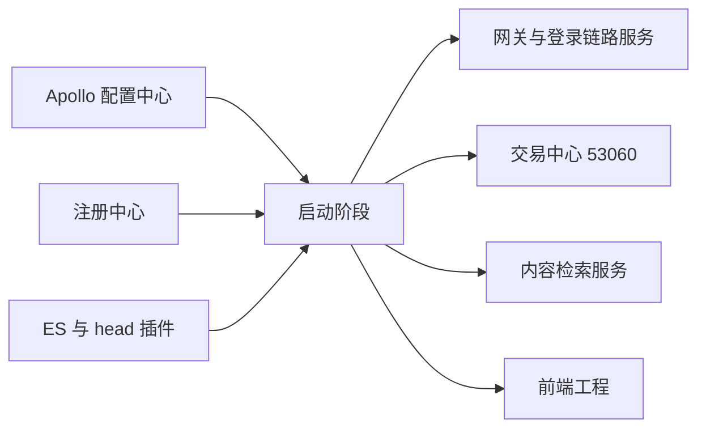

# 标的信息检索（四）：联调测试与第三章收官

检索服务的业务层写完了，还差控制器这最后一层。补完它，整条检索链路就能通，接下来是两头联调：Postman 里把接口打透，再上前端出借页面点一遍真实筛选。测试还顺带揪出一个字段没取到的小缺陷，修复过程本身就是一次很好的「接口返回与页面展示对不上」的排查示范。这一课也是发标这一章的收官，正好把第三章主线串起来复盘。

## 先给结论

- 控制器只做一层薄封装：注入 `ProjectIndexService`，调用 `queryProjectIndex`，结果套 `RestResponse.success` 返回，检索服务的三层至此齐了。
- 联调从 Postman 开始再上前端：先往交易中心的 `/transaction/projects/indexes/q` 发请求验证后端链路，再登录前端出借页面验证真实筛选。
- 排序参数不传时走默认排序，分页参数必传，条件对象只装了名称与期限，测试条件要跟实现里拼的条件对齐。
- 前端年化利率显示为 0 的根因在结果封装：循环转 DTO 时漏取了年化利率字段，取出 Object 后先转字符串再构造 BigDecimal，重启检索服务即恢复。
- 联调环境一次起齐：配置中心、注册中心、网关、登录链路相关服务、交易中心、内容检索服务、前端工程、ES 与 head 插件，少一个环节链路就断。

## 补上检索服务的控制器

控制器是纯粹的转发层，注入业务层、调用方法、包装响应：

```java
/** 内容检索服务控制器 包名按 com.study.finance 系改写 */
@Autowired
private ProjectIndexService projectIndexService;

@ApiOperation("检索标的信息")
@PostMapping(value = "/l/projects/indexes/q")
public RestResponse<PageVO<ProjectDTO>> queryProjectIndex(
        @RequestBody ProjectQueryParamsDTO projectQueryParamsDTO,
        @RequestParam Integer pageNo,
        @RequestParam Integer pageSize,
        @RequestParam(required = false) String sortBy,
        @RequestParam(required = false) String order) {
    PageVO<ProjectDTO> projects = projectIndexService.queryProjectIndex(
            projectQueryParamsDTO, pageNo, pageSize, sortBy, order);
    return RestResponse.success(projects);
}
```

到这里检索服务三层齐备：控制器收请求，业务层构造 ES 查询并解析结果，客户端发请求。路径 `/l` 打头守住内部接口约定，前端经网关访问不到它，能调它的只有交易中心。

## 测试前先把环境清单过一遍

前后端集成测试的前提是把整条链路的服务都拉起来。动手前先按依赖顺序过清单，少起一个服务，请求就会在某一段莫名挂掉：



关键路径从左往右读：基础设施（配置中心、注册中心、ES）先就位，业务服务再起，前端最后打开。检索功能还额外牵扯登录态，出借页面要登录才能进，所以网关与登录链路的服务也在必起清单里。全部起好后先用 head 插件确认索引库里有多少数据，这一步是后面判断「查无结果」到底算不算 bug 的基准，索引里总共四条标的，任何检索结果都不可能超过这个数。

## Postman 先把后端链路打透

Postman 测试比前端灵活，可以直接控制每个参数。请求发往交易中心的完整路径 `http://localhost:53060/transaction/projects/indexes/q`，因为前端请求就是先到交易中心再转发的，这里模拟的就是前端的请求。分页参数拼在 URL 上，条件装在请求体的 JSON 里：

```bash
curl -X POST "http://localhost:53060/transaction/projects/indexes/q?pageNo=1&pageSize=10" \
  -H "Content-Type: application/json" \
  -d '{"name": "借款"}'
```

名称条件传「借款」，与实现类里拼的词条查询对应；排序两个参数不传，验证默认按创建时间倒序的策略。返回结构如下：

```json
{
  "code": 0,
  "msg": "OK",
  "result": {
    "pageNo": 1,
    "pageSize": 10,
    "total": 4,
    "content": [
      {"name": "冯璐女第一次借款", "period": 360, "projectStatus": "FULLY"},
      {"name": "赵森第六次借款", "period": 360, "projectStatus": "FULLY"}
    ]
  }
}
```

四条全部命中，因为索引库里总共就四条数据，每条名称里都带「借款」这个词。把 `pageSize` 改成 2 再发，`total` 仍是 4，`content` 里只剩两条，分页生效。排序参数可以按字段试升序降序，其他条件字段也照此逐个补测，Postman 阶段的目标就是把接口行为钉死，前端再出问题就能断定不在后端。

## 前端出借页面走一遍真实筛选

登录前端后进入出借页面，这就是这条检索链路的最终使用现场。页面上的筛选条件比接口能力少，只有按借款期限分档：全部、0 到 6 个月、6 到 12 个月、12 个月以上。逐档点下来：

- 全部：四条数据全部出现，符合索引总量。
- 0 到 6 个月：查无结果，页面没有报错，这是正常现象。
- 6 到 12 个月：四条全部命中。

6 到 12 个月档全命中的原因要看数据：索引里每条标的的 `period` 都是 360，单位是天，360 天折算正好落在 6 到 12 个月这一档的边界内，所以四条全中。0 到 6 个月档查不出也是数据使然，没有标的落在这个区间。这类「结果不对但代码没错」的情况，判断依据就是先看数据分布再怀疑代码，测试数据单一的时候尤其要先做这一步。

## 揪出年化利率为 0 的缺陷

页面上有个刺眼的问题：每条标的的年化利率都显示为 0。后端接口返回正常、分页正常、名称期限都正常，唯独这个字段是 0。排查方向立刻指向结果封装那一层，因为 ES 里明明存了年化利率，head 插件里点开文档能看到 0.1 的值。

根因确实在业务实现的结果解析段：循环把 `SearchHit` 转成 DTO 时，年化利率这个字段压根没有取，DTO 里这个属性一直是默认值，前端拿不到只好显示 0。修复就是把字段补上，键名先到 head 插件里对着文档源确认：

```java
// 年化利率 键名对照索引文档源确认
Object annualRate = sourceAsMap.get("annualRate");
if (annualRate != null) {
    // 取出的 Object 先转字符串 再交给 BigDecimal 的字符串构造
    projectDTO.setAnnualRate(new BigDecimal(annualRate.toString()));
}
```

这里又是一次类型转换的现场教学：Map 的 `get` 返回 Object，直接 `new BigDecimal(object)` 编译不过，先 `toString` 再交给 BigDecimal 的字符串构造器，稳稳转成目标类型。改完重启内容检索服务，刷新前端页面，年化利率显示出 0.1，换算过来就是 10%，测试数据里四条标的利率都一样，所以页面数值一致。缺陷虽小，暴露的规律很有普遍性：接口字段与页面展示对不上时，先核对封装层有没有漏字段、转错类型，再看前端渲染。

## 第三章收官复盘

测试全部通过，第三章的主线也就走完了。回头串一遍：这一章从发标需求切入，交易中心与存管代理两个服务配合，借款人把标的发出来并经存管侧记账；随后是管理平台对标的的查询与审核，交易库做了分库分表与读写分离，管理端的复杂列表查询也有了着落；数据量与模糊检索的诉求最终落到检索方案上，Logstash 把标的数据同步进 Elasticsearch 索引库，内容检索服务以交易中心为入口对外提供检索能力，直到这一课联调收官。

一条功能链从关系型数据库一路走到搜索引擎，各环节各司其职：交易库保事务与一致性，检索库保查询速度与模糊匹配能力，同步管道保证两边数据的最终一致。后续投标、放款、还款的业务都建立在这批标的之上，检索能力也会随业务数据的增多持续兑现它的价值。

## 常见误区

- **联调前不做数据基准盘点。** 错例：索引里只有四条数据，看到筛选结果为空就断定查询有 bug。正解：先用 head 插件确认索引总量与字段分布，再判断结果是否符合数据事实。
- **测试条件与实现拼的条件脱节。** 错例：实现里只拼了名称与期限条件，测试却传年化利率期待过滤生效。正解：测试用例跟着实现里实际拼接的条件走，未实现的字段留在 Postman 阶段验证扩展性。
- **字段缺失时先怀疑前端。** 错例：页面数值为 0 就去查前端渲染逻辑。正解：先看后端接口返回的字段值，返回里就是 0 则问题在结果封装层，逐字段核对取值与类型转换。
- **改完服务不重启就刷新页面。** 错例：代码补了字段，服务还在跑旧进程，页面永远拿不到新字段。正解：重启对应服务再刷新，改动在哪个服务就重启哪个，别把整个环境全量重启浪费时间。

## 面试可能被问到的问题

1. 面试官追问：「MySQL 有了查询能力，为什么还要引入 Elasticsearch 做检索？」
   答：关系型数据库的 like 前缀模糊匹配走不了索引，多字段过滤加模糊查询在大数据量下必然慢查询；ES 靠倒排索引把分词后的词条到文档的映射建好，关键词检索、相关性排序都是原生能力。两者分工是事务归数据库、检索归搜索引擎，用同步管道保持数据最终一致。
2. 面试官追问：「前后端联调时接口返回正常但页面展示异常，你的排查思路是什么？」
   答：按数据流正向排查，先确认请求参数正确，再看后端接口返回的字段值，返回缺失就查封装层是否漏取字段或转错类型，返回完整再看前端渲染。本课年化利率为 0 就是返回层缺字段，补取值与类型转换即修复。
3. 面试官追问：「Object 转数值类型为什么要先 toString 再构造？」
   答：JSON 反序列化后数值通常落成 Double 或其他包装类型，直接强转目标类型容易抛 ClassCastException；toString 得到字符串后再交给 BigDecimal、Integer 的字符串构造器，能兼容索引里的多种存储形态，是最稳的通用转换路径。
4. 面试官追问：「集成测试前为什么要梳理服务启动清单？」
   答：微服务链路上每个环节缺失的表现都是请求失败，定位时容易误判为代码问题。按依赖顺序起服务并先验证基础设施，能把环境故障与代码故障分开，缩短联调排障时间。
5. 面试官追问：「怎么设计一条检索功能的测试用例集？」
   答：覆盖三个维度，功能维度逐条件验证命中范围，边界维度验证分页换算、空条件、不存在的关键词，异常维度验证服务不可用时的错误响应。先在接口层钉死行为，再在前端验证真实场景，最后对照索引数据分布复核结果合理性。

## 配套资料

- 讲义：`materials/docs/10/万信金融-第3章-讲义-发标v1.0.md`，标的快速检索一节：检索服务控制器实现、功能测试（Postman 测试与前后端集成测试）。
- 代码：`materials/code/10/wanxinp2p_apollo/`，公共模块归档（目录保留原始命名，路径只列到该层级），`RestResponse` 响应结构可对照。
- 代码：`materials/code/10/wanxinp2p_front/`，前端工程归档（目录保留原始命名，路径只列到该层级），出借页面的筛选交互可对照。
- 说明：内容检索服务工程随课程资料单独提供，未随仓库归档；控制器与字段修复代码按画面线与讲义口径整理，包名按 `com.study.finance` 系改写；curl 与响应 JSON 为按本课写法补全的示例，演示账号与索引数据以本机环境为准。
