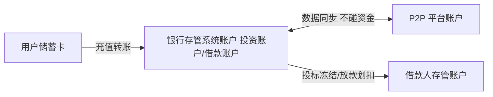
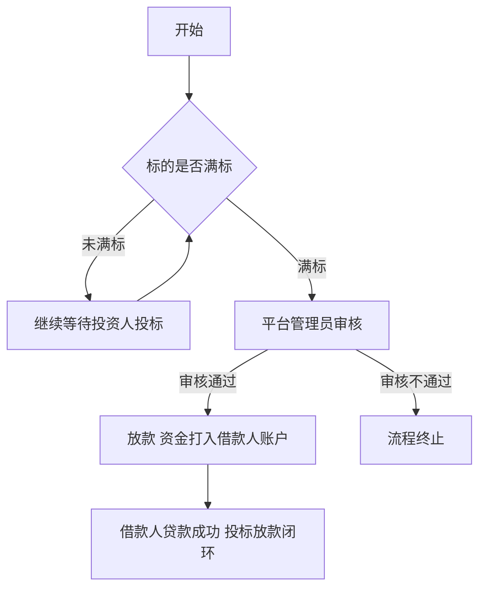

# 用户投标业务概述：投标放款这一章先把钱、标、款三件事说明白

发标业务收官之后，借款人的标已经挂到出借列表里了，接下来轮到另一端登场：投资人的钱怎么进平台、怎么借出去、借款人什么时候真正拿到钱。第四章「投标放款」回答的就是这条链路。动工前先把整块业务摊开看一遍：它由充值、投标、放款三段业务组成，每一端（前端怎么操作、资金在谁手里、状态怎么流转）都要有个整体印象，后面十几课的实现才不会迷路。

## 先给结论

- 第四章的业务地图是三段：充值、投标、放款，重点开发投标与放款，充值本课只交代原理与流程，功能暂缓开发。
- 平台走银行存管模式，用户在平台与银行存管系统各有一个账户，P2P 平台不碰资金，充值的目标账户是银行存管侧账户，不是平台账户。
- 充值功能暂不实现期间，测试资金靠直接修改存管侧数据库的余额字段来「人工充值」，投标放款的联调测试全都依赖这一步。
- 投标是投资人对可投标的出借动作，出借金额可分多笔；标的募集满全部借款金额即进入「满标」状态，满标的标不能再投。
- 满标后由平台管理员审核，审核通过才把出借资金打给借款人，这就是放款，借款人贷款成功，整条链路闭环。

## 三段业务：充值、投标、放款

把第四章的目录展开，业务按时间顺序排列：先充值，再投标，最后放款。这个顺序不是随意编排，而是资金流决定的因果链。

**第一，投标前账户里必须有钱。** 投资人要出借资金，账户余额为零时什么都做不了，所以充值是投标的前置动作。这个「充值」与支付宝、微信余额的充值是同一个概念：把储蓄卡里的钱转到账户上。区别在于转到哪里，这是本课最容易走偏的点。

**第二，充值的目标是银行存管系统账户。** 回顾开户时立下的规则：每个用户在平台与银行存管系统各有一个账户，平台账户只记数据不碰钱，所有资金由银行存管系统管理。由此充值的方向就确定了：钱从用户储蓄卡转入银行存管系统里这个用户的账户，平台侧只做数据同步。账户体系可以这样看：



关键在中间那条同步线：平台与存管侧各自记账，靠同步保持一致，资金实际划转只发生在存管系统内部。

**第三，充值的完整流程。** 前端入口在「账户余额」页面，点击充值后先校验是否已开户，未开户直接跳转开户流程；已开户则填写充值金额，跳到银行存管侧输入交易密码（资金流转必须验证交易密码），验证通过后从储蓄卡扣款、存入存管账户，充值完成。流程本身不复杂，难的是它横跨了平台前端与银行存管系统两端。

## 充值暂缓，测试资金怎么来

课程把充值功能的开发往后放，但投标放款马上就要联调测试，账户里没钱寸步难行。过渡方案是直接改数据库：找到银行存管系统对应的库 `p2p_bank_depository`，余额记录在 `balance_details` 表里，这张表的字段结构与充值业务一一对应：

```sql
-- 银行存管侧余额明细表 关键字段
CREATE TABLE balance_details (
    ID            BIGINT(20)    NOT NULL COMMENT '主键',
    USER_ID       VARCHAR(50)   NOT NULL COMMENT '用户编号',
    CHANGE_TYPE   TINYINT(4)    NOT NULL COMMENT '变动类型',
    AMOUNT        DECIMAL(10,2) NOT NULL COMMENT '变动金额',
    FREEZE_AMOUNT DECIMAL(10,2) NOT NULL COMMENT '冻结金额',
    BALANCE       DECIMAL(10,2) NOT NULL COMMENT '余额',
    APP_CODE      VARCHAR(50)   NOT NULL COMMENT '应用编码',
    PRIMARY KEY (ID)
);
```

「人工充值」就是把测试账号对应记录的 `BALANCE` 字段改大，比如直接置成一万、十万，随测试需要调整。动手前要看准三件事：哪个库、哪张表、哪个字段，改错了表就是白忙。值得注意的是 `FREEZE_AMOUNT` 冻结金额这一列，它是为投标准备的：投标成功时资金不是立刻转走，而是先冻结，满标放款时才真正划出，这个字段在后面的投标实现里还会反复出现。

测试账号怎么定位也要留意：银行存管侧存的是用户的编码（开户时生成的 `userNo`），不是手机号，改余额前得先拿手机号到用户数据里换出编码，再去 `balance_details` 里找对应记录。

## 投标：把出借这个动作讲清楚

投标指的是投资人在平台上浏览借款人发出的标的信息（即可投资项目），相中某个标之后把钱借给对方。业务流程在纸面上只有三步：浏览借款列表、选择标的输入出借金额、确认出借完成支付。

对照前端页面走一遍会更具体。出借列表里每个标展示着借款人身份、借款金额、利率与期限；点进某个标就是投标详情页，这里能看到年化利率（如 10% 的固定年化利率）、期限、总额、剩余总额与已出借人数，往下还有借款人信息、信用认证与收款计划。投资人输入出借金额（如 10000 元）点击授权出借，确认页会展示账户余额、出借金额与剩余支付金额，确认后跳转投标成功页，显示预期收益。

这里有一条隐性规则：**出借金额不必等于借款总额。** 一个标要借 29100 元，你可以出借 10000 元，剩下的部分由其他投资人陆续补齐。正因为允许多人分笔出借，才引出了下一个概念。

## 满标与放款：凑够数之后的审核与打款

一个标要借 29100 元，有人借一万、有人借五千、有人借两千，大家凑够这个数需要时间。当标的筹集到所借的全部资金，状态就变为「满标」。满标意味着这个标不能再接受投标，这在业务上必须严格卡住，否则借款金额会被投超。

满标之后不是系统自动把钱打给借款人，中间还有一道平台管理员审核，与发标时的管理员审核同构。审核通过后，平台把投资人的出借资金打入借款人的账户，这个过程叫放款，借款人贷款成功，投资人投资也同时生效。整条链路串起来：



关键分叉有两处：满标判断决定了标还能不能投，管理员审核决定了钱能不能放。管理端的「满标放款审核」列表查出的就是已满标的记录，审核按钮一点，通过与否直接决定这条借款的走向。

## 常见误区

- **以为充值是把钱充到平台账户。** 错例：平台自己记账，余额存在平台库里。正解：银行存管模式下资金只在银行存管系统内流转，平台不碰钱，充值目标是存管侧账户，平台侧仅同步数据。
- **以为投标金额必须等于借款总额。** 错例：想投一个借 29100 元的标，觉得要一次拿出 29100。正解：出借金额自定，可多笔累计，剩余额度留给其他投资人，凑满即满标。
- **以为满标后立即放款。** 错例：钱凑够了系统自动打款。正解：满标后先经平台管理员审核，审核通过才执行放款，审核即风控闸门。
- **人工充值时改错数据。** 错例：在平台侧数据库改用户余额，或忘了银行存管侧以用户编码而非手机号定位记录。正解：锁定 `p2p_bank_depository` 库的 `balance_details` 表，先用手机号换出用户编码再改 `BALANCE`。

## 面试可能被问到的问题

1. 面试官追问：「银行存管模式下，用户的资金账户体系是怎样的？」
   答：用户在平台与银行存管系统各有一个账户，平台账户只保存业务数据，资金全部由存管系统管理。充值、冻结、放款等资金动作都发生在存管侧，平台通过存管代理服务与存管系统同步数据，保证两边账实一致。
2. 面试官追问：「什么是满标？满标在业务上意味着什么？」
   答：一个标的募集到所借的全部资金即为满标。满标后标的不再接受投标，进入待审核状态，管理员审核通过后才放款。分笔出借与满标判定是 P2P 交易链路的典型状态机设计。
3. 面试官追问：「充值功能还没开发时，怎么保证投标放款可以联调测试？」
   答：直接修改存管侧数据库的余额字段做人工充值。定位记录要用开户时生成的用户编码，而不是手机号；改之前要确认库、表、字段，避免改错数据源导致测试结论失真。
4. 面试官追问：「投标时冻结金额而不是直接扣款，为什么？」
   答：投标成功只代表投资意向成立，借款人还没拿到钱，若直接扣款，满标前资金归属就不清晰。冻结让资金保持「锁定但未划出」的状态，既防止投资人挪用，也给流标、放款失败等异常留了回退空间，真实划转发生在满标放款时。
5. 面试官追问：「放款前为什么还要平台审核一道？」
   答：审核是风控闸门，与发标审核同构。满标只说明钱凑够了，平台还要复核这笔借款的合规性与资料真实性，通过后才把出借资金打入借款人账户，不通过则流程终止，避免把风险直接传导给资金端。

## 配套资料

- 讲义：`materials/docs/10/万信金融-第4章-投标放款v1.0.md`，1.1 充值：充值定义与流程；1.2 投标：投标定义与用户投标流程；1.3 放款：满标定义与平台放款流程。
- 代码：`materials/code/10/wanxinp2p/`，P2P 工程归档（目录保留原始命名，路径只列到该层级），可对照开户沉淀的账户体系与工程结构。
- 代码：`materials/code/10/wanxinp2p_front/wanxinp2p_front/pages/lend/`，前端出借相关页面归档，投标详情与确认出借的页面交互可对照。
- 说明：`balance_details` 表结构按存管系统数据库画面资料整理；充值流程中的页面交互细节以讲义与画面线为准，充值功能本课未开发，示例数据为按本课写法补全。
