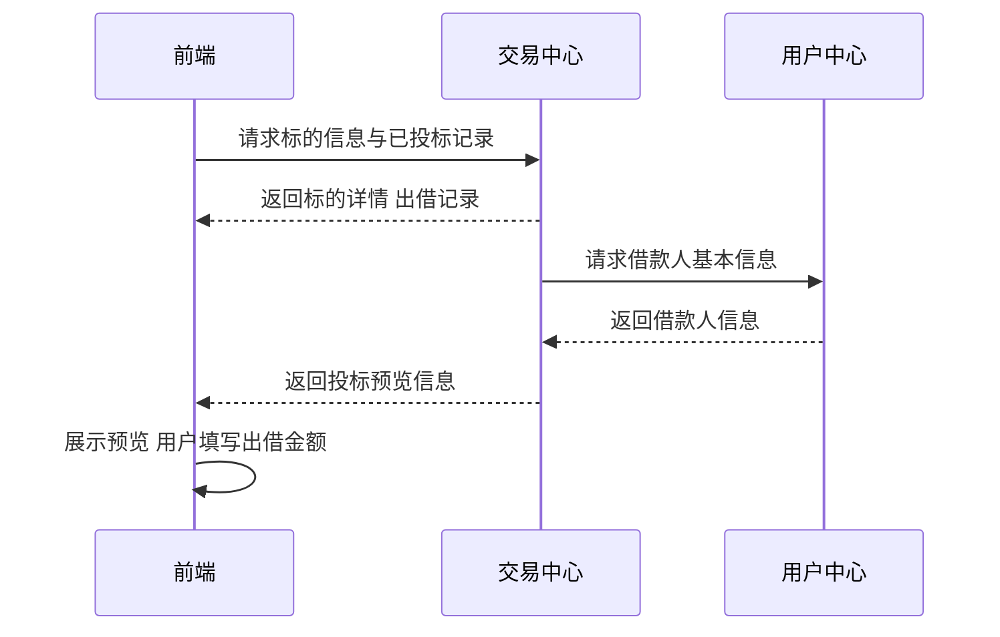
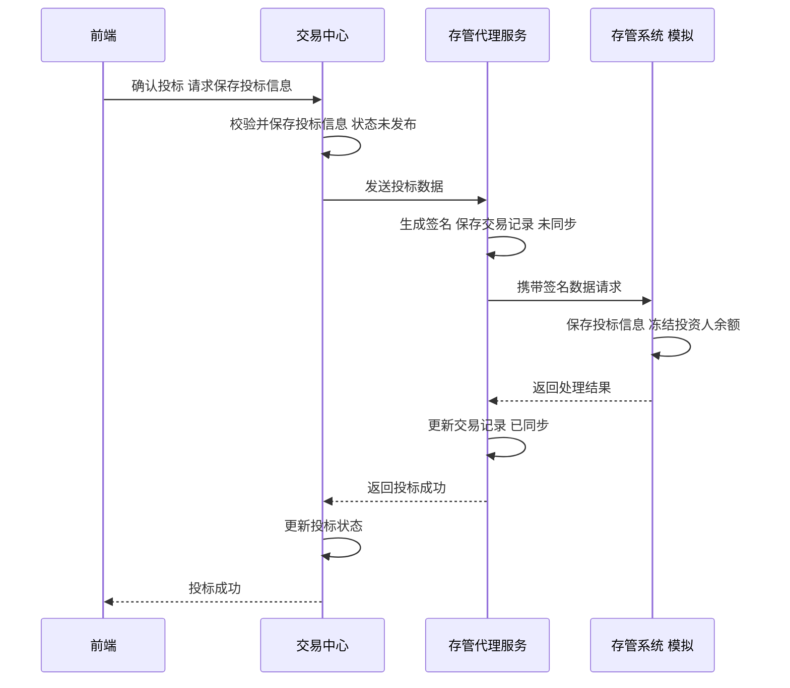

# 用户投标需求分析：一条时序图拆成投标预览与投标两个阶段

充值可以靠改数据顶替，投标可没法绕过实现。把投标的完整时序图摊开，从用户点「授权出借」到存管系统冻结余额，十几个编号步骤牵扯五个角色，一口气实现极易迷路。这一课的任务是把需求拆清楚：整条链路分两个阶段，每个阶段涉及哪些微服务、每一步做什么、要定义几个接口，都先钉死再动工。

## 先给结论

- 投标链路按时序图拆成两个阶段：第一阶段投标预览（图中 1.1 至 1.6），第二阶段用户投标（图中 2.1 至 2.13），逐阶段开发、逐阶段测试。
- 投标预览本质是三块信息的聚合查询：标的信息与已投标记录找交易中心，借款人信息找用户中心，查完组装返回前端展示。
- 用户投标阶段涉及交易中心、存管代理服务与银行存管系统：交易中心保存投标信息，存管代理签名、保存交易记录并转发银行，银行保存投标信息并冻结投资人余额。
- 交易中心保存投标前要做一组校验（最小投标金额、账户余额、是否满标等），具体实现放到后面的课程展开。
- 存管侧交互沿用开户、发标沉淀的同一套通道：签名、交易记录（未同步）、银行处理、回传更新（已同步）。

## 两个阶段：为什么这么切

投标的时序图覆盖 1.1 到 1.6 与 2.1 到 2.13 两段编号。切分的依据是行为性质：前一段是「看」，后一段是「买」。

**第一，投标预览是投标前的信息聚合。** 投资人在标的详情页看到的内容有三大块：标的信息（利率、期限、总额、剩余总额）、出借记录（多少人已投、各投多少）、借款人信息（姓名、年龄、信用认证）。这三块信息分属不同服务，聚合过程是纯查询，不改任何状态，所以单独成段先做。

**第二，用户投标是带资金动作的主流程。** 从用户确认出借金额、点击授权出借开始，前端发请求到交易中心，交易中心保存投标信息，再经存管代理与银行存管系统完成资金冻结，最后逐级回传更新状态。这一段改数据、动资金，复杂度远高于预览，所以放在第二阶段，占去了 2.1 到 2.13 共十三个编号步骤。

两个阶段共用同一条前端入口路径：标的详情页先走预览把信息铺出来，用户填完出借金额才切入投标段。按此顺序开发，先做投标预览，再做用户投标。

## 第一阶段：投标预览的三次查询

预览阶段的参与方只有前端、交易中心与用户中心三个，流程是标准的查询编排：



关键路径按查询对象分三类：标的信息与已投标记录都归交易中心，因为投标属于交易域，数据就在交易库里；借款人信息归用户中心，借款人本质是平台用户，个人信息、信用认证都存在用户侧；交易中心作为编排方把两路查询的结果组装成投标预览信息一次性返回。前端不分别调三个服务，经网关的请求只落在交易中心一个入口上，这符合「前端只认业务聚合方」的接口设计习惯。

预览阶段的接口定义在讲义里已经给出蓝图：交易中心新增按标的 id 查询标的详情与已投标记录的接口，用户中心新增按借款人 id 查询个人信息的接口，各配对应的控制器与业务层实现。这部分内容与实现细节属于投标预览功能开发的范围，按两阶段顺序会在随后的课程里落地。

## 第二阶段：用户投标的十三步主流程

第二阶段是重点。参与方从三个涨到五个：前端、交易中心、存管代理服务、银行存管系统，用户中心在这个阶段不参与（投标人的身份信息在交易中心侧通过登录上下文与远程调用获得）。逐步拆解：



关键路径上有三处值得停留。

**第一，交易中心的双重职责。** 收到投标请求后，交易中心先做一组前置校验（投标金额是否满足平台最小投标金额、账户余额是否足够、标的是否满标、投标金额是否超过剩余可投额度等），校验通过才落投标记录。投标记录落库时状态是「未发布」，并且要生成请求流水号，这条流水号贯穿后面与存管侧的全部交互。

**第二，存管代理的固定套路。** 凡是经存管代理与银行存管系统的交互都是同一套动作：按私钥对数据生成签名保证传输安全，落一条状态「未同步」的交易记录，把签名后的数据发往存管系统。银行侧做的事是保存投标信息并冻结投资人余额：比如投标 1 万，就先在存管账户里冻结 1 万，这笔钱将来满标放款时才真正划给借款人。处理完回传结果，存管代理把交易记录更新为「已同步」，再返回交易中心。

**第三，状态的两两对应。** 时序图里 2.12 的状态更新与 2.2 的初始落库正好呼应：交易中心保存投标时给的是初始状态，收到存管侧成功结果后再更新为最终状态。前端最终拿到的是投标成功的响应，页面上顺势展示预期收益。

## 接口地图：两个新接口

把十三步映射到工程上，用户投标阶段需要新定义两个接口，编号顺着投标预览的接口往后排。

**接口④是交易中心保存投标信息接口**，前端点击确认出借后请求的就是它。入参只需要两样：标的标识与投标金额，正好对应确认出借页上的两样数据。出参要带投标的完整信息，包括平台帮投资人算好的预期收益。接口定义：

```java
/** 交易中心 API 按讲义接口定义口径整理 包名按 com.study.finance 系改写 */
@ApiOperation("用户投标")
@ApiImplicitParam(name = "projectInvestDTO", value = "投标信息", required = true,
        dataType = "ProjectInvestDTO", paramType = "body")
@PostMapping("/my/tenders")
RestResponse<TenderDTO> createTender(ProjectInvestDTO projectInvestDTO);
```

入参 DTO 与前端页面一一对应：

```java
/** 用户投标信息 按讲义口径整理 包名按 com.study.finance 系改写 */
@Data
@Model(value = "ProjectInvestDTO", description = "用户投标信息")
public class ProjectInvestDTO {
    @ApiModelProperty("标的的标识")
    private Long id;
    @ApiModelProperty("投标金额")
    private String amount;
}
```

前端确认出借页正是往 `transaction/my/tenders` 发请求，请求体里带标的 id 与出借金额，与这个定义严丝合缝。

**接口⑤是存管代理服务预处理冻结接口**，覆盖 2.4 到 2.10 的全部动作：保存交易记录、请求银行存管系统做预处理冻结、返回处理结果给交易中心。「预处理」指银行正式处理之前的准备阶段，存管代理要按银行的要求备齐数据（冻结金额、请求流水号、投资人用户编码、业务类型等）并签名。方法定义在存管代理的 API 工程中，入参是预处理请求对象，出参是从银行侧返回结构里取出的处理结果。

一个容易被忽略的路径约定：接口⑤是微服务之间互访的内部接口，交易中心经 Feign 调用，前端根本访问不到它。按本课的路径约定，内部接口以 `/l` 打头，守住「内部路径不对外暴露」的规则。

## 常见误区

- **把投标预览当成一个独立页面功能。** 错例：以为预览要新建一套数据。正解：预览只是三路已有数据的聚合查询，标的信息与出借记录在交易中心，借款人信息在用户中心，没有任何写操作。
- **以为投标直接扣投资人的钱。** 错例：交易中心扣减余额再通知银行。正解：资金动作只能发生在存管系统，投标阶段的动作是冻结余额，真正划转在满标放款，平台全程不碰资金。
- **跳过交易中心的前置校验直接落库。** 错例：前端已经校验过金额，后端保存时不再校验。正解：前端校验只算体验优化，最小投标金额、余额是否充足、是否满标必须在交易中心侧重新校验，绕过前端的请求必须被拦住。
- **给接口⑤配一条对外的路径。** 错例：预处理冻结接口与业务接口一样直接暴露给前端。正解：它只服务微服务间调用，路径按内部约定以 `/l` 打头，前端经网关无法触达。

## 面试可能被问到的问题

1. 面试官追问：「投标业务为什么拆成投标预览和用户投标两个阶段？」
   答：按行为性质切分，预览是纯查询聚合，只读不改，实现与测试都简单；投标涉及落库、签名、资金冻结等写操作，复杂度高。先做读后做写，每个阶段可以独立开发独立测试，也便于按接口编号逐步推进。
2. 面试官追问：「投标预览要查哪几类数据？分别从哪里查？」
   答：三类，标的信息与已投标记录从交易中心查，借款人基本信息从用户中心查，交易中心负责编排并组装返回。前端只对接交易中心一个入口，避免跨多个服务的请求散落在前端。
3. 面试官追问：「用户投标主流程中，存管代理服务承担什么职责？」
   答：三件事，按私钥对投标数据签名，落一条状态为未同步的交易记录作为对账凭据，把签名后的数据转发银行存管系统并回传处理结果。银行侧确认成功后交易记录更新为已同步，存管代理全程是平台与银行之间的安全通道与记账员。
4. 面试官追问：「银行存管系统在投标时做的是什么动作？为什么是冻结而不是扣款？」
   答：保存投标信息并冻结投资人对应金额。因为投标成功只代表投资意向成立，借款资金尚未放款，冻结能锁定资金防止挪用，又保留满标放款前的回退余地，真实划转发生在审核通过的放款环节。
5. 面试官追问：「投标链路里交易记录的未同步状态有什么用？」
   答：它是请求是否送达银行的事务边界。发起请求前先落未同步记录并携带唯一流水号，若中途失败可以按流水号排查补发，成功后更新为已同步。它同时承担了幂等判断与对账依据的角色，与开户、发标共用同一套机制。

## 配套资料

- 讲义：`materials/docs/10/万信金融-第4章-投标放款v1.0.md`，2.1 需求分析：两阶段拆分与 2.1 至 2.13 步骤；2.2 投标预览：接口①②③ 的定义蓝图；2.3 用户投标：接口④⑤ 的定义与银行存管系统接口说明。
- 代码：`materials/code/10/wanxinp2p/`，P2P 工程归档（目录保留原始命名，路径只列到该层级），可对照 API 工程与包组织方式，交易中心与存管代理工程随课程资料单独提供。
- 代码：`materials/code/10/wanxinp2p_front/wanxinp2p_front/pages/lend/details.vue` 与 `confirmLend.vue`，前端标的详情页与确认出借页归档，预览数据展示与 `transaction/my/tenders` 请求路径可对照。
- 说明：接口④⑤ 的方法签名与注解按讲义接口定义口径整理，包名与工程名按 `com.study.finance` 系改写；前端页面字段与请求路径取自前端工程归档源码。
