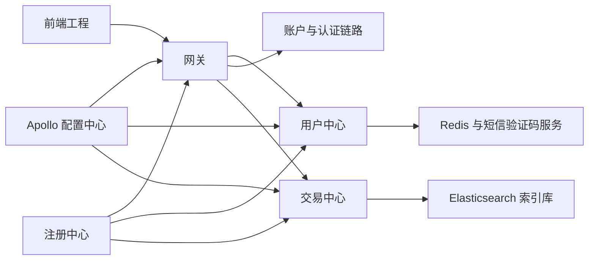

# 投标预览前后端集成测试：一次登录，把三个接口串成一条链

接口层的测试都过了，投标预览还差最后一道验收：拉上前端走真实链路。投资人在浏览器里登录、进出借列表、点「出借」进详情页，这一路会依次触发标的信息、投标记录、借款人信息三个接口，任何一环没起服务、任何一处数据没造对，页面就会露馅。集成测试麻烦就麻烦在牵扯的服务多、数据要前后呼应，跑通这一遍，投标预览才算真正收官。

## 先给结论

- 集成测试的服务清单比接口测试长得多：前端工程、Apollo、注册中心、网关、登录链路相关服务（用户中心、账户、认证）、交易中心，外加内容检索服务，配套的 Redis 与 Elasticsearch 也要起，一个都不能少。
- 内容检索服务必须在列：出借列表页的标的数据来自 Elasticsearch 索引库，索引里没数据，连进详情页的入口都没有，投标预览无从开始。
- 登录账号要挑已开户的，开户标志字段为 1；没开户的账号登录后还得先走开户流程，测试节奏全被打乱。
- 详情页的数据核对有一张固定清单：总额 12000、剩余额度 5000、出借人数 2、出借记录 2000 与 5000 且手机号脱敏、借款人年龄生日性别与身份证号解析一致。
- 造数据要前后呼应：投标记录要与索引库里的标的对上号，借款人信息要与发标人记录对上号，时间字段没造会给成默认的 1970 年，页面上会露出来。

## 服务清单：为什么检索服务也在列

接口测试只起交易中心就能跑，集成测试的清单一下子长了一截。先把这条链在脑中铺开，看这张图，它画的是从前端登录到详情页要经过的服务：



容易起疑的是内容检索服务这一项。投标预览的三个接口本身不查索引库，为什么检索服务也要启动？往前想一步就通了：测试入口不是直接敲详情页地址，而是从出借列表页点进去的，列表页的标的数据来自此前开发的检索功能，从 Elasticsearch 索引库里查出来经交易中心返回。检索服务不起，列表页空白，详情页的入口都没有。登录也是必须的，出借操作要登录态，验证码依赖 Redis 与短信验证码服务，网关要做认证拦截，这一串都是登录链路的既定配套。

## 登录与选号：开户标志是道门槛

服务全部拉起后先登录。挑测试账号有个讲究：账号必须已经开过户，用户表里开户标志字段值为 1。挑了没开户的账号，登录完点出借会被拦回开户流程，测试就得先绕道去补开户，节奏全乱。选定账号后走验证码登录：前端请求验证码，到后台控制台日志里把验证码取出来填回去，登录成功进入首页。

出借列表页这时展示出四条标的，这个数字不是巧合，索引库里就是四条文档。可以顺手核对一下来源：打开 ES 的 head 插件看索引数据，四条与页面一致，说明列表数据确实来自索引库而不是数据库。其中「左丘先生第一次借款」这条是测试主角，此前造的投标记录、发标人账号全都围着它转。

## 详情页逐项核对

点击左丘这条标的的「出借」，前端跳到投标预览详情页，地址栏里的标的 ID 与索引库文档对应。这一页会依次发起三个请求，对应的正是投标预览的三个接口：

```bash
# 详情页触发的三路请求 路径与接口层测试一致 经网关转发
curl "http://localhost:53010/transaction/projects/2139483643803590657"
curl "http://localhost:53010/transaction/tenders/projects/2139483643803590657"
curl "http://localhost:53010/consumer/my/borrowers/27"
```

页面渲染出来的数据逐项核对，清单如下：

- 标的信息区域：总额 12000，年化利率与期限正常显示，风险等级展示为 B。
- 进度区域：剩余金额 5000，出借人数 2，与接口①测试时的结论一致。
- 出借记录区域：两条记录，一条出借 2000、一条出借 5000，手机号中间四位是星号；记录时间显示 1970 年 1 月 1 日，这是造数时没给时间字段、后端按时间戳默认值处理的结果，属于测试数据的疏漏，不是代码缺陷。
- 借款人信息区域：左丘，47 岁，生日 1970 年 7 月 25 日，与接口③测试时身份证号的解析结果一致。

每一项都能回溯到库里的一行数据：总额来自 `project` 表，剩余额度与人数来自 `tender` 分表的聚合，出借记录对应那两条造数，借款人信息对应发标人用户 ID 27 的记录。前后端集成测试通过，唯一遗留的是测试数据的时间字段，补上真实时间即可消除页面上的 1970 年。

## 收官与遗留

到这里，投标业务的第一阶段整体完成：预览页的三块信息从库到页面全程走通，接口层测试与集成测试双重验收。复盘这轮集成测试，成本主要在两处：服务清单长，起环境一次就要拉起近十个进程；数据要求前后呼应，标的要在索引库里、投标记录要落对分片、借款人要能反查。这两点在后续投标动作、放款环节的联调里还会反复出现，清单与造数思路可以一直沿用。下一阶段就是投资人在这个页面上真正点下「授权出借」，钱开始动起来。

## 常见误区

- **集成测试只起自己这个功能的服务。** 错例：以为投标预览只涉及交易中心与用户中心，结果列表页空白进不了详情页。正解：从用户操作入口倒推整条链路，列表数据来自检索服务，登录依赖网关与验证码链路，配套中间件一并拉起。
- **挑了未开户的账号做测试。** 错例：随手挑个账号登录，点出借被跳转去开户。正解：登录前先确认用户表开户标志字段为 1，或者专门保留一个已开户的测试账号专供联调。
- **把页面上的 1970 年当成 bug。** 错例：看到出借记录时间显示 1970 年 1 月 1 日就去查日期处理代码。正解：先查测试数据，造数时没给时间字段，落库成时间戳 0，展示出来就是 1970 年，补数据即可。
- **造数只对齐数据库不对齐索引库。** 错例：投标记录造好了，但标的没进 ES 索引，详情页入口都进不去。正解：造数时把索引库关联上，标的要先经发标与同步进索引，再围绕它造投标与借款人数据。

## 面试可能被问到的问题

1. 面试官追问：「前后端集成测试和接口测试的边界怎么划分？」
   答：接口测试负责把每个接口的行为钉死，参数、返回、边界都在这一层验证，环境轻、定位快；集成测试验证的是用户操作链路下多接口、多服务的组装是否正确，重点在数据前后呼应与页面渲染。接口层先过再上集成，能把环境故障与代码故障分开。
2. 面试官追问：「集成测试环境的服务清单怎么定，有没有方法论？」
   答：从用户入口倒推依赖链。用户从哪个页面开始操作，页面渲染需要哪些数据，数据由哪些服务提供，服务又依赖哪些中间件与基础设施，逐层展开得到清单。起服务前先起配置中心与注册中心，业务服务随后，前端最后，顺序反了会反复重启浪费时间。
3. 面试官追问：「页面数据显示 1970 年 1 月 1 日，最可能的原因是什么？」
   答：时间字段存了零值。Java 与很多存储体系把 1970 年 1 月 1 日 0 时作为时间戳起点，字段没赋值或被赋成 0，格式化后就是这一天。先查数据源头是否漏赋值，再排查转换层有没有把空值兜成 0，最后才是前端格式化逻辑。
4. 面试官追问：「联调测试时如何快速判断问题是出在数据还是代码？」
   答：先做数据基准盘点，用数据库客户端和索引插件把相关表和索引里的数据看一遍，确认造数落对了分片、状态字段给对了值；数据没问题再对照接口返回与页面展示的差异逐层定位。多数联调问题是数据不符合约定，而不是代码错误。

## 配套资料

- 讲义：`materials/docs/10/万信金融-第4章-投标放款v1.0.md`，2.2.2.2 功能测试一节的前后端联调部分：环境启动清单、登录与详情页数据核对。
- 代码：`materials/code/10/wanxinp2p_front/`，前端工程归档（目录保留原始命名，路径只列到该层级），出借列表与借款详情页的跳转与请求可对照。
- 代码：`materials/code/10/wanxinp2p_apollo/`，公共配置工程归档（目录保留原始命名，路径只列到该层级），网关与各服务端口、响应封装可对照。
- 说明：详情页请求路径与核对清单按画面线口径整理，包名与工程名按 `com.study.finance` 系改写；curl 请求示例为按本课写法补全的演示，端口以本机环境为准（网关 53010、交易中心 53060、用户中心 53050）。
