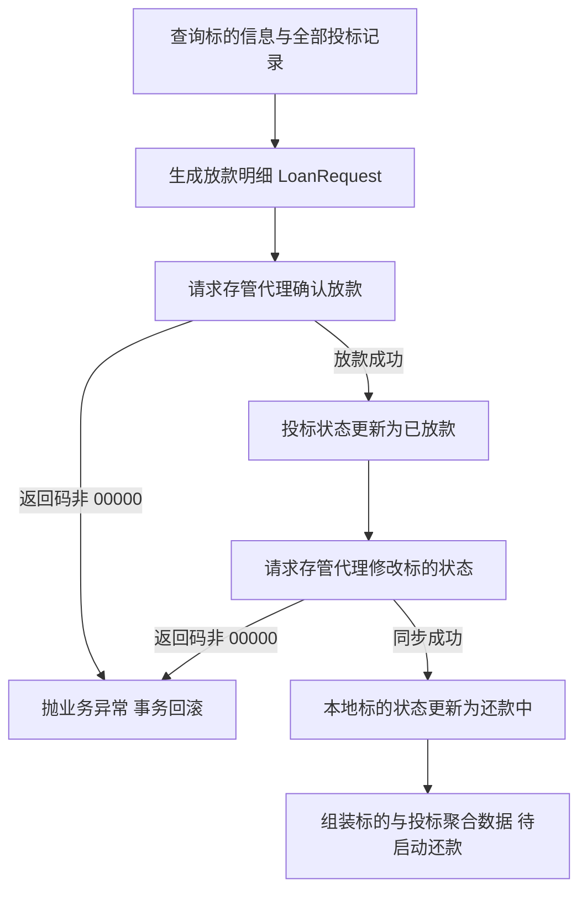
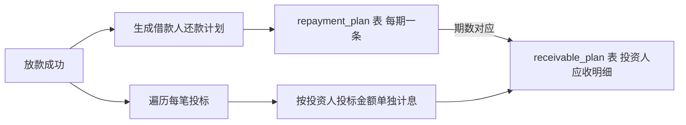

# 满标放款功能实现：交易中心四阶段串联与存管代理的确认放款、状态同步

需求分析与接口定义完成之后，满标放款剩下的是纯粹的实现活：四个接口按四个阶段逐个把代码填进去。难点集中在接口①，它是整个放款业务的总入口，方法体内部要按顺序包含生成放款明细、请求放款、修改状态、启动还款的全部编排，等于把接口②③④的调用逻辑全部装进一个带事务的业务方法里。接口②③落在存管代理服务一侧，代码几乎是开户、发标、投标以来反复使用的那套模板，写起来反而快。

## 先给结论

- 接口①的实现分四段：查标的与投标信息生成 `LoanRequest` 放款明细，调存管代理确认放款并把投标状态改成已放款，再调存管代理把标的状态同步成还款中并更新本地标的，最后组装 `ProjectWithTendersDTO` 准备交给还款服务。
- 存管代理的接口②③共用一套模板：构造交易记录、幂等性校验、JSON 序列化后 Base64 编码、拼存管系统地址、通用 `sendHttpGet` 发送，两段代码只差请求类型码与 `serviceName`。
- 每次存管交互都独立落一条 `DepositoryRecord` 交易记录，从未同步到已同步逐笔闭环，接口②用 `FULL_LOAN`，接口③用 `MODIFY_STATUS`。
- 接口④的启动还款不走 Feign 同步调用，因为生成还款计划与应收明细耗时较长且涉及分布式事务，课程安排改用 RocketMQ 传消息，这一块留到后续章节展开。
- 放款入口方法标了 `@Transactional(rollbackFor = BusinessException.class)`，存管侧任一环节返回失败码就抛业务异常，本地已做的状态更新随之回滚。

## 接口①：交易中心的放款总入口

接口①定义在交易中心的 `ProjectService` 业务层接口上，方法签名与 API 层的 `loansApprovalStatus` 一致，三个参数分别对应标的 ID、审核状态与平台佣金。实现之前有两件准备工作：Feign 代理与业务层接口。

交易中心要向存管代理服务发起两次远程请求，对应 Feign 代理接口 `DepositoryAgentApiAgent` 上新增的两个方法，路径沿用存管代理内部接口的 `/l` 约定：

```java
package com.study.finance.transaction.agent;

/** 交易中心的存管代理 Feign 接口 按讲义口径整理 包名按 com.study.finance 系改写 */
@FeignClient(value = "finance-depository-agent-service")
public interface DepositoryAgentApiAgent {

    @PostMapping("/depository-agent/l/confirm-loan")
    RestResponse<String> confirmLoan(LoanRequest loanRequest);

    @PostMapping("/depository-agent/l/modify-project-status")
    RestResponse<String> modifyProjectStatus(ModifyProjectStatusDTO modifyProjectStatusDTO);
}
```

这两个方法与 API 工程里定义的存管代理接口一一对应，只是视角换成了调用方：交易中心不关心银行侧怎么划拨，它只认 Feign 代理上的两个方法签名，传对象、拿响应。Feign 的服务名指向存管代理服务在注册中心的名字，路径与存管代理 Controller 的映射保持一致，两边对上了请求才落得进去。

业务层接口与实现类的骨架如下，实现方法加事务注解，回滚条件指定为业务异常：

```java
/** 交易中心业务层接口① 按讲义口径整理 */
/**
 * 审核标的满标放款
 * @param id 标的 id
 * @param approveStatus 审核状态
 * @param commission 平台佣金
 * @return 处理结果
 */
String loansApprovalStatus(Long id, String approveStatus, String commission);

@Override
@Transactional(rollbackFor = BusinessException.class)
public String loansApprovalStatus(Long id, String approveStatus, String commission) {
    // 第一阶段：生成放款明细
    // 第二阶段：放款
    // 第三阶段：修改标的业务状态
    // 第四阶段：启动还款
}
```

放款总入口的完整编排画出来是这样，四个阶段层层嵌套，上一阶段成功才有资格进入下一阶段：



关键路径在于两处返回码判断：确认放款失败与状态同步失败都走同一个异常出口，日志记下标的 ID 与存管代理的返回结果，抛出 `TransactionErrorCode.E_150113`，此时投标或标的状态尚未更新，事务回滚后数据库不留半成品状态。

### 第一阶段：生成放款明细

明细来自两份现成数据。标的信息按主键查一次，投标信息用条件构造器按标的 ID 查出整张列表，一个标的对应多条投标记录：

```java
/** 查询标的与投标信息 按讲义口径整理 */
// 获取标的信息
final Project project = getById(id);
// 构造查询参数, 获取所有投标信息
QueryWrapper<Tender> queryWrapper = new QueryWrapper<>();
queryWrapper.lambda().eq(Tender::getProjectId, id);
final List<Tender> tenderList = tenderMapper.selectList(queryWrapper);
// 生成放款明细
final LoanRequest loanRequest = generateLoanRequest(project, tenderList, commission);
```

放款明细像一张购物小票：谁发的标、借多少、多少人投了、每人投多少、平台抽多少佣金，全部封进一个 `LoanRequest` 对象。生成逻辑抽成独立方法，字段赋值逐项对应：

```java
/** 根据标的及投标信息生成放款明细 按讲义口径整理 */
public LoanRequest generateLoanRequest(Project project, List<Tender> tenderList, String commission) {
    LoanRequest loanRequest = new LoanRequest();
    // 设置标的 id
    loanRequest.setId(project.getId());
    // 设置平台佣金, 入参为字符串, 判空后转 BigDecimal
    if (StringUtils.isNotBlank(commission)) {
        loanRequest.setCommission(new BigDecimal(commission));
    }
    // 设置标的编码
    loanRequest.setProjectNo(project.getProjectNo());
    // 设置请求流水号
    loanRequest.setRequestNo(CodeNoUtil.getNo(CodePrefixCode.CODE_REQUEST_PREFIX));
    // 处理放款明细
    List<LoanDetailRequest> details = new ArrayList<>();
    tenderList.forEach(tender -> {
        final LoanDetailRequest loanDetailRequest = new LoanDetailRequest();
        // 设置放款金额
        loanDetailRequest.setAmount(tender.getAmount());
        // 设置预处理业务流水号
        loanDetailRequest.setPreRequestNo(tender.getRequestNo());
        details.add(loanDetailRequest);
    });
    // 设置放款明细
    loanRequest.setDetails(details);
    return loanRequest;
}
```

细节有三处值得留意。佣金入参是字符串，必须判空再转 `BigDecimal`，直接转换在参数缺失时会抛数字格式异常；请求流水号用工具类按请求前缀新生成，这笔放款请求从生成明细起就有了唯一凭据；每条明细的预处理业务流水号直接取自投标时存管侧留存的 `requestNo`，银行划拨时按这个流水号逐笔对应投标冻结资金，一一对应才对得上账。

### 第二阶段：放款与投标状态更新

明细生成后通过 Feign 发给存管代理服务，拿到响应后按五个零的返回码判断成败，这是与存管侧交互的老规矩：

```java
/** 请求存管代理确认放款并更新投标状态 按讲义口径整理 */
// 请求存管代理服务
final RestResponse<String> restResponse = depositoryAgentApiAgent.confirmLoan(loanRequest);
if (DepositoryReturnCode.RETURN_CODE_00000.getCode().equals(restResponse.getResult())) {
    // 响应成功, 更新投标信息: 已放款
    updateTenderStatusAlreadyLoan(tenderList);
} else {
    // 失败抛出业务异常
    log.warn("审核满标放款失败! 标的ID为:{}, 存管代理服务返回的状态为:{}",
            project.getId(), restResponse.getResult());
    throw new BusinessException(TransactionErrorCode.E_150113);
}
```

投标状态更新抽成私有方法，遍历列表逐条改状态再逐条落库，状态值取交易相关编码枚举中的已放款项：

```java
/** 更新投标信息为已放款 按讲义口径整理 */
private void updateTenderStatusAlreadyLoan(List<Tender> tenderList) {
    tenderList.forEach(tender -> {
        // 设置状态为已放款
        tender.setTenderStatus(TradingCode.LOAN.getCode());
        // 更新数据库
        tenderMapper.updateById(tender);
    });
}
```

这一步动的是投标记录，此刻标的状态还停在满标，要等第三阶段与银行侧同步完才改。

### 第三阶段：修改标的业务状态

放款成功的下一步是与存管系统同步标的状态，请求参数装进 `ModifyProjectStatusDTO`，四个字段各自有讲究：

```java
/** 请求存管代理修改标的状态为还款中 按讲义口径整理 */
// 构造请求参数
ModifyProjectStatusDTO modifyProjectStatusDTO = new ModifyProjectStatusDTO();
// 业务实体 id
modifyProjectStatusDTO.setId(project.getId());
// 业务状态: 还款中
modifyProjectStatusDTO.setProjectStatus(ProjectCode.REPAYING.getCode());
// 请求流水号: 同一笔放款业务, 复用放款明细的流水号, 不重新生成
modifyProjectStatusDTO.setRequestNo(loanRequest.getRequestNo());
// 标的编码: 存管系统按编码定位标的
modifyProjectStatusDTO.setProjectNo(project.getProjectNo());
// 执行请求
final RestResponse<String> modifyProjectProjectStatus =
        depositoryAgentApiAgent.modifyProjectStatus(modifyProjectStatusDTO);
if (DepositoryReturnCode.RETURN_CODE_00000.getCode().equals(modifyProjectProjectStatus.getResult())) {
    // 如果处理成功, 就修改标的状态为还款中
    project.setProjectStatus(ProjectCode.REPAYING.getCode());
    updateById(project);
} else {
    log.warn("审核满标放款失败! 标的ID为:{}, 存管代理服务返回的状态为:{}",
            project.getId(), restResponse.getResult());
    throw new BusinessException(TransactionErrorCode.E_150113);
}
```

请求流水号这里复用了第二阶段生成的那一个。虽然存管代理侧会为这笔状态修改单独落一条交易记录，但两步同属一次放款业务，业务维度上共用一个业务流水号，存管代理构造交易记录时会用自己的请求类型码区分这是哪一类交互。状态值不能手写字符串，从 `ProjectCode` 枚举取还款中对应的编码，本地与银行侧用的是同一个值。

### 第四阶段：启动还款的数据准备

第三阶段成功后进入数据装配。还款服务生成还款计划需要四样底数：标的信息、全部投标记录、投资人让利利率、借款人让利利率。前两样手头现成，做一次实体到 DTO 的转换；两个利率配置在 Apollo 配置中心，通过配置服务读取：

```java
/** 封装调用还款服务的聚合数据 按讲义口径整理 */
// 封装调用还款服务请求对象的数据
ProjectWithTendersDTO projectWithTendersDTO = new ProjectWithTendersDTO();
// 封装标的信息
projectWithTendersDTO.setProject(convertProjectEntityToDTO(project));
// 封装投标信息
projectWithTendersDTO.setTenders(convertTenderEntityListToDTOList(tenderList));
// 封装投资人让利
projectWithTendersDTO.setCommissionInvestorAnnualRate(configService.getCommissionInvestorAnnualRate());
// 封装借款人让利
projectWithTendersDTO.setCommissionBorrowerAnnualRate(configService.getCommissionBorrowerAnnualRate());
// 调用还款服务, 启动还款(生成还款计划、应收明细)
// 由于涉及分布式事务, 后面单独讲解
return "审核成功";
```

集合转换方法复用投标功能里写过的那套：遍历实体集合，`BeanUtils.copyProperties` 逐个拷贝进 DTO，收进新集合返回。到此为止接口①的方法体完整了，但发出调用这一步故意空着：还款计划与应收明细的生成是耗时操作，微服务之间同步等待容易把两边都拖住，这里涉及分布式事务的处理，课程把它留给 RocketMQ 章节，用消息驱动代替 Feign 同步调用。方法末尾直接返回审核成功字符串，Controller 层包一层 `RestResponse.success(result)` 即可，管理端路径 `/m/loans/{id}/projectStatus/{approveStatus}` 延续接口定义时的约定，佣金参数走查询参数、值由服务端配置提供。接口①单独没法测，它的三个下游都还没实现，等接口②③④全部就绪再做集成测试。

## 接口②：存管代理的确认放款

存管代理服务一侧的活从开户到投标写了很多遍，套路固定：保存交易记录、幂等性校验、签名、请求银行存管系统、回写交易记录。接口②的实现在 `DepositoryRecordServiceImpl` 里，与投标的预交易处理几乎逐行同构：

```java
/** 存管代理确认放款实现 按讲义口径整理 */
@Override
public DepositoryResponseDTO<DepositoryBaseResponse> confirmLoan(LoanRequest loanRequest) {
    DepositoryRecord depositoryRecord = new DepositoryRecord(loanRequest.getRequestNo(),
            DepositoryRequestTypeCode.FULL_LOAN.getCode(), "LoanRequest", loanRequest.getId());
    // 幂等性实现
    DepositoryResponseDTO<DepositoryBaseResponse> responseDTO = handleIdempotent(depositoryRecord);
    if (responseDTO != null) {
        return responseDTO;
    }
    // 根据 requestNo 获取交易记录
    depositoryRecord = getEntityByRequestNo(loanRequest.getRequestNo());
    // loanRequest 转为 json 用于数据签名
    final String jsonString = JSON.toJSONString(loanRequest);
    // 业务数据报文, json 数据 base64 编码处理方便传输
    String reqData = EncryptUtil.encodeUTF8StringBase64(jsonString);
    // 拼接银行存管系统请求地址
    String url = configService.getDepositoryUrl() + "/service";
    // 封装通用方法, 请求银行存管系统
    return sendHttpGet("CONFIRM_LOAN", url, reqData, depositoryRecord);
}
```

流程拆开看四步。构造交易记录时传四个值：请求流水号、请求类型码（满标放款对应 `FULL_LOAN`）、业务对象类型与业务实体 ID，交易记录落库时状态为未同步，它既是这次交互的凭据，也是幂等判断的数据来源。幂等性处理方法内部按首次处理、重复处理中、重复处理完三种情况返回：首次处理正常放行，处理中的重复请求被拒绝并提示稍后再试，处理完成的直接回传已保存的结果，调用方拿到的永远是确定性的答复。签名前的准备是序列化与 Base64 编码，真正的签名动作封装在通用发送方法的拦截器里随请求自动完成；`sendHttpGet` 是沉淀了多轮的通用请求方法，`serviceName` 传 `CONFIRM_LOAN`，银行存管系统按这个服务名路由到放款确认的处理器，银行侧逐笔解冻投资人的投标资金划入借款人账户，处理结果随响应回来，交易记录同步更新为已同步。Controller 层负责把 `DepositoryResponseDTO` 转成统一的 `RestResponse` 返回给交易中心：

```java
/** 存管代理 Controller 接口② 按讲义口径整理 */
@Override
@ApiOperation(value = "审核标的满标放款")
@ApiImplicitParam(name = "loanRequest", value = "标的满标放款信息",
        required = true, dataType = "LoanRequest", paramType = "body")
@PostMapping("/l/confirm-loan")
public RestResponse<String> confirmLoan(@RequestBody LoanRequest loanRequest) {
    DepositoryResponseDTO<DepositoryBaseResponse> depositoryResponse =
            depositoryRecordService.confirmLoan(loanRequest);
    return getRestResponse(depositoryResponse);
}
```

## 接口③：修改标的状态，同一套模板换个请求类型

接口③与接口②的差异只有三处：交易记录的请求类型码换成修改状态对应的 `MODIFY_STATUS`，业务对象类型是 `Project`，发往银行存管系统的 `serviceName` 换成 `MODIFY_PROJECT`。业务实现骨架完全一致：

```java
/** 存管代理修改标的状态实现 按讲义口径整理 */
@Override
public DepositoryResponseDTO<DepositoryBaseResponse> modifyProjectStatus(
        ModifyProjectStatusDTO modifyProjectStatusDTO) {
    DepositoryRecord depositoryRecord = new DepositoryRecord(modifyProjectStatusDTO.getRequestNo(),
            DepositoryRequestTypeCode.MODIFY_STATUS.getCode(), "Project", modifyProjectStatusDTO.getId());
    // 幂等性实现
    DepositoryResponseDTO<DepositoryBaseResponse> responseDTO = handleIdempotent(depositoryRecord);
    if (responseDTO != null) {
        return responseDTO;
    }
    // 根据 requestNo 获取交易记录
    depositoryRecord = getEntityByRequestNo(modifyProjectStatusDTO.getRequestNo());
    // 转 json 进行数据签名
    final String jsonString = JSON.toJSONString(modifyProjectStatusDTO);
    // 业务数据报文
    String reqData = EncryptUtil.encodeUTF8StringBase64(jsonString);
    // 拼接银行存管系统请求地址
    String url = configService.getDepositoryUrl() + "/service";
    // 封装通用方法, 请求银行存管系统
    return sendHttpGet("MODIFY_PROJECT", url, reqData, depositoryRecord);
}
```

Controller 的路径换成 `/l/modify-project-status`，入参 `@RequestBody` 接 `ModifyProjectStatusDTO`，处理完调用统一的 `getRestResponse` 封装返回。到这里接口②③全部落地，交易中心的放款总入口有了两个真正能打通的下游。

## 接口④：还款服务的总体设计

接口④的执行方是独立的还款微服务（端口 53080），工程与 Apollo 配置在接口定义阶段已经备好，API 工程里 `repayment` 包下的 `RepaymentApi` 与 `RepaymentController` 也已就位，`startRepayment` 的入参正是接口①第四阶段装配出来的那个聚合对象。它要在放款成功后产出两份计划。第一份是还款计划，面向借款人：借了谁的钱、分多少期、每期还多少本金多少利息、几号该还，逐期落进还款计划表，关键字段包括借款人用户标识、标的标识、期数、利息、本金、本息合计、应还时间、还款状态、平台佣金与年化利率。第二份是应收明细，面向投资人：作为出借方，每期应该收回多少利息、多少本金、几号到账，落进应收明细表，字段与还款计划表高度相似，多出投标信息标识与还款计划项标识两个关联字段，因为一笔投标的应收要按期对应到借款人的每期还款上。两张表的关系画出来是这样：



关键对应在期数上：借款人的一期还款，拆给这个标的下每一位投资人一条应收，还款计划的期数与应收明细的期数一一对齐，后续实际扣款与到账都靠这层对应关系驱动。

两份计划都基于等额本息的还款方式计算。平台对借款人默认采用等额本息：本金加利息的总和按月均摊，借款人每月偿还相同数额，其中本金占比逐月递增、利息占比逐月递减，每月还款总额不变。核心公式如下：

```text
月利率 = 借款年利率 / 12
每月还款额 = 借款本金 × [月利率 × (1 + 月利率) ^ 借款月数] / {[(1 + 月利率) ^ 借款月数] - 1}
第 n 月利息 = 本金 × 月利率 × [(1 + 月利率) ^ 借款月数 - (1 + 月利率) ^ (n - 1)] / {[(1 + 月利率) ^ 借款月数] - 1}
```

公式是金融领域的固定算法，课程会把等额本息的计算封装成现成的工具方法，业务代码直接调用即可，需要弄清的是输入输出：给入借款本金、年化利率、月数与让利利率，返回每期本金、每期利息与平台佣金三张分期映射表，接口④后续几步的功能实现全部围着这三个映射表展开。

## 常见误区

- **生成放款明细时佣金直接转类型。** 错例：拿到字符串佣金就 `new BigDecimal(commission)`，参数为空时接口直接抛数字格式异常。正解：先做非空判断再转换，佣金缺失属于正常业务分支而不是异常。
- **第三阶段给状态修改重新生成流水号。** 错例：每次发存管请求都新建一个 `requestNo`。正解：状态修改与放款确认同属一次放款业务，复用放款明细的请求流水号，存管侧靠不同的请求类型码区分交互种类，业务维度保持一个业务一个流水号。
- **两处存管调用失败抛不同的异常。** 错例：确认放款失败与状态同步失败各写一套错误码。正解：两条分支都是存管代理侧的问题，统一记日志并抛 `TransactionErrorCode.E_150113`，事务回滚条件只挂业务异常一种。
- **认为接口②③的代码要重写一遍。** 错例：修改标的状态接口从零另起炉灶。正解：与确认放款只差请求类型码、业务对象类型与 `serviceName` 三个值，识别出模板复用点，新存管接口的成本就只有业务参数本身。
- **把接口④当成同步 Feign 调用来实现。** 错例：在放款事务里同步等待还款服务生成计划。正解：生成还款计划与应收明细耗时长且跨服务，属于分布式事务问题，用 RocketMQ 消息驱动解耦，放款侧只负责把聚合数据准备好。

## 面试可能被问到的问题

1. 面试官追问：「放款总入口方法为什么用 `@Transactional`，跨服务的调用也能回滚吗？」
   答：本地事务只保证交易中心的数据库操作，比如投标状态与标的状态的更新。跨服务的资金划拨由存管系统自己保证，交易中心能做的是失败即抛业务异常，让本地已执行的状态更新回滚，配合存管侧的交易记录与幂等机制把两边对齐，这是典型的最终一致性思路而不是强一致。
2. 面试官追问：「存管代理服务里幂等性校验失败时直接返回上次结果，为什么不给调用方报错？」
   答：重复请求往往来自网络重试或消息重投，调用方要的本来就是那次处理的最终结果。幂等方法内部区分首次处理、处理中、处理完成三种状态，处理完成的直接回传已存的结果，这样重试方拿到确定答复就停止重试，避免重复划拨资金。
3. 面试官追问：「放款明细里每条 detail 的预处理业务流水号起什么作用？」
   答：投资人在投标时已在存管侧做了预处理并留下流水号，冻结资金就挂在这条流水号下。放款划拨时按这个流水号逐笔找到对应冻结金额解冻划转，明细与投标记录一一对应，少一条、错一条都对不上账。
4. 面试官追问：「启动还款为什么不直接 Feign 调用还款服务？」
   答：生成还款计划与应收明细要逐期计算并逐条落库，耗时明显长于普通查询，同步调用会把放款事务的持有时间拉长，失败重试又会引发重复生成的风险。它本质是跨服务的业务一致性问题，用 RocketMQ 异步消息驱动，后续配合事务消息与消费幂等来保证放款成功后计划必然生成且只生成一次。
5. 面试官追问：「等额本息每月还款额相同，本息结构是怎么变化的？」
   答：每月还款总额固定，早期还款里利息占比高、本金占比低，随着剩余本金递减，每期利息减少、本金份额相应增加。计算上先按公式算出每月还款额，再按第 n 月利息公式逐期拆出利息，本金等于还款额减去利息。
6. 面试官追问：「一次放款业务在存管代理落了几条交易记录，靠什么区分？」
   答：两条。确认放款一条，请求类型码是满标放款；修改标的状态一条，请求类型码是修改状态。两条记录共用业务维度的请求流水号但各自独立闭环，从未同步到已同步的状态随各自银行侧响应回写，对账时按类型码与流水号定位每一笔交互。

## 配套资料

- 讲义：`materials/docs/10/万信金融-第4章-投标放款v1.0.md`，3.2.2 交易中心满标放款接口（接口①）功能实现、3.2.3 存管代理服务确认放款接口（接口②）功能实现、3.2.4 存管代理服务修改标的状态接口（接口③）功能实现、3.2.5 还款服务启动还款接口（接口④）之 3.2.5.1 还款方式。
- 代码：`materials/code/10/wanxinp2p/`，P2P 工程归档（目录保留原始命名，路径只列到该层级），可对照 API 工程结构与 DTO 组织方式；交易中心、存管代理与还款服务的业务实现代码随课程资料单独提供。
- 说明：文中代码按讲义与画面线口径整理，包名、工程名按 `com.study.finance` 系改写；`TradingCode.LOAN`、`DepositoryRequestTypeCode.FULL_LOAN` 等枚举取值为课程既有编码体系，等额本息公式以讲义为准。
