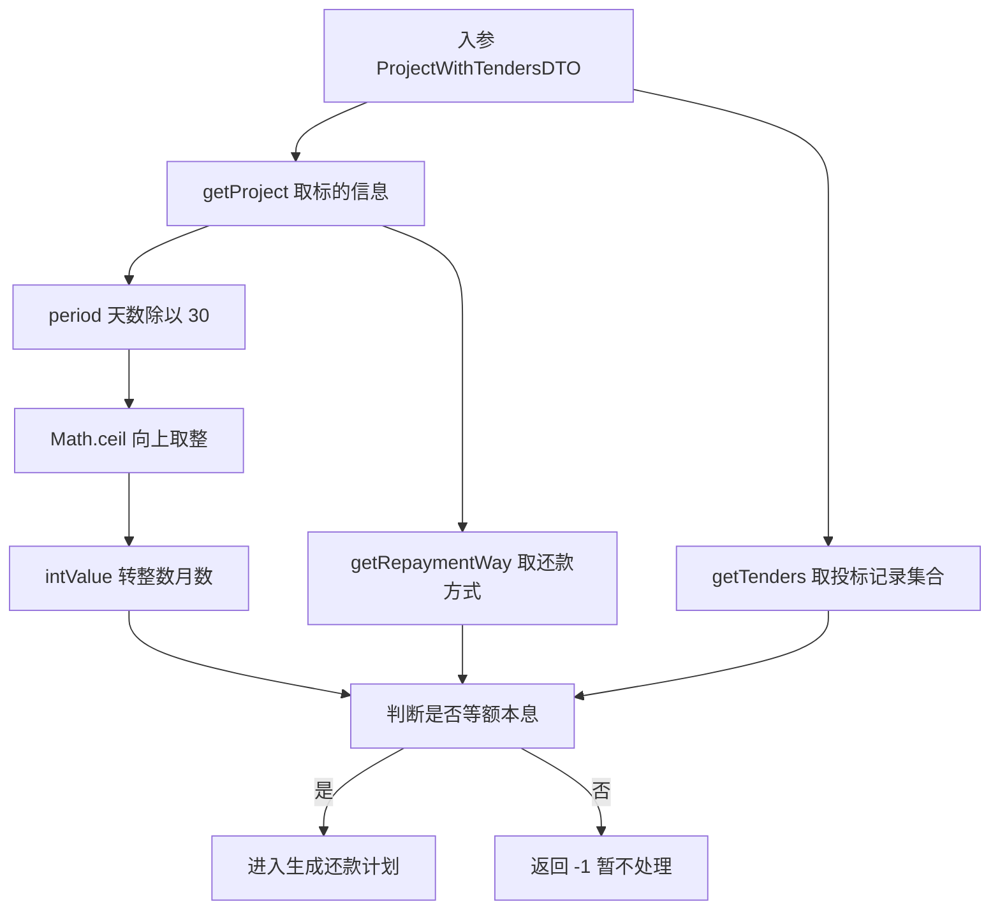

# 满标放款接口④业务层起步：RepaymentService 的定义与还款计划的数据准备

数据访问层就位后，还款服务开始写业务层。启动还款 `startRepayment` 是一个公认的长方法：生成借款人还款计划、生成投资人应收明细两大功能塞在同一个业务方法里，代码量在整个放款章节里数一数二。动手写之前把结构搭稳最重要，第一步就是把方法需要的底数一样样备齐，这一步看似只是几个 getter，里面藏着天数换月数的取舍、业务层接口怎么设计、还款方式怎么判断这些实打实的决策。

## 先给结论

- 业务层只有一个 `RepaymentService` 接口加一个 `RepaymentServiceImpl` 实现类，还款计划与应收明细两个功能合并在 `startRepayment` 一个方法里实现，不按 Mapper 一比一拆分。
- 实现类不继承 MyBatis-Plus 的 `ServiceImpl`：它要求在两个 Mapper 里指定一个泛型，而本方法两个 Mapper 都要用，索性直接实现自定义接口、手动注入两个 Mapper。
- 数据准备四步：从聚合参数里取标的信息与投标信息，天数除以 30 向上取整换算成还款月数，再取还款方式判断是否等额本息。
- 天数换月数用 `Math.ceil` 向上取整而不是四舍五入，`Math.ceil` 返回 `Double`，要经 `intValue()` 转成整数才能参与后续期数计算。

## 业务层接口：一个方法接住聚合对象

业务层接口 `RepaymentService` 新建于还款服务，方法名与 API 层的 `startRepayment` 对应，入参就是放款总入口第四阶段装配出来的 `ProjectWithTendersDTO`：

```java
package com.study.finance.repayment.service;

/** 还款服务业务层接口 按讲义口径整理 包名按 com.study.finance 系改写 */
public interface RepaymentService {

    /**
     * 启动还款
     * @param projectWithTendersDTO 标的与投标记录聚合信息
     * @return 处理结果
     */
    String startRepayment(ProjectWithTendersDTO projectWithTendersDTO);
}
```

入参的四个部分此时正好派上用场：`project` 装标的信息，`tenders` 装该标的全部投标记录，两个年化利率字段装投资人让利与借款人让利。交易中心已经把数据打包送到门口，业务层不用反向查询，直接从参数里拆。实现类骨架如下：

```java
package com.study.finance.repayment.service.impl;

/** 还款服务业务层实现 按讲义口径整理 */
@Service
@Slf4j
public class RepaymentServiceImpl implements RepaymentService {

    @Autowired
    private PlanMapper planMapper;

    @Autowired
    private ReceivablePlanMapper receivablePlanMapper;

    @Override
    public String startRepayment(ProjectWithTendersDTO projectWithTendersDTO) {
        // 1. 生成借款人还款计划
        // 1.1 获取标的信息
        // 1.2 获取标的的投标信息
        // 1.3 计算还款的月数
        // 1.4 还款方式, 只针对等额本息
        // 1.5 生成还款计划
        // 2. 生成投资人应收明细
    }
}
```

这里有一个设计细节值得停下来想清楚。数据访问层按两张表拆了 `PlanMapper` 与 `ReceivablePlanMapper`，业务层要不要也拆成两个接口对应？答案是不拆。MyBatis-Plus 的业务层封装 `ServiceImpl<M, T>` 要求指定一个 Mapper 泛型，两个 Mapper 只能二选一，选谁都丢掉另一个的能力；与其迁就封装，不如放弃继承 `ServiceImpl`，直接实现自定义接口，把两个 Mapper 都注入进来。还款计划与应收明细的生成又是一套联动逻辑，放同一个方法里恰好能共享标的信息、月数这些中间结果，拆开反而要来回传参。数据准备的四步链路画出来是这样：



## 取数四步：从参数到月数与还款方式

前三步都从入参取值，转换动作集中在月数计算上：

```java
// 1.1 获取标的信息
ProjectDTO projectDTO = projectWithTendersDTO.getProject();
// 1.2 获取标的的投标信息
List<TenderDTO> tenders = projectWithTendersDTO.getTenders();
// 1.3 计算还款的月数
Double ceil = Math.ceil(projectDTO.getPeriod() / 30.0);
Integer month = ceil.intValue();
```

月数这行代码有两处机关。发标时录的是借款天数，比如 360 天，而还款计划按期生成，期数是月，换算就是天数除以 30。除法写 `/30.0` 而不是 `/30`，前者是浮点除法，后者是整数除法，320 天除以 30 写成整数除法直接得 10，余数被无声吞掉，还款计划凭空少算的利息就出在这。除不尽时向上取整，65 天算作 3 个月，宁可多留一期也不能让借款人的借款周期没有计划覆盖。`Math.ceil` 的返回值是 `Double`，虽然数值上是整数，类型上仍是浮点，调用 `intValue()` 转回整数，经包装类自动装箱收进 `Integer`，后续期数循环都用它。

第四步取还款方式，同样从标的 DTO 里拿：

```java
// 1.4 还款方式, 只针对等额本息
String repaymentWay = projectDTO.getRepaymentWay();
if (repaymentWay.equals(RepaymentWayCode.FIXED_REPAYMENT.getCode())) {
    // 1.5 生成还款计划, 见后续功能实现
} else {
    return "-1";
}
```

还款方式是标的的属性，发标时就定了下来。平台当前对借款人默认采用等额本息，判断用枚举编码比较而不是手写字符串；非等额本息的标的暂时返回约定值不做处理，计算逻辑只针对等额本息一种方式展开，其他还款方式留待后续扩展。至此四样底数全部备齐：标的信息、投标记录、整数月数、还款方式，下一步就是带着它们进入还款计划的逐期计算与落库。

## 常见误区

- **整数除法直接换算月数。** 错例：`projectDTO.getPeriod() / 30` 用整数除法，余数直接丢弃，320 天算成 10 个月。正解：除数写成 `30.0` 做浮点除法，再用 `Math.ceil` 向上取整，保证借款周期完整覆盖在还款计划里。
- **用 `Integer` 直接接 `Math.ceil` 的返回值。** 错例：`Integer month = Math.ceil(...)` 编译不过。正解：`Math.ceil` 返回 `Double`，先收进 `Double` 再调 `intValue()` 转整数，数值上是整数不等于类型上是整数。
- **业务层也按两张表拆成两个接口。** 错例：建 `RepaymentPlanService` 与 `ReceivablePlanService` 各管一边。正解：两个 Mapper 生成动作是联动的，应收明细的期数要对着还款计划逐期拆，合在一个方法里共享中间变量，业务层一个接口一个实现即可。
- **还款方式用字符串字面量比较。** 错例：`repaymentWay.equals("FIXED_REPAYMENT")` 手写字符串。正解：用 `RepaymentWayCode.FIXED_REPAYMENT.getCode()` 枚举取值，编码统一收口在枚举里，改码只动一处。

## 面试可能被问到的问题

1. 面试官追问：「为什么还款计划与应收明细的业务实现合在一个方法里？」
   答：两者是同一份数据的两个视角，应收明细的每一期都要对应还款计划的同一期，逐期联动生成。放一起能共享标的信息、投标记录与月数这些中间结果，避免拆分后反复传参与两次查询；数据访问层仍按表分离，业务编排保持聚合。
2. 面试官追问：「实现类为什么不继承 MyBatis-Plus 的 `ServiceImpl`？」
   答：`ServiceImpl` 的泛型只接受一个 Mapper，而这里两个 Mapper 都要注入使用。继承它就得在两个 Mapper 里二选一，得不偿失；不继承只损失单方法 `saveBatch` 这类封装收益，换来两个 Mapper 的完整能力与更清晰的依赖声明。
3. 面试官追问：「天数换月数为什么选择向上取整？」
   答：还款计划必须覆盖借款的完整周期。向下取整或四舍五入会让零头天数落在计划之外，借款人实际占用资金的时间没有对应的还款期，利息计算出现缺口；向上取整多出一期只影响最后一期的期限划分，风险方向更安全。
4. 面试官追问：「`Math.ceil` 返回 `Double`，为什么不直接强转 `Integer`？」
   答：`Double` 到 `Integer` 之间没有自动转换，直接强转会编译失败。标准做法是先调 `intValue()` 拿到基本类型 `int`，再依赖自动装箱赋给 `Integer`，这样截断语义明确，也不会触发 `Double.intValue` 之外的非预期路径。
5. 面试官追问：「非等额本息的标的进来怎么办？」
   答：当前版本的计算逻辑只覆盖等额本息，判断不通过时返回约定值 `-1` 表明不支持，不做半途计算。还款方式是标的前置属性，发标环节已限定，这里属于防御性分支；扩展其他还款方式时新增对应计算策略即可，主干数据准备流程完全复用。

## 配套资料

- 讲义：`materials/docs/10/万信金融-第4章-投标放款v1.0.md`，3.2.5 还款服务启动还款接口（接口④）之 3.2.5.2 功能实现：业务层，RepaymentService 接口定义与 RepaymentServiceImpl 中获取标的信息、投标信息、计算还款月数、判断还款方式的实现。
- 代码：`materials/code/10/wanxinp2p/`，P2P 工程归档（目录保留原始命名，路径只列到该层级），可对照 API 工程中 `ProjectWithTendersDTO` 的结构；还款服务业务工程随课程资料单独提供。
- 说明：还款服务业务实现源码不在归档目录中，文中代码按讲义 3.2.5.2 与画面线口径整理，包名按 `com.study.finance` 系改写；生成还款计划与保存还款计划的后续实现见同系列后续篇章。
