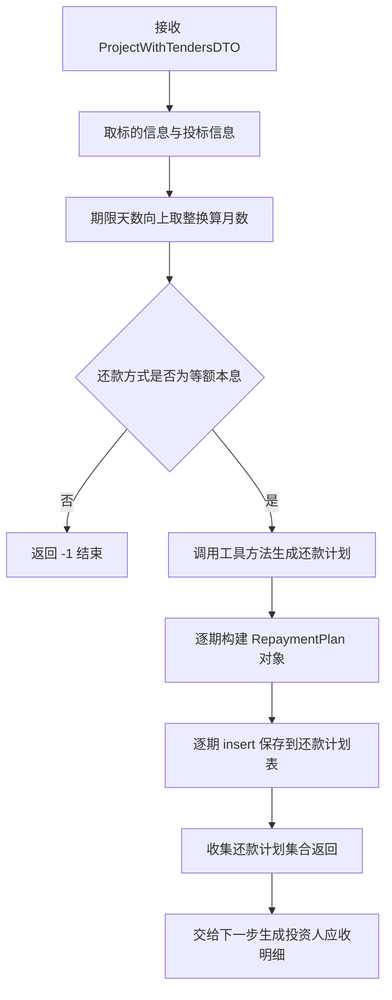

# 满标放款接口④业务层：等额本息算出借款人还款计划，再一期一条落库

接口④的入参 `ProjectWithTendersDTO` 进了还款服务的业务层，接下来的问题很具体：标的金额、期限、利率和一堆投标记录，怎么变成一张借款人逐月还钱的计划表。每个月还多少本金、多少利息、平台抽多少佣金、哪一天算逾期，全都要算出来并写到数据库里。这一步拆成两个动作：生成还款计划，保存还款计划，两个视频正好各讲一半，合成一篇把链路讲透。

## 先给结论

- 还款计划的计算核心是等额本息公式，课程把公式封装成工具方法 `RepaymentUtil.fixedRepayment`，四个入参：本金、年利率、还款月数、平台佣金参数，返回一个装满每期明细的 `EqualInterestRepayment` 对象。
- 还款月数不等于标的期限字段，期限单位是天，要用 `Math.ceil(period / 30.0)` 向上取整换算成月，50 天按两个月算。
- 计划按期落库：借 12 个月就往还款计划表插 12 条记录，一期一条，遍历本金 Map 逐期 `insert`，这是数据访问层 `PlanMapper` 继承 MyBatis-Plus 的 `BaseMapper` 直接提供的通用插入。
- 应还时间是「计划创建时间累加期数个月」，第 k 期的应还时间就是当前时间加 k 个月；还款状态默认 `0` 表示待还款。
- `BigDecimal` 求和必须用 `add` 方法，不能用加号，本息和、利息加本金都是这一口径。
- `saveRepaymentPlan` 方法除了保存还要把 `List<RepaymentPlan>` 返回出去，这批还款计划对象是下一步生成投资人应收明细的原料。
- 还款方式目前只支持等额本息，判断依据是 `RepaymentWayCode.FIXED_REPAYMENT` 的编码，其他方式直接返回 `-1`。

## 业务层的输入与整体流程

还款服务的业务层方法 `startRepayment` 收到的聚合参数里有两样东西：一份标的信息 `ProjectDTO`，一份该标的全部投标记录 `List<TenderDTO>`。借款人这边要还钱的底数全在标的信息里：借款金额就是本金，借款年化利率用来算利息，标的期限换算成还款月数，平台佣金参数决定平台每期抽多少。投标记录在这一步暂时用不上，它是下一步生成投资人应收明细的原料，但方法签名已经把它一起接住了。

值得留意的是，投标记录在生成借款人还款计划这一步一次都没被用到，但参数里已经把它带进来了。这不是接口设计的冗余：借款人每期还的钱，迟早要按投资人的出资比例拆成每期应收的钱，两份数据在同一个方法签名里进同一个业务层，业务边界一次划清，后续应收明细的生成不用再向交易中心二次取数。

业务层内部的流程画出来是一条直线，判断分支只有一个：



关键路径在中间三步：算月数、生成、落库。月数算错，后面每期的利息和应还时间全错；生成阶段拿到的是按期组织好的 Map 集合；落库阶段只是把 Map 里的数据逐期搬进实体对象再插入。整条线里没有资金动作，不碰存管系统，纯粹是还款服务自己库里的数据计算与写入。

## 等额本息与计算口径

等额本息是把借款本金和利息总额按月平均拆分，借款人每月偿还相同数额的本息。它的特点是每月还款总额固定，但结构在变：本金占比逐月递增，利息占比逐月递减。讲义里给出的公式分三层，月利率等于借款年利率除以 12；每月还款额由本金、月利率和借款月数套等额本息公式算出；第 n 月利息再用剩余本金占比修正。公式本身不用背，课程已经把它封装成了工具方法，能看懂每月还款额相同、本金逐月变多这件事就够了。

动手之前先算月数。标的期限字段单位是天，比如 360 天对应 12 个月，但课程语境下期限不一定是整月，所以用向上取整：

```java
//1.1 获取标的信息
ProjectDTO projectDTO = projectWithTendersDTO.getProject();
//1.2 获取投标信息
List<TenderDTO> tenders = projectWithTendersDTO.getTenders();
//1.3 计算还款的月数 期限单位为天 除以 30 向上取整
Double ceil = Math.ceil(projectDTO.getPeriod() / 30.0);
Integer month = ceil.intValue();
//1.4 还款方式 目前只针对等额本息
String repaymentWay = projectDTO.getRepaymentWay();
```

`Math.ceil` 返回 `Double`，还要再转一次 `Integer`，这个细节写代码时容易漏。45 天的标的除以 30 得 1.5，向上取整就是 2 期，宁可多算一期也不能把利息少算一个月。

还款方式要先判断再做计算，等额本息的编码统一维护在枚举 `RepaymentWayCode` 里。计算结果由 `EqualInterestRepayment` 承载，它把按期组织的数据全部装好：

```java
/** 等额本息计算结果 包名按 com.study.finance 系改写 */
public class EqualInterestRepayment {
    /** 每月还款本息 */
    private BigDecimal amount;
    /** 每期利息 键为期数 值为当期利息 */
    private Map<Integer, BigDecimal> interestMap;
    /** 每期本金 键为期数 值为当期本金 */
    private Map<Integer, BigDecimal> principalMap;
    /** 平台按期收取的佣金 键为期数 值为当期佣金 */
    private Map<Integer, BigDecimal> commissionMap;
    /** 本息总和 */
    private BigDecimal totalAmount;
    /** 总利息 */
    private BigDecimal totalInterest;
}
```

三个 Map 的键都是期数，从 1 开始编到 month，值是当期金额。这个结构决定了后面保存数据的方式：按期数遍历，一期构建一条记录。

## 生成还款计划：一个工具方法搞定

生成动作就是调用 `RepaymentUtil` 的 `fixedRepayment` 方法。它要四个参数，顺序按讲义口径是本金、年利率、月数、平台佣金参数，全部从标的信息里取：

```java
//1.5 生成还款计划 等额本息
EqualInterestRepayment fixedRepayment = RepaymentUtil.fixedRepayment(
        projectDTO.getAmount(),                 // 本金 借款人借的总额
        projectDTO.getBorrowerAnnualRate(),     // 借款人年化利率
        month,                                  // 还款月数 前一步换算好的
        projectDTO.getCommissionAnnualRate());  // 平台佣金年化利率
```

工具方法内部先把年利率除以 12 得到月利率，再按等额本息公式逐月循环，把每月还款额、每月利息、每月本金、本息总和、总利息、平台按期佣金全部算出来，塞进上面那个 `EqualInterestRepayment` 结构返回：

```java
/** 等额本息生成还款计划 按讲义口径整理 包名按 com.study.finance 系改写 */
public static EqualInterestRepayment fixedRepayment(BigDecimal invest, BigDecimal yearRate,
        int month, BigDecimal amount) {
    double monthRate = yearRate.doubleValue() / 12;  // 月利率 = 年利率 / 12
    EqualInterestRepayment repayment = new EqualInterestRepayment();
    // 封装每月本息 每期利息 Map 每期本金 Map 总额与总利息
    repayment.setAmount(getRepaymentAmount(invest, monthRate, month));
    repayment.setInterestMap(getInterestMap(invest, monthRate, month));
    repayment.setPrincipalMap(getPrincipalMap(invest, monthRate, month));
    repayment.setTotalAmount(getTotalAmount(invest, monthRate, month));
    repayment.setTotalInterest(getTotalInterest(invest, monthRate, month));
    return repayment;
}
```

内部的私有方法就是公式的代码化，涉及 BigDecimal 的精度控制与舍入模式，属于金融计算的工具层，业务层直接拿来用即可。年利率除以 12 得到月利率这一步看似简单，实际编码时两个数一个是 `BigDecimal` 一个是 `double`，先转类型再除，除不尽就涉及精度取舍，这类换算收口在工具类里统一处理，避免每个调用方各算一套。需要留心的还有第四个参数，平台佣金也是按年化利率口径传入的，工具方法会按期算出平台每期抽走的份额放进 `commissionMap`，P2P 平台作为撮合中介的收入就落在这里。

## 保存还款计划：一期一条记录

生成的计划还在内存里，落库的原因很直接：借款人随时会登录前端查询「每个月还多少本金、多少利息、几号还、还剩几期」，这些查询都打在数据库上，内存里的对象撑不住这种随时随地的读取。课程单独抽了一个方法 `saveRepaymentPlan` 来做这件事，入参两个：标的信息和刚生成的计算结果，返回值是一个还款计划集合，这个集合不是白给的，下一步生成投资人应收明细时要用。课程单独抽了一个方法 `saveRepaymentPlan` 来做这件事，入参两个：标的信息和刚生成的计算结果，返回值是一个还款计划集合，这个集合不是白给的，下一步生成投资人应收明细时要用。

保存的表是还款服务库里的还款计划表，字段覆盖借款人标识与编码、标的编号、期数、利息、本金、本息和、应还时间、还款状态、创建时间、平台佣金。数据访问层对应的 `PlanMapper` 继承 MyBatis-Plus 的 `BaseMapper`，通用插入直接可用。方法的核心结构是遍历本金 Map，一期构建一个实体对象：

```java
/** 保存还款计划到数据库 按讲义口径整理 包名按 com.study.finance 系改写 */
public List<RepaymentPlan> saveRepaymentPlan(ProjectDTO projectDTO,
        EqualInterestRepayment fixedRepayment) {
    List<RepaymentPlan> repaymentPlanList = new ArrayList<>();
    // 每期利息 键为期数
    final Map<Integer, BigDecimal> interestMap = fixedRepayment.getInterestMap();
    // 平台按期佣金
    final Map<Integer, BigDecimal> commissionMap = fixedRepayment.getCommissionMap();
    // 遍历每期本金 键 k 为期数 值 v 为当期本金
    fixedRepayment.getPrincipalMap().forEach((k, v) -> {
        final RepaymentPlan repaymentPlan = new RepaymentPlan();
        // 标的 id
        repaymentPlan.setProjectId(projectDTO.getId());
        // 借款人用户标识
        repaymentPlan.setConsumerId(projectDTO.getConsumerId());
        // 借款人用户编码
        repaymentPlan.setUserNo(projectDTO.getUserNo());
        // 标的编码
        repaymentPlan.setProjectNo(projectDTO.getProjectNo());
        // 期数
        repaymentPlan.setNumberOfPeriods(k);
        // 当期还款利息
        repaymentPlan.setInterest(interestMap.get(k));
        // 当期还款本金
        repaymentPlan.setPrincipal(v);
        // 当期本息和 BigDecimal 求和必须用 add
        repaymentPlan.setAmount(repaymentPlan.getPrincipal().add(repaymentPlan.getInterest()));
        // 应还款时间 当前时间累加 k 个月
        repaymentPlan.setShouldRepaymentDate(DateUtil.localDateTimeAddMonth(DateUtil.now(), k));
        // 还款状态 默认 0 待还款
        repaymentPlan.setRepaymentStatus("0");
        // 计划创建时间
        repaymentPlan.setCreateDate(DateUtil.now());
        // 平台佣金
        repaymentPlan.setCommission(commissionMap.get(k));
        // 逐期插入还款计划表
        planMapper.insert(repaymentPlan);
        repaymentPlanList.add(repaymentPlan);
    });
    return repaymentPlanList;
}
```

这段代码没有算法难度，但有几个口径必须咬死。**第一，循环变量就是期数。**遍历本金 Map 时，键 `k` 天然是期数，利息和佣金再按 `k` 从各自的 Map 里取，三个 Map 长度一致、按期对齐，任何一处取错键都会让利息和本金错位。**第二，求和只能用 `add`。**本金和利息都是 `BigDecimal`，用加号做的是对象引用层面的运算报错，或者精度丢失，金融金额一律走 `add`。**第三，应还时间是「当前时间加期数个月」。**保存计划的那一刻是三月，第 1 期应还是四月，第 2 期是五月，工具方法按月累加，不是加天数也不是加固定 30 天。**第四，每插一条就往集合里加一条。**借 12 个月就 `insert` 12 次、集合里攒 12 个对象，方法末尾把集合返回。

为什么不嫌逐条 `insert` 慢、不用批量插入？课程在这一步保留了最直白的写法，一期能看懂一条数据的完整组装过程。业务量上来之后换成 MyBatis-Plus 的批量保存或手写批量 SQL 都是顺手的事，不影响口径。

## 计划表里的字段从哪来

一条 `RepaymentPlan` 记录上的十几个字段，来源可以分成三组，分清来源能省掉一半的赋值错误。**第一组来自标的信息。**标的 ID、借款人用户标识、借款人用户编码、标的编码，这四个字段从入参 `projectDTO` 原样搬运，每一期的记录上都重复出现，因为这张表是按期组织的，每条记录都要能独立回答「谁的哪笔借款的第几期」。**第二组来自计算结果。**期数取自本金 Map 的键，利息、本金、佣金分别从三个 Map 按期数取值，本息和是本金与利息的求和，这组数据是还款计划的灵魂，数值对不对完全取决于工具方法算得准不准、键取得对不对。**第三组来自系统时间与业务默认值。**应还时间是创建时间按期数累加月份算出来的，计划创建时间取当前时间，还款状态写死默认值 `0` 表示待还款。

三组数据里有两组与期数无关、只有一组逐期变化，这解释了为什么循环结构选择「遍历本金 Map」而不是「for 循环期数」：遍历 Map 的键做期数，天然保证期数与本金对齐，利息佣金再按同一个键取，不会出现期数循环越界或者 Map 里缺键的问题。

## 借款人视角看这张计划

数据落库之后，这张计划表就是借款人在前端看到的还款安排。假设借款一万二、借 12 个月，查询接口按标的编码把 12 条记录按期数排序返回，用户看到的每一行是：第几期、应还时间、本息合计多少、其中本金多少利息多少、当前状态待还款。平台佣金不展示给借款人，它记在表里是平台侧对账用的。

计划的状态字段从 `0` 开始，代表这期还没还；到了还款日系统发起扣款，还成功了状态流转为已还，逾期了流转为逾期，这些流转是后面还款执行章节的事，但表结构和状态口径在这一步就定下来了。也就是说，生成还款计划不只是给前端画一个表格，它同时给后续的按期执行、逾期管理、提前结清预留了数据底座，这也是为什么放款一成功就要立即生成计划：晚一天生成，应还时间的锚点就晚一天，所有的还款日都要跟着顺延。

## 还款方式的分支处理

生成与保存两步都只在等额本息的分支里执行，完整的分支结构长这样：

```java
if (repaymentWay.equals(RepaymentWayCode.FIXED_REPAYMENT.getCode())) {
    // 生成还款计划
    EqualInterestRepayment fixedRepayment = RepaymentUtil.fixedRepayment(
            projectDTO.getAmount(), projectDTO.getBorrowerAnnualRate(),
            month, projectDTO.getCommissionAnnualRate());
    // 保存还款计划 返回集合留给应收明细使用
    List<RepaymentPlan> planList = saveRepaymentPlan(projectDTO, fixedRepayment);
} else {
    // 其他还款方式暂不处理
    return "-1";
}
```

平台将来可能提供一次性还款、等额本金、先息后本等方式，枚举里已经给这些方式留了位置，目前业务只实现等额本息。非等额本息的标的走到接口④就返回 `-1` 这个约定值，表示当前不支持，调用方据此结束流程。`-1` 与成功码的区别要说清楚：`-1` 是业务层的「未实现」语义，不是异常，不发异常也不抛错，让调用方拿到一个可判断的返回值自行决策，这比抛异常中断流程更适合这种可预期的分支。这个分支还有一个隐含价值：把「还款方式」这个维度的扩展点显式写进了代码结构里，后续加一种方式就是加一个分支加一套工具方法，不动主干。

## 常见误区

- **把标的期限天数直接当月数用。**错例：期限字段是 360，直接传给计算方法当 360 期。正解：期限单位是天，必须除以 30 再向上取整，`Math.ceil` 之后还要转 `Integer`。
- **BigDecimal 用加号求和。**错例：`plan.setAmount(principal + interest)` 编译都过不了，`BigDecimal` 不是基本类型。正解：统一用 `add` 方法，除法计算还要显式指定精度与舍入模式。
- **应还时间按固定 30 天累加。**错例：每期加 30 天，遇到 31 天的月份应还日期漂移。正解：按月累加期数，第 k 期就是当前时间加 k 个月。
- **保存方法漏掉返回集合。**错例：`saveRepaymentPlan` 落库完直接 `void` 返回。正解：这个方法的返回值 `List<RepaymentPlan>` 是下一步生成投资人应收明细的输入，漏了后面就没法按还款计划逐期配对生成明细。
- **利息和佣金的 Map 用错键。**错例：取利息时随手用了本金遍历之外的期数变量。正解：三个 Map 的键都是期数，统一用同一个 `k` 取值，保证每期利息、本金、佣金对齐。

## 面试可能被问到的问题

1. 面试官追问：「等额本息和等额本金在数据上怎么区分？」
   答：等额本息每月还款总额固定，本金占比逐月递增、利息占比逐月递减，计划表里每期本息和相同；等额本金每月还固定本金加剩余本金的利息，每月总额递减。两者计算公式不同，但计划表结构相同，都可以一期一条落库。
2. 面试官追问：「为什么保存还款计划要返回集合，保存完不就结束了吗？」
   答：还款计划和投资人应收明细是同一笔钱的两面，借款人每期还的钱对应投资人每期收的钱。应收明细的生成需要逐期与还款计划配对，包括关联还款计划的主键、对齐期数与应还时间，所以保存方法把落库后的还款计划对象集合返回，供下一步复用，避免二次查库。
3. 面试官追问：「12 期的标的会插多少条记录，为什么？」
   答：借款人还款计划表插 12 条，一期一条。如果该标的有 5 个投资人，应收明细表还要按 5 乘 12 生成 60 条。计划是按期组织的，查询、逾期判定、部分还款都按期处理，按期存储是这些业务的最小操作单元。
4. 面试官追问：「BigDecimal 处理金额要注意什么？」
   答：构造用字符串入参避免精度陷阱，加减乘除用 `add`、`subtract`、`multiply`、`divide`，除法必须显式传精度与舍入模式，比较大小用 `compareTo` 而不是 `equals`，因为 `equals` 会连标度一起比较。
5. 面试官追问：「还款方式扩展成多种时，代码结构怎么演进？」
   答：把还款方式抽象成策略，每种方式一套计算工具方法，入口按 `RepaymentWayCode` 分发。计划表与状态字段的口径保持不变，新增方式只加计算分支，落库与查询逻辑复用，避免在主干方法里堆叠嵌套判断。

## 配套资料

- 讲义：`materials/docs/10/万信金融-第4章-投标放款v1.0.md`，3.2.5 还款服务启动还款接口（接口④）：3.2.5.1 还款方式与等额本息公式、3.2.5.2 功能实现（数据访问层 `PlanMapper`/`PlanMapper.xml` 与 `ReceivablePlanMapper`/`ReceivablePlanMapper.xml`、`RepaymentService` 与 `RepaymentServiceImpl`、生成借款人还款计划并保存到数据库）。
- 代码：`materials/code/10/wanxinp2p/`，P2P 工程归档（目录保留原始命名，路径只列到该层级），可对照 API 工程结构与公共模块组织；还款服务业务工程随课程资料单独提供，文中业务层代码按讲义与画面线口径整理，包名与工具方法内部实现按 `com.study.finance` 系改写，工具类内部逐期计算与 `DateUtil` 的月份累加为按本课写法补全的示例。
