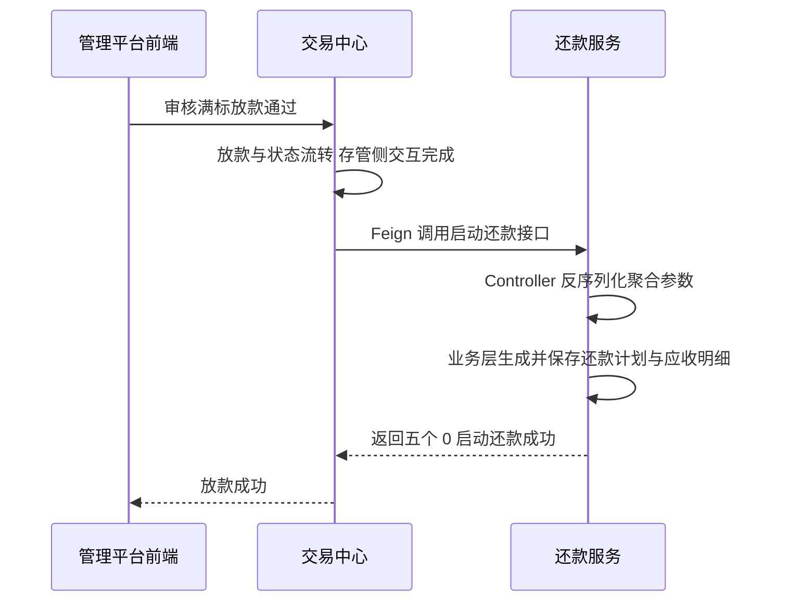

# 满标放款接口④Controller：两行调用把还款服务的门面立起来

业务层把生成还款计划与应收明细的活全干完了，接口④还差最后一层：Controller。这一层要做的就是把聚合参数接进来、把业务层调起来、把结果包成统一的响应结构丢回去。代码只有几行，却是放款链路的终点站，交易中心的远程调用最终就打在这个入口上。

## 先给结论

- 接口④的 Controller 是还款服务的门面，当时定义时是空实现，这一课注入业务层并把 `startRepayment` 调用补齐。
- 结构沿用全项目的标准套路：注入 Service、调用业务方法、结果用 `RestResponse` 包装返回。
- 业务层返回五个 0 的成功编码，Controller 不做二次加工，原样透传，判断成败的口径留给调用方。
- 路径按内部接口约定以 `/l` 打头，发起方是交易中心这类后台微服务，前端经网关摸不到这个端点。
- 入参 `ProjectWithTendersDTO` 是结构化聚合对象，必须加 `@RequestBody` 从请求体反序列化。
- Controller 补完，接口④的三层（API 定义、Controller、业务层）全部闭合，满标放款四个接口的代码阶段到此收尾。

## 门面层的标准写法

还款服务是这一章新立的微服务，`RepaymentController` 在定义接口阶段就已经按 API 口径搭出了空壳，方法签名、路径、注解都在，方法体是空的。现在业务层就绪，补实现只用三步：

```java
/** 还款服务 Controller 接口④ 按讲义与画面线口径整理 包名按 com.study.finance 系改写 */
@Autowired
private RepaymentService repaymentService;

@Override
@ApiOperation("启动还款")
@PutMapping("/l/startRepayment")
public RestResponse<String> startRepayment(
        @RequestBody ProjectWithTendersDTO projectWithTendersDTO) {
    // 交给业务层 生成并保存还款计划与投资人应收明细
    String result = repaymentService.startRepayment(projectWithTendersDTO);
    return RestResponse.success(result);
}
```

`@Autowired` 把业务实现注进来，方法体第一行调用 `startRepayment`，聚合参数原样下传；第二行把返回值包进 `RestResponse.success`。业务层内部返回的是五个 0 的成功编码字符串，Controller 不判断、不转换、不加工，直接透传。要不要重试、要不要继续走放款链路的收尾，这些决策属于调用方，门面层只负责协议转换：HTTP 请求进、业务调用、统一响应出。

路径上的 `/l` 前缀是项目对内部接口的约定，这一课接口②③④都在用它。`@RequestBody` 同样是口径的一部分：交易中心传过来的是聚合对象，反序列化必须从请求体走，漏了注解 Spring 会按查询参数解析，字段全是空，业务层第一步取标的信息就空指针。

整条调用链画出来，接口④在放款业务里的位置一目了然：



关键一跳是交易中心到还款服务的 Feign 调用，它打到的就是刚补完的这个端点。业务层内部的耗时主要在逐期逐人的数据落库上，这一跳之后还款服务自己消化，交易中心拿到成功码就可以给前端答复了。

## Controller 写薄是纪律不是偷懒

这一课视频很短，因为 Controller 确实没有故事可讲，但薄门面本身值得说透。**第一，业务逻辑下沉到业务层后，Controller 天然只剩编排。**生成计划的公式、落库的循环、成功码的判定全在业务层，Controller 一旦开始写 if 判断和金额计算，这层就废了，单元测试也只能从 HTTP 层做起。**第二，透传成功码保持口径单一。**五个 0 在业务层定义，Controller 若再包一层自己的语义，调用方就要维护两套判断。**第三，注解即契约。**`@ApiOperation` 供接口文档展示，`@PutMapping` 与 `/l` 前缀承载内部调用约定，`@RequestBody` 锁定反序列化方式，每个注解都是调用方要遵守的协议，不是装饰。

到这一步，接口④从 API 定义、Controller 空壳到业务层实现全部闭合，四个接口的编码工作全部完成。接下来按项目惯例进入前后端集成测试，把接口①到接口④整条链路跑一遍，那一课还有一个预料之中的留白要面对：交易中心发起启动还款的那一步，因为分布式事务问题还没解决，暂时是断开的。

## 常见误区

- **在 Controller 里写业务判断。**错例：先判断还款方式是不是等额本息再调业务层。正解：分支在业务层，Controller 只透传，判断逻辑写进门面层就无法复用也无法单测。
- **漏掉 `@RequestBody`。**错例：参数注解省略，聚合对象字段全空。正解：结构化入参一律从请求体反序列化，这是内部接口调用方与提供方的共同约定。
- **Controller 里二次包装成功码。**错例：业务层返回五个 0，Controller 又判断一次再返回别的值。正解：原样透传，成败口径只有一处定义。
- **路径前缀用错。**错例：接口④按用户端习惯加 `/my` 或不加前缀。正解：发起方是交易中心微服务，走 `/l` 内部约定，前端经网关不可达，安全边界由前缀表达。

## 面试可能被问到的问题

1. 面试官追问：「Controller 层的价值到底是什么，既然业务都在 Service？」
   答：Controller 是协议边界，负责 HTTP 语义到 Java 调用的转换、参数反序列化、统一响应包装与文档注解。它的价值在于让业务层完全不感知传输协议，同一套业务层可以被 Feign、消息、定时任务复用。
2. 面试官追问：「`/l` 前缀的内部接口怎么保证前端访问不到？」
   答：一层靠网关路由，只转发对外前缀的路径；一层靠服务端口不对外暴露，内部服务间通过注册中心直连。前缀是约定与文档层面的边界，真正的隔离由网络与路由策略落地。
3. 面试官追问：「为什么接口④的入参要打包标的加全部投标记录？」
   答：生成还款计划要标的的金额、利率、期限，生成应收明细要每个投资人的投标金额与利率。打包一次传输，还款服务无需反向调用交易中心查数，减少远程往返，也保证一次放款的数据快照一致。
4. 面试官追问：「Controller 返回统一响应结构有什么好处？」
   答：调用方拿到稳定的结构：状态码、消息、数据体位置固定，异常也走同一结构。前后端与微服务间都不用为每个接口猜返回格式，全局异常处理器能无缝接入同一协议。

## 配套资料

- 讲义：`materials/docs/10/万信金融-第4章-投标放款v1.0.md`，3.2.5 还款服务启动还款接口（接口④）功能实现的收尾部分：完善 `RepaymentController` 类中的代码；3.2.6 前后端集成测试一节的承接口径。
- 代码：`materials/code/10/wanxinp2p/`，P2P 工程归档（目录保留原始命名，路径只列到该层级），可对照 API 与 Controller 层组织方式；还款服务业务工程随课程资料单独提供，文中 Controller 代码按画面线与全项目写法整理，包名按 `com.study.finance` 系改写，端点路径细节为按本课写法补全的示例。
