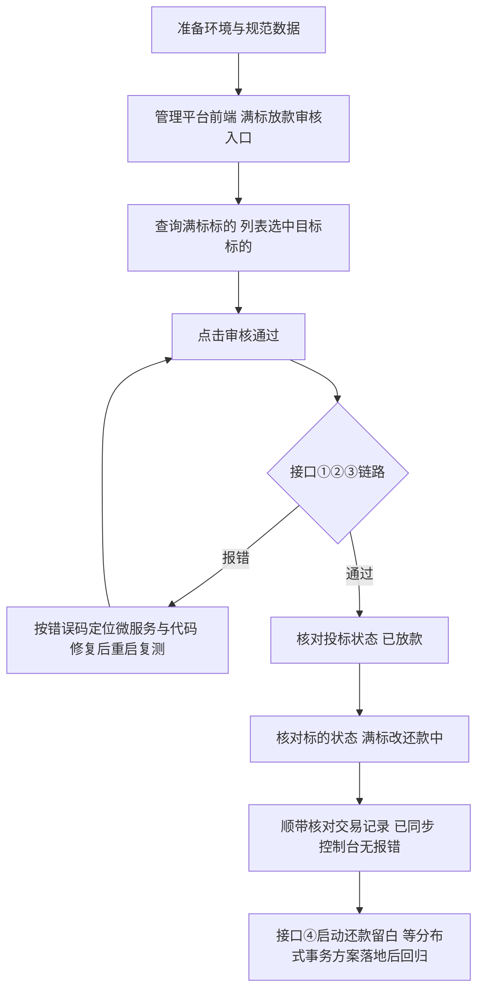

# 满标放款前后端集成测试：一条错误码揪出一个比较符，投标放款章收官

接口①到接口④的代码全部写完，满标放款到了验收环节。这一课把两个前端工程、全部微服务、银行存管模拟系统一起拉起来，从管理平台的审核按钮开始，把整条放款链路真实跑一遍。测的过程不全是顺利的：第一次点审核通过就报了一个错误码，顺着错误码定位到交易中心里一处漏写的 `getCode()`，修完复测，投标状态与标的状态才如期翻转。集成测试的价值恰恰在这里，单看代码都对，联起来跑才见真章。

## 先给结论

- 测试前要备齐环境：两个前端工程、Apollo 配置中心、全部微服务、银行存管模拟系统、Redis 与 Elasticsearch，缺一样链路就断。
- 测试数据必须规范有效：发标、投标阶段产生的数据是放款的输入，不完整的要么修库修正，要么重新发标重新投标造一套干净数据。
- 本次能测的是接口①②③全链路，核对重点两个状态：投标信息更新为已放款，标的信息从满标更新为还款中；存管代理的交易记录从未同步到已同步顺带确认。
- 接口④暂不能端到端测试：交易中心发起启动还款请求的那一步还没有实现，原因是要引入分布式事务方案，等可靠消息方案落地后再做回归。
- 实战踩坑：错误码 15013 定位到交易中心判断存管响应的位置，字符串直接与枚举对象比较恒为假，补上 `getCode()` 取出编码再比，问题消失。
- 测试通过即投标放款章收官：发标、投标、满标、审核、放款一条线全部打通，只剩启动还款的分布式事务留白。

## 测试准备：环境与数据两道关

环境清单在动手前先过一遍。前端要起两个：用户端与管理端，管理端是这次测试的主入口；后端是 Apollo、全部微服务、银行存管模拟系统，外加 Redis 与 Elasticsearch，检索链路的服务也在跑。项目测试常用一份清单文件逐项打勾，启动顺序、端口、控制台输出逐项确认，比出问题时再回头怀疑环境省得多走弯路。

数据这一关比环境更容易翻车。满标放款用的标的信息、投标信息都是发标与投标阶段留下的存量数据，之前手工测试可能造过字段不完整、金额对不上、状态不对的脏数据，这些数据一路带到放款环节就会以莫名其妙的方式报错。课程的口径很明确：放款之前把标的与投标数据过一遍，不规范的要么直接改库修正，要么重新发一个标、用几个账户登录把标投满，造一套规范的测试数据。这次测试选的标的是张伟先生的一笔借款，金额 12000 元、期限 12 个月，之前投标测试时用 5 个账户投满了这个标的，状态已经是满标，正好作为放款的输入。

## 测试范围：对着时序图逐段核对

测试范围不是拍脑袋定的，对照满标放款的时序图与四个接口逐段圈出来。存管代理保存交易记录、从未同步流转到已同步这一段在开户与投标阶段反复测过，本次顺带确认即可；重点核对两处状态落库，它们分别对应接口②③链路的执行结果：



接口④这一段暂时测不了，原因要交代清楚：时序图上交易中心通知还款服务生成计划与明细的那一步，涉及跨服务的分布式事务问题，交易中心的对应代码刻意留到引入可靠消息方案之后再写，还款服务内部的业务层与 Controller 已经完成。所以本次验收的标准收敛为接口①②③的效果是否落库，这个留白是有计划的留白，不是遗漏。

## 实战：一个错误码的定位与修复

一切就绪后在管理端刷新标的列表，筛选满标标的，选中测试标的点审核通过。第一次点击前端直接弹了错误，提示码 15013，含义是存管代理服务交互失败。集成测试排查的第一原则是按错误码定位抛出点：错误码由交易中心抛出，到交易中心代码里检索这个值，落在调用存管代理服务、判断响应结果的那段业务上。

排查路径顺着调用往下走：存管代理服务那边控制台没有任何报错，说明远程调用本身成功、存管侧执行成功；交易中心却没走成功分支，直接进了失败分支抛出 15013。问题必然出在对响应结果的判断上。看代码，业务里拿存管返回的编码与成功码枚举做相等判断，写的时候漏了取值方法：

```java
// 修复前 字符串与枚举对象比较 类型不同 恒为 false
// restResponse.getResult().equals(DepositoryReturnCode.RETURN_CODE_00000);
// 修复后 取出枚举里的编码字符串再比较
restResponse.getResult().equals(DepositoryReturnCode.RETURN_CODE_00000.getCode());
```

`equals` 的两边一个是字符串一个是枚举对象，类型都不一样，结果永远是 false，业务永远走失败分支。这类错误的隐蔽性在于存管侧其实成功了，钱在银行侧已经划拨，只是平台这边没接住成功信号，属于典型的「对端成功、本端误判」。补上 `getCode()` 重启交易中心，清理控制台再复测，这次审核通过，前端返回放款成功，存管代理控制台能看到交易记录的更新语句，交易中心这边也有状态更新的 SQL 输出，两边控制台都没有报错。

## 数据核对：两个状态说了算

控制台干净只是表象，验收看库。打开交易中心的库，先看投标表，5 个投资人的 5 条投标记录，状态字段已经全部更新为已放款，放款前它们是已满标对应的投标状态；再看标的表，找到这笔标的，状态从满标的编码更新为还款中的编码。这两个状态翻转成功，等于接口①②③的编排、存管交互、本地落库全部闭环。顺带确认了存管代理的交易记录表，两条交互各自的记录都从已同步前的状态走到了已同步，与一次放款落两条交易记录的口径一致。

用一条查询就能复核关键状态：

```sql
-- 核对投标状态 5 条投标记录应全部为已放款
SELECT id, tender_status FROM tender WHERE project_id = :projectId;
-- 核对标的状态 原值为满标编码 现应为还款中编码
SELECT id, project_no, status FROM project WHERE id = :projectId;
```

核对完这两个状态，本次前后端集成测试就可以下结论：满标放款现有功能全部正常，接口④的启动还款等分布式事务方案实现后再做一次回归，那时重点核对的将是还款计划表与应收明细表的数据。

## 收官复盘：投标放款这一章

从发标、审核、检索、投标，到满标、审核放款，投标放款章的业务主线到此全部打通。回看这一章的工程节奏：每个业务都是需求分析定接口、按阶段拆实现、逐层编码、前后端集成测试收口；每个测试课都会暴露一两个真实问题，幂等、比较符、数据规范性，修的都是联调才看得见的缝。满标放款还剩一块拼图，交易中心把标的状态改成还款中的同时要可靠地通知还款服务生成计划，跨服务原子性靠什么保证，下一课给出方案总览。

## 常见误区

- **带着脏数据进集成测试。**错例：之前手工测试留下的字段不完整、状态不对的标的与投标数据直接放款。正解：测试前过滤或重造规范数据，输入不干净，报错会出现在离错误源头很远的环节。
- **控制台无报错就认为测试通过。**错例：前端返回成功即收工。正解：核心状态逐一到库核对，投标状态与标的状态翻转才是接口链路真实生效的凭据。
- **错误码只看前端提示。**错例：看到 15013 就怀疑存管代理服务。正解：按错误码找到抛出方，本案抛出方在交易中心，故障点也在交易中心，对端服务反而全程正常。
- **字符串与枚举比较不取编码。**错例：`equals` 两边类型不同恒为 false，业务永远走失败分支。正解：枚举比较一律 `getCode()` 取编码字符串，或反过来把字符串转枚举，保持两边类型一致。
- **把接口④的留白当成 bug。**错例：测试发现启动还款没执行就当缺陷提单。正解：交易中心发起启动还款的调用为配合分布式事务方案刻意延后，属于有计划的留白，方案落地后回归。

## 面试可能被问到的问题

1. 面试官追问：「集成测试和单元测试在微服务项目里的分工是什么？」
   答：单元测试验证单类单方法的逻辑正确性，集成测试验证服务之间、服务与中间件之间的协议与数据流。微服务的多数事故出在边界上：反序列化字段对不上、状态码判断不一致、配置缺失，只有把真实链路拉起来才能暴露，所以每个业务收口都要跑一遍前后端集成测试。
2. 面试官追问：「集成测试报错时你的排查套路是什么？」
   答：先按错误码定位抛出方微服务与代码位置，再确认远端服务是否真的失败：看对端控制台与日志。本案里远端成功而本端走了失败分支，问题落在响应判断；若远端确实失败，再看请求参数与配置。原则是从异常点出发向上下游两端收缩，而不是全链路盲找。
3. 面试官追问：「为什么放款链路对测试数据的要求比其他业务更高？」
   答：放款是资金动作，输入的标的信息与投标信息直接决定划拨金额与明细条数。金额错一分、一条投标记录缺失，银行侧划拨与平台账目就对不上，而且资金类错误事后补救成本极高，所以放款前必须保证存量数据规范有效。
4. 面试官追问：「集成测试应该核对哪些数据才算闭环？」
   答：对齐时序图逐段找「落库凭据」：本地状态翻转，如投标状态、标的状态；跨服务留痕，如交易记录从未同步到已同步；本次还应有下游数据，如还款计划与应收明细，因留白本次未测。核心原则是每个接口的执行结果都要在库里留下可查询的证据。
5. 面试官追问：「枚举与字符串比较这个 bug 怎么从工程上防？」
   答：编码审查关注 `equals` 两边类型；封装统一的响应码判断工具方法，业务代码只调方法不自己写比较；启用静态检查工具对不可达分支做告警。根治思路是让成功码判断只有一处实现，业务层永远引用同一枚举的编码。

## 配套资料

- 讲义：`materials/docs/10/万信金融-第4章-投标放款v1.0.md`，3.2.6 前后端集成测试：满标放款功能测试范围与验收口径；3.2.5 还款服务启动还款接口（接口④）功能实现中与集成测试衔接的留白说明；3.3 分布式事务：放款链路引入 RocketMQ 事务消息的后续方向。
- 代码：`materials/code/10/wanxinp2p/`，P2P 工程归档（目录保留原始命名，路径只列到该层级），可对照工程结构与错误码定义方式；测试操作步骤、错误码排查过程与数据核对 SQL 按画面线与声音线口径整理，包名按 `com.study.finance` 系改写，SQL 示例为按本课写法补全。
