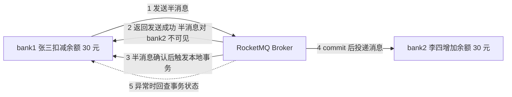

# 可靠消息入门案例环境搭建：两个演示工程与一套基础设施

> 🔒 安全提示：文中示例的口令/密钥均为课程教学环境演示口径，生产环境的安全要求见《安全与合规须知》。

事务消息的理论闭环讲完，接下来的问题是它在工程里长什么样。直接在万信金融的放款链路上动手风险太大，课程选了同一条技术路线的轻量载体：两个独立的银行演示工程 bank1 与 bank2，实现张三向李四转账 30 元级别的业务，把 RocketMQ 事务消息的每个环节都走一遍。环境搭不起来，后面的链路代码就无从落笔，这一课把数据库、MQ 服务端、Maven 工程与两份配置一次备齐。

## 先给结论

- 案例沿用转账场景：bank1 是张三所在的发送方微服务，bank2 是李四所在的接收方微服务，两个工程各自连接独立的数据库，构成分布式事务场景。
- 版本组合是硬约束：MySQL 5.7+、64 位 JDK 1.8+、Spring Boot 2.1.3、Spring Cloud Greenwich.RELEASE、RocketMQ 服务端 4.5.0、rocketmq-spring-boot-starter 2.0.2-RELEASE。
- 数据库不用新建：bank1、bank2 两个库直接复用之前 Hmily 快速入门案例里的库，唯一的新增动作是在两个库里各建一张 `de_duplication` 去重表，为幂等做准备。
- RocketMQ 本机启动顺序是先 NameServer 后 Broker，端口 9876。
- 工程是父工程加两个子模块的结构，依赖统一由父工程管理，两个模块的差别只在服务名、端口、数据库连接与生产者组名。

## 业务与流程对齐

动手前先对齐业务图。这张图讲的是案例要实现的完整链路，转账 30 元的每一步都对应事务消息流程的一个环节。



关键在第二步的注释：半消息虽然已经到达 Broker，但对 bank2 不可见，bank1 收到确认回调后才执行本地事务扣减余额，本地事务的结果再以 commit 或 rollback 决定消息的去留。这个图与理论课的六步流程一一对应，环境搭建的所有部件都是为它服务的。

## 数据库准备：两个旧库加一张新表

环境需求里数据库要求 MySQL 5.7 以上。bank1 库与 bank2 库不需要重新创建，直接使用 Hmily 快速入门案例时建好的两个库即可，转账还是那两个账户，余额变动逻辑没变。真正的新增只有一件事：为了实现消息接收方的幂等性（这个问题 RocketMQ 不负责，要自己解决），需要分别在 bank1、bank2 数据库中新增 `de_duplication` 表，即交易记录去重表：

```sql
DROP TABLE IF EXISTS `de_duplication`;
CREATE TABLE `de_duplication` (
  `tx_no` bigint(20) NOT NULL COMMENT '事务号',
  `create_time` datetime(0) NOT NULL DEFAULT NULL COMMENT '创建时间',
  PRIMARY KEY (`tx_no`) USING BTREE
) ENGINE = InnoDB CHARACTER SET = utf8 COLLATE = utf8_bin ROW_FORMAT = Dynamic;
```

表结构极简，两个字段：事务号 `tx_no` 做主键，创建时间记录落库时刻。别小看这张表，它后面要身兼两职：消费侧用它判断某笔事务是否已执行过，实现幂等；发送方 bank1 的本地事务也会往里写一行日志，事务回查时靠它确认本地事务的真实状态。

## 启动 RocketMQ 服务端

RocketMQ 服务端用 4.5.0 发行包，解压到没有空格和中文的目录。Windows 下的启动分两步，顺序不能颠倒，NameServer 是注册中心，Broker 要先能报到：

```bash
# 启动 NameServer
set ROCKETMQ_HOME=[RocketMQ服务端解压路径]
start [RocketMQ服务端解压路径]/bin/mqnamesrv.cmd

# 启动 Broker 指向本机 NameServer 的 9876 端口
set ROCKETMQ_HOME=[RocketMQ服务端解压路径]
start [RocketMQ服务端解压路径]/bin/mqbroker.cmd -n 127.0.0.1:9876 autoCreateTopic=true
```

两个窗口都起来了，事务消息才有落点。Broker 的 `autoCreateTopic` 参数允许主题自动创建，demo 阶段省去手工建 topic 的步骤。

## Maven 工程：一父两子

工程名为 `wanxin-ensure-message-demo`，导入 IDE 后是一个父工程带两个子模块：`ensure-message-demo-bank1` 与 `ensure-message-demo-bank2`，各自对应图里的一个微服务，各自操作各自的数据库。父工程负责统一管理依赖版本，核心的几组是 Spring Boot、Spring Cloud、Swagger 与 Lombok：

```xml
<dependencyManagement>
  <dependencies>
    <dependency>
      <groupId>org.springframework.cloud</groupId>
      <artifactId>spring-cloud-dependencies</artifactId>
      <version>Greenwich.SR1</version>
      <type>pom</type>
      <scope>import</scope>
    </dependency>
    <dependency>
      <groupId>org.springframework.boot</groupId>
      <artifactId>spring-boot-dependencies</artifactId>
      <version>2.1.3.RELEASE</version>
    </dependency>
    <dependency>
      <groupId>io.springfox</groupId>
      <artifactId>springfox-swagger2</artifactId>
      <version>2.8.0</version>
    </dependency>
    <dependency>
      <groupId>org.projectlombok</groupId>
      <artifactId>lombok</artifactId>
      <version>1.18.0</version>
    </dependency>
  </dependencies>
</dependencyManagement>
```

子模块里最关键的一行依赖是 RocketMQ 客户端 starter，它与服务端 4.5.0 配套，事务消息的发送与监听注解都由它提供：

```xml
<dependency>
  <groupId>org.apache.rocketmq</groupId>
  <artifactId>rocketmq-spring-boot-starter</artifactId>
  <version>2.0.2-RELEASE</version>
</dependency>
```

数据访问层用 MyBatis 而不是 MyBatis-Plus，本案例的 SQL 全部手写在注解里，依赖里带对应版本即可。

## 两个模块的配置与初始代码

bank1 的 `application.properties` 集中展示了这类案例的全部配置项，MySQL 账号为 root，密码 123456：

```properties
spring.application.name = ensure-message-demo-bank1
server.port=56081
server.servlet.context-path = /bank1
spring.http.encoding.enabled = true
spring.http.encoding.charset = UTF-8
spring.mvc.throw-exception-if-no-handler-found = true

spring.datasource.type = com.alibaba.druid.DruidDataSource
spring.datasource.driver-class-name = com.mysql.jdbc.Driver
spring.datasource.url = jdbc:mysql://localhost:3306/bank1?useUnicode=true
spring.datasource.username = root
spring.datasource.password = 123456

swagger.enable = true

rocketmq.producer.group = producer_ensure_bank1
rocketmq.name-server = 127.0.0.1:9876
```

bank2 的配置与 bank1 几乎逐行对应，差别只有四处：服务名换成 `ensure-message-demo-bank2`，端口换成 56082，访问路径换成 `/bank2`，数据库 URL 指向 bank2 库，生产者组名换成 `producer_ensure_bank2`。

初始代码方面，两个模块各带一份固定的骨架：Swagger 配置类、启动类、实体类与一个空实现的 Controller。实体类 `AccountChangeEvent` 是消息的载体，三个字段贯穿整个链路：

```java
@Data
@AllArgsConstructor
@NoArgsConstructor
public class AccountChangeEvent implements Serializable {
    // 目标账号
    private String accountNo;
    // 变动金额
    private double amount;
    // 事务号 时间戳
    private long txNo;
}
```

`txNo` 用当前时间的时间戳充当事务号，它既参与事务回查，也支撑消费幂等，后续编码时反复出现。Controller 与业务层此时还是空实现，属于留给功能实现的空白位。

## 常见误区

- **把 bank1、bank2 当成要新建的库。**错例：动手就 `create database bank1`、再建 account 表。正解：两个库在 Hmily 快速入门案例时已建好，直接复用，新增的只有 `de_duplication` 去重表，且要在两个库里各建一份。
- **启动顺序颠倒或漏掉 NameServer。**错例：只启动 Broker 就跑应用。正解：Broker 启动时要向 NameServer 注册，NameServer 不在，Broker 起不来或客户端找不到路由，先 `mqnamesrv.cmd` 后 `mqbroker.cmd`，端口 9876 与配置文件里 `rocketmq.name-server` 一致。
- **两个模块的配置互相抄完不改组名。**错例：bank2 的 properties 里生产者组还是 `producer_ensure_bank1`。正解：服务名、端口、访问路径、数据库连接、生产者组名五处都要改，组名是生产者集群的标识，两个服务共用一个组名会让回查路由出现歧义。
- **忽略 starter 与服务端的版本配套。**错例：随手引一个最新版 RocketMQ 客户端。正解：客户端用 `rocketmq-spring-boot-starter 2.0.2-RELEASE`，与服务端 4.5.0 配套，事务消息注解与模板方法在这个版本组合下才稳定可用。

## 面试可能被问到的问题

1. 面试官追问：「为什么入门案例要拆成 bank1 和 bank2 两个微服务，而不是一个工程里两个方法？」
   答：分布式事务的前提是两个独立资源拥有者，各自连各自的数据库，事务边界互相隔离。合在一个工程里就是本地事务了，验证不了半消息、回查、跨服务投递这些机制，拆开后才与真实的多服务场景同构。
2. 面试官追问：「de_duplication 去重表为什么要建在两个库里？」
   答：幂等是每个消费方自己的职责。bank1 执行本地事务时写事务日志供回查用，bank2 消费消息时也要判断这笔事务是否已处理过，两边各查各的库，谁也不能跨库查对方，所以两边都要有自己的去重表。
3. 面试官追问：「rocketmq.producer.group 这个配置和事务消息的发送组是一回事吗？」
   答：不是同一个层级。`rocketmq.producer.group` 是 RocketMQTemplate 默认的生产者组；事务消息通过 `sendMessageInTransaction` 发送时可以显式指定事务发送组名，事务监听器注解上的 `txProducerGroup` 必须与它一致，Broker 回查时按这个组名找到对应的监听器。
4. 面试官追问：「案例的 AccountChangeEvent 里 txNo 为什么用时间戳？」
   答：demo 里需要一个业务上唯一的事务号来贯穿消息体、去重表与回查逻辑，时间戳简单且不重复，够用。生产环境会用雪花 ID 或业务流水号，关键是同一笔业务操作在重试与重投中携带同一个事务号。
5. 面试官追问：「环境搭建里最容易踩的坑是什么？」
   答：版本与启动。一是 RocketMQ 必须 4.3 以上才有事务消息，客户端 starter 要与服务端配套；二是启动顺序先 NameServer 后 Broker；三是解压路径不能含空格和中文，否则启动脚本报错，这类问题占了 demo 排障的大头。

## 配套资料

- 讲义：`materials/docs/10/RocketMQ研究v1.0.md`，RocketMQ 4.5.0 安装与启动（`mqnamesrv.cmd`、`mqbroker.cmd -n 127.0.0.1:9876`、`autoCreateTopic`）、`RocketMQTemplate` 用法参考。
- 讲义：`materials/docs/10/day16-项目总结&就业指导v1.0.md`，3.4.3 事务消息六步流程，与案例业务图逐一对应。
- 讲义：`materials/docs/10/万信金融-第4章-投标放款v1.0.md`，3.3 分布式事务：满标放款与 RocketMQ 事务消息的选型结论。
- 代码：`materials/code/10/rocketmq-all-4.5.0-bin-release/`，案例所需的 RocketMQ 服务端发行包；`materials/code/10/rocketmq-console/` 可选，用于观察消息轨迹。
- 代码：`materials/code/10/完整代码/完整代码/shanjupay/test-rocketmq/`，starter 配置（`rocketmq.nameServer`、`rocketmq.producer.group`）与消息发送的真实参考代码。bank1/bank2 演示工程无源码包，文中配置与代码按本课画面线与讲义写法补全，包名按 `com.study.finance` 系改写，MySQL 密码统一为 123456。
