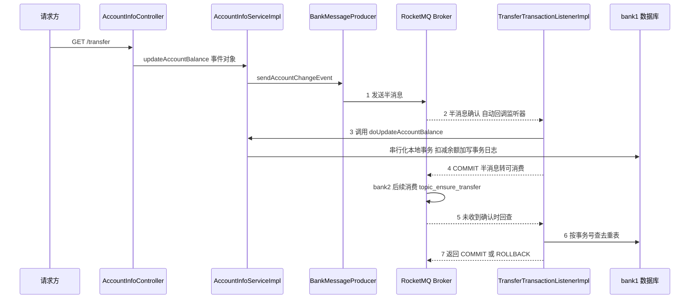

# bank1 Controller：一次转账请求如何走完事务消息的七步

bank1 侧的链路代码已经齐了：DAO 层、消息生产者、业务层、事务监听器各就各位，可这条链还没有入口。转账要从一次 HTTP 请求开始，Controller 就是链路的起点，代码本身只有几行，价值在于把请求参数组装成事件对象，并把一到七步的完整调用链串起来走通。bank1 到此全部完工，bank2 还在等这条消息。

## 先给结论

- Controller 只做一件事：接收请求，组装 `AccountChangeEvent`，调用业务层的 `updateAccountBalance` 方法，让消息发出去。
- 入口调的是 `updateAccountBalance`（只发消息），不是 `doUpdateAccountBalance`（执行本地事务），后者只能由事务监听器触发，不能从入口直接调。
- 事件对象的三个参数在 Controller 里就地组装：账号写死为张三的账号 `1`，金额 100，事务号取当前时间戳。
- 监听器的两个方法都不需要任何代码显式调用，半消息确认触发本地事务执行，Broker 收不到确认触发事务回查。
- Controller 返回「转账成功」只代表请求受理与半消息流程启动，bank2 侧的入账由 MQ 异步接力完成。

## Controller 的实现

工程初始化时给了一个空实现的 Controller，现在把它补全：

```java
package com.study.finance.demo.bank1.controller;

@RestController
@Slf4j
public class AccountInfoController {

    @Autowired
    private AccountInfoService accountInfoService;

    @GetMapping(value = "/transfer")
    public String transfer() {
        // 组装转账事件 账号 1 为张三 金额 100 事务号取当前时间戳
        AccountChangeEvent accountChangeEvent =
                new AccountChangeEvent("1", 100, System.currentTimeMillis());
        // 调用业务层入口方法 该方法只发送事务消息
        accountInfoService.updateAccountBalance(accountChangeEvent);
        return "转账成功";
    }
}
```

注入业务层之后调用一个方法，Controller 没有任何数据库操作，也没有消息发送的细节，所有职责都沉到下层。`AccountChangeEvent` 的三参构造在这里填值：账号用张三的账号 `1`，demo 里写死，真实系统里来自登录态；转账金额 100，想测余额不足的场景可以改大；事务号用 `System.currentTimeMillis()`，当前时间相对 1970 年 1 月 1 日的毫秒值，每次请求天然不同，正好充当去重表的主键与回查的检索键。返回值直接给前端一句「转账成功」。

这里有一个容易混淆的调用点：业务层有两个方法，入口必须调 `updateAccountBalance` 而不是 `doUpdateAccountBalance`。前者只发事务消息，是 Controller 的合法入口；后者是本地事务本体，设计上只能由监听器回调执行，如果从 Controller 直接调它，扣钱就先于半消息发生了，事务消息的时序约定被破坏。

## 请求进来之后：七步的完整走位

这张时序图讲的是一次 `/transfer` 请求在 bank1 内部的完整旅程，实线是每次请求的正常路径，虚线是异常时的回查路径：



对着代码把每一步落在哪个方法上看清楚。请求进入 `transfer`，组装事件并调 `updateAccountBalance`，业务层转发给 `BankMessageProducer`，构造 JSON 消息后 `sendMessageInTransaction` 发出半消息，对应第一步。Broker 确认后不是继续往下执行发送方的代码，而是回调 `TransferTransactionListenerImpl.executeLocalTransaction`，第二步与第三步在这里接上。监听器解析消息还原出 `AccountChangeEvent`，调业务层的 `doUpdateAccountBalance`，在串行化隔离级别的本地事务里扣减张三余额并往 `de_duplication` 表写一行事务日志，本地事务成功返回 COMMIT，Broker 把半消息转为可消费，第四步完成，bank2 之后从 `topic_ensure_transfer` 消费到这条消息。

异常分支同样有代码支撑：若第四步的 COMMIT 因网络闪断没能送达 Broker，Broker 超时后主动回查，也就是第五步，它自动调用 `checkLocalTransaction`，监听器解析消息取出事务号，调 DAO 的 `isExistTx` 查去重表，第六步，日志存在则说明本地事务早已成功，返回 COMMIT，Broker 补投消息；日志不存在返回 ROLLBACK，半消息被删除。一到七步没有一个环节需要人工介入调用，全部由 RocketMQ 按协议驱动，bank1 侧代码至此闭环。

## 参数组装的边界划分

Controller 里写死账号与金额看起来粗糙，但边界划分是有讲究的。**第一，参数的诞生地就是入口。**谁发起转账，谁决定账号与金额，事务号在发起时生成并终身携带，之后消息体、去重表、回查逻辑都只引用它，不再二次生成，保证同一笔事务在整条链路上有唯一身份。**第二，demo 与生产的差别只在参数来源。**真实系统里账号来自认证信息、金额来自前端表单校验、事务号来自业务流水号服务，这些变化只影响 `new AccountChangeEvent(...)` 这一行，链路上的其他代码一行不用改。**第三，返回值只表达受理。**「转账成功」出现在响应里时，本地事务可能还没执行完，bank2 更是尚未收到消息，这恰恰是最终一致性方案的正常形态：入口快速返回，结果靠消息接力收敛。

## 常见误区

- **从 Controller 直接调 doUpdateAccountBalance。**错例：想先扣钱再发消息，绕过 `updateAccountBalance` 直接调本地事务方法。正解：事务消息约定先发半消息再执行本地事务，本地事务方法只允许监听器回调触发，入口直接调等于退回普通方案的死结。
- **把「转账成功」当成本地事务成功的信号。**错例：看到响应成功就断定余额已扣。正解：响应只表示请求受理、半消息发出，本地事务在监听器回调里异步执行，验证结果要查 `account_info` 余额与 `de_duplication` 事务日志。
- **事务号在多处重复生成。**错例：消息体里一个时间戳，写去重表时又取一次。正解：事务号必须出生一次全程携带，否则重试与回查时对不上账，去重表查不到该查的日志，回查会误判 ROLLBACK。
- **认为 bank1 完工就能看到李四余额变化。**错例：bank1 写完就跑测试，发现 bank2 的余额没动。正解：bank2 是独立的接收方微服务，它的业务层与消费代码是下一课的内容，bank1 侧现在只能保证消息可靠送达 Broker。

## 面试可能被问到的问题

1. 面试官追问：「Controller 调 updateAccountBalance 之后请求就返回了，那扣钱是什么时候发生的？」
   答：在半消息发送成功之后。RocketMQ 确认半消息时自动回调事务监听器，监听器调业务层的 doUpdateAccountBalance 在本地事务里扣减余额并写事务日志，整个动作由 MQ 的协议驱动，与 HTTP 响应的返回时间没有先后绑定。
2. 面试官追问：「为什么入口方法与本地事务方法要拆成两个？」
   答：时序职责不同。入口方法面向 Controller，只负责发事务消息；本地事务方法面向监听器回调，负责扣余额加写日志，且必须是受事务控制的。拆开之后每个方法只有一个调用方、一种时序，若入口直接做本地事务，半消息与扣钱的先后顺序就无法保证。
3. 面试官追问：「事务号用 System.currentTimeMillis() 有什么隐患？」
   答：demo 下可用，并发高时毫秒级时间戳可能撞号，两个请求共用事务号会互相污染去重表。生产环境应使用雪花 ID 或带业务前缀的流水号，核心要求是全局唯一且同一笔事务的重试携带同一个号。
4. 面试官追问：「请求返回转账成功后，如果本地事务失败了，用户端如何感知？」
   答：感知不到同步失败，这正是最终一致性的边界。本地事务失败时监听器返回 ROLLBACK，半消息被删除，bank2 收不到通知，扣钱也没有发生，资金两边一致但转账没完成。业务上通常靠对账任务或查询接口兜底提示，而不是在这次请求的响应里。
5. 面试官追问：「bank1 侧的代码写完了，你如何验证一到七步都真的通了？」
   答：分两条路径验证。正常路径：调 `/transfer` 后查 bank1 库，`account_info` 余额减少 100，`de_duplication` 多一条该事务号的日志，说明监听器回调与本地事务执行成功。回查路径：在监听器返回前断点或模拟网络异常，观察 Broker 超时后回调 checkLocalTransaction，按去重表内容返回 COMMIT 后消息仍能投递。

## 配套资料

- 讲义：`materials/docs/10/day16-项目总结&就业指导v1.0.md`，3.4.3 事务消息六步流程，与调用链时序图对应。
- 讲义：`materials/docs/10/万信金融-第4章-投标放款v1.0.md`，3.3 分布式事务：满标放款场景下事务消息的选型结论。
- 讲义：`materials/docs/10/RocketMQ研究v1.0.md`，RocketMQ 启动与 `RocketMQTemplate` 用法，本地验证环境的操作参考。
- 代码：`materials/code/10/完整代码/完整代码/shanjupay/test-rocketmq/`，`RocketMQTemplate` 发送与消费的真实参考代码。
- 代码：`materials/code/10/rocketmq-all-4.5.0-bin-release/`，本地运行的 RocketMQ 服务端。bank1/bank2 演示工程无源码包，文中 `AccountInfoController` 按本课画面线与讲义写法补全，包名按 `com.study.finance` 系改写。
