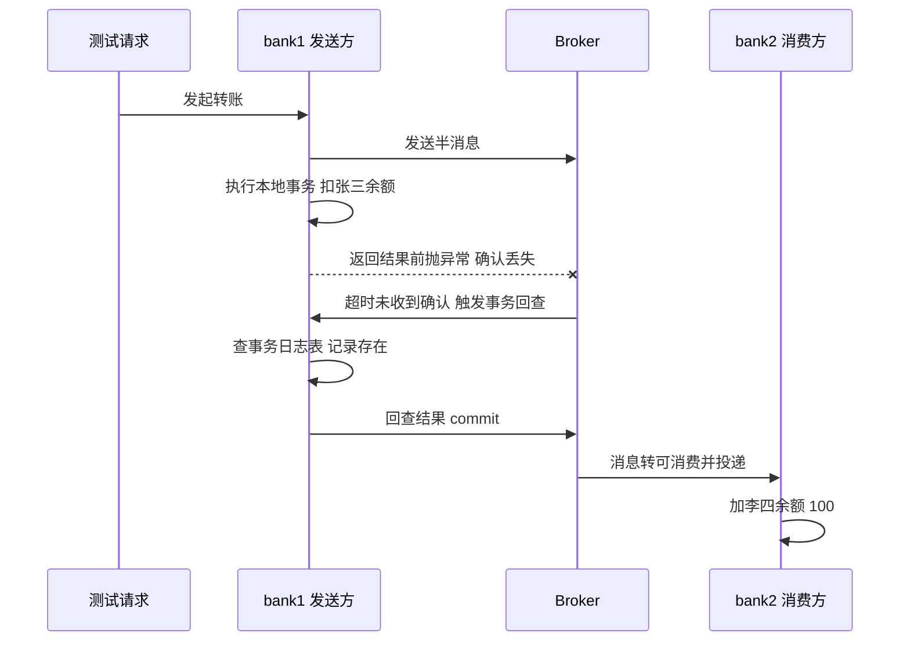

# 事务消息入门案例功能测试：四组用例验证「消息必达」的承诺

转账案例两端的代码都已完成，方案里承诺过的能力（本地事务成功则消息必达、事务回查兜底、消费失败重试）目前还只是代码里的假设。功能测试要做的就是把假设逐条变成观察事实：故意制造成功、失败、失联三种局面，看 Broker 与消费端的反应是否与机制设计一致。这一课完整演示四组用例的执行过程与判定依据。

## 先给结论

- 测试环境三件套：RocketMQ、bank1 与 bank2 两个微服务、两个独立数据库；初始数据为张三余额 1000、李四余额 0。
- 四组用例分别验证：两边都成功、bank1 本地事务失败、发送后不返回执行结果、bank2 本地事务失败，外加消费幂等留作自行验证。
- 本地事务失败时消息不会被投递，半消息滞留在 Broker 的系统主题里，控制台可以直接查到。
- 发送方失联时事务回查自动触发，回查依据事务日志表给出 commit，消息最终投递成功。
- 消费端本地事务抛异常会触发重复投递，控制台能看到多次消费打印，余额不会因重试而错乱的前提是幂等已实现。

## 测试环境与初始数据

需要启动的组件不多：RocketMQ 的 NameServer 与 Broker、bank1 与 bank2 两个 Spring Boot 服务、两个独立的 MySQL 库。bank1 的关键配置如下，发送方端口与 context-path 决定了测试请求的地址：

```properties
spring.application.name=ensure-message-demo-bank1
server.port=50001
server.servlet.context-path=/bank1
spring.datasource.type=com.alibaba.druid.pool.DruidDataSource
spring.datasource.driver-class-name=com.mysql.jdbc.Driver
spring.datasource.url=jdbc:mysql://localhost:3306/bank1?useUnicode=true
```

两个库的账户表各有一条初始数据，测试结果全部以这两个余额为基准核对：

```sql
-- bank1 库 张三
insert into account_info (account_no, account_balance) values ('1', 1000);
-- bank2 库 李四
insert into account_info (account_no, account_balance) values ('2', 0);
```

转账入口在 bank1 侧，浏览器直接发请求即可触发整条链路：

```bash
curl http://localhost:50001/bank1/transfer
```

## 用例一：两边都成功

不改动任何代码直接请求。bank1 返回「转账成功」，bank2 控制台打印出消费到的消息内容（张三账号、100 元、流水号），核对两个库：张三余额 1000 变 900，李四余额 0 变 100，两边的 `de_duplication` 防重日志表里各有一条记录。这条用例确认的是正常路径：本地事务提交、消息转可消费、消费执行本地事务，三步全部按预期走完。

## 用例二：bank1 本地事务失败，消息不投递、半消息可查

在 bank1 业务层的本地事务方法里故意抛一个异常（例如除零运算），重启 bank1 后再次请求。观察结果：bank2 控制台没有任何输出，说明消息未被投递；bank1 库余额仍为 900 未变，说明本地事务回滚。更值得注意的是半消息的去向：打开 RocketMQ 控制台的消息查询页，按系统主题检索，能查到刚才那条消息，内容完整存在，只是带着 Prepared 标记不能被消费。

这正是半消息机制的价值所在：消息先于本地事务结果落库，本地事务失败后 Broker 收到 rollback 删除它，即便 rollback 响应丢失，滞留的半消息也只是一条永远不会被消费的死数据，不会造成资金错乱。用例把「本地事务失败则消息不可达」从设计承诺变成了亲眼可见的事实。

## 用例三：不返回执行结果，触发事务回查

这次不动本地事务，改为在 bank1 事务监听器执行完本地事务、准备返回 commit 的位置抛出异常。模拟的局面是：本地事务实际已成功（张三扣款已生效），但 Broker 收不到任何确认结果。为了便于观察，在回查方法里加一行打印：

```java
@Override
public RocketMQLocalTransactionState checkLocalTransaction(Message msg) {
    System.out.println("事务回查");
    // 解析消息 查事务日志表给出确定答案
    final JSONObject jsonObject = JSON.parseObject(new String((byte[]) msg.getPayload()));
    AccountChangeEvent accountChangeEvent = jsonObject.parseObject(
            jsonObject.getString("accountChange"), AccountChangeEvent.class);
    int isExistTx = accountInfoDao.isExistTx(accountChangeEvent.getTxNo());
    return isExistTx != 0 ? RocketMQLocalTransactionState.COMMIT
            : RocketMQLocalTransactionState.ROLLBACK;
}
```

重启 bank1 后再次请求，稍等片刻（Broker 的回查有超时与次数设置，默认配置下需要一点耐心）：bank2 起初收不到消息，随后 bank1 控制台打印出「事务回查」，回查逻辑查事务日志表发现记录存在，返回 commit，紧接着 bank2 收到消息，李四余额变成 100。整条时序如下图：



这张图讲的就是机制第 5 至第 7 步的真实触发过程：回查不是异常兜底的摆设，而是发送方失联时推动事务走向一致的实际动力。

## 用例四：bank2 本地事务失败，消费重试

恢复 bank1，改为在 bank2 业务层执行本地事务的位置故意抛异常，同时在业务方法里加打印以便计数。重启后请求：bank2 控制台先打印一次消费消息、抛异常，稍后再次打印，出现第二遍、第三遍，说明 Broker 在按重试策略重复投递；库表核对，bank1 张三余额变为 900（发送侧成功），bank2 李四余额保持 0（每次重试都被异常回滚）。用例确认了消费失败不会丢消息，只会反复重试。

课程在本次演示里使用的是默认重试参数，未做定制；次数与间隔都可以配置，这一点在 RocketMQ 基础部分已经铺垫过。另外消费幂等属于第五组场景，本次未演示，留给读者按同样思路验证：重复投递的消息到达时，防重表查询命中，业务直接跳过。

## 测试背后的口径

四组用例跑完，方案的能力边界就清晰了：它适合执行周期较长、实时性要求不高的场景，典型如支付完成后的异步通知。引入这套机制后，原本同步的事务变成了基于消息的异步执行，分布式事务里最容易出问题的同步阻塞被消除，两个服务之间也完成了耦合解除。几种分布式事务方案各有适用场景，选型时对照业务特征做判断，比记住方案本身更重要。

## 常见误区

- **只测成功路径。**错例：请求一次、余额对齐、测试结束。正解：这套方案的全部价值都在异常分支，失败、失联、重复三类场景各测一遍才算完整。
- **本地事务失败后以为半消息会立即消失。**错例：认为失败就不留痕迹。正解：rollback 依赖发送方与 Broker 的交互，交互失败时半消息可能滞留系统主题，它不可被消费，最终会被机制清理，不影响一致性。
- **把回查当成需要人工触发的补偿。**错例：测试时手动调用回查方法。正解：回查由 Broker 定时自动发起，人工只需要保证回查实现查库给确定答案。
- **重试成功就认为消费端可靠。**错例：看到多次打印后最终成功即通过。正解：还要核对业务结果只执行了一次，这依赖幂等实现，重试与幂等是一对必须同时验收的能力。

## 面试可能被问到的问题

1. 面试官追问：「发送方本地事务失败，消息为什么没有被消费？」
   答：事务消息先以半消息形式存到 Broker，本地事务失败时发送方返回 rollback，Broker 将其删除；消息从未进入可消费状态，消费端自然收不到。
2. 面试官追问：「事务回查什么时候发生，依据什么判断结果？」
   答：Broker 在超时未收到 commit 或 rollback 确认时定时回调发送方。判断依据是本地事务的真实落库结果，例如事务日志表中是否存在该流水号的记录，实现必须查库，不能凭内存状态猜。
3. 面试官追问：「消费失败的消息最终会不会丢？」
   答：不会丢，RocketMQ 按默认策略多次重投，超出次数上限后进入死信队列，可人工处理。可靠性靠重试保证，正确性靠幂等保证，两者缺一不可。
4. 面试官追问：「这套方案适合什么业务特征？」
   答：执行周期长、可异步、对强一致性要求低的场景。它把同步事务改造成消息驱动的异步执行，消除同步阻塞并解耦服务；强实时业务应考虑 TCC 这类方案。

## 配套资料

- 讲义：`materials/docs/10/day16-项目总结&就业指导v1.0.md`，3.4.3 如何通过 RocketMQ 事务消息实现最终一致性事务（与四组用例对应的机制步骤）。
- 讲义：`materials/docs/10/RocketMQ研究v1.0.md`，消息查询、消费重试与死信队列的运维基础。
- 代码：`materials/code/10/rocketmq-all-4.5.0-bin-release/` 与 `materials/code/10/rocketmq-console/`，本地环境与控制台，用例二的半消息查询依赖控制台完成。
- 转账演示工程无独立源码包，文中代码与配置为按本课画面与写法补全的示例，包名按 `com.study.finance` 系改写。
