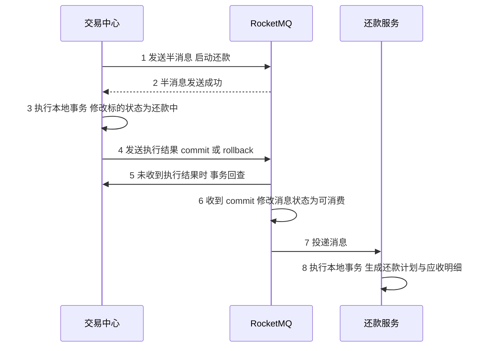

# 满标放款的事务难题：哪些环节会不一致，为什么选事务消息

转账入门案例把 RocketMQ 可靠消息最终一致性的整套机制验证完毕，学它的目的终究是回到项目本身。满标放款链路上有一处早已预留的空白：交易中心改标的状态与还款服务生成还款计划被拆在两个微服务里，从第一版代码起就没敢用 Feign 直连。这一课先不动代码，把这笔事务账算清楚：不一致会发生在哪些环节、为什么事务消息是这道题的正确选项。

## 先给结论

- 满标放款流程的第 21 步（交易中心修改标的状态为还款中）与第 23 步（还款服务生成还款计划与应收明细）是原子性绑定关系，中间的第 22 步通知动作从一开始就预留为空。
- 两步分属两个独立微服务、各自连库，是典型分布式事务场景，改了状态就必须生成计划，缺一不可。
- 选可靠消息最终一致性的三个理由：生成计划与明细逐期逐人计算加批量落库，耗时不可控；业务对强一致性要求低，晚几秒不影响资金正确性；异步执行天然不阻塞放款主流程。
- 场景与转账案例完全同构：交易中心对应扣钱的 bank1，还款服务对应收钱的 bank2，中间的协调者从抽象的「消息队列」落成 RocketMQ。
- 落地按方案图编码：交易中心发半消息、执行本地事务、返回执行结果，Broker 回查兜底，还款服务消费消息执行本地事务，第 22 步从此有了实现。

## 链路上预留的那一步空白

满标放款的业务流程图此前拆解过很多次，从存管侧放款完成到前端提示，每个节点都有对应代码。把视线压到流程末端的红框：第 21 步，交易中心把标的状态修改为还款中；第 22 步，交易中心把启动还款的数据发往还款服务；第 23 步，还款服务生成还款计划与应收明细。21 与 23 的代码早已写完，唯独 22 在实现满标放款功能时被明确预留下来，当时的判断是这里涉及分布式事务，直接用 Feign 发远程调用会把问题埋进链路里。

预留的理由现在可以完整展开。Feign 调用是同步 RPC，交易中心改完状态后必须等还款服务算完计划与明细才能返回，而计算耗时取决于标的投资人数，逐期逐人的金融计算加批量落库，耗时完全不可控；更麻烦的是调用失败的补偿要自己重写，交易中心该把状态改回去还是等重试，两边都可能处在中间态。这一步空的不是功能，是一套可靠的协调机制。

## 原子性绑定为什么成立

判断一笔业务是否是分布式事务问题，标准是两个操作是否必须同生同灭。这里答案很干脆：标的状态改成还款中，意味着标进入还款阶段，后续的每一期还款都依赖还款计划与应收明细存在；状态改了而计划没生成，用户还款将无账可还，系统账实不符。反过来，计划生成了而状态没改，还款数据悬挂在一个未放款的标的上。两个操作不允许任何一个单方面完成，这就是原子性绑定。

而执行两个操作的是交易中心与还款服务两个独立微服务，各自持有数据库连接、各自的事务边界，任何本地事务都无法跨越服务边界把它们绑在一起。跨服务的原子性绑定，属于分布式事务问题的教科书场景。

## 选型的三个理由

分布式事务的候选方案此前学过不止一种，选型依据不是方案的新旧强弱，而是业务特征与方案的匹配度。**第一，业务耗时不可控。**还款服务生成计划与明细要遍历每一条投资记录、做金融计算、批量落库，投资人多的标的耗时显著拉长，这类业务不适合拖住主流程。**第二，对强一致性要求低。**管理员触发放款后，计划晚几秒生成不影响任何资金正确性，用户侧感知不到软状态的存在，业务天然容忍中间态，这正是最终一致性方案的舒适区。**第三，异步解耦的价值。**放款主流程在状态落库后即完成，计划生成在后台通过消息驱动推进，前端不等待，服务间不互相拖垮。三个特征叠加，指向的答案就是 RocketMQ 可靠消息实现最终一致性。

与转账案例对号入座，结构完全同构：交易中心的本地事务（改状态）对应 bank1 的扣款，还款服务的本地事务（生成计划与明细）对应 bank2 的加钱，中间的协调枢纽对应 RocketMQ。学转账案例时建立的心智模型可以整体平移过来，差异只在业务动作与数据结构。

## 方案在放款链路上的完整形态

这张图把预留的第 22 步展开成事务消息机制的完整步骤，编码阶段就按它施工：



关键路径上的每个数字都对应一段待写的代码：交易中心一侧要补生产者、事务监听器（执行本地事务与回查两个回调）以及业务层的状态修改方法；还款服务一侧要补消费监听器，收到消息后驱动已实现的计划生成逻辑。消费侧的失败重试与幂等控制同样在编码范围内，重试保证收到的消息最终执行成功，幂等保证重复投递不会生成两份还款计划。

用代码骨架预览发送侧的最终形态，细节留到实现篇展开：

```java
/** 交易中心事务消息发送骨架 按本课写法补全的示例 包名按 com.study.finance 系改写 */
SendResult sendResult = rocketMQTemplate.sendMessageInTransaction(
        txProducerGroup, "topic_start_repayment:tag_start_repayment", msg, null);
```

```java
/** 事务监听器两个回调 按本课写法补全的示例 */
@Override
public RocketMQLocalTransactionState executeLocalTransaction(Message msg, Object arg) {
    // 执行本地事务 修改标的状态为还款中 返回 COMMIT 或 ROLLBACK
    return RocketMQLocalTransactionState.COMMIT;
}

@Override
public RocketMQLocalTransactionState checkLocalTransaction(Message msg) {
    // 事务回查 重查标的状态给出确定答案
    return RocketMQLocalTransactionState.COMMIT;
}
```

## 常见误区

- **把第 22 步当成一个简单的 HTTP 转发。**错例：交易中心改完状态顺手发一个 Feign 请求了事。正解：这一步要承载跨服务原子性，同步调用在耗时与补偿两个维度都无法胜任，必须换成事务消息。
- **认为改状态和生成计划可以各自独立。**错例：两边各自成功即可，顺序无所谓。正解：状态是还款业务的开关，计划是还款业务的数据，任何一个单方面存在都会造成账实不符，它们是原子性绑定。
- **因为耗时就说要用 TCC。**错例：金融业务一律上强一致方案。正解：TCC 的强一致以同步阻塞与三阶段改造为代价，耗时不可控的业务反而会被它拖垮；可异步、弱一致的场景选可靠消息才是匹配。
- **只规划正常路径。**错例：方案图只画半消息到消费的正常链路。正解：回查、重试、幂等是方案的三条腿，编码范围从第一天就要把它们算进去。

## 面试可能被问到的问题

1. 面试官追问：「满标放款里分布式事务的具体场景是什么？」
   答：交易中心修改标的状态为还款中与还款服务生成还款计划、应收明细是原子性绑定，两者分属两个独立微服务、各自连库，状态改成功就必须生成计划，属于典型分布式事务。
2. 面试官追问：「为什么不用 Feign 同步调用通知还款服务？」
   答：生成计划与明细逐期逐人计算加批量落库，耗时不可控，同步调用会阻塞放款主流程；调用失败后的补偿逻辑也要自己实现，事务消息自带持久化、重投与回查，可靠性和解耦都更好。
3. 面试官追问：「这个场景和转账案例有什么对应关系？」
   答：结构完全同构，交易中心改状态对应 bank1 扣款，还款服务生成计划对应 bank2 加钱，RocketMQ 是同一个协调者，转账案例的机制与代码骨架可以整体迁移。
4. 面试官追问：「选可靠消息最终一致性的判断标准是什么？」
   答：看三个业务特征，操作是否可异步、执行是否耗时、是否容忍中间态。三条同时满足时，最终一致性方案的实现成本远低于 TCC，收益却覆盖了可靠性诉求。

## 配套资料

- 讲义：`materials/docs/10/万信金融-第4章-投标放款v1.0.md`，3.3 分布式事务：满标放款涉及分布式事务问题、需使用 RocketMQ 事务消息实现最终一致性事务的指引。
- 讲义：`materials/docs/10/day16-项目总结&就业指导v1.0.md`，3.4.3 事务消息机制六步与满标放款场景选型分析（耗时、弱一致、不阻塞主流程的判断依据）。
- 讲义：`materials/docs/10/万信金融-第5章-用户还款v1.0.md`，还款计划与应收明细的生成逻辑，第 23 步的既有实现基础。
- 代码：`materials/code/10/rocketmq-all-4.5.0-bin-release/` 与 `materials/code/10/rocketmq-console/`，RocketMQ 环境资料；文中发送侧代码骨架为按本课写法补全的示例，包名按 `com.study.finance` 系改写。
