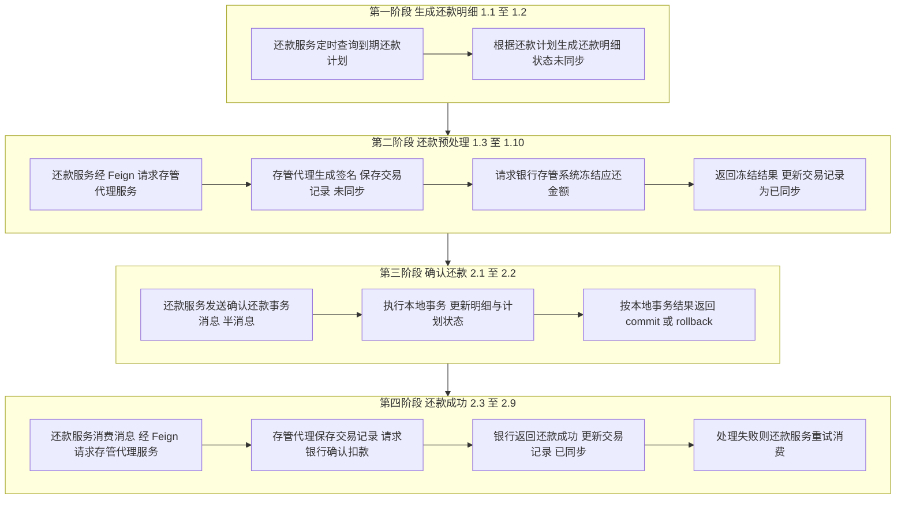

# 用户还款需求分析：定时任务驱动的自动扣款与四阶段流程拆解

满标放款审核通过，借款人拿到钱、投资人的钱放了出去，交易达成。此后每个还款日，借款人要按借款时约定的等额本息方式，把当期本金加利息通过平台归还给投资人。这听上去平平无奇，实现起来却是本项目业务链上交互最密集的一段：三个服务参与、十个接口串联、还要再打一次分布式事务的仗。动手编码之前，先把「还款日自动扣款」这件事拆成看得清、排得动的阶段。

## 先给结论

- 用户还款的业务闭环是「借款人提前充值、平台还款日自动扣款、扣款划转给投资人」，与信用卡还款的体验高度相似，扣款动作由系统在还款日自动发起。
- 该业务与前端无关，没有页面操作触发，由定时任务驱动，还款服务每天定时查询到期的还款计划作为流程起点。
- 涉及三个服务：还款服务、存管代理服务、银行存管系统；存管系统继续不开发、直接使用，凡与银行打交道一律经存管代理服务转发。
- 整个流程按图划分为四个阶段：生成还款明细、还款预处理（冻结应还金额）、确认还款、还款成功，分析时放在一起看，编码时逐段推进。
- 第三与第四阶段之间存在分布式事务问题，沿用 RocketMQ 可靠消息最终一致性方案解决，并且消息的接收方设计为还款服务自身，即「自发自收」。

## 什么是用户还款：一次信用卡式的循环

用一句大白话定义：用户还款就是借款人在还款日，把应还本息通过平台自动划转给投资人。它的用户体验与信用卡几乎一致。持卡人都熟悉这个循环：账单日之后记下一个还款日，在还款日之前把应还金额充进卡里，到了还款日银行自动扣款，逾期则产生滞纳金。

万信金融 P2P 平台的借款人走同样的循环。借款人借钱时约定了还款方式，本项目的标的全是等额本息，借款分 12 期就有 12 个还款日，每个还款日要还的钱是固定的本金加利息。借款人要做的只有一件事：在临近还款日时把应还金额充值到平台账户，剩下的交给自己正在使用的这个平台。

平台侧要做的正是本章要实现的全部内容：还款日当天自动从借款人账户扣款，把钱划给投资人。整条业务流程可以用一张极简的图概括：


图上只有三个节点，但「系统自动扣款」这四个字背后藏着一整条服务链：判断哪些还款计划到期、算清该扣谁多少钱、冻结资金、确认扣款、更新一串状态。需求概述阶段不需要展开，需求分析阶段就必须把它拆开看。还要留意一个隐含前提：自动扣款只在账户余额充足时才能成功，借款人忘记充值会发生什么，平台上对应的逾期与滞纳金处理属于风控业务的范畴，本项目聚焦在余额充足时的正常还款链路。

## 为什么这条流程没有前端

此前每个业务功能，起点几乎都是前端页面上的某次操作：发标点发布、投标点投资、审核点通过，前端发请求，后端跟着执行。用户还款的流程图里找不到前端的影子，这不是遗漏，是业务形态的差异。

自动还款意味着用户不需要在前端做任何操作。借款人充值是前置条件，属于账户业务的范畴；还款日当天的扣款动作由平台自己发起，具体载体是定时任务。还款服务每天定时执行一次调度，查询当天到期的还款计划，查到谁就给谁走还款流程。触发源从「HTTP 请求」变成「时间点」，这是本章所有接口设计与此前章节的根本不同：接口不再围绕 Controller 组织，业务层方法成了主角。

定时任务使用的具体框架是后续课程的内容，现阶段先把它当黑盒：只需要知道每天会有一个外部驱动按固定节奏调用还款服务的入口方法。为了测试方便，讲义规划了一个临时的手动触发入口，通过向一个测试接口发请求来代替定时任务，等定时任务引入后再替换。

## 三个服务的分工

用户还款一共涉及三个服务，个个都是熟面孔。**还款服务是业务主战场。**四阶段里的状态修改、计划与明细的读写、事务消息的发送与消费全部发生在它身上，`finance-repayment-service` 独立部署，持有还款计划、还款明细、应收计划、应收明细四张表。**存管代理服务是银行协议的屏蔽层。**凡是要与银行存管系统交互的动作，签名加密、生成请求数据、保存交易记录、转发请求、回写同步状态，都由它统一代劳，平台内其他微服务只管通过 Feign 把业务参数递给它。**银行存管系统继续扮演外部角色。**与之前开户、投标、放款的口径一致，存管系统不开发、部署即用，它接收代理服务的请求，执行冻结与划扣，返回标准结果码。

分工清楚了，交互路径也就定了：还款服务想动银行的钱，无论预处理冻结还是确认扣款，都必须走存管代理服务这一条路，不存在直达银行的旁路。这条约束在流程图上表现为所有指向银行存管系统的箭头都从存管代理服务出发，编码时对应着 Feign 代理接口只在代理服务一侧定义、业务服务只引用 API 代理的既有约定。

## 四个阶段的接口地图

把流程图上的编号步骤归拢，用户还款被切成四个阶段。这张图画出每个阶段的动作与跨越的服务边界：



**第一阶段是还款服务的「自查自算」。**定时任务触发后，先按日期查询到期的还款计划，再根据计划生成还款明细。计划与明细的差别在于详细程度：还款计划是放款时一次性生成的 12 条分期记录，只有应还金额、应还日期这些粗粒度字段；还款明细则是某一期真正要执行扣款时生成的执行单，记录还款计划的关联标识、实还本息、实际还款时间、请求流水号与同步状态，后续与银行对账全靠它。明细初始状态为未同步，表示本地已记账、存管侧还没有动作。

**第二阶段是还款预处理，核心动作是冻结。**要还 1000 元，银行并不是到期直接划走 1000 元，而是先把这 1000 元冻结起来做预处理，确认这笔钱在借款人账户里且专款专用，到了执行点再划走。流程与此前多个存管业务同构：还款服务通过 Feign 调存管代理服务，代理服务生成密钥与签名数据、保存状态为未同步的交易记录，然后请求银行存管系统执行资金冻结，拿到结果后把交易记录更新为已同步，再把预处理结果逐层返回。看过开户、投标、放款的处理套路，这一段几乎是熟客。

**第三阶段确认还款，事务消息登场。**还款服务发送确认还款的事务消息（半消息），随后执行本地事务：更新还款明细为已同步、更新投资人实收明细为已收、更新还款计划状态为已还款，三处状态修改共同构成消费侧的本地事务，按执行结果向 Broker 返回 commit 或 rollback。

**第四阶段还款成功，真正的扣款落地。**消息被消费后，还款服务通过 Feign 请求存管代理服务执行确认还款，代理服务保存交易记录并请求银行做还款确定，银行把冻结资金划扣，返回还款成功，代理服务更新交易记录为已同步。这一阶段处理失败时，还款服务会重试消费，反复执行直到成功。

## 第三与第四阶段的事务问题

第二阶段结束时资金已冻结，风险敞口已经控制住，但第三阶段的本地状态修改与第四阶段的银行扣款依然是一对跨服务的原子性绑定：本地把明细改成已同步、计划改成已还款之后，银行的扣款必须成功；反过来银行扣了钱而本地状态没改，账就对不上。要么都成功，要么都不成功，这正是熟悉的分布式事务问题。

解法也早已在本项目演练过：RocketMQ 可靠消息实现最终一致性。满标放款用它绑定了「标的状态改还款中」与「生成还款计划」两件事，确认还款用它绑定「本地三处状态修改」与「银行确认扣款」两件事，方案的骨架完全一致。

有一个设计细节与满标放款不同，值得专门解释。满标放款里消息由交易中心发给还款服务，接收方天然是下游服务；确认还款的消息，设计上却由还款服务自己发送、自己接收。直觉上的替代方案是让存管代理服务当消费方，收到消息直接去调银行，功能上确实可行，但存管代理服务的定位不允许这么用。这个服务诞生时的使命是解耦：平台内多个微服务都要与银行打交道，统一经由代理转发，它不该了解任何具体业务语义。一旦让它消费「确认还款」消息，它就与还款业务绑定了，今天它能替还款服务收消息，明天提现业务、转账业务是否也要它收？代理服务会逐渐退化成业务编排者，与解耦初衷背道而驰。所以消息自发自收：还款服务消费自己的消息，在消费回调里再通过 Feign 调存管代理服务，代理服务照旧只做「签名、记账、转发」三件事，职责边界维持干净。

## 数据从哪来：还款计划表

第一阶段的一切输入都来自还款计划表 `repayment_plan`，它是满标放款阶段事务消息消费成功后落库的数据。还款服务查询到期计划、生成明细、更新还款状态，操作的都是这张表。按本课画面还原其主要字段：

```sql
-- 借款人还款计划表 字段按本课画面还原 示例
CREATE TABLE repayment_plan (
    ID                    BIGINT       PRIMARY KEY COMMENT '主键',
    CONSUMER_ID           BIGINT       COMMENT '借款人用户标识',
    PROJECT_ID            BIGINT       COMMENT '标的标识',
    NUMBER_OF_PERIODS     INT          COMMENT '期数 12 期即 1 至 12',
    INTEREST              DECIMAL(10,2) COMMENT '每期应还利息',
    PRINCIPAL             DECIMAL(10,2) COMMENT '每期应还本金',
    AMOUNT                DECIMAL(10,2) COMMENT '每期应还本息',
    SHOULD_REPAYMENT_DATE DATETIME     COMMENT '应还时间 即还款日',
    REPAYMENT_STATUS      CHAR(1)      COMMENT '0 待还 1 已还 2 部分还款',
    CREATE_DATE           DATETIME     COMMENT '创建时间'
) COMMENT '还款计划表';
```

字段里有两个是需求分析的钥匙。`SHOULD_REPAYMENT_DATE` 定义了「到期」的含义：定时任务传一个日期进来，应还时间等于该日期的计划就是要执行还款的计划。`REPAYMENT_STATUS` 定义了「待还」的含义：0 待还、1 已还、2 部分还款，查询到期计划时必须叠加「状态等于 0」的条件，已还款的记录不允许再次进入还款流程。这两个条件组合起来，就是第一阶段接口的查询语义。

触发入口按讲义规划补一个示意，测试期由手动接口代替定时任务：

```java
/** 测试用还款触发入口 包名按 com.study.finance 系改写 示例 */
@ApiOperation("测试用户还款")
@GetMapping("/execute-repayment/{date}")
public void testExecuteRepayment(@PathVariable String date) {
    // 定时任务引入前 以手动请求代替每日调度
    repaymentService.executeRepayment(date);
}
```

入口方法接收日期参数，语义与定时任务的每日调度等价：拿到日期、查询到期计划、逐条推进后续阶段。业务层方法如何分阶段拆分、每个阶段的接口长什么样，从下一课的第一阶段实现开始逐个落地。

## 常见误区

- **以为用户还款功能要从前端开发起。**错例：找页面、找按钮、设计表单。正解：该业务与前端无关，由定时任务驱动，第一阶段的工作重心在业务层接口与数据访问层。
- **把还款计划与还款明细混为一谈。**错例：直接拿 12 条还款计划去请求银行扣款。正解：计划是放款时生成的分期账单，明细是每期扣款前生成的执行单，带请求流水号与同步状态，银行交互以明细为准。
- **跳过冻结环节直接扣款。**错例：查询、扣款两步走完。正解：预处理冻结是资金安全的预处理，先冻结再确认，冻结失败则后续动作不应发生。
- **让存管代理服务消费确认还款消息。**错例：代理服务直接收消息调银行，看似少一次自发自收的绕行。正解：代理服务的使命是解耦，不该绑定具体业务语义，消息由还款服务自发自收，经 Feign 调代理转发。

## 面试可能被问到的问题

1. 面试官追问：「自动还款的触发机制为什么不用前端调用？」
   答：还款由还款日驱动而不是用户意愿驱动，用户期望的就是无需操作。定时任务按天扫描到期还款计划是这类到期扣款业务的标准形态，前端只在充值等前置动作上参与。
2. 面试官追问：「还款预处理阶段冻结资金的意义是什么？」
   答：冻结是扣款前的资金预占，确认借款人账户余额充足且这笔钱专款专用，避免确认扣款时余额不足导致流程反复。冻结成功再执行划扣，失败则流程终止，资金始终可控。
3. 面试官追问：「确认还款为什么用事务消息而不是 Feign 同步调用？」
   答：本地三处状态修改与银行扣款是跨服务的原子性操作，同步调用无法保证两侧一致。事务消息让本地事务先落地、银行动作由消费侧执行，失败靠回查与重试对齐，最终一致。
4. 面试官追问：「消息自发自收，和让存管代理服务消费，差别在哪？」
   答：差别在服务职责边界。代理服务的价值是屏蔽银行协议、为全部微服务提供统一转发，消费业务消息会让它绑定还款语义，破坏解耦。自发自收把业务流程留在还款服务内部，代理服务保持纯转发。
5. 面试官追问：「还款计划表的状态字段为什么要设计部分还款这个值？」
   答：现实中存在借款人只能偿还部分本息的场景，状态机需要表达「这一期还没结清但已经动过」。查询到期计划只取待还状态，部分还款的记录进入后续的差额处理流程，避免已结清的期次被重复扣款。

## 配套资料

- 讲义：`materials/docs/10/万信金融-第5章-用户还款v1.0.md`，1 需求概述、2 需求分析（四阶段划分与各阶段步骤）、3.2.3 业务触发入口的临时测试接口规划。
- 讲义：`materials/docs/10/day16-项目总结&就业指导v1.0.md`，本项目各业务分布式事务选型的汇总，可对照确认还款环节的方案口径。
- 代码：`materials/code/10/rocketmq-all-4.5.0-bin-release/` 与 `materials/code/10/rocketmq-console/`，RocketMQ 运行环境，确认还款事务消息的联调依赖。
- 还款服务源码不在资料包内，文中 `repayment_plan` 表结构按本课画面还原为示例，触发入口代码按第 5 章讲义 3.2.3 节补全，包名按 `com.study.finance` 系改写；四阶段流程与接口编号均以讲义与方案图为准。
