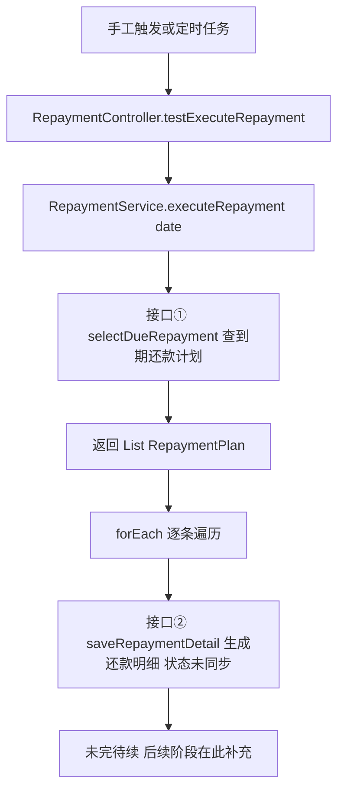

# 用户还款的业务触发入口：用一个 executeRepayment 把第一阶段串起来

查询到期还款计划与生成还款明细两个接口已经各自就位，但它们还只是两个孤立的方法。看一眼用户还款的方案图就会发现，还款服务在这条业务链里要多次主动出手：请求存管代理服务、发送确认还款的消息、再请求存管代理服务做还款确认。这些动作必须按固定顺序推进，谁成功才轮到谁，中间缺一个把它们串起来的总调度。这一课就补上这个调度点，也就是业务触发入口。

## 先给结论

- 还款服务在用户还款业务里是多次主动操作的发起方，需要一个入口按 1.1 到 1.2、再到 1.3、2.1、2.3 的顺序编排这些操作，入口落在业务层一个名为 `executeRepayment` 的方法上。
- 触发方式分两步走：最终由定时任务驱动，目前定时任务尚未实现，先在 Controller 里定义一个测试方法，手工发请求触发，方便边开发边验证。
- 入口方法先调用接口① `selectDueRepayment(date)` 拿到到期还款计划集合，再遍历集合逐条调用接口② `saveRepaymentDetail(repaymentPlan)` 生成还款明细。
- 日期参数从 Controller 一路传到 Mapper，格式 `yyyy-MM-dd`，来源是还款计划表的应还时间字段。
- 方法体尾部留了「未完待续」注释，后续每开发完一个接口就回来补一段调用，入口随功能推进逐步生长。

## 为什么还款服务需要一个业务入口

用户还款业务的参与方是三个服务：还款服务、存管代理服务和银行存管系统。其中真正编写业务编排逻辑的只有还款服务，方案图上 1.1 查询到期还款计划、1.2 生成还款明细、1.3 请求存管代理服务做预处理、2.1 发确认还款事务消息、2.3 请求存管代理服务确认还款，全部由还款服务按序发起。

把这些步骤编排起来需要一个起点。以前大多数功能的起点是前端：页面发一个请求，后端跟着执行。用户还款与前端无关，讲义里明确写了这条业务由定时任务驱动、到期自动扣款，所以它的起点在概念上应该是定时任务。问题在于定时任务这一课还没学到，工程里暂时没有能跑的任务框架，入口的触发就缺一个替身。

替身就是 Controller 里一个手工触发方法。定时任务将来做的事，本质上是「到点后调用业务层的入口方法」，那么现在由人替定时任务发一个请求、走到同一个业务层方法，链路完全等价，等任务调度落地后只需把触发者换掉，入口代码一行不用改。这也是「开发一点、测试一点」策略的落点：每完成一个阶段，就能立刻从这个入口发请求验证本阶段成果。

## Controller 里的临时触发方法

触发方法定义在还款服务的 `RepaymentController` 中，与讲义保持一致：

```java
/** 还款服务的测试触发入口 包名按 com.study.finance 系改写 */
@ApiOperation("测试用户还款")
@GetMapping("/execute-repayment/{date}")
public void testExecuteRepayment(@PathVariable String date) {
    repaymentService.executeRepayment(date);
}
```

方法没有返回值，因为它是替定时任务发请求的占位，不是给前端用的接口。参数 `date` 通过路径变量传入，这个参数不是凭空出现的：接口①的功能就是「根据日期查询所有到期的还款计划」，到期与否的比较对象就是应还时间，所以入口必须携带日期，格式为 `yyyy-MM-dd`。Controller 只做转发，真正的编排全部下沉到业务层，将来定时任务直接调用业务层即可跳过这层 HTTP 壳。

## 业务层的总入口 executeRepayment

业务层接口里新增入口方法，命名与讲义一致：

```java
/** 执行还款 */
void executeRepayment(String date);
```

实现类里完成第一阶段的编排。先调接口①，再用 Lambda 遍历调用接口②：

```java
@Override
public void executeRepayment(String date) {
    // 查询所有到期的还款计划
    List<RepaymentPlan> repaymentPlanList = selectDueRepayment(date);
    repaymentPlanList.forEach(repaymentPlan -> {
        // 生成还款明细（未同步）
        RepaymentDetail repaymentDetail = saveRepaymentDetail(repaymentPlan);
        // 未完待续...
    });
}
```

这段代码里有两个值得咀嚼的细节。**其一，循环的粒度。**每一条到期还款计划对应一条还款明细，集合里有 10 条计划就生成 10 条明细，所以遍历对象是计划集合、循环体里调的是生成明细方法，一一对应的关系直接体现在循环结构上。**其二，「未完待续」注释是刻意的。**入口方法是全业务的编排骨架，接口③到接口⑥的调用将来都要加进这个循环体或循环体之后的判断里，现在只接到接口②，注释占住位置，提醒每完成一个新接口就回来补调用，避免入口与功能开发脱节。

这张图把入口到两个接口的调用关系串起来：



关键路径在循环体：接口①的输出直接是接口②的输入，还款计划查出来多少条，明细就生成多少条，两个接口在入口方法里完成串联。

## 查询到期计划的 SQL 底座

入口能跑起来依赖接口①的查询逻辑，它落在 `PlanMapper` 上，用注解 SQL 直接写在接口方法上方：

```java
/** 查询所有到期的还款计划 */
@Select("SELECT * FROM repayment_plan "
        + "WHERE DATE_FORMAT(SHOULD_REPAYMENT_DATE,'%Y-%m-%d')=#{date} "
        + "AND REPAYMENT_STATUS='0'")
List<RepaymentPlan> selectDueRepayment(String date);
```

SQL 的两个条件对应业务语义。`DATE_FORMAT(SHOULD_REPAYMENT_DATE,'%Y-%m-%d')=#{date}` 把应还时间格式化到天再比较，应还时间落库带时分秒，直接等值比较会漏掉当天的记录；`REPAYMENT_STATUS='0'` 限定状态为待还款，已还款的计划不允许被再次拉出来重复处理。业务层实现方法只是把调用转发给 Mapper，按第 5 章讲义的写法，查询入口收敛在 `RepaymentServiceImpl.selectDueRepayment` 里。

## 常见误区

- **把入口当成给前端用的接口。**错例：给 `testExecuteRepayment` 加返回值、接鉴权，按页面接口的标准打磨。正解：它是定时任务落地前的手工替身，用户还款与前端无关，入口的正式触发者是定时任务。
- **在 Controller 里编排业务。**错例：把查询、生成明细的调用全写在 Controller 方法里。正解：Controller 只转发，编排逻辑进业务层，定时任务将来直接调业务层方法，不需要绕道 HTTP。
- **忘记循环调用的对应关系。**错例：只对集合第一条计划生成明细。正解：计划与明细一期对一条，必须遍历集合逐条生成。
- **删掉「未完待续」注释。**错例：功能跑通后清理注释。正解：这个注释是编排骨架的施工标记，后续接口的调用点都挂在这里，提前删掉容易漏接。

## 面试可能被问到的问题

1. 面试官追问：「用户还款业务与前端无关，为什么还要在 Controller 里加方法？」
   答：定时任务尚未引入，需要手工触发点支撑分阶段测试。Controller 方法只是临时替身，业务编排全部在业务层入口方法里，定时任务落地后直接调用业务层，Controller 方法可以随时摘除。
2. 面试官追问：「入口方法为什么接收日期参数？」
   答：第一阶段的核心查询按日期筛选到期还款计划，应还时间与传入日期格式化到天后相等且状态为待还款的计划才会被处理。日期是这条链路第一个接口的必要输入，所以入口必须携带。
3. 面试官追问：「为什么入口方法放在业务层而不是 Controller？」
   答：入口的本质是业务编排，Controller 是传输层适配。放在业务层可以让定时任务与手工测试共用同一份编排逻辑，事务注解、依赖注入也都在业务层生效，职责边界清晰。
4. 面试官追问：「查询 SQL 为什么要对日期做 DATE_FORMAT？」
   答：`SHOULD_REPAYMENT_DATE` 落库值包含时分秒，与形如 `2019-11-11` 的参数直接等值比较永远匹配不上。格式化到天之后按天比较，才能覆盖当天到期的所有计划。
5. 面试官追问：「每期还款计划都会生成一条还款明细吗？」
   答：是。到期查询结果里的每条计划在循环体里各生成一条状态为未同步的明细，且生成前先按还款计划 ID 查重，已有明细的计划不会重复生成，保证入口被多次触发时数据依然幂等。

## 配套资料

- 讲义：`materials/docs/10/万信金融-第5章-用户还款v1.0.md`，3.1 接口定义、3.2 功能实现（接口①与接口②的 Mapper SQL 与业务层代码）、3.2.3 业务触发入口（Controller 测试方法与 `executeRepayment` 实现）。
- 代码：`materials/code/10/wanxinp2p/`，课程资料包内的工程源码归档目录（内含原始工程命名，与正文改写后的命名并非一一对应）；还款服务模块源码不在资料包内，文中代码为按讲义与课堂画面补全的示例，包名按 `com.study.finance` 系改写。
