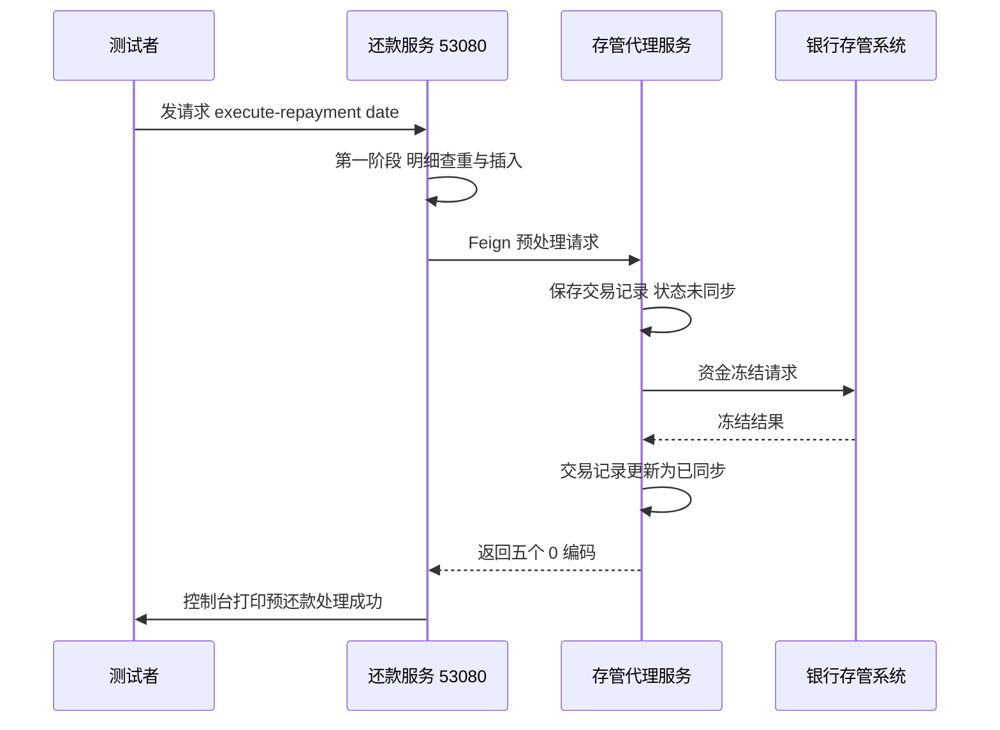

# 第二阶段功能测试：从本地断言到跨三方核对存管交易记录

第二阶段的代码与入口都已就位，测试随之升级。第一阶段只验证本地两张表，这次要验证的是一条跨还款服务、存管代理服务、银行存管系统三方的链路：借款人本期应还金额在银行存管账户里被冻结，存管代理服务留下一笔从未同步推进到已同步的交易记录。观察点的分布也随之变化，本地控制台看结果打印，存管代理侧看交易记录的落库与状态推进。

## 先给结论

- 测试环境要启动三个参与方：还款服务（53080）、存管代理服务、银行存管系统，比第一阶段多了两个。
- 触发方式不变：仍从还款服务的测试入口发请求 `localhost:53080/repayment/execute-repayment/2019-11-11`，入口依次执行第一阶段与第二阶段代码。
- 为观察预处理布尔结果，临时在成功分支加一条控制台打印，看到「预还款处理成功」即证明存管代理返回了五个 0 编码。
- 存管代理服务侧的核对点：控制台出现保存交易记录的插入与状态更新的更新语句；交易记录表新增一条请求类型为还款的记录，报文含签名，最终状态为已同步。
- 服务启动阶段偶发配置中心连接报错，属于启动时序问题，重启后正常，不影响功能验证。

## 测试环境：三个服务一起起

第一阶段测试只需要还款服务，这次不行了。`preRepayment` 通过 Feign 请求存管代理服务，存管代理服务再向银行存管系统发起资金冻结，链路上每一环都要在线。启动清单由此变成三项：还款服务、存管代理服务、银行存管系统，其中银行存管系统是现成的部署包，无需开发，直接运行。

启动过程有一个插曲值得记录：还款服务启动时控制台出现过配置同步失败的报错，提示无法获取配置中心元数据地址。原因是本机各基础设施的启动顺序没有排好，服务抢在配置中心就绪之前开始拉取配置。重启服务后报错消失，Bean 初始化、注册中心注册、动态配置加载全部正常。这类启动时序问题在联调期高发，特征是重启即愈，遇到时先查基础设施是否全部在线，再怀疑代码。

## 观察点的准备：临时打印布尔结果

预处理成功与否在还款服务的返回值里，但当前入口代码拿到 `preRepaymentResult` 后只做分支判断，分支体空着，控制台上看不出成败。测试阶段加一行临时打印最直接：

```java
if (preRepaymentResult) {
    // 临时观察点 测试通过后可移除
    System.out.println("预还款处理成功");
    // 未完待续......
}
```

打印放在成功分支内，只有存管代理返回五个 0 编码时才会出现。判断依据很简单：`preRepayment` 的返回值就是 `RETURN_CODE_00000.getCode()` 与响应结果的比较结果，比较为真打印才执行，控制台打出这行字等于存管链路整体成功的直接证据。加完打印重启还款服务，然后从入口发请求。

## 执行与核对：两条线索一起看

请求发出后，浏览器依然是空白页，观察全部转移到了日志与数据库。这条链路在两处留下了可核对的数据，一起看才能确认全链路成功：

**其一，还款服务控制台。**先出现第一阶段的两条语句（明细查重与插入），随后打印「预还款处理成功」。这行打印出现，说明 Feign 请求已往返、存管代理已返回成功编码。

**其二，存管代理服务一侧。**控制台应出现交易记录的插入语句与状态更新语句，对应方案图 1.5 保存未同步交易记录与 1.9 更新为已同步。打开交易记录表 `depository_record`，核对三列：请求类型为还款（与预处理请求里传的业务类型编码一致）；请求报文列里是发往银行存管系统的业务数据，含签名信息；状态列最终为已同步。

```sql
-- 核对存管代理侧交易记录 请求类型与最终状态是两个关键列
SELECT ID, REQUEST_NO, REQUEST_TYPE, DATA, CREATE_DATE, REQUEST_STATUS
FROM depository_record
WHERE REQUEST_TYPE = 'repayment'
ORDER BY CREATE_DATE DESC;
```

签名由存管代理服务按密钥生成后拼入报文，正文以 `example-*` 占位表示，密钥本体只存在于存管代理的配置中。

这张时序图把一次请求在三方之间的流转与各自的验证点对应起来：



核对的闭环在最后两段：存管代理把交易记录推进到已同步之后才返回成功编码，还款服务打印的「预还款处理成功」与交易记录表里的已同步状态互为印证，两处都对上，1.3 到 1.10 这条链才算整体测试通过。

## 常见误区

- **沿用第一阶段环境直接测。**错例：只启动还款服务就发请求。正解：预处理要跨三个参与方，缺存管代理服务或银行存管系统，Feign 调用会因服务不可达直接失败。
- **只看还款服务控制台就下结论。**错例：看到「预还款处理成功」就收工。正解：布尔结果只证明存管代理返回了成功编码，交易记录是否从未同步推进到已同步，要到存管侧的表里核对才算完整。
- **临时打印忘了清理计划。**错例：观察点打印永久留在分支里。正解：`System.out.println` 属于临时观测手段，第三阶段接入后应替换为日志框架输出或直接删除。
- **把启动报错当成代码缺陷。**错例：看到配置同步失败就开始排查业务代码。正解：先确认配置中心与注册中心是否先于业务服务就绪，重启即愈的报错通常是启动时序问题。

## 面试可能被问到的问题

1. 面试官追问：「为什么第二阶段的验证点要分布到两个服务？」
   答：第二阶段的事实分散在三方：冻结结果在银行存管系统，交易记录与状态推进在存管代理服务，布尔结果在还款服务。任何单点观察都只覆盖链路的一段，跨服务核对才能确认资金冻结与留痕同时成立。
2. 面试官追问：「交易记录的状态推进有什么用？」
   答：未同步表示请求已受理但银行结果未确认，已同步表示结果已落定。状态列是存管侧对账与失败排查的事实依据，银行调用失败时记录停在未同步，可据此重试或人工介入。
3. 面试官追问：「测试为什么在成功分支里打印而不是打日志？」
   答：临时观察追求改动最小、输出最显眼，一条打印即可。生产代码应使用日志框架替代，控制级别与输出位置，测试结束后清理。
4. 面试官追问：「预处理请求报文里的签名是干什么用的？」
   答：银行存管系统以签名验证请求来源合法性与报文完整性，签名由存管代理服务按约定密钥对业务数据计算生成。签名密钥属于敏感配置，不入代码库，报文中只呈现计算结果。
5. 面试官追问：「启动时配置拉取失败的报错如何定位？」
   答：看报错发生阶段与重启后是否复现。发生在 Bean 初始化前的配置加载阶段、重启基础设施后即愈，属于启动时序问题；若重启仍失败，才需要检查配置中心地址配置与网络连通性。

## 配套资料

- 讲义：`materials/docs/10/万信金融-第5章-用户还款v1.0.md`，4.3 第二阶段功能测试（需启动还款服务、存管代理服务与银行存管系统，通过入口请求触发并核对存管侧交易记录）。
- 代码：`materials/code/10/wanxinp2p/`，课程资料包内的工程源码归档目录（内含原始工程命名，与正文改写后的命名并非一一对应）；还款服务与存管代理服务模块源码不在资料包内，文中代码为按讲义与课堂画面补全的示例，包名按 `com.study.finance` 系改写。
