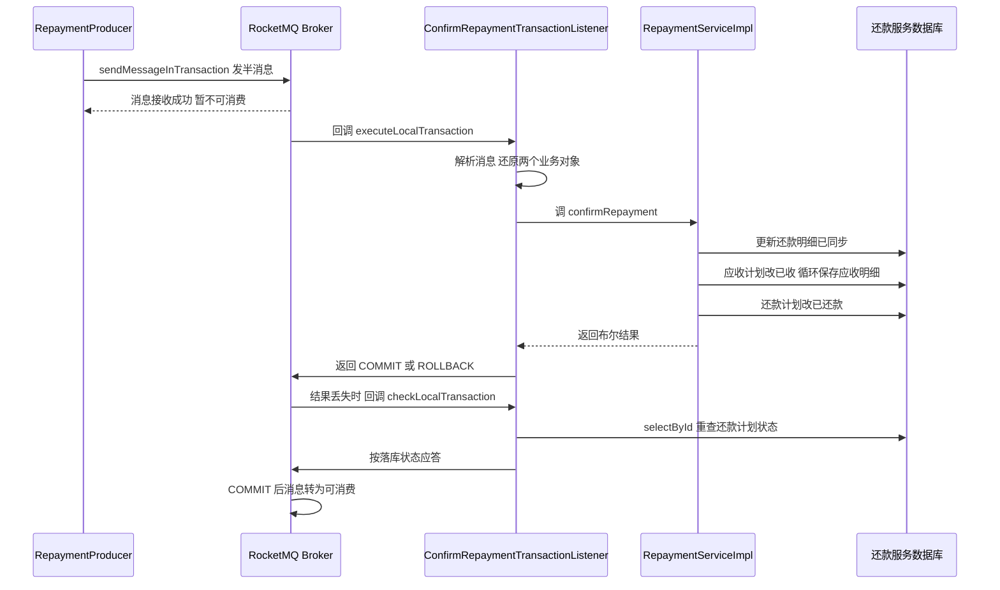

# 还款第三阶段实现：事务消息发送、本地事务与事务监听器一次打通

第三阶段的业务分析已经把账算清：本地三处状态更新与银行扣款划转必须同生共死，解法是 RocketMQ 事务消息。分析归分析，代码得一步步落下来。这一课把第三阶段的四个编码环节串成一条线：还款服务先在 `message` 包里建好消息生产者，把还款计划与还款请求打包成半消息发出去；随后编写本地事务方法，完成三处状态更新与一处明细保存；再用事务监听器接住 Broker 的回调执行本地事务、应答回查。四个环节写完，方案图上 2.1、2.2 与第 4 步全部有代码可依，只剩消息的消费留给第四阶段。

## 先给结论

- 消息生产者 `RepaymentProducer` 专管发送：`RepaymentPlan` 与 `RepaymentRequest` 两个对象打包进 JSON，用 `rocketMQTemplate.sendMessageInTransaction` 发出事务消息，生产者组 `PID_CONFIRM_REPAYMENT`、目的地 `TP_CONFIRM_REPAYMENT`。
- 本地事务落在业务层 `confirmRepayment` 方法里，一共四个数据库操作：更新还款明细为已同步、更新应收计划为已收、循环保存投资人应收明细、更新还款计划为已还款，方法标 `@Transactional` 并指定回滚异常。
- 应收明细 `receivable_detail` 表此前从没被操作过，这一步要新建 `ReceivableDetailMapper` 接口与映射文件，继承 MyBatis-Plus 的 `BaseMapper` 即可。
- 事务监听器 `ConfirmRepaymentTransactionListener` 实现两个回调：`executeLocalTransaction` 三步走解析消息、执行本地事务、按布尔结果返回 commit 或 rollback；`checkLocalTransaction` 重查还款计划状态给回查答案。
- 回查的依据就是落库状态：还款计划的还款状态已经是 1 即本地事务成功，无需另建事务日志表。

## 消息生产者：两个业务对象打包进一条消息

发送侧的骨架与满标放款的生产者同构，模板已在交易中心验证过一遍，这次只换业务对象与目的地。在还款服务的 `message` 包下新建 `RepaymentProducer`，类上标 `@Component` 交给容器管理，方法名与讲义保持一致：

```java
/** 确认还款事务消息生产者 包名按 com.study.finance 系改写 */
@Component
public class RepaymentProducer {

    @Resource
    private RocketMQTemplate rocketMQTemplate;

    public void confirmRepayment(RepaymentPlan repaymentPlan, RepaymentRequest repaymentRequest) {
        // 1 构造消息 两个业务对象打包进 JSON
        JSONObject jsonObject = new JSONObject();
        jsonObject.put("repaymentPlan", repaymentPlan);
        jsonObject.put("repaymentRequest", repaymentRequest);
        Message<String> msg = MessageBuilder
                .withPayload(jsonObject.toJSONString())
                .build();
        // 2 发送事务消息 半消息确认后由事务监听器接管
        rocketMQTemplate.sendMessageInTransaction(
                "PID_CONFIRM_REPAYMENT", "TP_CONFIRM_REPAYMENT", msg, null);
    }
}
```

方法体固定两步。**构造消息**：先建一个 `JSONObject`，把还款计划与还款请求两个参数按固定键名放进去，转成 JSON 串后再由 `MessageBuilder.withPayload` 封装成 Spring Messaging 的 `Message` 对象，泛型是 `String`，因为消息最终以字符串形态传输。**发送消息**：调用 `sendMessageInTransaction`，四个参数里第一个是生产者组名 `PID_CONFIRM_REPAYMENT`，第二个是目的地 `TP_CONFIRM_REPAYMENT`，第三个是消息本体，第四个透传参数本例用不上传 `null`。组名与目的地都是两端约定值，讲义里写死的字符串照抄即可，消费侧与回查路由都靠它们对齐。

发送方法的两个参数不是随手挑的。`RepaymentPlan` 是还款计划，本地事务更新还款计划状态、回查重查状态全靠它；`RepaymentRequest` 是还款信息请求，将来消费侧走确认还款链路时要把它原样转交给存管代理服务。这个类在 API 工程的 `api.depository.model` 包下，与放款明细 `RepaymentDetailRequest` 成对出现：

```java
/** 还款信息请求 银行存管系统需要什么就封装什么 */
@ApiModel(value = "还款请求信息")
public class RepaymentRequest {
    @ApiModelProperty("请求流水号")
    private String requestNo;
    @ApiModelProperty("预处理业务流水号")
    private String preRequestNo;
    @ApiModelProperty("标的编码")
    private String projectNo;
    @ApiModelProperty("平台佣金")
    private BigDecimal commission;
    @ApiModelProperty("放款明细")
    private List<RepaymentDetailRequest> details;
    @ApiModelProperty("业务id")
    private Long id;
    @ApiModelProperty("还款金额")
    private BigDecimal amount;
}

/** 还款明细请求 每一位投资人一条 */
@ApiModel(value = "RepaymentDetailRequest", description = "还款明细请求信息")
public class RepaymentDetailRequest {
    @ApiModelProperty("投资人用户编码")
    private String userNo;
    @ApiModelProperty("向投资人收取的佣金")
    private BigDecimal commission;
    @ApiModelProperty("投资人应得本金")
    private BigDecimal amount;
    @ApiModelProperty("投资人应得利息")
    private BigDecimal interest;
}
```

字段清单的取舍逻辑一句话概括：银行存管系统要什么就封装什么。请求流水号、预处理业务流水号、标的编码、平台佣金是整笔还款的凭据；`details` 集合按投资人逐条展开，投资人用户编码、应得本金、应得利息、向投资人收取的佣金，每一项都是银行侧逐笔划转与记账的依据。这些数据从封装那一刻起就跟着消息走，中途不再回库补查。

发送类单独建而不是把发送逻辑内联进业务方法，除了沿用满标放款的模板惯性，还有两个工程上的理由。**其一，协议收口。**消息体的打包结构、键名约定、目的地命名，这些属于「还款服务对内的消息协议」，集中在生产者类里维护，将来字段增减或目的地拆分只改一处，业务触发入口感知不到协议细节。**其二，与满标放款生产者平行。**还款服务此刻只发一种事务消息，但满标放款链路已经证明消息协议会随业务扩张，独立的生产者类让每一种消息有自己的类与方法，避免若干个月后在一个类里堆出十几个语义混杂的发送方法。方法名 `confirmRepayment` 与它承载的业务动作同名，见名即知这条消息驱动的是什么业务。

## 本地事务：三处更新与一处保存

生产者发完半消息，Broker 会回调还款服务执行本地事务。这段逻辑写在业务层 `RepaymentService` 接口上，方法签名与讲义一致，返回布尔值表达成败：

```java
/**
 * 确认还款处理
 * @param repaymentPlan 还款计划
 * @param repaymentRequest 还款信息
 * @return 处理结果
 */
Boolean confirmRepayment(RepaymentPlan repaymentPlan, RepaymentRequest repaymentRequest);
```

实现类里把这次要做的数据库操作列全，实际上是四个而不是三个。更新还款明细为已同步是一步；更新应收计划为已收是一步，这一步要先按还款计划标识把相关应收计划查出来再逐条改；保存数据到应收明细表 `receivable_detail` 是独立的一步，这张表在满标放款阶段只往 `receivable_plan` 里写过应收计划，真正的应收明细表一直空着，现在借款人实际还款了，投资人一侧就要产生「这笔钱收到了」的明细记录；更新还款计划为已还款是最后一步。

两个「应收」表的区别值得说透。`receivable_plan` 是应收计划，记录的是投资人「应当」收回的钱：满标放款时按等额本息逐期算出来的每期利息、本金、应收到账日，它在放款成功那天就全部落库，状态一直是未收。`receivable_detail` 是应收明细，记录的是投资人「实际」收回的钱：借款人哪一期真的还了、到账多少、什么时间到账。计划是预测，明细是事实，还款动作落地的那一刻，事实才第一次产生。业务分析阶段说的「三处状态更新」是粗粒度概括，落到数据访问层就是这四个操作，理解了这个口径，后面写 SQL 与对账逻辑时不会混乱。

四个操作必须包在同一个本地事务里，任何一个失败整体回滚，方法上标事务注解并指定回滚异常：

```java
/** 确认还款处理 本地事务 包名按 com.study.finance 系改写 */
@Override
@Transactional(rollbackFor = BusinessException.class)
public Boolean confirmRepayment(RepaymentPlan repaymentPlan, RepaymentRequest repaymentRequest) {
    // 1 更新还款明细状态为 已同步
    String preRequestNo = repaymentRequest.getPreRequestNo();
    repaymentDetailMapper.update(null, Wrappers.<RepaymentDetail>lambdaUpdate()
            .set(RepaymentDetail::getStatus, StatusCode.STATUS_IN.getCode())
            .eq(RepaymentDetail::getRequestNo, preRequestNo));
    // 2 根据还款计划id查询应收计划 状态改为已收
    List<ReceivablePlan> receivablePlanList = receivablePlanMapper.selectList(
            Wrappers.<ReceivablePlan>lambdaQuery()
                    .eq(ReceivablePlan::getRepaymentPlanId, repaymentPlan.getId()));
    for (ReceivablePlan receivablePlan : receivablePlanList) {
        receivablePlan.setReceivableStatus(1);
        receivablePlanMapper.updateById(receivablePlan);
        // 3 保存投资人应收明细 一条应收计划对应一条明细
        ReceivableDetail receivableDetail = new ReceivableDetail();
        // 应收计划标识 两个表一对一关联
        receivableDetail.setReceivableId(receivablePlan.getId());
        // 实收金额 本息合计从应收计划里取
        receivableDetail.setAmount(receivablePlan.getAmount());
        // 实收时间 当前时间
        receivableDetail.setReceivableDate(DateUtil.now());
        receivableDetailMapper.insert(receivableDetail);
    }
    // 4 更新还款计划状态为 已还款
    repaymentPlan.setRepaymentStatus("1");
    int rows = planMapper.updateById(repaymentPlan);
    // 受影响行数大于 0 即更新成功
    return rows > 0;
}
```

四段代码各有值得停留的细节。**第一，更新还款明细的更新条件用预处理业务流水号。**还款明细在预处理阶段生成时记录了 `preRequestNo`，它能把本次还款对应的明细唯一圈出来；条件构造器用 `lambdaUpdate` 先 `set` 状态再 `eq` 条件，少了哪个条件这张表里所有明细都会被改掉。状态值取自状态编码枚举 `StatusCode.STATUS_IN`，对应已同步，不手写字符串。**第二，应收计划要先查后改。**`receivable_plan` 表里躺着全部投资人全部标的的应收数据，满标放款时五个投资人十二期就落过六十条，本次还款只与当前还款计划的标识相关，用 `ReceivablePlan::getRepaymentPlanId` 等值查询圈定范围，查出来的集合在循环里逐条把应收状态改成 1，即已收。**第三，应收明细的保存放在循环里。**一条应收计划对应一条应收明细，几个计划就存几条明细，循环体里新建 `ReceivableDetail` 对象，应收计划标识、实收金额取自当前计划，实收时间取当前时间，随即 `insert` 落库。**第四，方法返回值以受影响行数为准。**最后一次 `updateById` 的返回行数大于 0 才算成功，这个布尔值向上交给监听器，直接决定消息 commit 还是 rollback。

应收明细表的 Mapper 之前不存在，因为这张表从未被操作过。按 MyBatis-Plus 的标准做法补齐：接口继承 `BaseMapper`，映射文件照接口名新建一份：

```java
/** 应收明细 Mapper 包名按 com.study.finance 系改写 */
public interface ReceivableDetailMapper extends BaseMapper<ReceivableDetail> {

}
```

接口与 `ReceivableDetailMapper.xml` 建好、在业务实现类里注入之后，保存动作才有落点。这类只做单表 CRUD 的 Mapper 是 MyBatis-Plus 提供的红利，继承即用，连 XML 里都不用写 SQL，映射文件存在的意义只剩工程约定上的完整性。

## 事务监听器：执行本地事务与应答事务回查

本地事务只是「备好了」，谁去调用它？答案在监听器里。回顾链路：还款服务发半消息，RocketMQ 回复接收成功；Broker 回调监听器执行本地事务，监听器调业务层方法并返回结果；结果没送达时 Broker 定时回查。这些动作都收在 `message` 包下的 `ConfirmRepaymentTransactionListener` 里，类上两个注解，`@Component` 注册组件，`@RocketMQTransactionListener` 声明它是生产者组 `PID_CONFIRM_REPAYMENT` 这组事务的裁决者，组名与发送侧逐字一致：

```java
/** 确认还款事务监听器 包名按 com.study.finance 系改写 */
@Slf4j
@Component
@RocketMQTransactionListener(txProducerGroup = "PID_CONFIRM_REPAYMENT")
public class ConfirmRepaymentTransactionListener implements RocketMQLocalTransactionListener {

    @Autowired
    private RepaymentService repaymentService;
    @Autowired
    private PlanMapper planMapper;

    /** 收到消息后执行本地事务 */
    @Override
    public RocketMQLocalTransactionState executeLocalTransaction(Message msg, Object arg) {
        // 1 解析消息 取出两个业务对象
        final JSONObject jsonObject =
                JSON.parseObject(new String((byte[]) msg.getPayload()));
        RepaymentPlan repaymentPlan = JSON.parseObject(
                jsonObject.getString("repaymentPlan"), RepaymentPlan.class);
        RepaymentRequest repaymentRequest = JSON.parseObject(
                jsonObject.getString("repaymentRequest"), RepaymentRequest.class);
        // 2 执行本地事务 三处更新一处保存
        Boolean result = repaymentService.confirmRepayment(repaymentPlan, repaymentRequest);
        // 3 返回结果 成败直接映射消息状态
        if (result) {
            return RocketMQLocalTransactionState.COMMIT;
        } else {
            return RocketMQLocalTransactionState.ROLLBACK;
        }
    }

    /** 进行事务状态回查 Broker 未收到执行结果时定时回调 */
    @Override
    public RocketMQLocalTransactionState checkLocalTransaction(Message msg) {
        // 1 解析消息 回查只需要还款计划
        JSONObject jsonObject =
                JSON.parseObject(new String((byte[]) msg.getPayload()));
        RepaymentPlan repaymentPlan = JSON.parseObject(
                jsonObject.getString("repaymentPlan"), RepaymentPlan.class);
        // 2 重查还款计划最新状态
        RepaymentPlan newRepaymentPlan = planMapper.selectById(repaymentPlan.getId());
        // 3 状态已是已还款证明本地事务执行成功
        if (newRepaymentPlan != null
                && newRepaymentPlan.getRepaymentStatus().equals("1")) {
            return RocketMQLocalTransactionState.COMMIT;
        } else {
            return RocketMQLocalTransactionState.ROLLBACK;
        }
    }
}
```

`executeLocalTransaction` 是经典三步。**解析消息**：负载是发送侧打包的 JSON 字符串，先以字节数组取出再转字符串交给 `JSON.parseObject`，随后按 `repaymentPlan` 与 `repaymentRequest` 两个键分别反序列化成业务对象，键名与发送侧 `put` 时的字符串必须一致；反序列化目标类型用 `xxx.class` 告诉解析器。**执行本地事务**：调业务层的 `confirmRepayment`，两个参数正好是刚解析出来的对象，发送侧设计消息体时就是按这个调用场景配对的。**返回结果**：布尔值真返回 `COMMIT`，假返回 `ROLLBACK`，Broker 按返回值决定消息转为可消费还是直接删除。

`checkLocalTransaction` 处理发送方失联的局面。本地事务执行完、执行结果在回传 Broker 的路上丢了（服务宕机、网络闪断都可能），Broker 等待一段时间后会主动回查。回答的依据还是那句话：本地事务的成败写在落库数据里。按消息里的还款计划标识 `selectById` 重查一次，严谨起见先判空再判状态，还款状态等于 1 即证明那次事务成功，返回 commit；查不到记录或状态未变，返回 rollback。三个更新一个保存是原子整体，挑任意一张表的状态做判断都等价，挑还款计划是因为它的标识就在消息体里、查询成本最低。回查不需要事务日志表，状态字段天然就是事实源。

组名一致性的原理与满标放款那一课完全相同：`sendMessageInTransaction` 以组名发起事务，`@RocketMQTransactionListener` 以组名认领裁决权，Broker 的回查请求按组名路由。两处名字对不上，回查找不到裁决者，半消息会一直悬着。

监听器里还有一个隐含的失败分支值得推演：业务层方法没有返回布尔假，而是中途抛出了异常。`executeLocalTransaction` 里没有捕获异常，异常会沿着回调栈向上抛给 RocketMQ 客户端，客户端无法向 Broker 报出确定结果，这条消息会被标记为未知状态，等待期过后进入回查流程。也就是说，异常路径与返回 rollback 的路径殊途同归：本地事务回滚、落库状态未变、回查时查到旧状态、返回 rollback、消息删除。**只要本地事务方法带完整的事务注解，异常抛不抛都不会造成半成功状态**，这正是把三处更新与一处保存收进同一个 `@Transactional` 方法的价值，监听器不需要为异常写任何补偿代码。

消费侧到此还没有实现，但发送、事务、回查这一段已经自洽。联调时可以从还款服务的测试入口触发到第三阶段为止的链路，观察 RocketMQ 控制台里这条消息的状态：停在 Prepared 说明监听器没被回调或返回了未知，变成已提交说明本地事务成功且消息可消费，直接消失说明走了 rollback 分支。控制台里的状态变化与数据库里四张表的状态推进互相印证，第三阶段的正确性不需要等第四阶段写完就能验证。

## 链路串起来看

这张时序图把第三阶段从发送到回查的完整代码路径串起来，每一跳都对应上文的一段代码：



关键路径在中间的往返：发送方法发出半消息后立即返回，真正的状态变更发生在 Broker 回调监听器之后，业务触发入口与本地事务在时间上解耦、在机制上由组名与回查协议绑定。commit 之后消息进入可消费状态，谁来消费、消费之后怎么走 2.3 到 2.9 的确认还款链路，是第四阶段的任务。

## 常见误区

- **把本地事务写进发送方法里。**错例：在 `confirmRepayment` 生产者方法里先改状态再发消息。正解：本地事务必须在监听器的 `executeLocalTransaction` 中由 Broker 回调触发，半消息先行落库，消息存续与本地事务才绑成一体。
- **更新还款明细不写条件。**错例：`lambdaUpdate` 只 `set` 状态不加 `eq` 条件，整表明细全被改成已同步。正解：用预处理业务流水号圈定本次还款的明细，条件构造器的 `set` 与 `eq` 缺一不可。
- **应收明细的保存放进循环外。**错例：循环里改完应收计划状态，循环外只插一条明细。正解：应收计划与应收明细一对一，几个计划就对应几条明细，保存必须留在循环体内与当前计划配对。
- **回查方法里凭日志或内存判断。**错例：回查时打个日志直接返回 commit。正解：接住回查的可能是另一台实例，唯一可信的事实源是数据库，重查还款计划状态是唯一正确姿势。
- **监听器组名与发送侧各写各的。**错例：注解上随手另起一个组名。正解：`txProducerGroup` 是 Broker 路由事务结果的钥匙，与 `sendMessageInTransaction` 的第一个参数逐字一致，否则回查无门。

## 面试可能被问到的问题

1. 面试官追问：「生产者的 `sendMessageInTransaction` 四个参数分别是什么？」
   答：第一个是生产者组名，绑定裁决该组事务的监听器；第二个是目的地，`topic:tag` 形式，与消费侧监听的 topic 逐字一致；第三个是消息本体，这里是打包好的 JSON 字符串；第四个是透传参数，不需要时传 null。
2. 面试官追问：「本地事务里为什么要先查应收计划再逐条更新，直接按条件批量更新不行吗？」
   答：批量更新只能改状态，循环查出来逐条处理能把每条应收计划的标识、金额顺手带出来，同一次循环里保存对应的应收明细。一条计划对应一条明细的写入与状态推进在同一循环里完成，逻辑上配对、事务上同生共死。
3. 面试官追问：「事务回查为什么查还款计划就够了？」
   答：三处更新与一处保存是同一个本地事务，要么全成功要么全回滚，任何一张表的状态都能代表事务结局。还款计划的标识随消息携带，按主键重查成本最低，状态等于已还款即 commit，否则 rollback，答案始终与落库一致。
4. 面试官追问：「`executeLocalTransaction` 返回 ROLLBACK 后本地数据是什么状态？」
   答：业务方法标了 `@Transactional` 并指定回滚异常，返回布尔假之前事务已经回滚，四步数据库操作一个都不生效；Broker 随即删除半消息，消费端永远收不到。两侧要么都动、要么都不动，不会出现单边成功的中间态。
5. 面试官追问：「消息体里为什么同时携带还款计划与还款请求两个对象？」
   答：本地事务要用还款计划做状态更新与回查凭据，消费侧的确认还款链路要用还款请求向存管代理服务转交银行需要的全部数据。两类输入在发送侧一次性打包，消费侧按键还原，中途不需要回库补查，也保证了整条链路基于同一份事实。

## 配套资料

- 讲义：`materials/docs/10/万信金融-第5章-用户还款v1.0.md`，5.1 确认还款事务消息生产接口（接口④）的 `RepaymentProducer` 代码，5.2 确认还款处理接口（接口⑤）中 `confirmRepayment` 的接口定义、`ReceivableDetailMapper` 的搭建与本地事务实现，5.3 确认还款事务消息监听类的 `ConfirmRepaymentTransactionListener` 代码。
- 代码：`materials/code/10/wanxinp2p/`，课程资料包内的工程源码归档目录（内含原始工程命名，与正文改写后的命名并非一一对应）；还款服务模块源码不在资料包内，文中代码为按讲义与课堂画面补全的示例，包名按 `com.study.finance` 系改写，状态枚举与编码命名与本课口径一致。
