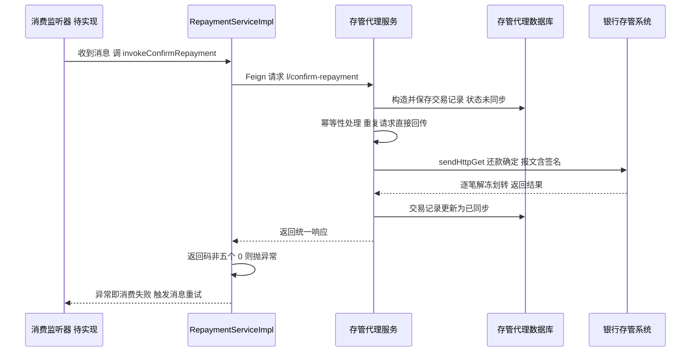

# 还款第四阶段实现：确认还款接口定义与存管链路的固定模板再落地

第三阶段的触发入口补完之后，本应立刻做功能测试，但第三阶段与第四阶段被分布式事务绑在一起：本地状态改完、消息转成可消费，若消费侧没人干活，银行扣款永远不发生，整个业务就停在中间态。两阶段一起测才是完整验证，所以编码顺序是先跳过测试继续开发第四阶段，写完再联合功能测试。第四阶段覆盖方案图 2.3 到 2.9：还款服务通过 Feign 请求存管代理服务，存管代理保存交易记录、向银行存管系统发起还款确定、回传结果。这一课把 2.3 到 2.9 的常规业务处理全部落地，消息接收触发它的那一环留给下一课的监听器。

## 先给结论

- 第四阶段的开发顺序先常规业务、后消息接收：2.3 到 2.9 是从开户以来反复落地的存管交互模板，先把它实现，消息监听器写好后一调即通。
- 存管代理侧新增接口⑦：`DepositoryAgentApi` 定义 `confirmRepayment` 方法，Controller 映射 `/l/confirm-repayment`，`l` 前缀路径只允许微服务互访，网关不转发，前端无法触达。
- 业务层实现五步固定套路：构造交易记录、幂等性处理、按流水号重查交易记录、业务数据转 JSON 再 Base64 编码、通用 `sendHttpGet` 携签名请求银行存管系统，请求类型码是还款。
- 还款服务侧两处改动：`DepositoryAgentApiAgent` 新增 Feign 方法指向 `/depository-agent/l/confirm-repayment`；业务层新增 `invokeConfirmRepayment` 方法封装远程调用与结果判断。
- 结果判断沿用五个 0 编码口径，失败直接抛运行时异常：消费监听器调用这个方法，异常抛出即消费失败，RocketMQ 会重试投递，重试与幂等配合保证确认还款最终成功且不重复执行。

## 接口⑦定义：存管代理的确认还款入口

接口⑦的职责描述两句话：请求银行存管系统进行确认还款，返回结果给还款服务。定义落在存管代理 API 工程的 `DepositoryAgentApi` 接口上，方法名、参数、返回值都与既有接口同构：

```java
/**
 * 还款确认
 * @param repaymentRequest 还款信息
 * @return 处理结果
 */
RestResponse<String> confirmRepayment(RepaymentRequest repaymentRequest);
```

参数类型正是第三阶段消息体里携带的那个 `RepaymentRequest`：还款服务的消息消费后会原样把它转交过来，银行需要的流水号、标的编码、按投资人展开的明细全部在内，中间不需要任何字段翻译。返回值是统一封装的 `RestResponse<String>`，与存管代理的其余接口口径一致。

Controller 实现类补上空实现并完善注解：

```java
/** 存管代理 Controller 接口⑦ 包名按 com.study.finance 系改写 */
@Override
@ApiOperation(value = "确认还款")
@ApiImplicitParam(name = "repaymentRequest", value = "还款信息",
        required = true, dataType = "RepaymentRequest", paramType = "body")
@PostMapping("/l/confirm-repayment")
public RestResponse<String> confirmRepayment(@RequestBody RepaymentRequest repaymentRequest) {
    return getRestResponse(depositoryRecordService.confirmRepayment(repaymentRequest));
}
```

路径上的 `l` 前缀是一条安全约定，值得专门解释。存管代理服务的 Controller 映射分两类：`c` 开头面向消费端用户，`m` 开头面向管理端，两者都经由网关暴露给前端；`l` 开头的路径只服务微服务之间的内部调用，网关的路由规则不覆盖它们，外部请求根本到不了。确认还款只能由还款服务发起，前端如果能看到并请求这个地址，等于把资金划转入口暴露在了公网，`l` 前缀就是这道隔离墙。方法体直接委托业务层并用统一的 `getRestResponse` 包装返回，Controller 保持薄壳。

## 业务层实现：五步固定模板的又一次落地

业务层接口新增 `confirmRepayment` 方法，参数 `RepaymentRequest`，返回值 `DepositoryResponseDTO<DepositoryBaseResponse>`，封装银行侧返回的编码、描述与业务数据。两层返回类型的分工是既有口径：`DepositoryResponseDTO` 面向存管链路内部，装银行侧的原生编码、描述与具体业务数据；`RestResponse` 面向微服务调用方，装平台统一的成功与失败语义。Controller 层用 `getRestResponse` 做两层之间的翻译，调用方永远只面对统一口径，银行侧的私有编码不会外泄到业务服务里。实现方法从开户、发标、投标、放款一路复制过来的模板已经写了四五遍，差异只在业务参数：

```java
/** 存管代理确认还款实现 包名按 com.study.finance 系改写 */
@Override
public DepositoryResponseDTO<DepositoryBaseResponse> confirmRepayment(
        RepaymentRequest repaymentRequest) {
    // 1 构造交易记录 流水号 请求类型 业务对象类型 业务id
    DepositoryRecord depositoryRecord = new DepositoryRecord(
            repaymentRequest.getRequestNo(),
            DepositoryRequestTypeCode.REPAYMENT.getCode(),
            "Repayment", repaymentRequest.getId());
    // 2 幂等性实现 非空说明重复请求已处理过 直接回传结果
    DepositoryResponseDTO<DepositoryBaseResponse> responseDTO =
            handleIdempotent(depositoryRecord);
    if (responseDTO != null) {
        return responseDTO;
    }
    // 3 根据 requestNo 重查交易记录 获得最新数据
    depositoryRecord = getEntityByRequestNo(repaymentRequest.getRequestNo());
    // 4 业务数据转 JSON 再 Base64 编码方便传输
    final String jsonString = JSON.toJSONString(repaymentRequest);
    String reqData = EncryptUtil.encodeUTF8StringBase64(jsonString);
    // 5 拼接银行存管系统请求地址 通用方法发请求
    String url = configService.getDepositoryUrl() + "/service";
    return sendHttpGet("CONFIRM_REPAYMENT", url, reqData, depositoryRecord);
}
```

五步逐一看过去。**构造交易记录**传四个值：请求流水号取自还款请求（第三阶段构造方法里生成的那一个），请求类型码取还款对应的 `REPAYMENT`，业务对象类型写 `"Repayment"`，业务实体 id 是还款计划的标识。这笔交易记录落库时状态为未同步，它是本次银行交互的凭据。**幂等性处理**按三种情况分流：首次请求正常放行返回空，处理中的重复请求被拒绝，处理完成的重复请求直接回传上次结果。确认还款这条链路将来跑在消息重试机制上，重复投递是常态而非事故，幂等方法保证同一个流水号重复执行不会产生第二笔扣款。**重查交易记录**是因为幂等方法落库后内存对象的状态已过时，按流水号从数据库取回最新一份，后续请求银行时要用的数据都从它上面取。**序列化与编码**把业务报文转成便于传输的 Base64 字符串，真正的签名动作封装在通用发送方法里随请求自动完成。**`sendHttpGet`** 传服务名 `CONFIRM_REPAYMENT`，银行存管系统按服务名路由到确认还款的处理器，逐笔解冻冻结资金、划转给投资人，处理结果随响应回来，交易记录同步更新为已同步。

从开户到本课，这套模板只换过请求类型码、业务对象类型与 `serviceName` 三个值。识别出可复用点之后，新增一个存管接口的真实工作量只剩业务参数本身，这也是前面几轮反复写模板攒下的红利。

请求报文与银行侧动作的对应关系也顺一遍。还款请求里的 `details` 集合按投资人逐条展开，每条明细的预处理流水号都能在银行存管侧找到一笔被冻结的资金，银行收到确认还款请求后按明细逐笔解冻、划转给对应投资人，最后把借款人应还的总额从其账户划出。报文少一条明细，就有一位投资人的钱躺在冻结状态无人认领；多一条明细，划转就对不上冻结记录直接报错。流水号体系在这条链路里承担了对账锚点的作用：整笔还款有请求流水号，逐笔划转有预处理流水号，两层凭据在交易记录里都能回溯。

## 还款服务侧：Feign 代理与远程调用方法

存管代理一侧就绪后，切回还款服务。2.3 这一步的发起方是还款服务，需要定义 Feign 代理。在 `repayment` 模块的 `agent` 包下，`DepositoryAgentApiAgent` 接口已有预处理请求用的 `userAutoPreTransaction` 方法，同处再添一个：

```java
/** 还款服务的存管代理 Feign 接口 包名按 com.study.finance 系改写 */
@FeignClient(value = "depository-agent-service")
public interface DepositoryAgentApiAgent {

    @PostMapping("/depository-agent/l/user-auto-pre-transaction")
    RestResponse<String> userAutoPreTransaction(
            @RequestBody UserAutoPreTransactionRequest userAutoPreTransactionRequest);

    @PostMapping("/depository-agent/l/confirm-repayment")
    RestResponse<String> confirmRepayment(@RequestBody RepaymentRequest repaymentRequest);
}
```

路径必须与存管代理 Controller 的映射逐字对齐，包括容易遗漏的服务级前缀 `/depository-agent`。这一层是微服务的上下文路径，Controller 上的 `/l/confirm-repayment` 只是它的后缀，Feign 这边写完整路径，两边合起来请求才能落进方法。漏掉前缀是这类代码最高发的笔误，报错形态是 404，排查时要先对路径再怀疑别的。

Feign 代理解决「怎么调」，业务层还要定义「调完干什么」。`RepaymentService` 接口新增 `invokeConfirmRepayment` 方法，名字里的 invoke 就是调用的意思，讲义明确它将在消费监听器收到消息后被调用：

```java
/**
 * 远程调用确认还款接口
 * @param repaymentPlan 还款计划
 * @param repaymentRequest 还款信息
 */
void invokeConfirmRepayment(RepaymentPlan repaymentPlan, RepaymentRequest repaymentRequest);
```

实现里把 Feign 调用与结果判断装在一起：

```java
/** 远程调用确认还款 包名按 com.study.finance 系改写 */
@Override
public void invokeConfirmRepayment(RepaymentPlan repaymentPlan,
        RepaymentRequest repaymentRequest) {
    // 请求存管代理服务执行确认还款
    RestResponse<String> repaymentResponse =
            depositoryAgentApiAgent.confirmRepayment(repaymentRequest);
    // 返回码不是五个 0 视为业务失败 抛异常触发消息重试
    if (!DepositoryReturnCode.RETURN_CODE_00000.getCode()
            .equals(repaymentResponse.getResult())) {
        throw new RuntimeException("还款失败");
    }
}
```

方法体两行逻辑。调用 Feign 代理，把还款请求发给存管代理服务，请求落在 `/l/confirm-repayment` 上，激活上一节那套五步模板，银行存管系统完成扣款划转后结果原路返回。拿到响应后按五个 0 编码判断，相等说明 2.3 到 2.8 整段链路成功，方法正常返回；不相等说明存管侧任一环节失败，直接抛运行时异常。异常在这里不是事故，是协议的一部分：将来消费监听器调用这个方法，异常抛出即消费失败，RocketMQ 判定消费不成功就会重新投递这条消息，重试循环直到确认还款真正成功为止。还款侧的业务错误码枚举此时尚未封装，先用运行时异常顶上，效果与自定义业务异常一致，后续统一错误码时再替换。

方法签名里那个暂未被方法体使用的 `repaymentPlan` 参数也值得留意。讲义把两个参数都留在签名里，是为消息监听器的调用场景预留的对称性：监听器解析消息会同时还原还款计划与还款请求，两个对象顺手全部传进来，方法内部要用哪个取哪个，签名不用再动。

## 第四阶段链路全景

这张时序图把 2.3 到 2.9 的调用关系与状态推进画全，方法的出口与异常出口都标了出来：



关键路径在两端。请求端，`invokeConfirmRepayment` 是第四阶段被消息驱动的把手，监听器写好后一调即通，本课先把它备好。响应端，异常抛出与消息重试构成闭环：存管侧失败或网络抖动都不再需要人工补偿，重试机制兜底，幂等机制保证重试无害，两个机制合起来就是可靠消息方案在消费侧的兑现方式。

重试策略的边界也交代清楚，避免对重试抱过度期待。RocketMQ 对消费失败的消息按固定间隔重新投递，次数有上限，超过上限的消息进入死信队列，等待人工排查后再补偿。也就是说，这套机制保证的是「最终大概率自动成功」，而不是「无限重试直到成功」；死信队列是它的安全阀。对确认还款这种资金动作而言，死信里的每一条都对应一笔可能没扣到款的还款，监控应当对死信队列设置告警，人工介入时靠交易记录与幂等机制确认当前进度，再决定是重新触发还是人工对账。可靠性设计的完整拼图由此闭合：重试解决瞬时故障，幂等解决重复执行，死信与告警解决极端情况，三层各管一段。

联调层面，本课写完的代码已经可以单独验证一半链路：从第三阶段的触发入口发出消息、本地事务 commit 之后，暂时还没有监听器去消费，RocketMQ 控制台里应能看到这条消息停在可消费状态；此时若手动调用 `invokeConfirmRepayment`（比如临时加个测试入口），整段 2.3 到 2.9 应能独立跑通，交易记录落库、银行扣款、状态回写全部就位。常规链路先独立验证正确，再交给消息驱动，联调时问题域会小很多，这也是「先常规业务后消息接收」这个开发顺序的另一层用意。

## 常见误区

- **Feign 路径漏写服务级前缀。**错例：代理方法只写 `/l/confirm-repayment`。正解：`/depository-agent` 是存管代理服务的上下文路径，Feign 路径与 Controller 映射必须拼成同一个完整地址，404 时先查这里。
- **把 `/l` 路径当成普通命名风格。**错例：图省事把管理端前端也指向 `l` 开头的接口。正解：`l` 前缀路径不进网关路由，只能被微服务内部调用，资金类接口暴露给前端是安全事故。
- **幂等判断失败当异常处理。**错例：重复请求时抛错让调用方重试。正解：幂等方法对已完成的重复请求回传上次结果，重试方拿到确定答复即停止，抛错反而会让消息无限重投。
- **认为抛异常是代码缺陷。**错例：确认还款失败后吞掉异常返回正常。正解：消费场景里异常是触发重试的信号，吞掉异常等于告诉 MQ 消费成功，银行没扣成的款从此没人再管。
- **每个存管接口重写一遍请求逻辑。**错例：确认还款自己拼签名、自己处理响应。正解：序列化、编码、签名、状态回写都在通用 `sendHttpGet` 里，新接口只提供业务参数与服务名，重复造轮子只会引入新的不一致。

## 面试可能被问到的问题

1. 面试官追问：「确认还款接口为什么设计在存管代理服务而不是让还款服务直连银行？」
   答：银行存管系统的接入协议、签名规则、密钥管理都收拢在存管代理一侧，业务微服务只面向统一的 `RestResponse` 口径。直连意味着每个业务服务都要实现一遍签名与安全传输，密钥也会散落多处，网关式的代理层把这些敏感点集中管控。
2. 面试官追问：「`l` 前缀路径为什么不允许暴露给前端？」
   答：`l` 路径服务的是微服务互调，网关路由不覆盖它，外部请求到不了。确认还款这类资金动作的合法发起方只有还款服务，如果前端能触达，伪造请求就能触发资金划转。路径隔离与网关路由白名单是纵深防御的第一层。
3. 面试官追问：「确认还款的幂等性靠什么实现，为什么这里必须幂等？」
   答：靠交易记录表：请求流水号是唯一索引，幂等方法按流水号判断首次处理、处理中、处理完成三种状态，完成态直接回传上次结果。必须幂等的原因是消费链路跑在消息重试上，重复投递必然发生，没有幂等就会重复扣款。
4. 面试官追问：「确认还款失败时抛运行时异常，消息会怎样？」
   答：监听器捕获到异常，本次消费判定失败，RocketMQ 按重试策略重新投递这条消息，重试次数耗尽后进入死信队列供人工介入。每次重试都会再次走确认还款链路，幂等机制保证已成功的部分不会被重复执行。
5. 面试官追问：「存管代理的业务层模板五步里，哪几步是安全性相关的？」
   答：业务数据转 JSON 后 Base64 编码属于传输准备，真正的签名在通用发送方法里随请求完成，签名把报文内容与密钥绑定，银行侧验签防止报文被篡改。交易记录保存了报文与流水号，事后可追溯每一笔交互，安全与对账共用这一份数据。
6. 面试官追问：「交易记录的状态未同步到已同步，由谁推动？」
   答：存管代理自己推动。发起银行请求前落库为未同步，银行响应回来后由通用发送方法统一回写状态，成功即已同步。这个状态是对账的基准：停在未同步的记录意味着银行交互结果未确认，需要人工或定时任务介入核对。

## 配套资料

- 讲义：`materials/docs/10/万信金融-第5章-用户还款v1.0.md`，6.1 定义接口（接口⑦）中 `DepositoryAgentApi` 的 `confirmRepayment` 定义与 Controller 映射，6.2 存管代理业务层 `confirmRepayment` 的五步实现，6.3/6.4 还款服务侧 `invokeConfirmRepayment` 接口与 Feign 代理新增方法。
- 代码：`materials/code/10/wanxinp2p/`，课程资料包内的工程源码归档目录（内含原始工程命名，与正文改写后的命名并非一一对应）；还款服务模块源码不在资料包内，文中代码为按讲义与课堂画面补全的示例，包名按 `com.study.finance` 系改写，`DepositoryRequestTypeCode.REPAYMENT` 等编码取值与本课既有编码体系一致。
