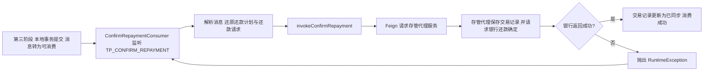

# 消费确认还款消息：还款服务自发自收的最后一块拼图

第三阶段把确认还款的事务消息发出去、本地三处状态也更新落库了，但整个用户还款链路还差一个入口：谁来消费这条消息，把 2.3 到 2.9 的确认还款链路真正推动起来。答案前面已经给出，还是还款服务自己，只是这次它换了一个身份，从生产者变成消费者。本课把这块消费监听器补齐，第四阶段的代码就全部收口了。

## 先给结论

- 消费监听器写在还款服务的 `message` 包里，类名 `ConfirmRepaymentConsumer`，实现 RocketMQ 的 `RocketMQListener<String>` 接口。
- `@RocketMQMessageListener` 注解里的 `topic` 必须与发送侧完全一致，都是 `TP_CONFIRM_REPAYMENT`，`consumerGroup` 配 `CID_CONFIRM_REPAYMENT`，目的地写错消息就永远收不到。
- `onMessage` 方法只有两步：解析消息、执行本地业务，解析出的还款计划与还款请求两个对象原样传给业务方法。
- 本地业务就是调用 `invokeConfirmRepayment`，通过 Feign 向存管代理服务发起确认还款请求，返回码不是 00000 就抛出异常。
- 抛异常正是重试机制的开关：消费失败消息会重新投递，直到确认还款链路执行成功，配合存管代理侧按请求流水号做的幂等控制，重复投递不会造成重复扣款。

## 监听器放哪：发送方与消费方是同一个服务

把消费代码写错位置是这类自发自收方案里最常见的低级失误。满标放款业务里，消息从交易中心流向还款服务，监听器自然写在还款服务；用户还款的消息由还款服务在第三阶段发出，业务分析时已经明确，消费动作同样属于还款服务的职责范围。确认还款的远程调用要请求存管代理服务、再经存管代理请求银行存管系统，这段链路可能失败、需要重试，所以被消息隔开，交给消费侧承担。

于是监听器落在还款服务工程里，与 `RepaymentProducer` 同在 `message` 包。RocketMQ-Spring 的消费写法是固定的：类加 `@Component` 交给容器管理，再加 `@RocketMQMessageListener` 声明订阅关系，类实现 `RocketMQListener<String>` 并重写 `onMessage`，泛型参数就是消息体类型，这里与发送侧保持一致用字符串。

```java
package com.study.finance.repayment.message;

import com.alibaba.fastjson.JSON;
import com.alibaba.fastjson.JSONObject;
import org.apache.rocketmq.spring.core.RocketMQListener;
import org.springframework.stereotype.Component;

@Component
@RocketMQMessageListener(
        topic = "TP_CONFIRM_REPAYMENT",
        consumerGroup = "CID_CONFIRM_REPAYMENT")
public class ConfirmRepaymentConsumer implements RocketMQListener<String> {

    @Resource
    private RepaymentService repaymentService;

    @Override
    public void onMessage(String message) {
        // 1 解析消息
        JSONObject jsonObject = JSON.parseObject(message);
        RepaymentPlan repaymentPlan = JSONObject.parseObject(
                jsonObject.getString("repaymentPlan"), RepaymentPlan.class);
        RepaymentRequest repaymentRequest = JSONObject.parseObject(
                jsonObject.getString("repaymentRequest"), RepaymentRequest.class);
        // 2 执行本地业务
        repaymentService.invokeConfirmRepayment(repaymentPlan, repaymentRequest);
    }
}
```

解析这一段与发送侧是镜像关系。发送时往 `JSONObject` 里放了两个键 `repaymentPlan` 与 `repaymentRequest`，消费时就必须按同样的键名取值，再用 FastJSON 的 `parseObject` 加目标类的 `Class` 对象把 JSON 还原成实体。键名与类型任何一边对不上，运行时才会暴露，编译期帮不上忙，这两行值得对着发送代码逐字核对。

## 执行本地业务：一次 Feign 调用加一个返回码判断

`invokeConfirmRepayment` 在第四阶段定义接口与功能实现时已经准备好，消费侧只是它的触发入口。方法内部通过 Feign 代理 `depositoryAgentApiAgent` 调用存管代理服务的确认还款接口，存管代理保存交易记录后向银行存管系统发起还款确定，银行返回成功，存管代理更新交易记录状态为已同步并把结果回传。

```java
@Override
public void invokeConfirmRepayment(RepaymentPlan repaymentPlan,
                                   RepaymentRequest repaymentRequest) {
    // 远程调用存管代理服务的确认还款接口
    RestResponse<String> repaymentResponse =
            depositoryAgentApiAgent.confirmRepayment(repaymentPlan, repaymentRequest);
    // 返回码不是成功码 视为还款失败
    if (!repaymentResponse.getResult().equals(
            DepositoryReturnCode.RETURN_CODE_00000.getCode())) {
        throw new RuntimeException("还款失败");
    }
}
```

这个抛出异常的写法是有意为之，不是随手写的防御代码。RocketMQ 的消费重试机制以异常为信号：`onMessage` 正常返回，Broker 认为消费成功；方法抛出异常，消息稍后重新投递。确认还款链路某一次执行失败，可能 Feign 超时、可能银行侧暂不可用，异常让这次消费宣告失败，消息重投，链路在下一轮重试中再次执行，直到存管代理返回成功码为止。这就是第三阶段业务分析时说的「消费失败靠消息重试兜底」在代码上的落点。

重试带来的是至少一次投递语义，同一笔消息可能被执行多次，重复扣款的风险由幂等控制化解：每次确认还款都携带请求流水号，存管代理侧按流水号判断请求是否已处理过，重复请求不会产生第二笔扣款。重试保证最终成功，幂等保证重复无害，两者合起来才构成完整的可靠性设计。

## 消费触发后整条链路的样子

把四个阶段串起来看，消息消费是第四阶段的起点，也是整个用户还款流程从本地走向银行的开关。



图右侧的回环是这条链路最关键的一处：任何一步失败都表现为异常，异常触发重投，链路从消费处再次出发。反向验证也成立，如果发送侧与消费侧的 topic 配置不一致，消息发出后在 Broker 里无人订阅，回环根本不会启动，整个第四阶段表现为「本地已还款、银行无动作」的静默失败，排查时应当先核对订阅关系。

至此第四阶段代码全部开发完成，从还款明细、应收明细、还款计划三处本地更新，到确认还款消息的发送与消费，再到存管代理与银行存管系统的交互，流程已经贯通，接下来就是功能测试验证数据正确性。

## 常见误区

- **监听器写错工程。**错例：参考满标放款的布局，把消费代码写到存管代理服务里。正解：消息发送方与消费方都是还款服务，监听器必须写在还款服务的 `message` 包，存管代理只通过 Feign 被调用，不订阅消息。
- **topic 或消费组与发送侧不一致。**错例：凭印象手打 `TP_CONFIRM_MESSAGE` 之类的名字。正解：`topic` 必须逐字符等于发送侧的 `TP_CONFIRM_REPAYMENT`，消费组用 `CID_CONFIRM_REPAYMENT`，订阅关系错配不会报错，只会静默丢消息。
- **解析消息时漏掉目标类型的 `Class` 参数。**错例：写成 `parseObject(jsonObject.getString("repaymentPlan"))` 返回的只是 `JSONObject`，后续赋值直接编译报错。正解：第二个参数必须是 `RepaymentPlan.class`、`RepaymentRequest.class`，才能还原成业务对象。
- **把消费失败的异常吞掉。**错例：`onMessage` 里 `try catch` 后仅打印日志不抛出。正解：吞掉异常等于告诉 Broker 消费成功，重试机制失效，银行侧没完成的扣款再也不会被补偿，失败必须以异常形式上抛。

## 面试可能被问到的问题

1. 面试官追问：「为什么确认还款的消费者和生产者是同一个服务？」
   答：第三阶段的本地事务更新与第四阶段的远程调用被消息隔开，本地事务放在事务监听器里保证可回滚，远程调用放在消费监听器里接受重试。两个动作都属于还款服务的业务范围，消息只是内部解耦手段，自然表现为自发自收。
2. 面试官追问：「消费失败后消息会怎样？」
   答：`onMessage` 抛出异常即视为消费失败，Broker 会按重试间隔重新投递，直到链路执行成功或超过最大重试次数进入死信队列。用户还款场景中失败原因多为存管代理或银行侧暂不可用，重试通常能在几轮内成功。
3. 面试官追问：「消息重复投递会不会重复扣款？」
   答：不会。重试语义是至少一次投递，重复是预期内的；每次确认还款请求都携带请求流水号，存管代理侧按流水号做幂等控制，同一流水号的请求只产生一笔扣款，重复请求直接返回既有结果。
4. 面试官追问：「解析消息为什么要写两次 `parseObject`？」
   答：消息体是包含两个业务对象的 JSON，先整体解析成 `JSONObject`，再按键名分别取出 `repaymentPlan` 与 `repaymentRequest` 两个子对象，各自还原成对应实体。两次解析对应发送侧的两次 `put`，键名必须一致。
5. 面试官追问：「如果消费一直没有成功，怎么保证本地状态与银行侧最终一致？」
   答：本地三处状态更新已在第三阶段的本地事务里提交，消费侧的重试不断驱动银行侧向本地状态靠拢；重试超过上限进入死信队列后，依靠请求流水号与交易记录进行人工对账补偿。最终一致性不承诺时刻一致，只承诺有机制让两侧趋同。

## 配套资料

- 讲义：`materials/docs/10/万信金融-第5章-用户还款v1.0.md`，6.4 节确认还款远程调用的实现（`invokeConfirmRepayment` 的返回码判断），6.5 节确认还款消息监听（`ConfirmRepaymentConsumer` 的完整代码），6.6 节功能测试要点。
- 代码：`materials/code/10/wanxinp2p/`，课程资料包内的工程源码归档目录（内含原始工程命名，与正文改写后的命名并非一一对应）；还款服务与存管代理服务模块源码不在资料包内，文中代码为按讲义与课堂画面补全的示例，包名按 `com.study.finance` 系改写。
