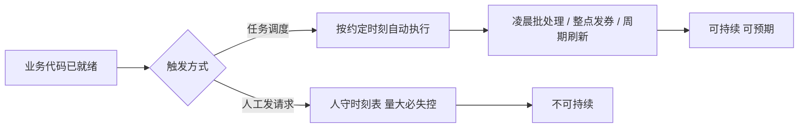

# 任务调度概述：为什么用户还款必须由系统定时触发

用户还款功能测试通过后，触发方式还停留在人工层面：向测试入口发一个请求，业务才执行。放到真实平台里，每天到期的还款计划成百上千，日期分散在今天的明天后天每一天，靠人守着接口挨个触发显然不现实。解决办法是让系统在约定时刻自动执行这笔业务，也就是任务调度。这一课先把任务调度的概念讲清楚，再回来用学到的框架实现定时还款。

## 先给结论

- 任务调度的定义可以压缩成两个关键词：自动与定时，系统在约定的特定时刻自动完成特定任务，全程不需要人工参与。
- 凡是「到点就要做、量大人手做不过来」的业务都属此类：定时发券、还款提醒、凌晨财务统计、分批放票、天气数据周期更新。
- Java 领域常见的实现手段有三种：多线程配合 `sleep`、JDK 自带的定时器 API、调度框架，前两种能跑通但繁琐，第三种是首选。
- 单机方案有一个共同短板：不能适应分布式部署的需求，多实例环境下要么重复执行要么难以扩容，这是引出分布式任务调度框架的直接原因。
- 万信金融项目的定时还款将采用 Elastic-Job 实现，查询到期还款计划时按期数分片，这一课先打概念底子。

## 五个典型场景：人工触发全部不可行

讲义列举的场景在生活里几乎都遇到过，每个都值得对照一遍，看它为什么不能靠人。

**电商定时发券。**大促预热阶段商家在上午十点或晚上八点整点发优惠券，抢券人群以百万计。安排一个员工盯着表、到点手动发请求，先不说夜里十点谁在岗，光是与用户手动操作之间的时差就足以让活动翻车。

**信用卡还款提醒。**每个持卡人的还款日各不相同，银行每天可能有大量用户的账单即将到期，系统要提前三天发短信或站内通知。用户量意味着触发次数，人工逐个提醒在数据量面前彻底失效。

**财务数据统计汇总。**数据汇总与维护类任务通常安排在凌晨执行，那时访问量最低，后台运维动作对业务干扰最小。总不能真安排一个人天天凌晨三点起来跑批处理。

**分批放票。**售票平台把可售车票按几个时间点分批投放，全国范围的票务数据规模决定了批次数量与每批的处理量，人工放票既不精确也不可行。

**天气数据更新。**天气 App 上的数据每隔十几分钟或半小时刷新一次，功能已经上线，只是需要有人持续触发刷新。每十分钟按一次按钮的人不存在，这个活只能交给系统。

这些场景的共同结构是：业务代码早已写好，缺的只是「在正确的时间点调用它」。把「调用」这件事从人手里接管过来，就是任务调度。

## 任务调度的定义与实现手段

讲义的定义直白：系统为了自动完成某个特定任务，在约定的特定时刻去执行它。拆开看两个关键属性，一是自动，不需要人工触发；二是定时，执行时刻由业务需求约定，可能是每天凌晨一点，可能是上午十点，也可能是每隔十分钟。



图上两条分支的差别不在功能，业务代码完全一样，差别在于触发权归属。把触发权交给系统，人才能从重复劳动里退出。

Java 生态里实现任务调度常见的三条路。**第一条是多线程配合 `sleep`**，起一个线程循环休眠、到点干活，学并发时都写过，但休眠精度差、任务管理全靠手写，纯演示可以，生产里太繁琐。**第二条是 JDK 自带的定时器 API**，`Timer` 与 `ScheduledExecutorService` 提供了按周期执行任务的原始能力，比手工线程规范，异常处理与任务编排仍然要自己操心。**第三条是调度框架**，功能丰富、策略齐全，是实际项目的首选，但传统单机调度框架满足不了分布式架构的需求，这一点正是下一课展开的线索。

以 JDK 自带的 `ScheduledExecutorService` 为例，给定时还款的触发逻辑搭一个最朴素的骨架（示例代码，按本课业务背景补全）：

```java
// 每天凌晨 1 点扫描到期还款计划并触发用户还款 示例写法
ScheduledExecutorService scheduler = Executors.newScheduledThreadPool(1);
long initialDelay = Duration.between(
        LocalDateTime.now(), LocalDateTime.now().plusDays(1).withHour(1)).getSeconds();
scheduler.scheduleAtFixedRate(() -> {
    String today = LocalDate.now().format(DateTimeFormatter.ISO_LOCAL_DATE);
    repaymentService.executeRepayment(today);
}, initialDelay, 24 * 60 * 60, TimeUnit.SECONDS);
```

这段代码能工作，也确实表达了「约定时刻自动执行」的意思，但它在微服务架构下有明显缺陷：还款服务部署多实例时，每个实例都会跑这份调度，同一批还款计划被重复触发；实例宕机时任务无人接管；执行情况无处监控。单机手段的天花板恰好暴露了分布式环境的新问题，这也是课程把话题引向分布式任务调度与 Elastic-Job 的原因。

## 回到用户还款：这个触发缺口有多大

P2P 平台的还款计划按期生成，借款人分若干期偿还，每天都会有一批计划到期。测试时指定的那个日期只有一笔标、五个投资人，是因为数据是专门造的；真实环境里到期计划按天累计，遍布每一天。人工触发既无法覆盖如此分散的日期，也无法保证在约定的执行时刻准时启动，定时还款是这条业务线唯一的收口方式。

结合项目的微服务架构，定时还款还要面对多实例部署的现实：调度逻辑本身要以分布式架构运行。任务怎么在实例间分工、实例宕机后任务怎么转移，这些问题的答案在下一课的分布式任务调度概述里展开。

## 常见误区

- **把任务调度理解成某种业务逻辑。**错例：以为定时还款要重写一套还款代码。正解：业务代码不变，调度只解决「什么时刻调用它」，业务与调度是两层。
- **认为 `sleep` 循环就是合格的调度方案。**错例：生产代码里用线程加休眠实现定时。正例：休眠漂移、异常即停、无法管理任务，生产环境应选调度框架。
- **忽视单机调度与分布式部署的冲突。**错例：多实例微服务里每个实例都跑一份 `@Scheduled`。正解：多实例下同一任务会重复执行，必须引入分布式协调，这正是引入 Elastic-Job 的动因。
- **混淆「定时」与「延时」。**错例：把每隔十分钟更新天气与「登录后十分钟发券」混为一谈。正解：前者是周期性任务调度，后者是业务延时逻辑，手段不同。

## 面试可能被问到的问题

1. 面试官追问：「什么是任务调度？它解决什么问题？」
   答：系统为了自动完成特定任务，在约定的特定时刻执行它，核心是自动与定时两个属性。它解决的是「到点要做、量大且分散、人工触发不可行」这类业务场景的触发问题，业务代码本身不因调度而改变。
2. 面试官追问：「Java 里实现任务调度有哪几种方式？」
   答：多线程配合 sleep、JDK 自带的 Timer 与 ScheduledExecutorService、成熟调度框架三种。前两种适合简单场景但管理能力弱，框架提供 cron 表达式、任务持久化、失败处理等完整能力，是项目首选。
3. 面试官追问：「单机调度框架在微服务架构下的缺陷是什么？」
   答：多实例部署时每个实例都会触发同一个任务，造成重复执行；实例宕机后任务没有接管机制；任务规模增大时无法分摊到多机并行处理。这些缺陷需要分布式任务调度框架补齐。
4. 面试官追问：「万信金融项目里哪个业务要用任务调度？」
   答：用户还款的触发。四阶段业务链路已经实现，每天到期还款计划分散且量大，采用 Elastic-Job 实现分布式定时还款任务，扫描到期计划时按期数分片并行处理。
5. 面试官追问：「为什么财务统计类任务通常安排在凌晨？」
   答：凌晨访问量最小，批处理对在线业务的干扰最小；同时统计口径通常按自然日切分，凌晨执行恰好处理完前一天的数据，时间点与业务语义天然吻合。

## 配套资料

- 讲义：`materials/docs/10/万信金融-第5章-用户还款v1.0.md`，第 7 章 7.1 节分布式任务调度 Elastic-Job 的引言（定时还款任务背景），7.2 节功能实现中关于 cron 表达式测试值与生产值取舍的说明。
- 代码：`materials/code/10/wanxinp2p/`，课程资料包内的工程源码归档目录（内含原始工程命名，与正文改写后的命名并非一一对应）；本课为概念概述课，`ScheduledExecutorService` 示例为按本课写法补全，定时还款的正式实现采用 Elastic-Job，见后续课程。
