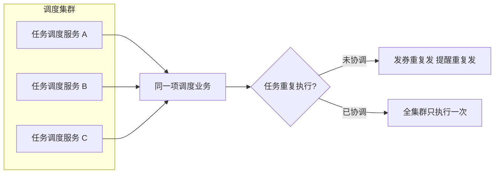

# 分布式任务调度概述：多实例环境里同一个任务为什么只能执行一次

任务调度的概念已经清楚，但项目的现实是微服务架构：任何一个服务都可能部署多个实例组成集群。任务调度一旦跑在这样的环境里，一个新问题立刻冒出来，三台服务器干着同样的活，同一个任务被执行了三次。把这个问题看透，才能理解为什么需要专门的分布式调度框架，以及它凭什么保证任务只执行一次。

## 先给结论

- 分布式任务调度就是任务调度与分布式部署的结合：分布式架构下一个服务部署多个实例运行业务，运行的业务是任务调度，它就是分布式任务调度。
- 采用分布式架构带来四个收益：并行执行突破单机性能瓶颈、实例互备实现高可用、随时加机实现弹性扩容、运维侧可以监测任务运行情况。
- 代价是一个必须解决的问题：任务重复执行，同一任务在集群里被多个实例各跑一遍，发券场景造成资金损失，提醒场景骚扰用户。
- 目标只有一个：相同的任务在多个运行实例上只执行一次。
- 两个常见解法：分布式锁，抢到锁的实例执行；ZooKeeper 选举，选出的 Leader 负责执行。Elastic-Job 内部采用的就是 ZooKeeper 选举机制。

## 从单机扩到集群：架构演变的过程

微服务项目上线后按集群部署，访问量大的服务加机器，这在交易中心的部署里已经实践过。任务调度服务同样如此：部署一台服务器 A 跑调度，业务量一大单机扛不住，扩容再部署 B、C，形成三台服务器组成的调度集群。每台服务器上运行的任务完全一样，都是执行某一项调度业务，这正是一个分布式架构下的任务调度系统。



图上向下的分叉是全部问题的来源：三台机器指向同一项业务，谁先触发、谁后触发、会不会同时触发，没有任何天然机制约束。分布式任务调度要补的就是这道约束。

## 分布式架构带来的四项收益

扩成集群不是为了摆设，四项收益都是实打实的。**并行执行**：多台服务器同时干活，任务量被摊薄，单机性能瓶颈被突破，这是扩容的初衷。**高可用**：A 宕机还有 B 和 C 继续提供调度能力，单点故障不再导致任务停摆。**弹性扩容**：三台不够就加第四台，业务高峰期随时加机器，任务量上来横向扩即可。**任务管理与监控**：运维可以对任务的运行情况进行监测，跑了没有、跑到哪一步、失败多少次，都可观测。

有收益就有代价，代价就是重复执行，解决它之前集群的收益随时可能被一笔重复发放的优惠券抵消掉。

## 核心问题：只执行一次的两个解法

**解法一是分布式锁。**思路简单直接：多个实例执行任务前先抢一把全局互斥的锁，抢到的实例执行任务，没抢到的知道已有实例在跑，本轮歇着等下一次。锁的存在把「同时执行」变成「先后执行」，任一时刻集群内只有一个实例真正在干活。下面是基于 Redis 的锁骨架（示例代码，按主流写法补全）：

```java
// 抢到锁的实例执行任务 未抢到的本轮放弃 示例写法
public void executeRepayment() {
    Boolean locked = stringRedisTemplate.opsForValue()
            .setIfAbsent("lock:repayment", instanceId, Duration.ofSeconds(30));
    if (Boolean.TRUE.equals(locked)) {
        try {
            repaymentService.executeRepayment(LocalDate.now().toString());
        } finally {
            // 仅持有者可释放锁 避免误删
            if (instanceId.equals(stringRedisTemplate.opsForValue().get("lock:repayment"))) {
                stringRedisTemplate.delete("lock:repayment");
            }
        }
    }
}
```

锁方案依赖锁本身的可靠性：锁要带过期时间防止持有者宕机后死锁，释放要校验持有者身份防止误删别人的锁，锁失效时间与任务执行时长的匹配也需要斟酌，这些细节都要自己维护。

**解法二是 ZooKeeper 选举。**ZooKeeper 的选举机制会在多台服务器中选出一个 Leader，由 Leader 负责协调与执行，其余实例待命；Leader 下线后 ZooKeeper 自动重新选举，集群里永远保证有一个 Leader 存在；在新 Leader 选出来之前，任务处于阻塞状态，不会执行也不会漏执行。协调的职责交给了 ZooKeeper，业务代码不用再操心锁的细节。

Elastic-Job 内部采用的就是第二种：基于 ZooKeeper 实现分布式协调与 Leader 选举，这也是它作为分布式调度框架的地基。选中它的直接理由在下节课展开，分片能力是它区别于纯选举方案的关键。

## 常见误区

- **把重复执行当成小概率事件忽略。**错例：三个实例 cron 配置相同，认为触发时间有几秒偏差不会撞车。正解：整点触发恰恰是同时性最高的时刻，未协调的集群重复执行是常态而非意外。
- **以为加了分布式锁就万事大吉。**错例：锁用过期时间随意设置，任务没跑完锁先失效，第二个实例接着执行。正解：锁有效期要覆盖任务执行时长并考虑续期，释放时校验持有者，锁方案的全部可靠性都靠这些细节撑起。
- **认为高可用等于任务自动转移执行。**错例：以为 A 挂掉时 B 会立刻接手跑到一半的任务。正解：调度层面保证的是下一轮触发由存活的实例执行，执行到一半的任务是否可续跑由业务自身设计决定，两者不能混谈。
- **把弹性扩容理解成性能线性叠加。**错例：加机器必然更快。正解：扩容收益取决于任务能否被切分并行，不可切分的任务加再多机器也只能由一个实例执行。

## 面试可能被问到的问题

1. 面试官追问：「什么是分布式任务调度？」
   答：分布式架构下一个服务部署多个实例组成集群运行业务，运行的业务如果是任务调度，就是分布式任务调度。它保留了定时与自动的调度属性，同时要解决集群环境下的分工与协调问题。
2. 面试官追问：「任务调度采用分布式部署有哪些好处？」
   答：并行执行突破单机性能瓶颈、多实例互备实现高可用、随时增减机器实现弹性扩容、运维可以对任务运行情况进行监测管理。收益的代价是必须处理任务重复执行问题。
3. 面试官追问：「分布式任务调度如何保证任务只执行一次？」
   答：常见两种方案。分布式锁：执行前抢全局锁，抢到才执行，锁带过期时间并校验持有者；ZooKeeper 选举：选出唯一 Leader 由它执行，Leader 下线自动重选。本质都是把集群的多执行体收敛成任一时刻的单执行体。
4. 面试官追问：「为什么选 ZooKeeper 选举而不是分布式锁？」
   答：选举机制由 ZooKeeper 的会话与临时节点支撑，Leader 崩溃后自动重新选举，协调过程不需要业务代码维护锁的生命周期；阻塞机制保证无 Leader 期间任务不执行也不混乱。Elastic-Job 内部即采用 ZooKeeper 选举实现协调。
5. 面试官追问：「重复执行在金融业务里会造成什么后果？」
   答：以还款提醒为例，同一用户被重复提醒严重损害体验；若重复执行的是扣款类任务则会造成资金层面的多扣。所以金融项目的定时任务必须以幂等或分布式协调双重手段保证只执行一次。

## 配套资料

- 讲义：`materials/docs/10/万信金融-第5章-用户还款v1.0.md`，7.1 节对分布式任务调度专题的指引与定时还款任务背景（Elastic-Job 专题讲义未随资料包归档，本课概念表述按课堂讲授整理）。
- 代码：`materials/code/10/wanxinp2p/`，课程资料包内的工程源码归档目录（内含原始工程命名，与正文改写后的命名并非一一对应）；本课为概念概述课，分布式锁示例为按主流写法补全，Elastic-Job 的正式接入代码见第 5 章讲义 7.2 节与后续课程。
