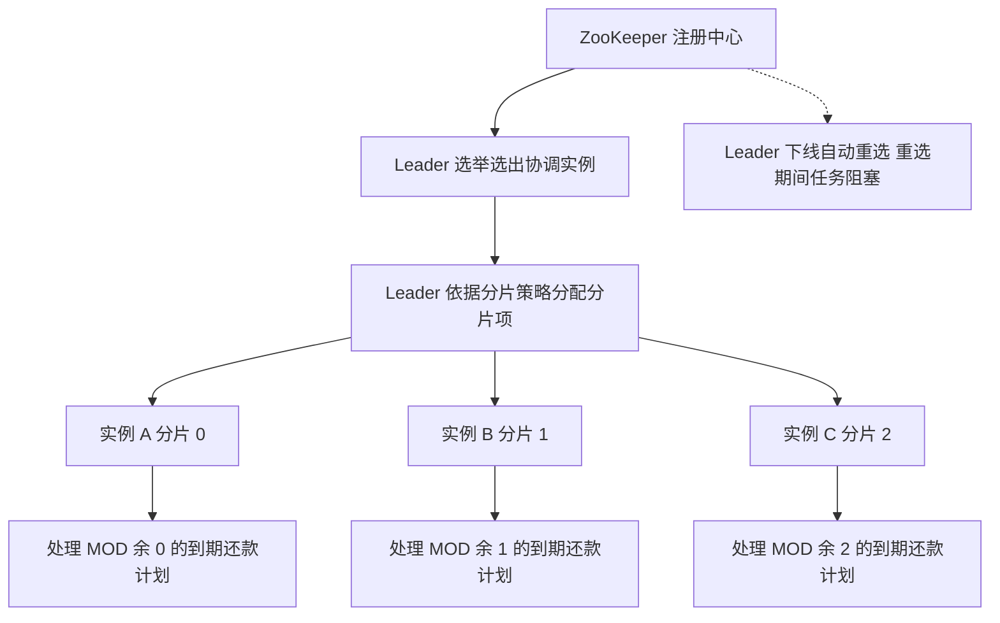

# Elastic-Job 简介与核心概念：分片、Leader 选举与分片策略

定时还款需要的不是一把锁，而是一套完整的分布式调度方案。市面上的框架不止一个，选谁、它凭什么能解决「多实例不重复执行」与「任务量大了怎么办」，取决于对它核心概念的理解深度。Elastic-Job 在使用之前有三个概念必须先吃透：分片、Leader 选举、分片策略，三个概念环环相扣，这一课把框架定位与概念体系一次讲完，为后面的入门案例与定时还款实现铺路。

## 先给结论

- 行业主流的分布式调度框架有四款：TBSchedule、XXL-Job、Elastic-Job、Saturn，全部出自电商平台，说明分布式调度在电商场景是普遍刚需。
- Elastic-Job 由当当网开源，借鉴 TBSchedule 并基于老牌调度框架 Quartz 构建，内部采用 ZooKeeper 实现分布式协调，具备任务高可用与分片两项关键能力，项目选定它实现定时还款。
- 分片的本质是分工：把一个作业拆成若干片，多个实例各领一片并行执行，每片只执行一次。
- Leader 选举回答「谁来分工」：ZooKeeper 在实例中选出 Leader 负责分片协调，Leader 下线自动重选，新 Leader 产生前任务阻塞。
- Elastic-Job 内置三种分片策略，默认的平均分配策略在绝大多数场景够用，生产上一般不需要另选。

## 四款框架的格局：全都来自电商

选型先看市场。讲义列出的四款产品挨个过一遍，各自的出身与现状差异很大，这直接影响选型结论。

**TBSchedule。**出自淘宝，是一款高性能的分布式调度框架，问题在于已经多年未更新，文档稀少、缺少维护。新项目选择它，踩坑成本与上手成本都偏高，现如今的选型里很少再出现。

**XXL-Job。**出自大众点评，定位轻量级分布式任务调度平台，主打学习简单、开发迅速、易扩展，社区活跃度长期不错，是 Elastic-Job 之外最常见的候选。

**Elastic-Job。**出自当当网，是本项目的选择。它的技术血统值得留意：借鉴了 TBSchedule 的设计思路，构建在 Quartz 这个功能强大、历史悠久的调度框架之上，内部又引入 ZooKeeper 做分布式协调，从而补上了任务高可用与分片能力。Quartz 解决单机调度的编排问题，ZooKeeper 解决集群的协调问题，两者叠加就是 Elastic-Job 的骨架。

**Saturn。**出自唯品会，是一个分布式任务调度平台，基于 Elastic-Job 构建，与 Elastic-Job 存在血缘关系，用得不多但侧面印证了 Elastic-Job 的工业可靠性。

四款产品来自四家电商，这个现象本身有信息量：电商场景里整点抢购、库存对账、订单超时处理这类定时任务规模巨大且必须并行，分布式调度在那里是真实痛点，框架因此在那里孵化。

## Elastic-Job 的定位与功能特性

Elastic-Job 是分布式调度的开源解决方案，由两个独立的子项目组成：Elastic-Job-Lite 定位轻量级解决方案，以 jar 包形式嵌入业务工程，去中心化部署；Elastic-Job-Cloud 面向 Mesos 云平台的部署形态。本项目用的是 Lite，讲义里的依赖坐标也能印证：

```xml
<!-- Elastic-Job-Lite 的 Spring 集成模块 -->
<dependency>
    <groupId>com.dangdang</groupId>
    <artifactId>elastic-job-lite-spring</artifactId>
    <version>2.1.5</version>
</dependency>
```

官方给出的功能清单覆盖调度全生命周期：分布式调度协调、丰富的调度策略、弹性扩容缩容、失效转移、错过执行的作业重触发、支持并行调度、支持作业生命周期操作、丰富的作业类型、Spring 整合以及命名空间支持、运维平台。清单里几项与分布式场景直接对应，值得单独点出。

**弹性扩容缩容**：实例增加或减少时，分片自动重新分配，上一课讲的「三台不够加第四台」在框架层天然支持。**失效转移**：某个实例执行中宕机，它名下未完成的分片会转移给其他实例继续执行，高可用从「下一轮由别人触发」细化到「本轮就有人接手」。**错过执行作业重触发**：实例恰好在触发时刻不可用而错过的作业，恢复后会补执行，调度精度不因宕机而丢失。**运维平台**：作业的运行情况可视化，上一课列的「任务管理与监控」收益在这里落地。

## 作业类型与生命周期：框架还提供了什么

除了分片与协调这两条主线，Elastic-Job 的「丰富的作业类型」也值得提前认识。最常用的是 `SimpleJob`，简单作业，每次触发执行一段逻辑，定时还款用的就是它；进阶一点是 `DataflowJob` 流式作业，抓取一条数据、处理一条、再抓取下一条，直到数据流取尽为止，适合数据量不确定的批处理场景；还有 `ScriptJob` 脚本作业，直接执行脚本命令，把非 Java 的任务也纳入统一调度。

作业生命周期操作指框架对作业运行态的管理能力：触发、暂停、恢复、终止都能在运行期间操作，配合运维平台，作业不再是「配置写死、只能等它跑」的黑盒。这套能力在排查线上问题时尤其有用，某个作业疑似异常，先暂停再分片排查，比改代码重新发布轻量得多。

## 分片：把「分工」做成框架概念

分布式架构下执行任务调度，有三条协调底线：不能让某台服务器累死，全部任务压给一个实例等于白扩容；不能让某台服务器闲死，资源闲置是浪费；更不能重复执行某个任务。三条底线合起来就是一句话：如何分工。Elastic-Job 把分工命名为分片。

分片模型很朴素：一个作业被分成 `shardingTotalCount` 片，每个分片项有编号 0 到总数减一，每个实例领走若干片，只执行自己片内的数据。讲义给的例子可以直接搬过来：一个作业要遍历数据库某张表，表里有一千万条数据，两台服务器都部署了这个作业。分两片，最简单的策略是按主键奇偶拆分，实例 A 遍历主键以奇数结尾的记录，实例 B 遍历偶数记录，两台都有活干且绝不重复。如果拆成十片而实例只有两台，按主键对十取模，余数为 0 到 4 的分片给实例 A，余数为 5 到 9 的给实例 B，十个小任务被两台机器分摊完毕。

分片不是抽象口号，它会直接写进 SQL。定时还款任务查询到期还款计划时，就是按期数做分片过滤的，讲义 7.2 节的数据访问层代码把这一点写得明明白白。分片项与分片总数这两个值并不由业务代码计算，而是框架在每次触发时根据当前集群状态算好，再经由作业上下文传进来，业务侧拿到的永远是「本轮你该处理哪一片」的现成答案，这也是框架与手写调度代码的本质区别：协调逻辑被框架收编，业务只剩纯粹的执行。

```java
/** 查询所有到期的还款计划 按期数分片 */
@Select("SELECT * FROM repayment_plan "
        + "WHERE DATE_FORMAT(SHOULD_REPAYMENT_DATE, '%Y-%m-%d') = #{date} "
        + "AND REPAYMENT_STATUS = '0' "
        + "AND MOD(number_of_periods, #{shardingCount}) = #{shardingItem}")
List<RepaymentPlan> selectDueRepayment(@Param("date") String date,
                                       @Param("shardingCount") int shardingCount,
                                       @Param("shardingItem") int shardingItem);
```

`MOD(number_of_periods, shardingCount) = shardingItem` 这一行就是分片在数据层的落点：分片总数为 2 时，期数除以 2 余 0 的还款计划归一个实例，余 1 的归另一个，每个实例只扫自己那一半数据。分片项的编号与总数由框架在运行时传进来，业务代码只需要把这两个值拼进查询条件。

## Leader 选举：分工的人从哪来

会分工之后立刻有一个问题：谁负责分工？生活里的类比是包工头，工地需要一个负责人来分派任务。分布式集群里同样需要一个协调者，这就是 Leader 选举要解决的事。

Elastic-Job 依赖 ZooKeeper 完成选举：多个实例注册到 ZooKeeper，框架从中选出一个实例担任 Leader，Leader 以协调者的角色负责分片与协调，把任务分给其余实例。Leader 不是特权岗位，而是责任岗位：它挂了或下线，ZooKeeper 会自动重新选举，集群里永远保证有一个 Leader 存在；在新 Leader 选出来之前，任务执行处于阻塞状态，宁可等待也不出现没有协调者的混乱期。

把两个概念串成一条完整的链路：



图上三条并行支路说明一件事：Leader 负责的是协调，不是独占执行。分片分配完毕后各实例同时干活，这正是分片带来的并行收益；左下角的虚线支路则是可靠性的兜底，协调者这个角色本身也是高可用的。

## 分片策略：三种内置实现的取舍

怎么把片分给实例，Elastic-Job 封装成三类策略类，按全路径理解即可。

**平均分配算法 `AverageAllocationJobShardingStrategy`。**这是默认策略，也是最容易想到的：尽量平均分。九片配三个实例，正好除尽，实例一执行 0、1、2，实例二执行 3、4、5，实例三执行 6、7、8。除不尽也处理得了：八片配三个实例，第三台少干一片，只负责两个分片项；十片配三个实例，多出来的一片按序号追加，先追加给序号最小的实例，再多的依次给第二台、第三台。策略的措辞是「尽量平均」，允许个别实例多干或少干一片，保证的是没有实例闲死、没有分片漏掉。

**根据作业名的哈希值对服务器 IP 升降序分配 `OdevitySortByNameJobShardingStrategy`。**策略先按作业名的哈希值奇偶决定服务器排序方向，哈希值为奇数按 IP 升序排列，为偶数按降序排列，再按排序结果分配分片。它有一个明显缺点：分片数小于作业数时，排序靠后的实例完全空闲。三台服务器配两个分片，无论升降序，都只有前两台拿到分片，第三台一直闲着。平均分配策略下不会出现实例无活可干的情况，这也是日常更多用默认策略的原因之一。

**根据作业名的哈希值对服务器列表轮转 `RotateServerByNameJobShardingStrategy`。**同样是依据哈希值，但不对服务器排序而是轮转分配，行为相对复杂，实际使用频率也低，理解它的存在即可，不必深究细节。

三种策略的选择可以简化成一个经验判断：拿不准就用默认的平均分配，它的产出最稳定，也不会让实例空闲。

## 概念落进定时还款任务

三个概念最终都汇入定时还款的实现。作业类实现 `SimpleJob` 接口，`execute` 方法携带 `ShardingContext`，框架每次触发时把分片总数与当前分片项放进上下文，作业类再把两个值转交给业务层，业务层用上一节那条 `MOD` 查询只取自己片内的到期计划：

```java
@Component
public class RepaymentJob implements SimpleJob {

    @Autowired
    private RepaymentService repaymentService;

    @Override
    public void execute(ShardingContext shardingContext) {
        // 调用业务层执行任务 传入分片参数实现分片查询
        repaymentService.executeRepayment(
                LocalDate.now().format(DateTimeFormatter.ISO_LOCAL_DATE),
                shardingContext.getShardingTotalCount(),
                shardingContext.getShardingItem());
    }
}
```

作业的调度参数在配置类里组装：`JobCoreConfiguration` 携带任务名、cron 表达式与分片总数，包成 `SimpleJobConfiguration` 再包成 `LiteJobConfiguration`，最后交给 `SpringJobScheduler` 启动：

```java
private LiteJobConfiguration createJobConfiguration(
        final Class<? extends SimpleJob> jobClass,
        final String cron,
        final int shardingTotalCount) {
    // 作业核心配置 任务名 cron 分片总数
    JobCoreConfiguration core = JobCoreConfiguration
            .newBuilder(jobClass.getName(), cron, shardingTotalCount).build();
    SimpleJobConfiguration simple = new SimpleJobConfiguration(
            core, jobClass.getCanonicalName());
    // overwrite 允许覆盖注册中心中的旧配置
    return LiteJobConfiguration.newBuilder(simple).overwrite(true).build();
}
```

cron 与分片总数都来自 Apollo 配置中心的 `micro_service.elasticjob` 命名空间，键为 `p2p.job.cron` 与 `p2p.job.count`，ZooKeeper 连接地址与命名空间同样由配置下发，对应 `p2p.zookeeper.connString` 与 `p2p.job.namespace`。讲义特意标注：测试用 cron 每 5 秒一次只是为了观察方便，真实运行要结合业务设定，例如每天早上五点扫一遍到期还款计划。到这里概念与实现已经对上号：ZooKeeper 负责注册与选举，Leader 负责分片分配，每个实例拿着自己的分片项执行 `MOD` 查询，多实例下同一期还款计划只会被一个实例处理。

## 常见误区

- **混淆分片数与实例数。**错例：以为分片总数 2 就是两台服务器各执行一次作业。正解：分片数是作业被拆成多少片，实例数是跑作业的进程数，十片配两实例时每个实例领五片，框架按策略完成映射。
- **认为 Leader 独占任务执行。**错例：把 Elastic-Job 理解成主备模式，只有 Leader 干活。正解：Leader 是协调者，负责分片分配，分片之后各实例并行执行各自的片，执行并不集中在一台机器上。
- **忽视重选期间的阻塞。**错例：以为 Leader 挂掉的瞬间任务会无缝切换继续跑。正解：新 Leader 选举出来之前任务处于阻塞状态，这是设计上的取舍，牺牲短暂延迟换取协调秩序，对分钟级以上的调度任务影响可控。
- **把测试 cron 当成生产配置。**错例：照抄讲义里每 5 秒一次的表达式上生产。正解：5 秒是教学观察用的临时值，真实频率要按业务节奏设定，例如每日凌晨或早上五点，并同步考虑触发时刻的负载。
- **给 OdevitySortByName 策略配少量分片。**错例：两片配三实例还选用升降序策略，第三台长期空转。正解：分片数小于实例数时优先用默认平均分配策略，保证每台实例都有分片。

## 面试可能被问到的问题

1. 面试官追问：「主流的分布式任务调度框架有哪些？你怎么选？」
   答：TBSchedule、XXL-Job、Elastic-Job、Saturn 四款。TBSchedule 已多年未维护，文档少，新项目选它成本高；XXL-Job 轻量、上手快；Elastic-Job 基于 Quartz 并用 ZooKeeper 做协调，具备高可用与分片；Saturn 基于 Elastic-Job。需要分片并行与失效转移能力时选 Elastic-Job，追求轻量与运维简单时可考虑 XXL-Job。
2. 面试官追问：「Elastic-Job 的分片是什么？举一个具体例子。」
   答：分片是把一个作业拆成若干片，每个分片项有编号，各实例领走自己的片只处理片内数据。例如遍历一千万行数据的作业拆成两片，按主键奇数偶数各归一个实例；拆成十片配两实例时，按分片项编号对半分配，两台机器并行处理且互不重复。
3. 面试官追问：「Leader 选举解决了什么问题？Leader 挂了会怎样？」
   答：分工需要协调者，Leader 选举由 ZooKeeper 保证集群里始终有一个实例担任 Leader，负责分片与协调。Leader 下线后 ZooKeeper 自动重新选举，新 Leader 产生前任务处于阻塞状态，牺牲短暂时间换秩序，避免无协调者期间出现重复执行。
4. 面试官追问：「Elastic-Job 内置的分片策略有哪些？默认是哪个？」
   答：三种：平均分配的 AverageAllocationJobShardingStrategy，默认策略，尽量平均且允许序号小的实例多领一片；按作业名哈希值奇偶决定 IP 升降序的 OdevitySortByNameJobShardingStrategy，缺点是分片数小于实例数时靠后实例空闲；按哈希值轮转的 RotateServerByNameJobShardingStrategy，使用少。生产上默认平均分配即可。
5. 面试官追问：「失效转移与弹性扩容缩容分别指什么？」
   答：失效转移指实例执行中宕机，它名下未完成的分片转移给其他实例继续，本轮任务不中断；弹性扩容缩容指实例增减时框架自动重新分配分片，加机器即增并行度，减机器分片自动收敛，不需要人工调整任务。
6. 面试官追问：「万信金融的定时还款为什么天然适合分片？」
   答：到期还款计划按期数分散，量随业务增长而增大。按期数对分片总数取模，每个实例只扫描并处理自己分片项内的到期计划，查询条件直接写进 SQL，既实现了并行处理，又天然避免了多实例重复触发同一批计划。

## 配套资料

- 讲义：`materials/docs/10/万信金融-第5章-用户还款v1.0.md`，7.1 节分布式任务调度引言，7.2 节功能实现（elastic-job-lite-spring 依赖、按期数分片的到期计划查询、RepaymentJob 作业类、ZooKeeper 注册中心与 LiteJobConfiguration 配置类、Apollo 中 `micro_service.elasticjob` 命名空间的配置项）；Elastic-Job 专题讲义（框架对比、功能清单、分片与 Leader 选举概念、三种分片策略）未随资料包归档，相关表述按课堂讲授与画面内容整理。
- 代码：`materials/code/10/wanxinp2p/`，课程资料包内的工程源码归档目录（内含原始工程命名，与正文改写后的命名并非一一对应）；还款服务模块源码不在资料包内，文中代码为按讲义补全的示例，包名按 `com.study.finance` 系改写。
