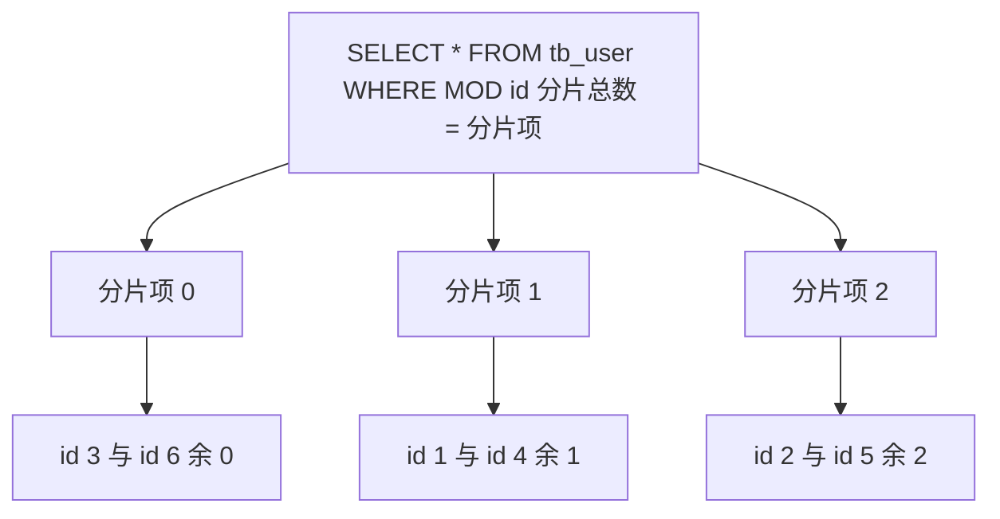

# Elastic-Job 快速入门（二）：把分片规则写进数据访问层

> 🔒 安全提示：文中示例的口令/密钥均为课程教学环境演示口径，生产环境的安全要求见《安全与合规须知》。

工程骨架、ZooKeeper、依赖都就位之后，接下来按分层顺序填代码。这个案例的业务只是一次查询，没有业务层，所以第一步是数据访问层。别小看这一层，整个案例最关键的分片逻辑不是写在任务类里，而是藏在 Mapper 接口的一条 SQL 里：id 按分片总数取余，余数等于分片项的记录才被查出来。这一篇把基础配置、实体类与这条分片 SQL 一次讲透。

## 先给结论

- 配置文件分两块：Spring Boot 基础配置（端口、数据源、MyBatis-Plus）与 Elastic-Job 相关的自定义配置（ZooKeeper 地址、命名空间、分片总数、cron）。
- 服务端口必须设计成可变的，分片查询至少要起两个实例，每个实例端口不同，靠启动参数区分。
- 自定义配置的键名是自己起的，不是框架规定的；放配置文件是因为分片总数、cron 这类值会随业务频繁调整。
- 数据访问层只有一个 `UserMapper` 接口，继承 MyBatis-Plus 的 `BaseMapper<User>`，新增一个带两个参数的分片查询方法。
- 分片 SQL 的核心是 MySQL 的 `MOD` 函数：`MOD(id, #{shardingTotalCount}) = #{shardingItem}`，分片项从 0 开始编号。

## 基础配置与启动类

先看 `application.properties` 的基础部分。服务端口、数据源、MyBatis-Plus 的扫描配置都是此前案例的常规写法：

```properties
server.port=57081
spring.application.name=elastic-job-springboot
logging.level.root=info

spring.datasource.driver-class-name=com.mysql.jdbc.Driver
spring.datasource.url=jdbc:mysql://localhost:3306/mp?useUnicode=true&characterEncoding=utf8
spring.datasource.username=root
spring.datasource.password=123456

# 设置 Mapper 接口所对应的 XML 文件位置
mybatis-plus.mapper-locations=classpath*:mapper/*.xml
# 设置别名扫描路径
mybatis-plus.type-aliases-package=com.study.elasticjob.pojo
```

端口这一项值得停下来想一下。**它必须可变。** 分片查询要求至少启动两个以上的服务实例，每个实例的端口必然不同：第一台 57081，第二台 57082，再来一台 57083。写死在配置文件里就起不了第二个实例，所以实际运行时通过启动参数覆盖这个值，一份数据多实例共存。

启动类没有特殊之处，重点是一个注解：

```java
@SpringBootApplication
@MapperScan("com.study.elasticjob.dao")
public class JobApplication {

    public static void main(String[] args) {
        SpringApplication.run(JobApplication.class, args);
    }
}
```

`@MapperScan` 扫描 dao 包下的 Mapper 接口，让 MyBatis-Plus 为它们生成代理对象，接口还没写，先把扫描路径铺好。

实体类 `User` 与 `tb_user` 表逐字段对应，大量使用 Lombok 注解省去样板代码：

```java
@Data
@NoArgsConstructor
@AllArgsConstructor
public class User {

    @TableId("ID")
    private Long id;
    @TableField("USER_NAME")
    private String userName;
    @TableField("PASSWORD")
    private String password;
    @TableField("NAME")
    private String name;
    @TableField("AGE")
    private Integer age;
}
```

`@Data` 生成 getter、setter 等方法，`@NoArgsConstructor` 与 `@AllArgsConstructor` 分别生成无参与全参构造，`@TableId`、`@TableField` 把属性映射到表里的大写字段名。

## 与 Elastic-Job 相关的自定义配置

配置文件里还有一段是给 Elastic-Job 准备的，先看内容再解释设计：

```properties
# zookeeper 服务地址
zookeeper.connectstring=localhost:2181
# 作业命名空间
myjob.namespace=elastic-job-example
# 分片总数
myjob.count=3
# cron 表达式（定时策略）
myjob.cron=0/5 * * * * ?
```

**第一项是 ZooKeeper 的服务地址与端口。** 微服务启动后要找到 ZooKeeper 完成注册，找它的前提是知道它的 IP 与端口，本机环境就是 `localhost:2181`。

**第二项是命名空间。** ZooKeeper 是一个通用的注册与管理中心，任何项目、任何微服务都可以共用同一个 ZooKeeper 往里注册。不同项目、不同业务的节点混在一起没法管理，命名空间就相当于分类目录：与这个案例相关的定时任务节点都挂在 `elastic-job-example` 下面，将来另一个项目可以换个名字，互不干扰。

**后两项是分片总数与 cron 表达式，也是整个案例最重要的两个值。** `myjob.count=3` 表示把任务分成 3 片，也就是计划由三台服务器分工完成；`myjob.cron=0/5 * * * * ?` 表示每 5 秒触发一次，方便观察效果。

这四个键名都不是框架的配置项，是自定义的。**为什么把它们抽出来放配置文件？** 因为这些值灵活多变：分片总数可能从 3 改成 5，定时策略可能从每 5 秒改成每小时，改动不能去翻代码。键放在配置文件里，值随时可调，代码里通过 `@Value` 读取，这正是配置外置的典型收益。

## 分片 SQL 是怎么推出来的

数据访问层的方法叫 `queryUserById`，目标是按 id 尽量平均地分配查询任务：分 3 片查 6 条数据，每台服务器 2 条；换成 9 条数据，每台就 3 条。怎么把「平均」翻译成 SQL？

答案是取余。分片总数为 3，就用 id 除以 3 看余数，MySQL 里求余数的函数是 `MOD`，第一个参数除以第二个参数返回余数。分片项是每台服务器的编号，从 0 开始，依次是 0、1、2。把两个概念拼成条件：`MOD(id, 分片总数) = 分片项`。拿 6 条数据验证一遍：



逐条算：id 为 1 的记录，1 除以 3 余 1，命中分片项 1 的服务器；id 为 2，余 2，归编号 2 的服务器；id 为 3，余 0，归编号 0 的服务器；后面 id 为 4、5、6 的记录重复同样的循环。三台服务器各领到 2 条，合起来恰好覆盖全表，没有重复也没有遗漏，这就是平均分配的数学本质。余数只可能是 0 到分片总数减一，天然与分片项的编号范围重合。

## UserMapper 接口完整实现

把推导结果落成代码。方法有两个参数（分片总数、分片项）、一个返回值（查询结果集合，泛型是 `User`）：

```java
import com.baomidou.mybatisplus.core.mapper.BaseMapper;
import com.study.elasticjob.pojo.User;
import org.apache.ibatis.annotations.Param;
import org.apache.ibatis.annotations.Select;
import java.util.List;

public interface UserMapper extends BaseMapper<User> {

    /**
     * 分片查询 按 id 取余平均分配
     * @param shardingTotalCount 分片总数
     * @param shardingItem 分片项 当前服务器的编号 从 0 开始
     */
    @Select("SELECT * FROM tb_user "
            + "WHERE MOD(id, #{shardingTotalCount}) = #{shardingItem}")
    List<User> queryUserById(@Param("shardingTotalCount") int shardingTotalCount,
                             @Param("shardingItem") int shardingItem);
}
```

三个细节对应三处易错点。**参数用 `@Param` 显式命名**，SQL 里的 `#{}` 才能准确绑定到对应形参，可读性与可维护性都更好。**括号的位置要留意**，`MOD(id, #{shardingTotalCount})` 是先求余，求出来的余数再与 `#{shardingItem}` 比较相等，`MOD` 的小括号必须包住整个取余表达式，写在等号前面，一旦括号错位整个条件的语义就变了。**接口要继承 `BaseMapper<User>`** 并指定泛型，MyBatis-Plus 提供的单表 CRUD 能力才随之而来，案例虽只用到了自定义查询，继承本身是固定姿势。

顺便对照定时还款的同款写法：真实项目里按期数分片查到期还款计划的 `selectDueRepayment` 方法，用的正是同样的 `MOD` 取余套路，只是把 id 换成了期数字段。入门案例练的就是那个查询的骨架。

## 常见误区

- **`MOD` 表达式括号写错位置。** 错例：把条件写成 `MOD(id, #{shardingTotalCount} = #{shardingItem})`，把比较塞进了求余函数里。正解：小括号只包住取余部分，整个表达式是「求余的结果等于分片项」。
- **分片项当成从 1 开始。** 错例：手算余数时用 1、2、3 去对分片项，id 为 3 的记录怎么都对不上。正解：分片项编号从 0 开始，范围是 0 到分片总数减一，与 `MOD` 的余数范围严格一致。
- **省略 `@Param` 注解。** 错例：方法只声明两个 int 参数不写 `@Param`，运行时 `#{}` 绑定不到参数值。正解：多参数的注解式 Mapper 必须用 `@Param` 声明参数名，与 SQL 占位符一一对应。
- **端口写死导致起不了多实例。** 错例：`server.port` 固定为 57081，第二台实例启动直接端口冲突。正解：端口设计为可变，按实例通过启动参数分别指定 57081、57082、57083。

## 面试可能被问到的问题

1. 面试官追问：「分片查询的 SQL 怎么保证多实例不重复查数据？」
   答：查询条件里带 `MOD(id, #{shardingTotalCount}) = #{shardingItem}`，分片总数对每个实例相同，分片项各不相同且从 0 连续编号。每条记录的 id 除以分片总数的余数唯一，只会命中一个分片项，因此每条数据只被一台实例查出，合起来又不漏。
2. 面试官追问：「为什么分片项的编号从 0 开始？」
   答：分片项由框架生成，编号规则就是 0 到分片总数减一，与 `MOD` 运算的余数范围完全重合，条件才能严丝合缝。这是框架的约定，业务代码照着对齐即可。
3. 面试官追问：「为什么把分片总数和 cron 放进配置文件而不是写死？」
   答：这两个值随业务变化最频繁，分片数随数据量与实例数调整，cron 随调度节奏调整。外置到配置文件后改值不碰代码，代码里通过 `@Value` 注入，配置与实现解耦。
4. 面试官追问：「ZooKeeper 的命名空间有什么用？」
   答：ZooKeeper 是通用组件，多个项目可以共用同一个实例。命名空间相当于给各项目的作业节点划了独立目录，彼此隔离互不干扰，也方便按项目维度查看和管理自己名下的任务节点。
5. 面试官追问：「实体类上那几个 Lombok 注解分别干什么？」
   答：`@Data` 生成 getter、setter、toString 等方法；`@NoArgsConstructor` 生成无参构造；`@AllArgsConstructor` 生成包含全部属性的构造方法。它们消除的是纯样板代码，配合 MyBatis-Plus 的 `@TableId` 与 `@TableField` 完成属性到表字段的映射。

## 配套资料

- 讲义：`materials/docs/10/万信金融-第5章-用户还款v1.0.md`，7.2 节功能实现第 3 步（`PlanMapper` 接口新增 `selectDueRepayment` 分片查询方法，`MOD(number_of_periods, #{shardingCount}) = #{shardingItem}` 与正文 `MOD(id, #{shardingTotalCount}) = #{shardingItem}` 同构）。
- 代码：`materials/code/10/wanxinp2p/`，课程资料包内的工程源码归档目录（内含原始工程命名，与正文改写后的命名并非一一对应）；快速入门工程源码不在资料包内，文中 `UserMapper`、实体类与配置为按本课写法补全的示例，包名统一为 `com.study.elasticjob`，数据源口令按本课程环境口径书写。
